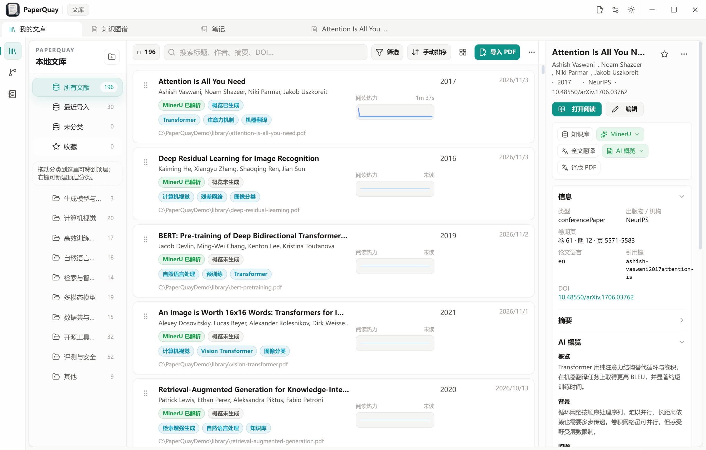
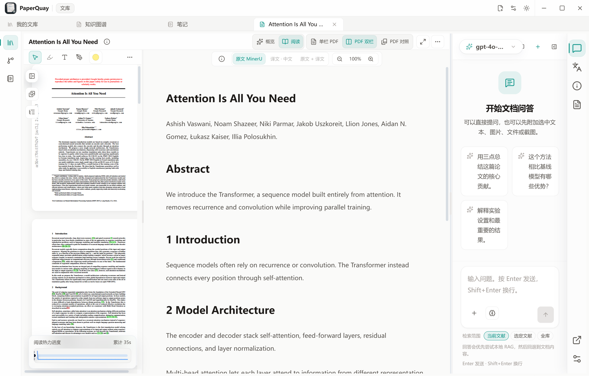
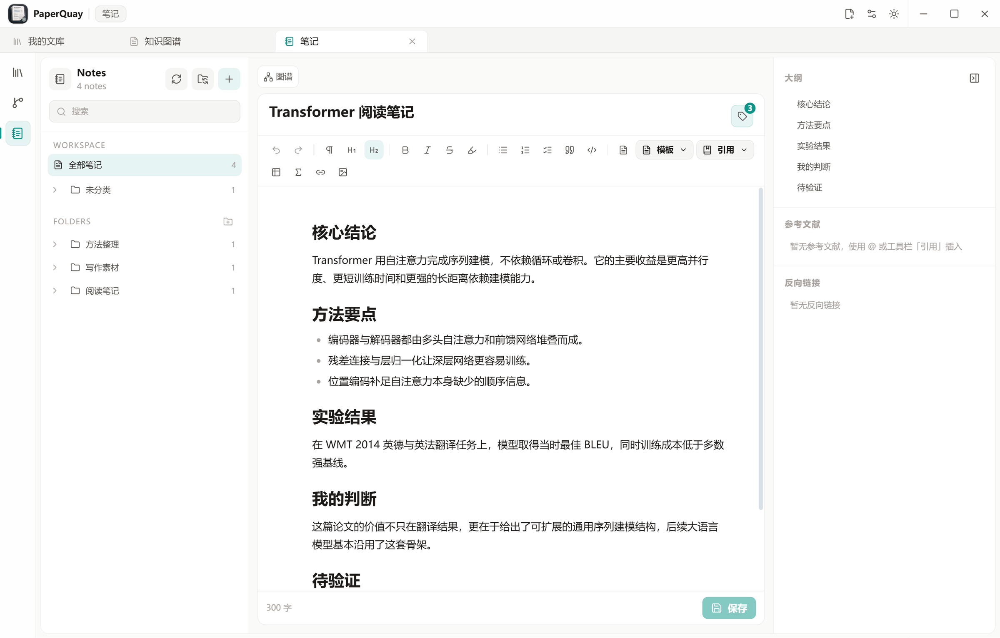
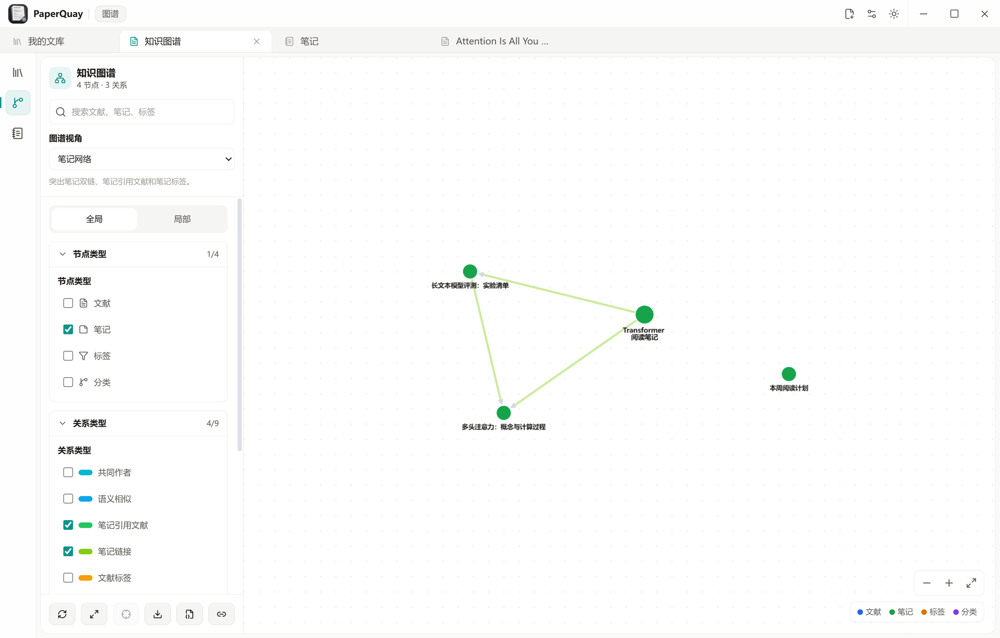

<h1 align="center">PaperQuay</h1>

<p align="center">
  中文 | <a href="./README_EN.md">English</a>
</p>

<p align="center">
  <strong>本地优先的开源 AI 论文工作台。</strong><br>
  PDF 阅读、全文翻译、结构化概览、笔记、本地 RAG 与外部 Agent 接入，集中在一个桌面应用里。
</p>

<p align="center">
  
  
  
  
  
  
</p>

<p align="center">
  <a href="./docs/USER_MANUAL.zh-CN.md">用户手册</a> |
  <a href="#近期更新">近期更新</a> |
  <a href="#功能概览">功能概览</a> |
  <a href="#下载与安装">下载与安装</a> |
  <a href="#mcp-与外部-agent">MCP</a> |
  <a href="#本地开发">本地开发</a> |
  <a href="./CHANGELOG.md">更新日志</a>
</p>

> **仓库说明**：本项目基于 [WangQrkkk/PaperQuay](https://github.com/WangQrkkk/PaperQuay)，由 [@Dongyurocket](https://github.com/Dongyurocket) 维护，许可证为 `AGPL-3.0-only`。Fork 版增强了排版清洗、BBox 原始切片、AI 区块重析、长文档分卷、本地 RAG、MCP 混合检索和 Zotero 选择性同步。

<p align="center">
  
</p>

---

## 这是什么

PaperQuay 面向研究生、科研人员和需要持续阅读论文的用户。文献导入、阅读、翻译、概览、批注、笔记、整理和知识库检索都在本地完成。Zotero 可作为导入来源，但不是必需依赖。

| 常见问题 | PaperQuay 的做法 |
| --- | --- |
| 翻译打断阅读 | 全文翻译按结构块缓存，点击原文即可查看对应译文 |
| 中英文对照分散注意力 | 保留原始 PDF，需要时再跳到对应译文 |
| 笔记脱离原文 | 笔记、标签、双链和文献引用保存在本地，可跳回 PDF 位置 |
| 逐篇速读耗时 | 在文献库中生成并保存结构化概览 |
| 模型选择受限 | 支持任意 OpenAI 兼容接口、模型和参数 |
| 文献整理繁琐 | 外部 Agent 经 MCP 批量补全元数据、打标签和分类，写入可预览、可回读 |

<p align="center">
  
</p>

---

## 近期更新

- **v0.4.36**：新增“用 RetainPDF 生成译版”。应用调用本机 RetainPDF 完成整本翻译，并自动下载、附加译版 PDF；任务进度进入全局任务条，重启后可续跑。
- **v0.4.35**：全文翻译缓存写入更稳。应用数据目录直接放行，`EPERM` / `EBUSY` 等瞬时错误自动重试；译文已完整落盘时不再误判失败。
- **v0.4.32**：只保留外部 Agent 接入，移除应用内独立 Agent、Agent 记忆和笔记 AI 润色；MinerU OCR 重试成为唯一解析降级入口；阅读器问答支持当前文献、选定文献和全库三档范围。
- **v0.4.31**：移除综述写作工作区和图谱 AI 关系候选。跨文献归纳改由外部 Agent 检索证据，并写入 `synthesis` 笔记。
- **v0.4.30**：阅读器顶栏改为单行，PDF 工具行支持页码跳转和溢出菜单；新增沉浸阅读（`Ctrl+Shift+F`）。
- **v0.4.29**：论文概览页重做。解析、翻译和概览生成收进“处理”菜单，概览按节显示，文件卡列出原始 PDF、译版 PDF 和 MinerU 结果。

完整记录见 [CHANGELOG.md](./CHANGELOG.md)，安装包见 [Releases](https://github.com/Dongyurocket/PaperQuay/releases)。

---

## 功能概览

| 模块 | 能力 |
| --- | --- |
| 文献库 | SQLite 保存论文、作者、分类、标签、附件、笔记、批注和设置；拖拽导入 PDF，入库前确认元数据；支持复制、移动、保留原路径，多选批量和组合筛选 |
| 元数据 | 按 DOI 或标题查询 OpenAlex，Crossref 兜底；中文论文未命中时由模型提取首页信息；支持作者单位、ORCID、论文语言、引用键和 BibTeX 导出 |
| 分类与标签 | 多级分类、拖拽排序、标签、收藏 |
| 文档解析 | MinerU 云端解析；多 Key 轮换、超长文档分卷合并、OCR 重试；支持强制重新识别和解析缓存自愈 |
| 阅读器 | PDF 与结构块联动、批注、阅读热力、长文档窗口化、沉浸模式；排版清洗、BBox 原始切片和单块 AI 重析 |
| 翻译 | 全文翻译与块级缓存、划词翻译、批量翻译标题；中文文献跳过翻译；支持附加译版 PDF 和独立语言设置 |
| 论文概览 | 按背景、问题、方法、实验、发现、结论和局限分节保存，打开即读缓存 |
| 阅读器问答 | 基于本地 RAG 证据回答，可限定当前文献、选定文献或全库；引用带页码和证据类型，可停止生成并存为笔记 |
| 笔记 | Tiptap 富文本；8 种页面类型和 11 个模板；双链、标签、文献引用、摘录卡、引用样式、笔记图谱与 Obsidian 兼容 vault |
| 本地 RAG | 向量 KNN + FTS5 + RRF 混合检索；支持批量建立、暂停、继续、取消和单篇移出知识库 |
| 知识图谱 | 文献、笔记、标签、分类和引用节点；支持语义相似、参考文献、共同作者和自定义关系 |
| Zotero | 读取 `zotero.sqlite` 临时副本，不改原库；支持全量导入或按分类、条件检索后选择性同步 |
| 备份 | 密码保护的 `.pqbackup` 单文件导出与导入；导入后重启替换，并保留回滚点 |
| 其他 | 浅色 / 深色主题、命令面板（`Ctrl+K`）、应用内更新检查 |

操作步骤见[用户手册](./docs/USER_MANUAL.zh-CN.md)。

### 阅读与问答

<p align="center">
  <br>
  <sub>PDF、结构块和文档问答在同一页联动。</sub>
</p>

### 笔记与关系

<table>
  <tr>
    <td width="50%"></td>
    <td width="50%"></td>
  </tr>
  <tr>
    <td align="center"><sub>富文本笔记、模板与大纲</sub></td>
    <td align="center"><sub>双链与文献关系图</sub></td>
  </tr>
</table>

---

## 下载与安装

从 [GitHub Releases](https://github.com/Dongyurocket/PaperQuay/releases) 下载 Windows x64 `.exe`。

自 0.4.24 起只发布、维护和测试 Windows x64。macOS 和 Linux 可从源码自行打包；历史平台安装包仍保留在 Releases 中。

### 快速开始

1. 打开“设置 → AI 模型”，填写 OpenAI 兼容接口的 Base URL、API Key 和模型。
2. 在“文库与 Zotero”设置文献存储目录和导入模式。
3. 在“文档解析”填写 MinerU API Token。需要本地 RAG 时，再配置 Embedding。
4. 拖入 PDF，确认元数据后入库。
5. 建立分类、添加标签，打开论文开始阅读。

可选外部服务：

- OpenAI 兼容 API：翻译、概览、问答和区块重析。
- MinerU：结构化解析。
- Embedding API：RAG 与笔记语义检索。
- OpenAlex / Crossref：元数据查询，需要联网。

---

## MCP 与外部 Agent

PaperQuay 内置 MCP stdio 服务，外部 Agent 可直接读取本地 SQLite。当前提供 28 个工具。

- **只读检索**：`search_papers`、`get_paper_details`、`search_knowledge_base`、`read_paper_content`、`read_paper_figure`、`search_notes`、`get_note`、`list_note_tags`、`list_note_folders`、`list_categories`、`preview_delete_papers`
- **Zotero**：`zotero_list_collections`、`zotero_search_items`、`zotero_preview_sync`、`paperquay_sync_from_zotero`
- **文库写入**：`import_pdfs`、`manage_category`、`set_paper_categories`、`update_paper`、`delete_papers`、`attach_translated_pdf`、`remove_translated_pdf`
- **笔记维护**：`create_note`、`update_note`、`delete_note`、`create_note_folder`、`rename_note_folder`、`delete_note_folder`

桌面应用运行时，写工具默认拒绝写入。需要并行写入时传 `allowWhileAppRunning: true`，并携带读取到的版本；版本冲突会返回 `PAPER_CONFLICT`、`CATEGORY_CONFLICT` 或 `NOTE_CONFLICT`。

`PAPERQUAY_MCP_WRITE=off` 可全局只读，`PAPERQUAY_MCP_EMBEDDING=off` 可禁用向量检索的网络请求。

**接入方式**：安装版打开“设置 → MCP 服务”，复制 Proma、Claude 或 Codex 配置。安装版使用 `PaperQuay.exe` 和 `ELECTRON_RUN_AS_NODE=1` 启动 `resources/paperquay-mcp/server.cjs`，无需另装 Node.js。开发模式使用 `node bin/paperquay-mcp.cjs`。

仓库 [`skills/`](./skills) 提供四个配套 Skill：

- `paperquay-knowledge-search`：证据检索。
- `paperquay-notes`：笔记维护。
- `paperquay-zotero-sync`：预检后同步。
- `paperquay-library-manage`：文库写入。

参数、客户端配置和检索模式见 [MCP 接入指南](./docs/MCP_AGENT_INTEGRATION.md)。

---

## 技术架构

Electron 主进程负责文件系统、IPC、SQLite 持久化、Zotero 导入、更新和打包；React 渲染进程负责界面。PDF 使用 PDF.js，笔记使用 Tiptap / ProseMirror，数据存于 SQLite（sql.js）和 sqlite-vec。

| 路径 | 职责 |
| --- | --- |
| `src/features/literature/` | 文献库、导入、分类树、文献详情 |
| `src/features/reader/` | 阅读器、联动阅读、概览与阅读问答 |
| `src/features/pdf/` | PDF 渲染、覆盖层与批注 |
| `src/features/blocks/` | MinerU 结构块渲染 |
| `src/features/notes/` | Tiptap 笔记工作区与扩展 |
| `src/services/`、`src/platform/electron/` | 渲染进程的 IPC 封装 |
| `electron/` | 主进程、preload 与后端命令 |
| `bin/paperquay-mcp.cjs`、`electron/mcp/` | MCP 服务 |
| `skills/` | 配套 Agent Skills |
| `tests/` | 自动化测试 |

---

## 本地开发

环境：Node.js 22.18 或更高（CI 使用 Node.js 24）。

```bash
npm ci                   # 安装依赖
npm run dev              # 启动桌面开发模式
npm run build            # 类型检查并构建前端
npm test                 # 运行测试
npm run electron:build   # 构建桌面安装包
```

上游同步、发布和文档约定见[开发手册](./docs/DEVELOPMENT.zh-CN.md)、[UPSTREAM.md](./docs/UPSTREAM.md) 和 [RELEASE.md](./docs/RELEASE.md)。贡献方式见 [CONTRIBUTING.md](./CONTRIBUTING.md)。

---

## 数据与隐私

PaperQuay 本地优先。文献库、笔记和 RAG 索引存于本地 SQLite，PDF 存于指定目录。AI 与 Embedding 请求只发往你配置的接口。

完整迁移包包含配置与 API Key、三个数据库和文献库引用的 PDF。完整迁移包还包含知识图谱关系、阅读状态、批注、笔记 vault，以及 MinerU / 翻译 / 摘要缓存。日常备份不含 RAG 数据库和 MinerU 缓存。密码无法找回。

新版不读取旧 WebDAV 备份。需要旧数据时，先用 0.4.18 或更早版本恢复到本机，再升级并导出 `.pqbackup`。

不要提交本地数据、API Key、PDF、解析结果、数据库或备份包。安全问题按 [SECURITY.md](./SECURITY.md) 报告。

---

## 待做计划

- **元数据补全**：接入 arXiv 与 Semantic Scholar，支持 arXiv ID 查询和预印本合并提示。
- **无文字层封面识别**：为扫描封面增加 OCR，并在候选冲突时显示依据。
- **批注与笔记双向定位**：让 PDF 批注列出引用该批注的笔记，也让摘录卡定位到具体批注。
- **导入自动化**：监听文件夹，新 PDF 自动入库；失败项进入可重试队列。
- **写作衔接**：导出 Markdown / LaTeX 草稿、引用键和 BibTeX，成稿交给外部 Agent 或本地 LaTeX 流程。
- **可选云同步**：本地优先模型稳定后，再评估端到端加密同步。

---

## 致谢

- 上游项目：[WangQrkkk/PaperQuay](https://github.com/WangQrkkk/PaperQuay)。
- 社区：[LinuxDo](https://linux.do/) 的讨论和反馈。
- 编辑器：[Tiptap](https://github.com/ueberdosis/tiptap)。

## 许可证

PaperQuay Community Edition 使用 `AGPL-3.0-only`。分发修改版或通过网络提供服务时，请保留许可证和版权声明、说明修改内容，并提供对应源代码。闭源商业授权、商业支持或品牌许可需与维护者另行协商。品牌说明见 [TRADEMARKS.md](./TRADEMARKS.md)。
