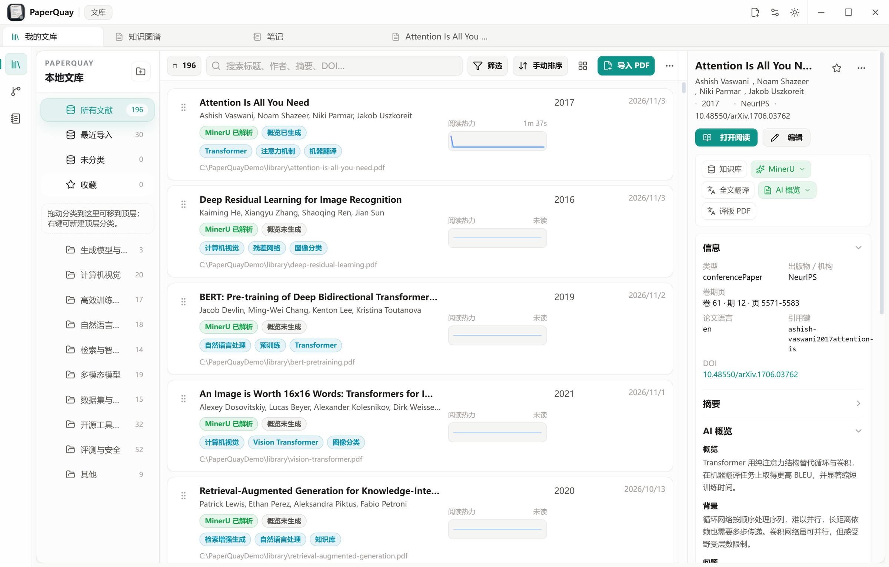
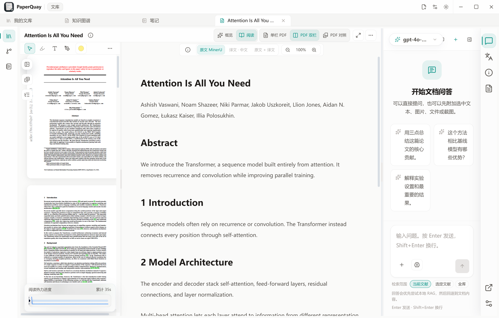
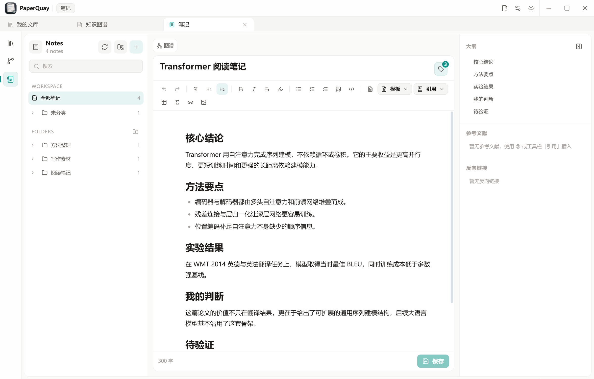
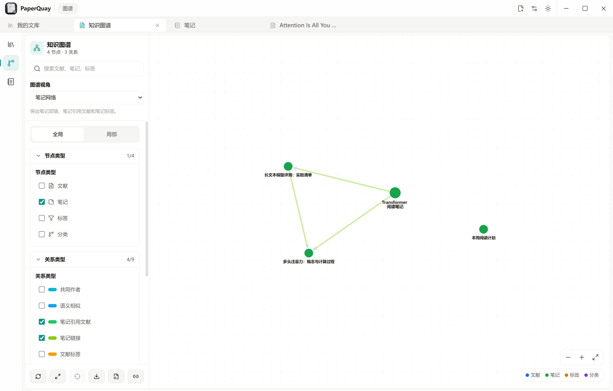

<h1 align="center">PaperQuay</h1>

<p align="center">
  English | <a href="./README.md">中文</a>
</p>

<p align="center">
  <strong>A local-first, open-source AI paper workspace.</strong><br>
  Read PDFs, translate full papers, build structured overviews, write notes, search a local RAG index, and connect external agents in one desktop app.
</p>

<p align="center">
  
  
  
  
  
  
</p>

<p align="center">
  <a href="./docs/USER_MANUAL.zh-CN.md">User Manual (Chinese)</a> |
  <a href="#recent-updates">Recent Updates</a> |
  <a href="#features">Features</a> |
  <a href="#download-and-install">Download</a> |
  <a href="#mcp-and-external-agents">MCP</a> |
  <a href="#local-development">Development</a> |
  <a href="./CHANGELOG.md">Changelog</a>
</p>

> **About this repository**: a fork of [WangQrkkk/PaperQuay](https://github.com/WangQrkkk/PaperQuay), maintained by [@Dongyurocket](https://github.com/Dongyurocket) under `AGPL-3.0-only`. The fork adds typography cleanup, raw BBox slices, AI block re-parsing, long-document splitting, local RAG, hybrid MCP search, and selective Zotero sync.

<p align="center">
  
</p>

---

## What It Is

PaperQuay is built for graduate students, researchers, and anyone who reads many papers. Import, reading, translation, overviews, annotations, notes, organization, and knowledge-base search all run locally. Zotero can be an import source but is not required.

| Common problem | How PaperQuay helps |
| --- | --- |
| Translation interrupts reading | Full-text translation is cached by block; click the source text to view the matching translation |
| Side-by-side reading is distracting | Keep the original PDF and jump to the translation only when needed |
| Notes lose their source context | Notes, tags, wiki links, and paper references stay local and link back to PDF positions |
| Screening many papers is slow | Generate and save structured overviews inside the library |
| Model choice is limited | Use any OpenAI-compatible endpoint, model, and parameters |
| Library upkeep is manual | External agents batch-fill metadata, tags, and categories through MCP with previews and read-back |

<p align="center">
  
</p>

---

## Recent Updates

- **v0.4.36**: the translated-PDF menu now offers "Generate with RetainPDF". PaperQuay calls the local RetainPDF app, downloads the result, and attaches it automatically. Progress appears in the global task bar and resumes after restart.
- **v0.4.35**: full-text translation caches persist more reliably. App-data directories are trusted directly, transient `EPERM` / `EBUSY` errors are retried, and completed translations are no longer marked as failed.
- **v0.4.32**: external agents are the only agent path. The in-app agent, agent memory, and note AI polish were removed. Reader Q&A supports current paper, selected papers, and whole library scopes.
- **v0.4.31**: the survey workspace and AI graph relation suggestions were removed. Cross-paper synthesis now belongs to external-agent search and `synthesis` notes.
- **v0.4.30**: the reader top bar is now a single row. The PDF toolbar supports page jump and an overflow menu, and immersive reading uses `Ctrl+Shift+F`.
- **v0.4.29**: the overview page was redesigned. Parsing, translation, and overview generation now live under "Process"; overviews are split by section, and the files card lists the original PDF, translated PDF, and MinerU output.

See [CHANGELOG.md](./CHANGELOG.md) for the full history and [Releases](https://github.com/Dongyurocket/PaperQuay/releases) for installers.

---

## Features

| Module | Capabilities |
| --- | --- |
| Library | SQLite stores papers, authors, categories, tags, attachments, notes, annotations, and settings; import PDFs by drag and drop and confirm metadata; copy, move, or keep files in place; multi-select actions and composable filters |
| Metadata | OpenAlex lookup by DOI or title with Crossref fallback; LLM extraction from the first page for unmatched Chinese papers; author affiliations, ORCID, paper language, citation keys, and BibTeX export |
| Categories and tags | Nested categories, drag-and-drop ordering, tags, favorites |
| Parsing | MinerU cloud parsing with multi-key rotation, splitting and merging of long documents, and OCR retry; forced re-parse and self-healing image references |
| Reader | Linked PDF and block views, annotations, reading heatmap, windowed rendering, immersive mode, typography cleanup, BBox fallback, and per-block AI re-parsing |
| Translation | Full-text translation with block cache, selection translation, batch title translation, translated-PDF attachments, and a separate attachment language |
| Overviews | Background, problem, method, experiments, findings, conclusions, and limitations saved by section; cached overviews open instantly |
| Reader Q&A | Answers from local RAG evidence with current-paper, selected-papers, or whole-library scope; citations include page and evidence type; stop generation and save the answer as a note |
| Notes | Tiptap rich text, 8 page kinds and 11 templates, wiki links, tags, paper references, excerpt cards, citation styles, note graph, and an Obsidian-compatible vault |
| Local RAG | Hybrid vector KNN + FTS5 + RRF search; batch build, pause, resume, cancel, and remove individual papers |
| Knowledge graph | Paper, note, tag, category, and citation nodes; semantic similarity, references, co-authors, and custom relations |
| Zotero | Reads a temporary copy of `zotero.sqlite`; full import or selective sync after browsing and filtering |
| Backup | Password-protected single-file `.pqbackup` export and import, with a rollback point after restore |
| Other | Light and dark themes, command palette (`Ctrl+K`), and in-app update checks |

See the [User Manual](./docs/USER_MANUAL.zh-CN.md) for operating instructions.

### Reading and Q&A

<p align="center">
  <br>
  <sub>PDF, structured blocks, and document Q&A stay linked on one page.</sub>
</p>

### Notes and relations

<table>
  <tr>
    <td width="50%"></td>
    <td width="50%"></td>
  </tr>
  <tr>
    <td align="center"><sub>Rich-text notes, templates, and outline</sub></td>
    <td align="center"><sub>Wiki links and paper relations</sub></td>
  </tr>
</table>

---

## Download and Install

Download the Windows x64 `.exe` from [GitHub Releases](https://github.com/Dongyurocket/PaperQuay/releases).

Since 0.4.24, only Windows x64 is released, maintained, and tested. macOS and Linux can be built from source; older platform installers remain in Releases.

### Quick Start

1. Open **Settings → AI Models** and enter an OpenAI-compatible base URL, API key, and model.
2. Set the paper storage folder and import mode under **Library & Zotero**.
3. Enter a MinerU API token under **Document Parsing**. Configure an embedding endpoint if you want local RAG.
4. Drop in PDFs and confirm their metadata.
5. Create categories, add tags, and start reading.

Optional external services:

- OpenAI-compatible API: translation, overviews, Q&A, and block re-parsing.
- MinerU: structured parsing.
- Embedding API: RAG and semantic note search.
- OpenAlex / Crossref: metadata lookup with network access.

---

## MCP and External Agents

PaperQuay ships an MCP stdio server that lets external agents read the local SQLite data. It exposes 28 tools.

- **Read-only search**: `search_papers`, `get_paper_details`, `search_knowledge_base`, `read_paper_content`, `read_paper_figure`, `search_notes`, `get_note`, `list_note_tags`, `list_note_folders`, `list_categories`, `preview_delete_papers`
- **Zotero**: `zotero_list_collections`, `zotero_search_items`, `zotero_preview_sync`, `paperquay_sync_from_zotero`
- **Library writes**: `import_pdfs`, `manage_category`, `set_paper_categories`, `update_paper`, `delete_papers`, `attach_translated_pdf`, `remove_translated_pdf`
- **Note maintenance**: `create_note`, `update_note`, `delete_note`, `create_note_folder`, `rename_note_folder`, `delete_note_folder`

When the desktop app is running, write tools refuse to write by default. Pass `allowWhileAppRunning: true` and the version you read for checked parallel writes. Stale versions return `PAPER_CONFLICT`, `CATEGORY_CONFLICT`, or `NOTE_CONFLICT`.

Set `PAPERQUAY_MCP_WRITE=off` for a read-only server. Set `PAPERQUAY_MCP_EMBEDDING=off` to disable network requests for vector search.

**Setup**: in the installed app, open **Settings → MCP Service** and copy the Proma, Claude, or Codex configuration. The installed build runs `resources/paperquay-mcp/server.cjs` with `PaperQuay.exe` and `ELECTRON_RUN_AS_NODE=1`, so no separate Node.js install is needed. In development, use `node bin/paperquay-mcp.cjs`.

The [`skills/`](./skills) folder contains four companion skills:

- `paperquay-knowledge-search`: evidence search.
- `paperquay-notes`: note maintenance.
- `paperquay-zotero-sync`: preview, then sync.
- `paperquay-library-manage`: library writes.

See the [MCP Integration Guide](./docs/MCP_AGENT_INTEGRATION.md) for parameters, client configuration, and retrieval modes.

---

## Architecture

The Electron main process handles the filesystem, IPC, SQLite persistence, Zotero import, updates, and packaging. The React renderer handles the UI. PDFs use PDF.js, notes use Tiptap / ProseMirror, and data lives in SQLite (sql.js) with sqlite-vec.

| Path | Responsibility |
| --- | --- |
| `src/features/literature/` | Library, import, category tree, paper details |
| `src/features/reader/` | Reader, linked reading, overview, and reading Q&A |
| `src/features/pdf/` | PDF rendering, overlays, and annotations |
| `src/features/blocks/` | MinerU block rendering |
| `src/features/notes/` | Tiptap notes workspace and extensions |
| `src/services/`, `src/platform/electron/` | Renderer IPC wrappers |
| `electron/` | Main process, preload, and backend commands |
| `bin/paperquay-mcp.cjs`, `electron/mcp/` | MCP service |
| `skills/` | Companion Agent Skills |
| `tests/` | Automated tests |

---

## Local Development

Requirements: Node.js 22.18 or newer (CI uses Node.js 24).

```bash
npm ci                   # install dependencies
npm run dev              # start the desktop app in development
npm run build            # type-check and build the frontend
npm test                 # run tests
npm run electron:build   # build the desktop installer
```

See the [Development Manual](./docs/DEVELOPMENT.zh-CN.md), [UPSTREAM.md](./docs/UPSTREAM.md), and [RELEASE.md](./docs/RELEASE.md) for upstream sync and release steps. See [CONTRIBUTING.md](./CONTRIBUTING.md) to contribute.

---

## Data and Privacy

PaperQuay is local-first. The library, notes, and RAG index are stored in local SQLite databases, and PDFs stay in the folder you choose. AI and embedding requests go only to the endpoints you configure.

The full `.pqbackup` archive contains configuration and API keys, the three databases, referenced PDFs, knowledge-graph relations, reading state and annotations, the notes vault, and MinerU / translation / summary caches. The smaller daily backup leaves out the RAG database and MinerU caches. A forgotten password cannot be recovered.

New versions cannot read old WebDAV backups. To keep that data, restore it locally with 0.4.18 or earlier, then upgrade and export a `.pqbackup`.

Do not commit local data, API keys, PDFs, parser output, databases, or backups. Report security issues as described in [SECURITY.md](./SECURITY.md).

---

## Roadmap

- **Metadata enrichment**: add arXiv and Semantic Scholar, including arXiv ID lookup and a merge prompt for preprints.
- **Scanned cover recognition**: add OCR for cover pages without a text layer and show the evidence when candidates conflict.
- **Two-way annotation and note navigation**: list the notes that cite a PDF annotation and let excerpt cards target a specific annotation.
- **Import automation**: watch a folder and queue failed imports with retryable reasons.
- **Writing hand-off**: export Markdown / LaTeX drafts, citation keys, and BibTeX for an external agent or local LaTeX workflow.
- **Optional cloud sync**: revisit opt-in end-to-end encrypted sync after the local-first model is stable.

---

## Acknowledgements

- Upstream: [WangQrkkk/PaperQuay](https://github.com/WangQrkkk/PaperQuay).
- Community: discussions and feedback from [LinuxDo](https://linux.do/).
- Editor: [Tiptap](https://github.com/ueberdosis/tiptap).

## License

PaperQuay Community Edition is licensed under `AGPL-3.0-only`. If you distribute modified versions or provide them over a network, keep the license and copyright notices, mark your changes, and provide the corresponding source code. Closed-source commercial licensing, commercial support, and brand permission require a separate agreement with the maintainer. See [TRADEMARKS.md](./TRADEMARKS.md).
