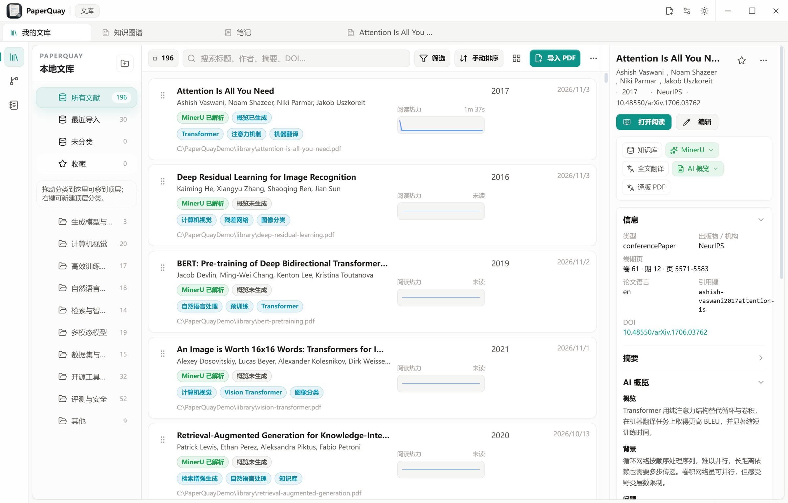
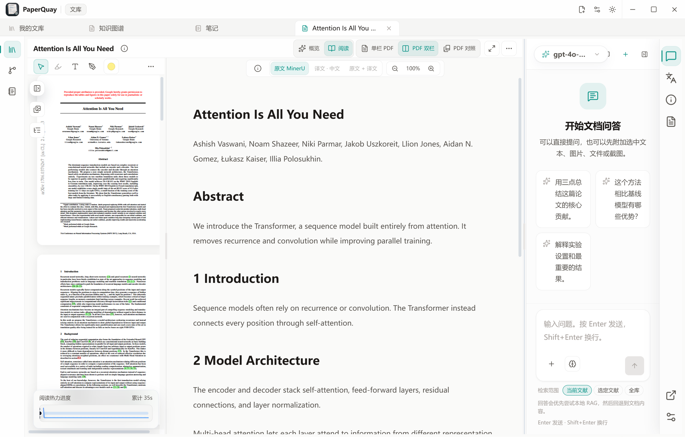
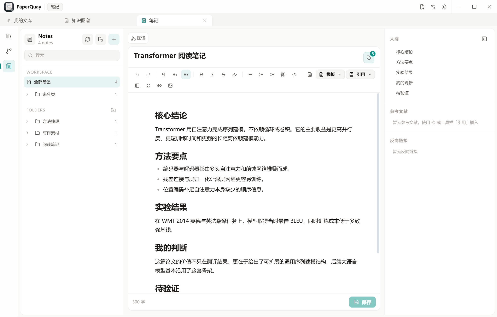
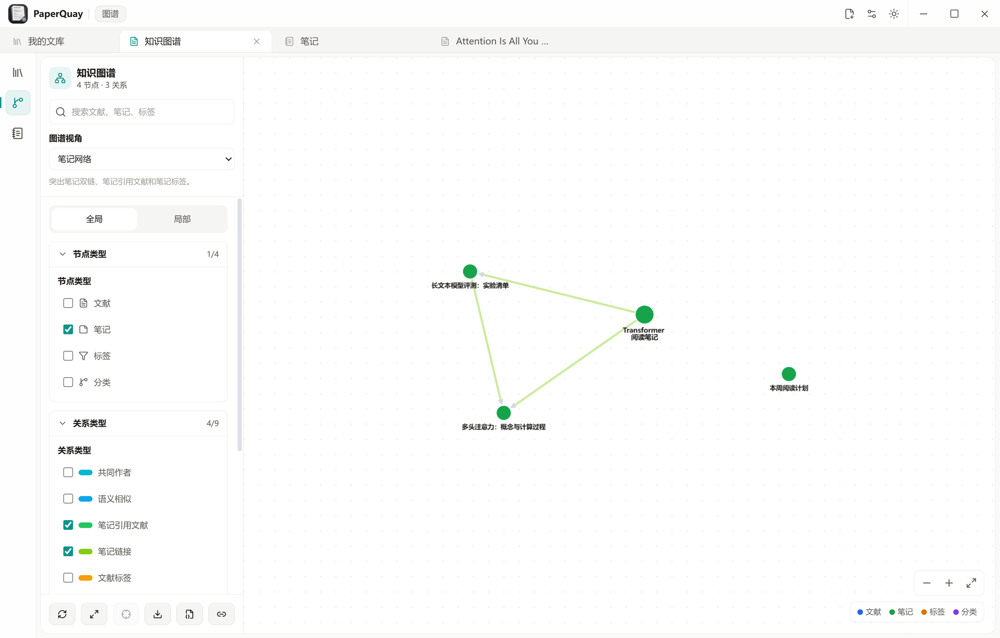

# PaperQuay 用户手册

> 适用版本：**v0.4.43**。更新日期：2026-11-26。
> 配套文档：[README](../README.md)、[笔记宪章](./notes-charter.md)、[MCP 接入指南](./MCP_AGENT_INTEGRATION.md)、[开发手册](./DEVELOPMENT.zh-CN.md)、[更新日志](../CHANGELOG.md)。

本手册介绍导入、阅读、翻译、概览、问答、笔记和备份操作。开发、构建与发布流程见[开发手册](./DEVELOPMENT.zh-CN.md)。

## 目录

- [1. 安装与首次启动](#1-安装与首次启动)
- [2. 文献库](#2-文献库)
- [3. 阅读器](#3-阅读器)
- [4. 笔记：使用](#4-笔记使用)
- [5. 笔记：维护](#5-笔记维护)
- [6. 知识图谱](#6-知识图谱)
- [7. 本地 RAG 知识库](#7-本地-rag-知识库)
- [8. MCP 与外部 Agent 接入](#8-mcp-与外部-agent-接入)
- [9. 数据、备份与隐私](#9-数据备份与隐私)
- [10. 设置参考](#10-设置参考)
- [11. 更新与排障](#11-更新与排障)
- [附录 A：快捷键](#附录-a快捷键)
- [附录 B：常见问题速查](#附录-b常见问题速查)

---

## 1. 安装与首次启动

### 1.1 安装

1. 从 [GitHub Releases](https://github.com/Dongyurocket/PaperQuay/releases) 下载 Windows x64 `.exe`。
2. 启动应用。首次运行会自动创建数据目录，无需初始化。
3. 从源码运行需要 Node.js 22.18+，见[开发手册](./DEVELOPMENT.zh-CN.md)。

自 0.4.24 起只发布、维护和测试 Windows x64。其他平台可从源码打包，作者不提供维护和测试。

### 1.2 首次启动建议按顺序配置

打开“设置”，依次配置：

| 顺序 | 分区 | 配置内容 | 未配置的影响 |
| --- | --- | --- | --- |
| 1 | AI 模型 | OpenAI 兼容接口的 Base URL、API Key 和模型预设 | 翻译、概览、问答和区块重析不可用 |
| 2 | 文库与 Zotero | 文献存储目录、导入模式、文件命名规则 | 使用数据目录下的默认存储位置 |
| 3 | 文档解析 | MinerU API Token | 只能阅读原始 PDF，无法查看结构块 |
| 4 | AI 模型 → Embedding | Embedding 端点、模型和维度 | RAG 与笔记检索退化为关键词检索 |
| 5 | 备份与迁移 | 可选；导出或导入 `.pqbackup` | 数据只保存在本机 |
| 6 | 概览与问答 | 可选；设置概览输入、批量概览和问答上下文 | 使用默认策略 |

### 1.3 数据位置

PaperQuay 本地优先。`<数据目录>` 指 Electron 用户数据目录，Windows 默认是 `%APPDATA%\PaperQuay`。

| 位置 | 内容 |
| --- | --- |
| `<数据目录>/PaperQuay/paperquay-library.sqlite` | 文献元数据、分类、标签、批注、阅读记录、文库设置 |
| `<数据目录>/PaperQuay/paperquay-notes.sqlite` | 笔记正文、标签、分类、双链、锚点、参考文献关联 |
| `<数据目录>/PaperQuay/paperquay-rag.sqlite` | RAG 切片、全文与向量索引 |
| `<数据目录>/PaperQuay/.settings/paperquay.config.json` | 界面与功能设置、模型预设、密钥 |
| `<数据目录>/PaperQuay/.mineru-cache/`、`.downloads/`、`.screenshots/` | 解析缓存、远程 PDF 下载、截图 |
| 文献存储目录（设置中指定） | 入库的 PDF |
| 笔记 vault 目录（可选） | 笔记的 Markdown 镜像，可用 Obsidian 打开 |

### 1.4 界面总览

应用有三个工作区：

- **文献库**：常驻标签页，包含文献列表、分类树、详情面板、批量和阅读器。
- **笔记**：笔记列表、编辑器、大纲、参考文献和图谱。
- **知识图谱**：文献、笔记、标签、分类和引用关系。

按 `Ctrl+K`（macOS 为 `Command+K`）打开命令面板，可切换工作区、打开设置或切换主题。



---

## 2. 文献库

### 2.1 导入 PDF

1. 把 PDF 拖入文献库，或点顶栏“导入 PDF”。
2. 在导入窗口检查元数据。应用先查 OpenAlex，未命中时查 Crossref；中文论文远程未命中时，由模型从首页提取。
3. 选择复制、移动或保留原路径。应用按内容哈希去重。

### 2.2 从 Zotero 导入

1. 在“设置 → 文库与 Zotero”指定 Zotero 数据目录。
2. 选择全量导入，或按分类、关键词、作者和年份检索。
3. 选择性同步先显示差量预检：已存在、缺本地 PDF、可导入。
4. 确认后入库。

应用读取 `zotero.sqlite` 的临时副本，不修改原库。分类、标签、论文语言、作者单位、ORCID 和 Citation Key 会一并保留。入库后与 Zotero 互不依赖。

### 2.3 顶栏：搜索、筛选、排序与视图

文库顶栏从左到右：全选与计数、搜索框、“筛选”、排序、“视图”、“导入 PDF”和“⋯”。

- **搜索**：搜索标题、作者等字段。`Ctrl+F` 聚焦搜索框。
- **筛选**：按钮角标显示生效条件数。可组合收藏、最近 30 天阅读、阅读状态、出版年份、文献类型、标签、附件、处理状态、知识库、RAG 索引状态和来源。RAG 状态包括已索引、待更新、待索引、失败、未建立（含未解析）；「已排除」仍由知识库成员筛选表达。演示库不提供 RAG 状态；索引库不可用时控件保留并提示结果降级。
- **生效条件**：显示在顶栏下方，可单独移除或“清除全部”。条件重启后保留。
- **排序**：按最近阅读等字段排序并切换方向。
- **视图**：调整标题语言、阅读热力列和显示密度。面板较窄时，视图选项进入“⋯”。
- **“⋯”**：存储体检、刷新文库。

### 2.4 分类、标签与收藏

- **分类树**：系统分类包括所有文献、最近导入、未分类和收藏；自定义分类支持多级、折叠、右键菜单、拖拽排序和调整层级。
- **标签**：在详情面板维护，用于跨分类筛选。
- **收藏**：在详情面板或列表中切换星标。

分类表示归属，标签表示横切主题。笔记沿用同一约定。

### 2.5 详情面板与元数据

- **标题区**：显示标题、中文标题、作者、年份和出版物。标题、年份、DOI 可直接编辑。
- **标题菜单**：可显示文件位置、复制 DOI、引文或 BibTeX、按 DOI 重新识别、切换知识库状态或删除。
- **按 DOI 重新识别**：逐字段显示当前值和识别结果，只应用勾选项。
- **状态条**：汇总知识库、MinerU、全文翻译、AI 概览和译版 PDF 状态。未完成项可启动，已完成项可重新执行或查看。
- **分区**：摘要、AI 概览、笔记、引用和阅读时间图。分区可折叠，状态重启后保留。
- **AI 概览**：小标题随界面语言显示。无法识别的自定义标题保留原文。

**编辑元数据**：

1. 点“编辑”。字段按信息组折叠，并按文献类型显示。
2. 作者可逐行增删、拖动排序，也可粘贴整串作者自动拆分。
3. 展开作者行可填单位和 ORCID。有效 ORCID 显示为 `orcid.org` 链接。
4. 关键词和标签使用 chip 输入；分类可多选。
5. “论文语言”使用 BCP 47 标签，如 `en`、`zh-CN`。论文语言表示原文语言，与译版 PDF 语言分开。
6. `Ctrl+S` 保存，`Esc` 放弃草稿。保存前会校验 DOI、年份、ISSN、URL、论文语言、引用键和 ORCID。

草稿未保存时切换文献，可选择“保存并切换”“放弃并切换”或“取消切换”。

### 2.6 右键菜单与批量操作

- **在文件夹中显示**：右键文献，可定位原始 PDF、译版 PDF 或 MinerU 结果，也可复制 PDF 路径。MinerU 结果优先定位 `full.md`，没有时定位解析 JSON。
- **多选**：Ctrl / Shift 勾选，或全选当前筛选结果。可批量删除、移动分类、收藏、翻译标题、导出 Bib、设置译版语言、加入或移出知识库，以及按 RAG 状态批量建立/重试/更新/重建索引。批量栏会先预览候选与跳过原因（未解析、已排除、已就绪、待索引），确认后显示进度并可暂停、继续或取消。批量运行期间单篇 RAG 动作禁用。
- **Bib 导出**：合并为单个 `.bib` 或每篇一个文件。优先使用填写的引用键；缺失时自动生成去重键。

### 2.7 译版 PDF 语言

“附件语言”是该 PDF 的实际语言。设置中的“翻译目标语言”只是附加新译版时的默认候选。显示“语言待确认”表示尚未确认。

- **单篇**：在译版 PDF 菜单中设置、修改或清除语言。
- **批量**：选择文献后点“设置译版语言”，检查附件清单、勾选目标、预览后保存。已有语言的附件默认不勾选。
- **不自动推断**：应用不会推断已有译版的语言。
- **用 RetainPDF 生成**：在译版 PDF 菜单选“用 RetainPDF 生成译版”，或在阅读器空状态点相应按钮。应用调用本机 RetainPDF，结束后自动下载并附加译版。进度显示在左下角任务条；同一文献同时只允许一个任务。该功能仅支持 Windows，输出为简体中文，附件语言记为 `zh-CN`。

### 2.8 阅读进度

阅读器自动记录阅读时间和位置，并写回文库。详情面板显示热力图和进度；排序可选“最近阅读”，筛选可按阅读状态。

---

## 3. 阅读器

### 3.1 论文概览页

打开文献先进入概览页：

- **标题区**：标题最多三行，下方显示作者、年份、期刊和所属分类。
- **进入阅读**：打开正文。
- **“处理”菜单**：MinerU 解析、全文翻译、生成概览。每项显示完成、进行中或失败；运行中的翻译可取消。
- **AI 概览**：按概览、背景、问题、方法、实验、发现、结论和局限分节。空节不显示，发现以列表呈现。
- **没有概览时**：显示模型配置状态。已配置可点“生成概览”；未配置可从“模型设置”进入。已有缓存不会因未配置模型而消失。
- **文件卡**：列出原始 PDF、译版 PDF、MinerU 结果和结构块数。每项可“在文件夹中显示”，缺失项置灰。

已生成的概览打开时直接读本地缓存，不调用模型。“自动生成概览”只决定没有缓存时是否自动调用模型。

### 3.2 顶栏

- **单行顶栏**：标题单行省略；旁边的 `ⓘ` 显示作者、年份、文件、来源、当前块、状态和操作提示。
- **视图切换**：“概览 / 阅读”和 PDF 视图（单栏、PDF 双栏、PDF 对照）。窄窗口只显示图标。
- **PDF 版本**：有多个版本时显示下拉。
- **沉浸阅读**：点顶栏的沉浸图标或按 `Ctrl+Shift+F`（macOS 为 `Command+Shift+F`）。顶栏和工具行隐藏，只留退出按钮。按 `Esc` 或再次按快捷键退出。

### 3.3 PDF 阅读与工具行

- 左侧是 PDF，右侧是可停靠的助手侧栏。双栏或对照模式下，每个窗格各有一条工具行。
- **页码**：输入后按 `Enter` 跳转，`Esc` 还原。越界会夹到首页或末页。
- **缩放**：适合宽度、适合页面、`100%`。窗口或分栏尺寸变化后自动重算适配比例；手动缩放保持不变。
- **批注**：高亮、写字、跳转批注。“当前颜色”打开颜色弹层。
- **删除批注**：选中批注后点“删除所选”，或在焦点不在输入框时按 `Delete` / `Backspace`。
- **“⋯”**：阅读热力图、导出批注 PDF。窗口变窄时，放不下的工具、翻页和缩放也进入此菜单。
- **目录侧栏**：树状折叠、关键词筛选、当前章节高亮。优先读取 PDF 目录，缺失时用 MinerU 章节索引。
- **长文档**：按视口渲染结构块和缩略图，数百页也能流畅滚动。



### 3.4 结构块视图

- 解析完成后可切到结构块视图。正文、公式、表格和图片按结构显示，并与 PDF 区域双向联动。
- 工具行显示块数、译文块数和联动说明，也提供显示模式和正文缩放。
- 公式或表格解析失败时，可回退为 PDF 原始切片。任意块都可执行**区块 AI 重析**：排版纠错、表格 / 术语表结构化、公式提取。
- 重析结果支持对比预览和撤销，按解析版本单独保存，不改写原始 OCR 数据。清空修复即回到原始解析。

### 3.5 解析引擎

- “设置 → 文档解析”使用 **MinerU**。普通解析没有返回可用结构时，自动切换 OCR 模式重试。
- 支持多 API Key 轮换和故障切换。超页大文件自动分卷解析、本地合并。
- 可强制重新识别单篇文献。解析在后台运行，关闭阅读页不影响。

### 3.6 翻译

- **全文翻译**：按结构块翻译并缓存，可切换原文 / 译文对照。已完成的翻译打开时直接显示。
- **划词翻译**：选中文本后，浮层显示译文。可开启“自动翻译划词”。
- **中文文献**：自动跳过翻译；中文标题可直接回填入库。

### 3.7 助手侧栏

侧栏有四个面板：**问答 / 翻译 / 信息 / 摘录**。

- **问答**：基于本地 RAG 证据回答，附文献、页码和证据类型。检索范围可选当前文献、选定文献或全库。
- **摘录**：“定位”列出当前文献的摘录锚点；“笔记”列出关联笔记，可按全部、PDF、AI 或笔记筛选。顶部可“加入当前笔记”或“新建笔记”。

---

## 4. 笔记：使用

### 4.1 数据模型

1. **Tiptap JSON 是唯一事实源**。每篇笔记保存 `contentJson`、`contentHtml`、`contentText` 和 `content`。Markdown 只用于导出和交换。
2. **锚点是证据**。锚点指向文献具体位置：`paperId`、`pageIndex`、`blockId`、`pdfLocation`、`excerpt` 和 `label`。界面不提供编辑入口；外部 Agent 只能新增，不能改指或伪造。
3. **笔记分类存在笔记库中**，随 `.pqbackup` 迁移，MCP 和外部 Agent 都能读写。

笔记字段包括标题、类型、正文、标签、颜色、分类、摘录原文和 PDF 位置。笔记字段还包括锚点、关联文献、双链、反向链接、字数、置顶、收藏和软删除标记。

### 4.2 笔记工作区

三栏布局：

- **左栏**：笔记总数、重建语义索引、同步 Markdown vault、新建笔记；下方是搜索框和分类树。
- **中栏**：编辑器。左上角“图谱”切到图谱和体检视图；底部显示字数、保存状态和保存按钮。
- **右栏**：大纲、参考文献和反向链接。



### 4.3 创建笔记

| 入口 | 位置 | 结果 |
| --- | --- | --- |
| 新建空白笔记 | 笔记工作区左上角 `+`，或分类右键“在此分类新建笔记” | 当前分类下的新笔记 |
| 划词“加入笔记” | 阅读器划词浮层 | 把原文作为摘录插入当前笔记；没有则新建 |
| 划词“AI 提炼为摘录卡” | 阅读器划词浮层（需配置 AI） | 摘录卡：锚点块、提炼正文和“我的想法” |

也可从模板开始：点工具栏 `模板`，或在空行输入 `/`。共有 11 个模板。

### 4.4 编辑与排版

- **工具栏**：
  - 文本：撤销、重做、标题、加粗、斜体、删除线、高亮。
  - 块：列表、任务列表、引用、代码块。
  - 插入：组件块、模板、文献引用、表格、公式、链接和图片。
- **斜杠命令**：空行输入 `/` 打开插入菜单。可插入段落、标题、列表、引用、代码块、表格和组件块，也可插入公式、文献引用、参考文献列表和模板。
- **块右键菜单**：复制、剪切、粘贴、文字样式、转换类型、插入行或组件块、复制块、删除块。表格另有行列、表头、合并和拆分操作。
- **公式**：支持行内和块级 LaTeX，KaTeX 渲染。
- **图片**：填 URL 或 data URL，也可粘贴、拖入图片文件。

### 4.5 组织笔记

- **分类**：删除分类会级联删除子分类，笔记移回未分类，不会删除。
- **标签**：标题右侧标签按钮打开面板，逗号分隔输入。正文中的 `#标签` 保存时提取为标签。MCP 写入时自动去掉 `#`，单篇上限 30 个。
- **双链**：输入 `[[` 补全笔记。编辑器插入的双链记录目标 ID，改名后仍可跳转；Markdown 侧手写的纯标题双链按当前标题匹配。
- **搜索与筛选**：左栏搜索标题、正文和摘录；点击正文 `#标签` 按标签过滤。
- **置顶与收藏**：右键切换。列表默认置顶优先、按更新时间倒序。
- **批量整理**：多选后可批量加标签或移动分类。

### 4.6 文献引用与锚点

- **内联引用**：输入 `@` 或用工具栏 `引用` 插入。点击引用，有页 / 块位置时跳原文，否则打开文献。
- **摘录锚点块**：显示原文摘录和页码标签（如 `P20`），点击可跳回 PDF。
- **多锚点**：一条笔记可挂多个来源锚点，支持跨页、跨段累加。

### 4.7 引用编号与参考文献列表

- **编号**：同一文献全文共用一个编号，按首次出现顺序实时派生。增删引用后自动重排。
- **样式**：支持 **GB/T 7714-2015（默认）/ APA 7 / IEEE**。GB/T 与 IEEE 显示 `[n]`，APA 显示 `(第一作者 et al., 年份)`。
- **文末列表**：`引用 → 插入/更新文末参考文献列表` 写入正文，重复执行会覆盖更新。右栏始终实时显示。
- **数据来源**：优先使用作者、年份、期刊、卷期页和 DOI；缺失时退化为 `citation` 预设串和标题。
- **导出**：vault 导出时内联引用写成 `[n]`，文末附 GB/T 7714 列表。

### 4.8 摘录卡

摘录卡由三块组成：

```text
[锚点块] 来源标签 + 原文摘录，保真
[提炼正文] 浓缩与改写，可编辑
[我的想法] 独立观点和推断
```

- **生成**：划词后点“AI 提炼为摘录卡”。应用先清洗识别文本，再改写提炼，然后打开对照预览。左侧为原始识别文本，右侧为可编辑标题和正文。点“确认并写入”才保存。
- **多段累加**：继续划词时点“追加到当前摘录卡”。新锚点和提炼内容插在“我的想法”前，已有锚点和原文只增不改。
- **原文快照**：默认只存锚点，可随时跳回 PDF。需要逐字留存时，用“摘录卡”模板的“原文快照”区。
- **手动路径**：用“加入笔记”插入原文，再补想法。
- **保真边界**：提炼正文可修改；锚点和原文快照必须保持原样。

### 4.9 笔记图谱

点编辑器左上角“图谱”：

- 笔记按分类或论文归属分组，双链以虚线连接。
- 节点大小表示字数，颜色表示笔记类型。
- 点击节点打开笔记。

### 4.10 笔记体检

图谱视图顶部有体检徽标。点击徽标高亮对应笔记，再点取消。

| 徽标 | 判定标准 | 处理建议 |
| --- | --- | --- |
| 孤立 | 无标签、无双链、无论文关联，且未分类 | 补标签、移动分类，或并入概念页 / 索引页 |
| 断链 | 双链指向不存在或已删除的笔记 | 改指向，或删除链接 |
| 无标题 | 标题为空或为“未命名笔记” | 补一个可作双链锚点的标题 |
| 无标签 | 没有标签 | 补 1–3 个主题标签 |
| 陈旧 | 超过 30 天未更新 | 复核结论，或归档 |

体检用于按需自查，不必清零。

### 4.11 保存与外部更新

- **保存**：修改后显示未保存状态。点底部 `Save` 或按 `Ctrl+S`（macOS 为 `Command+S`）。应用内切换笔记时草稿保留，退出应用会丢失未保存内容。
- **保存时重算**：纯文本、字数、双链、文献引用、锚点（只保留正文中仍存在的）、分类和标签。
- **外部更新**：同一篇笔记在阅读器侧栏或 MCP 被保存时，编辑器提示“有外部更新”。点“刷新”会用外部版本覆盖未保存内容，请先复制草稿。
- **避免同时编辑**：阅读器“摘录”面板和笔记工作区编辑同一份数据。

---

## 5. 笔记：维护

> 目标：让笔记长期可检索、可复用、可追溯到原文。规则见[笔记宪章](./notes-charter.md)。

### 5.1 三层结构与三条红线

```text
第 1 层  原始来源（不可变）：文献 PDF、MinerU 结构块、划词高亮
第 2 层  笔记 Wiki（持续维护）：摘录卡、论文卡片、概念页、综述页、问答页、索引 / 日志
第 3 层  规则：页面类型、命名与链接约定、标签词表
```

**三条红线**：

1. **Tiptap JSON 是唯一事实源**。用外部工具重写正文会重建文档，锚点块、文献引用和表格可能退化。
2. **锚点不可丢**。编辑、AI 改写和 Markdown 往返都不能改变锚点指向。
3. **提炼自由，证据保真**。提炼正文可改；来源锚点和原文快照不能动。

### 5.2 页面类型与模板

| 类型 | 用途 | 最低要求 | 模板 |
| --- | --- | --- | --- |
| 论文卡片 `paper-card` | 单篇文献的结构化档案 | 建议挂 paperId；必须含“我的判断” | 论文卡片 |
| 概念页 `concept` | 概念、方法、术语的定义与理解 | 必须有定义段；尽量挂来源锚点 | 概念页 |
| 综述页 `synthesis` | 跨文献比较、归纳和研究脉络 | 至少引用 2 篇文献 | 综述页 |
| 问答页 `qa` | 具体问题、回答和证据 | 必须有“证据位置”段 | 问答整理 |
| 摘录卡 `excerpt` | 对原文的提炼式摘录 | 必须有来源锚点 | 摘录卡 |
| 索引页 `index` | 主题或项目的入口 | 以双链为主，少写正文 | 索引页 |
| 日志页 `log` | 按时间推进的研究日志 | 倒序，每条带日期 | 研究日志 |
| 总览页 `overview` | 全局学习或研究状态 | 每周刷新 | 总览页 |

另有文献阅读、方法拆解和实验记录三个通用模板。模板从 `模板` 菜单或 `/` 插入到光标处。

**最小维护流程**：划词摘录 → 每周把摘录聚合成概念页 → 每月写综述页或总览页，用双链串联。

### 5.3 命名、链接与标签

- **双链按 ID 解析**：见 [4.5](#45-组织笔记)。
- **概念页用术语命名**：如“KV Cache”“FlashAttention”，不加“笔记”“总结”后缀。
- **论文卡片用“年份 第一作者 短题”**：如“2023 Vaswani Attention Is All You Need”。
- **索引页只链接**：放双链和一句说明，不粘贴正文。
- **分类管归属，标签管主题**：每个方向保留 5–10 个标签。

### 5.4 用外部 Agent（MCP）维护笔记

PaperQuay 内置 MCP stdio 服务。Codex、Claude 等外部 Agent 无需打开桌面应用即可连接笔记库。配置见 [MCP 接入指南](./MCP_AGENT_INTEGRATION.md)。

笔记工具：

| 工具 | 说明 |
| --- | --- |
| `search_notes` | 混合检索笔记，只读 |
| `get_note` | 读取正文、标签、文件夹、双链和锚点 |
| `list_note_tags` / `list_note_folders` | 读取标签和分类树 |
| `create_note` | 新建笔记 |
| `update_note` | 局部更新，需 `expectedUpdatedAt` |
| `delete_note` | 软删除，需 `expectedUpdatedAt` |
| `create_note_folder` / `rename_note_folder` / `delete_note_folder` | 维护分类树；改名和级联删除需版本快照 |

使用边界：

- 正文使用 Markdown 或纯文本。`[[笔记标题]]` 在目标存在时解析为双链，`#标签` 合并进标签。
- 替换 `content` 时，应用重建富文本。标题、列表、表格、公式、代码块、引用块、双链和标签可重建；已知锚点和唯一匹配的文献引用恢复为专用节点。
- **含锚点的笔记不能用 MCP 整篇重写正文**。新正文缺少任一 `paperquay://anchor/<id>` 链接时，写入返回 `NOTE_ANCHOR_MISSING`。此时只改标题、标签、文件夹或页面类型。
- 写入前先用 `get_note` / `list_note_folders` 读版本。冲突返回 `NOTE_CONFLICT`，重读合并后再写。
- 批量删除前先列出清单，由用户确认。

### 5.5 Markdown vault 与 Obsidian 双向同步

**开启**：笔记工作区左上角“同步 Markdown vault”→ 首次选择目录 → 之后每次点击同步一次。同步只由手动操作或显式开启的定时任务触发，默认关闭。

**目录与文件**：

- 每篇笔记一个 `.md`，分类即目录，文件名为标题。
- 改名或换分类时文件随之移动，旧文件按清单清理。
- 同名冲突时新文件加 `--<id 后 6 位>` 后缀，不覆盖已有文件。
- 同步清单是 vault 根目录的 `.paperquay-vault.json`。应用只删除或改写清单记录过的文件。

**frontmatter**：`id`（同步锚，不要在 Obsidian 修改）、`type`、`paperId`、`folder`、`tags`、`sources`、`createdAt`、`updatedAt`、`anchors`。

**同步规则**：

| 情况 | 行为 |
| --- | --- |
| 无 `id` 的新文件 | 导入为新笔记，所在目录映射为分类 |
| 有 `id`，仅文件侧变化 | 用文件更新标题、正文、标签和分类 |
| 有 `id`，库内与文件都变化 | 保留应用侧版本，文件另存为 `--conflict-YYYYMMDD-HHmmss.md` |
| 有 `id`，笔记已在应用内删除 | 跳过，不复活 |
| 库内笔记 | 导出 Markdown，保留双链、标签、引用和锚点链接 |

**注意**：

- Obsidian 导入的正文是纯文本，锚点块、引用节点和表格等富文本结构会退化。
- frontmatter 的 `anchors` 只是导出记录，导回时不写入数据库。

### 5.6 加密备份与迁移

备份格式是密码保护的单文件 `.pqbackup`，密码至少 8 位。备份包可能含 API Key 和个人数据，请与密码分开保管。忘记密码无法恢复。

| 预设 | 内容 |
| --- | --- |
| 完整迁移包（默认） | 配置与 API Key；文献库、笔记和 RAG 数据库；引用的 PDF；知识图谱关系；阅读器状态与批注；笔记 vault；MinerU、翻译和摘要缓存 |
| 日常备份 | 不含 RAG 数据库与 MinerU 缓存，体积更小 |

两种预设都不含 Zotero 本地库、操作系统凭据和未被引用的 PDF 下载缓存。

**导出与导入**：

1. 打开“设置 → 备份与迁移”。
2. 点“一键导出备份包”，选择预设并设置密码。
3. 在新设备点“从备份包导入”，选择文件、输入密码，检查内容后确认。

导入会替换当前数据并重启应用。旧数据目录保留作回滚点。确认新数据可用后，可在历史记录中“回滚”或删除旧数据。

恢复摘要会列出附件已恢复、未找回和包内缺失的数量。目标目录的父级含 junction 或符号链接时，应用解析为真实路径后继续。

**旧 WebDAV 备份**：新版无法读取旧远端备份。请先用 0.4.18 或更早版本恢复到本机，再升级并导出 `.pqbackup`。

### 5.7 维护节奏

| 频率 | 动作 |
| --- | --- |
| 每次阅读 | 划词提炼或加入笔记；补 1–3 个标签；把想法写进“我的想法” |
| 每篇读完 | 用“论文卡片”模板写研究问题、方法、实验和判断 |
| 每周 | 看图谱体检；聚合概念页；修断链；同步一次 vault |
| 每月 | 刷新总览页；复核陈旧笔记；导出加密备份 |
| 换机或重装前 | 导出完整迁移包；迁移后核对文献目录和 vault |

### 5.8 笔记常见问题

| 现象 | 原因与处理 |
| --- | --- |
| 点引用没跳到对应页 | 跨文献引用只显示来源；当前文献的引用来自划词或摘录锚点 |
| 保存后锚点按钮消失 | 保存时只保留正文中仍存在的锚点；删除锚点块后需重新摘录 |
| 双链点击无反应 | 目标笔记不存在；Markdown 侧手写的纯标题双链在改名后可能失效 |
| 列表里找不到旧笔记 | 工作区最多加载 1000 条；用搜索、标签或分类定位 |
| 编辑器与阅读器侧栏不一致 | 同一篇笔记在两处被编辑；以最后保存的为准，点“刷新”加载外部版本 |
| vault 出现重复文件 | 同名或双侧修改产生了冲突副本；确认后手工合并 |
| 想批量改标题或标签 | 用 MCP 先读版本再写；不要用脚本直接改数据库 |

---

## 6. 知识图谱

- **视图模式**：默认「主题总览」，只显示论文、引用和语义边；标签/分类只用于着色，不再形成蜘蛛网。「混合」显示文献、笔记、标签和分类；「聚焦」以选中文献为中心显示 1 跳邻居（深度 1–5）。文献库右键、阅读器「⋯」菜单和笔记右键都提供「在知识图谱中查看」。
- **着色**：可按主分类、节点类型、年份或聚类着色。切换视角时使用该视角的默认着色（总览=主分类，引用=年份，混合=类型）；手动改过着色后不再自动覆盖。
- **语义边**：按「每篇的最近邻」生成（互近邻 kNN），不是全局相似度排行榜。侧栏「语义邻居数 K」控制每篇最多 K 个双向邻居（3–20，默认 10）；关闭「跨分量自动桥接」可观察真实的主题隔离。语义覆盖在图谱统计中显示为「已建索引/全部文献」。
- **节点**：文献为圆形，笔记为圆角矩形，标签为菱形，分类为六边形；论文大小按内容边度数，阅读进度显示为外环。悬停显示标题、作者/年份、分类/标签、度数、阅读进度与 RAG 状态；点击锁定高亮，`Esc` 清除。
- **右侧 inspector**：概览（元数据、RAG 状态、分类/标签、打开/局部/连线）、连接（按边类型分组，显示方向、权重、相似度、引用原文与共同标签）、统计（度数、分量、语义覆盖、Hubness、快照/布局/首帧/交互帧耗时）。
- **布局与位置**：全量布局由 fcose 自行做谱初始化，因此首次打开和点「重新布局」得到的排布可能不同；刷新、筛选、新增文献只让新节点就近落位并做轻量重排，已有节点不跳。节点位置按图签名持久化，重开图谱恢复上次排布；超过 2000 节点不持久化。侧栏可拖动力参数（聚集力、斥力、连线长度），改动重排但不自动改变视图缩放。
- **搜索**：默认「聚光」保留全图，匹配节点加环、其余变暗；可切换「仅显示匹配」，并用上/下一个在匹配间跳转。
- **性能与规模**：默认渲染器为 Canvas，可在高级面板切换实验性 WebGL（软件渲染或不可用时自动保持 Canvas）。总边预算默认 50,000；低缩放时只画高权重边（三档 LOD），放大后逐步恢复。超过聚合阈值（默认 1,500 篇）时按主分类折叠为成员数超节点，双击超节点展开该分类。
- **自定义关系**在右侧面板创建：选起点、终点，填关系名和说明，再点「添加关系」。关系名最多 80 字，说明最多 2000 字；首版不支持更换端点。
- 可导出 PNG / JSON。笔记双链和文献关联也会进入图谱。



---

## 7. 本地 RAG 知识库

- **启用**：“设置 → 概览与问答”打开“启用本地 RAG”，并在“AI 模型”配置 Embedding。
- **检索来源**：MinerU Markdown、PDF 文本或两者混合。`Top-K 检索块数` 控制每次送入模型的切片数，建议 4–8。
- **索引管理**：设置中的“知识库索引管理”显示全库的已索引、待更新、待索引、失败和已排除数量。可批量建立、更新过期索引、重试失败项、暂停、继续或取消。
- **索引状态**：文献库角标区分「RAG 已索引」「RAG 待更新」「RAG 待索引」「RAG 索引失败」「RAG 未建立」「RAG 已排除」。点击角标直接打开该篇的建立/重试/更新/重建/查看详情/移出菜单；详情页「本地知识库」面板按来源显示状态、分块数、模型、抽取器版本、索引时间、错误分类与冷却时间。未建立索引且未 MinerU 解析的文献提供「先运行 MinerU 解析」。待更新表示索引由旧的分块规则或旧的 Embedding 模型建立：打开文献或提问时会先用旧索引回答，再在后台重建；也可以在设置中批量更新。
- **重建行为**：重建期间旧索引保持可检索，新索引完整后一次性替换；中途失败不会丢失旧索引。文本未变化的分块复用旧向量，减少 Embedding 调用。遇到余额不足或 Key 失效（HTTP 401/402/403）时批量任务立即暂停。
- **整理存储**：“整理索引存储”重建向量表并执行 VACUUM，回收删除后的空间与小文献浪费的槽位；执行需要几分钟且期间无法检索。
- **加入或移出**：在详情面板、右键菜单或批量操作中切换。移出会删除该文献的索引，不删除 PDF、解析结果或笔记；重新加入后显示「未建立」，不会自动建索引。
- **自动重试**：默认关闭。开启后可设置最多重试次数（1–5，默认 2）与间隔（5–240 分钟，默认 30）；只在冷却结束且不是认证/余额错误时重试，成功清零、失败累加，修改 Embedding Key/模型或手动重试也会清零。自动重试可能产生 Embedding 费用。
- **自动建立**：「MinerU 解析后自动建立索引」默认开启；启动不会扫描全库补建。补建缺失索引用批量栏的「未建立」模式或设置页的「为未建立索引的文献建索引」。
- **统计口径**：设置页概览统计「MinerU 已解析的可索引集合」；文献库筛选统计「全部已加入文献」，其中「未建立」包含尚未解析的文献。两处数字不同是口径差异。
- **检索方式**：配置 Embedding 后使用“向量 KNN + FTS5 + RRF”，否则使用关键词检索。证据卡片可查看切片上下文。
- **使用方**：阅读器文档问答和外部 Agent 证据检索。

---

## 8. MCP 与外部 Agent 接入

- **启动方式**：安装版服务位于 `resources/paperquay-mcp/server.cjs`，用应用自带 Electron 和 `ELECTRON_RUN_AS_NODE=1` 启动，无需另装 Node.js。“设置 → MCP 服务”会生成配置。
- **能力**：文献检索与详情；知识库混合检索、正文切片和图表读取；Zotero 预检与同步；文库写入；笔记维护。共 28 个工具：14 个只读，14 个写入。
- **写入护栏**：
  1. `PAPERQUAY_MCP_WRITE=off` 时全局只读，优先级最高。
  2. 检测到桌面应用运行时默认拒绝写入。运行标记损坏或无法读取时，同样拒绝。
  3. 确需并行写入时传 `allowWhileAppRunning: true`，并携带读取到的版本。版本缺失或变化会返回 `PAPER_CONFLICT`、`CATEGORY_CONFLICT` 或 `NOTE_CONFLICT`，不会静默覆盖。
  4. 删除文献先调用 `preview_delete_papers`。用户确认后，按 `previewVersion` 删除。默认保留 PDF；`deleteFilePaperIds` 可只删指定文献的受管附件。

完整工具清单与配置见 [MCP 接入指南](./MCP_AGENT_INTEGRATION.md)。

---

## 9. 数据、备份与隐私

- **本地优先**：文献库、笔记库和 RAG 索引存于本机 SQLite，PDF 存于指定目录。
- **会发送到外部的数据**：翻译、概览、问答发往配置的模型接口；MinerU 接收 PDF；OpenAlex / Crossref 接收标识符；Embedding 接收查询文本或切片。
- **密钥**：API Key 存在本地设置文件中。导出 `.pqbackup` 时，密钥随配置加密写入。
- **备份包**：可能含密钥、文献和个人状态，受密码保护，密码无法找回。

---

## 10. 设置参考

| 分区 | 关键项 |
| --- | --- |
| 通用 | 界面语言、主题、基础行为、笔记与 Vault（引用样式、定时同步） |
| 文库与 Zotero | 文献存储目录、导入模式、命名规则、分类文件夹、OpenAlex Key / mailto、Zotero 目录 |
| 阅读显示 | PDF 与结构块联动、滚动、布局、结构块显示选项 |
| 文档解析 | MinerU API Key、缓存目录、自动解析、批量任务、图片引用修复 |
| 备份与迁移 | 导出、导入 `.pqbackup`、完整迁移、日常备份、回滚 |
| 翻译 | 全文和划词开关、语言、并发、缓存清理 |
| AI 模型 | 模型预设、功能绑定、Embedding |
| 概览与问答 | 概览输入、自动和批量概览、本地 RAG、检索来源、Top-K、索引管理 |
| MCP 服务 | 生成外部 Agent 的 MCP 配置 |
| 软件更新 | 检查 GitHub 发布版本并安装 Windows 更新 |

---

## 11. 更新与排障

- **更新**：“设置 → 软件更新”。仅 Windows 支持应用内自动更新。升级前建议导出 `.pqbackup`。
- **解析异常**：检查文档解析状态、API Key 和缓存目录。
- **检索或引用异常**：检查 Embedding 配置和索引统计。
- **翻译或概览异常**：检查模型预设和连通性。
- **MCP 写入被拒**：关闭桌面应用，或传 `allowWhileAppRunning: true` 并携带正确版本。
- **性能**：大文库使用 SQL 分页和行窗口化；超长文档按视口渲染。仍卡顿时，先检查后台解析任务。

---

## 附录 A：快捷键

macOS 上把 `Ctrl` 换成 `Command`。

| 快捷键 | 作用 | 生效位置 |
| --- | --- | --- |
| `Ctrl+K` | 打开 / 关闭命令面板 | 全局 |
| `Ctrl+,` | 打开设置 | 全局（焦点不在输入框） |
| `Ctrl+W` | 关闭当前标签（文库标签除外） | 全局（焦点不在输入框） |
| `Ctrl+F` | 聚焦文库搜索框 | 文献库 |
| `Ctrl+S` | 保存元数据或当前笔记 | 文献详情 / 笔记 |
| `Esc` | 取消编辑；关闭浮层、弹窗或设置 | 对应界面 |
| `Ctrl+Shift+F` | 进入 / 退出沉浸阅读 | 阅读器 |
| `Enter` / `Esc` | 跳转 / 还原页码 | PDF 页码框 |
| `Delete` / `Backspace` | 删除选中的批注 | PDF（焦点不在输入框） |

## 附录 B：常见问题速查

| 问题 | 答案 |
| --- | --- |
| 备份包包含什么？ | 见 [5.6](#56-加密备份与迁移) |
| 旧 WebDAV 备份如何迁移？ | 用 0.4.18 或更早版本恢复到本机，再升级并导出 `.pqbackup` |
| 可以用 Obsidian 编辑笔记吗？ | 可以，通过 Markdown vault 同步；含锚点块或引用节点的笔记不要重写 |
| 外部 Agent 改笔记会直接生效吗？ | 会写入本地笔记库；含锚点的正文重写会被拒绝 |
| 外部 Agent 写入被拒绝？ | 关闭桌面应用，或传 `allowWhileAppRunning: true` 和正确版本 |
| 引用编号要手工维护吗？ | 不需要，编号实时派生，增删引用自动重排 |
| 摘录卡原文会被 AI 改掉吗？ | 不会；锚点和原文快照保真 |
| 换电脑怎么迁移？ | 导出完整迁移包，在新设备导入并输入密码 |
| 阅读器顶栏和工具行不见了？ | 处于沉浸阅读；按 `Esc` 或点右上角退出 |
