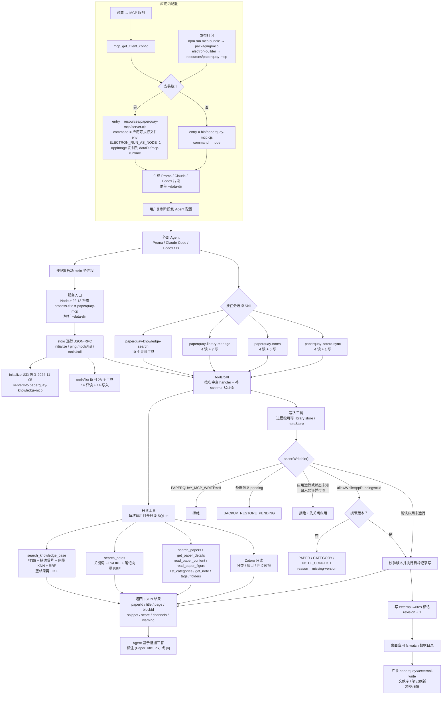

# MCP、Skills 与外部 Agent 调用流程

> 核对基线：`c197e32`（0.4.40），2026-11-25。对象是 PaperQuay 随安装包发布的 `paperquay-knowledge-mcp` 服务、仓库 `skills/` 下的四个作业规范，以及 Proma / Claude Code / Codex / Pi 等外部 Agent 的接入方式。
>
> 主要入口：`bin/paperquay-mcp.cjs`（stdio 传输）→ `electron/mcp/mcpTools.cjs`（工具注册与 JSON-RPC）→ `electron/mcp/knowledgeMcpService.cjs`（数据与业务）。客户端配置由 `electron/backend/mcpClientConfig.cjs` 生成，设置页在 `src/app/settings/McpSettingsSection.tsx`。

## 图 2：MCP 服务、Skills 与外部 Agent



> Skills 是仓库里的 Markdown 作业规范，不是应用安装的插件，也不会被 MCP 服务执行或校验。外部 Agent 需要自己加载 / 复制这些 Skill；图里的 `SK` 是 Agent 侧的决策，不是服务端的分支。

## 1. 两条调用路径

MCP 有两条互相独立的路径，容易混淆：

| 路径 | 发起方 | 做什么 |
| :--- | :--- | :--- |
| 应用内“生成配置” | PaperQuay 设置页 | 调用 `mcp_get_client_config`，读取安装路径、数据目录、Node 版本，生成 Proma / Claude / Codex 三种配置片段，供用户复制。应用**不会**替外部 Agent 启动服务，也不会写客户端配置文件。 |
| 外部 Agent 调用 | Proma / Claude Code / Codex / Pi | Agent 按自己的配置启动 `server.cjs` / `paperquay-mcp.cjs` 子进程，通过 stdin/stdout 发 JSON-RPC。 |

### 1.1 安装版 vs 开发版

| | 安装版 | 开发版 |
| :--- | :--- | :--- |
| 服务入口 | `resources/paperquay-mcp/server.cjs` | `bin/paperquay-mcp.cjs` |
| 启动命令 | 应用可执行文件（如 `PaperQuay.exe`） | `node` |
| 参数 | `[entry, '--data-dir', <数据目录>]` | `[<仓库>/bin/paperquay-mcp.cjs, '--data-dir', <数据目录>]` |
| 环境变量 | `ELECTRON_RUN_AS_NODE=1` | 无 |
| Node 要求 | 用应用内嵌 Electron 作为 Node，不需要另装 | 系统 Node ≥ 22.13（`package.json` engines 要求 ≥ 22.18） |

AppImage 特例：`mcp_get_client_config` 会把 `resources/paperquay-mcp` 复制到 `<数据目录>/mcp-runtime`，让配置指向稳定路径；如果准备失败，会回退到挂载目录并在设置页显示 `stable` / `appdir` / `mount` 状态提示。

### 1.2 生成的片段

| 客户端 | 格式 |
| :--- | :--- |
| Proma | `{"servers":{"paperquay":{"type":"stdio","command":...,"args":[...],"env":{...},"enabled":true}}}` |
| Claude Code / Claude Desktop / Pi | `{"mcpServers":{"paperquay":{"command":...,"args":[...],"env":{...}}}}` |
| Codex | `[mcp_servers.paperquay]` TOML，`command`、`args`、`env = { ... }` |

设置页同时显示：安装版 / 开发版、入口路径、入口是否存在、内嵌 Node 版本、系统 Node 版本、`--data-dir` 说明、客户端下拉框、复制按钮和只读文本框。

## 2. 启动与协议

| 步骤 | 实际行为 | 代码位置 |
| :--- | :--- | :--- |
| Node 检查 | 低于 22.13 直接退出，并提示用应用内嵌 Electron 或升级 Node。 | `bin/paperquay-mcp.cjs:20-32` |
| 进程标题 | 改为 `paperquay-mcp`，避免 `pgrep -x PaperQuay` 把 MCP 自身误判为桌面应用。 | `bin/paperquay-mcp.cjs:57-64` |
| 参数 | 只解析 `--data-dir <path>` 和 `--data-dir=<path>`。 | `bin/paperquay-mcp.cjs:35-49` |
| 数据目录 | 优先级：`--data-dir` → `PAPERQUAY_DATA_DIR` → 平台候选目录中第一个含 `paperquay-library.sqlite` 或 `paperquay-rag.sqlite` 的目录。 | `electron/mcp/knowledgeMcpService.cjs:394-446` |
| 传输 | readline 逐行读 stdin；每行一个 JSON-RPC 对象；stdout 每行一个响应；stderr 打日志；没有 `Content-Length` 帧。 | `bin/paperquay-mcp.cjs:86-135` |
| 生命周期 | 一个进程一个 `PaperQuayKnowledgeService`；stdin 关闭、`exit`、`SIGINT`、`SIGTERM` 时关闭服务。 | `bin/paperquay-mcp.cjs:51-84` |
| 协议方法 | 只实现 `initialize`、`ping`、`tools/list`、`tools/call`；通知只处理 `notifications/initialized`。 | `electron/mcp/mcpTools.cjs:830-925` |
| `initialize` | 固定返回 `protocolVersion: '2024-11-05'`，`capabilities.tools.listChanged = false`，`serverInfo.name = 'paperquay-knowledge-mcp'`，版本取 `package.json`。 | `electron/mcp/mcpTools.cjs:843-855` |
| `tools/list` | 返回完整 28 个工具描述，只有 `name` / `description` / `inputSchema`；没有 `annotations`、`readOnlyHint`、`outputSchema`，没有分页。 | `electron/mcp/mcpTools.cjs:862-866` |
| `tools/call` | 必须有 `params.name`；每次调用按名字构建 handler 映射；先补 schema 顶层默认值；未知工具报 `Unknown tool`。 | `electron/mcp/mcpTools.cjs:739-805, 868-915` |
| 成功结果 | `content: [{type:'text', text: JSON.stringify(data, null, 2)}]`，`isError:false`；`read_paper_figure` 的图片在 8 MiB 内额外返回一个 `image` content block。 | `electron/mcp/mcpTools.cjs:868-915` |
| 错误结果 | `isError:true`，文本为 `Error executing <tool>: [CODE: ]<message>`，可附 JSON `details`。 | `electron/mcp/mcpTools.cjs:900-914` |
| 并发 | `handleMessage` 对每行是 fire-and-forget，多个 `tools/call` 可能并行；服务内部没有全局串行锁。 | `bin/paperquay-mcp.cjs:86-108` |

## 3. 工具目录（28 个：14 只读 + 14 写入）

### 3.1 只读工具

| 工具 | 数据 / 能力 | 关键默认值与上限 | 覆盖 Skill |
| :--- | :--- | :--- | :--- |
| `search_papers` | 文献元数据：标题、中文标题、作者、期刊、DOI、标签、关键词 | `limit` 默认 10，最大 50；可按 `tag`、`categoryId` 过滤 | knowledge-search、library-manage |
| `get_paper_details` | 单篇完整元数据、摘要、笔记、引用、附件、`updatedAt`、`ragEnabled` | `paperId` 必填 | knowledge-search、library-manage |
| `search_knowledge_base` | RAG 证据：文献、页码、块 ID、片段、分数、通道 | `limit` 默认 8，最大 30；`mode` = auto / hybrid / keyword | knowledge-search |
| `read_paper_content` | 文献正文分块，可按页读取 | `pageIndex` 从 0 开始；`limit` 默认 20，最大 100 | knowledge-search |
| `read_paper_figure` | MinerU 图表块；表格返回结构化文本，图片在 8 MiB 内返回 image block | `paperId` + `blockId` 必填，`pageIndex` 可回退 | knowledge-search |
| `search_notes` | 笔记检索：关键词 / 混合 | `limit` 默认 10，最大 50；可按 `paperId`、`pageKind` 过滤 | knowledge-search、notes |
| `get_note` | 笔记正文、标签、文件夹、双链、锚点、`contentJson` / `contentFormat`、`updatedAt` | `offset` 默认 0；`limit` 默认 12000，最大 20000；锚点最多 100 条；`contentJson` 超过 2,000,000 字符时省略并置 `contentJsonTruncated` | knowledge-search、notes |
| `list_note_tags` | 标签与使用次数 | 可按 `paperId` 过滤 | knowledge-search、notes |
| `list_note_folders` | 笔记文件夹树与 `updatedAt` | 无参数 | knowledge-search、notes |
| `zotero_list_collections` | 本地 Zotero 分类树与条目数 | `dataDir` 可覆盖自动探测 | zotero-sync |
| `zotero_search_items` | 本地 Zotero 条目检索 | `limit` 默认 50，最大 200 | zotero-sync |
| `zotero_preview_sync` | 同步预检：`ready` / `alreadyExists` / `missingPdf` | `itemKeys` 或 `collectionKey` | zotero-sync |
| `list_categories` | 文库分类树、父级、排序、文献数 | 无参数；注意它打开的是可写 library store，不是只读连接 | knowledge-search、library-manage、zotero-sync |
| `preview_delete_papers` | 删除预览：`updatedAt`、附件、将删文件、共享 / 非受管文件、`previewVersion` | `paperIds` 必填；`deleteFiles` 默认 false；read-only | library-manage |

### 3.2 写入工具

| 工具 | 数据 / 能力 | 关键默认值与版本要求 | 覆盖 Skill |
| :--- | :--- | :--- | :--- |
| `paperquay_sync_from_zotero` | 从 Zotero 导入选定条目或分类，复制 PDF、建分类 | 需先预览；`createCollectionCategory` 默认 true；**不校验 `expectedUpdatedAt`** | zotero-sync |
| `import_pdfs` | 批量导入本地 PDF，按内容哈希 / DOI / 标题查重 | `paths` 必填；`importMode` 取显式值 → 文库设置 → `copy` | library-manage |
| `manage_category` | 建、改名、移动、删除分类 | 改名 / 移动 / 级联删除需 `expectedUpdatedAt` 或 `expectedCategoryVersions`；系统分类不可改 | library-manage |
| `set_paper_categories` | 批量加 / 减 / 替换分类 | 整批事务；任一版本冲突整批不写 | library-manage |
| `update_paper` | 白名单元数据更新 | `expectedUpdatedAt`；未知字段报错；冲突 `PAPER_CONFLICT` | library-manage |
| `delete_papers` | 批量删除文献；可选删文件 | 应用运行 / 状态未知时需 `previewVersion`；先提交数据库再删受管且未共享文件 | library-manage |
| `attach_translated_pdf` | 附加翻译版 PDF，替换旧翻译版 | `paperId` + `sourcePath`；页数不一致返回 `pageCountMismatch`，但不拒绝 | library-manage |
| `remove_translated_pdf` | 移除翻译版 PDF | 默认 `deleteFile: true`；先提交数据库再删文件 | library-manage |
| `create_note` | 新建笔记，自动解析 `[[双链]]` 与 `#标签` | `title` / `content` 至少一个非空；`tags` 最多 30；`type` 默认 `standalone` | notes |
| `update_note` | 局部更新标题、正文（`content` 或结构化 `contentJson`）、标签、`pageKind`、`folderId`、`paperId` | 需 `expectedUpdatedAt`；`content` 与 `contentJson` 不能同时传；含锚点笔记必须保留全部 `paperquay://anchor/<id>`，否则 `NOTE_ANCHOR_MISSING` | notes |
| `delete_note` | 软删除并移出全文索引 | 需 `expectedUpdatedAt` | notes |
| `create_note_folder` | 新建文件夹，可嵌套 | `name` 必填 | notes |
| `rename_note_folder` | 重命名文件夹 | 需 `expectedUpdatedAt` | notes |
| `delete_note_folder` | 删除文件夹及子文件夹，笔记移到未分类 | 目标版本 + `expectedFolderVersions`；任一变化整批拒绝 `NOTE_CONFLICT` | notes |

> `preview_delete_papers` 在 `docs/MCP_AGENT_INTEGRATION.md` 的“写入：文库管理”表里，但代码中它没有 `allowWhileAppRunning`，使用只读连接；14 / 14 的划分按“只读”计。

## 4. 检索流程

### 4.1 `search_knowledge_base`

```text
归一化 mode → 读 Embedding 开关 → 打开只读 RAG 库
→ FTS5 关键词召回（+ 单篇精确信号）
→ 解析 Embedding 配置、选维度 / 模型键、向量化查询
→ sqlite-vec KNN
→ 异步等待后重新校验排除项、chunk 文本、ready 状态
→ 双通道 RRF（只命中一个通道时直接用该通道）
→ 融合结果为空才走 LIKE
→ 邻接片段扩展
→ 返回 paperId / paperTitle / pageNumber / blockId / snippet / score / channels
```

关键规则：

| 步骤 | 规则 |
| :--- | :--- |
| `mode` | `auto`：有可用配置走混合，否则关键词；`hybrid`：强制尝试向量，失败降级并给 `warning`；`keyword`：只走关键词，不发网络请求。 |
| 向量开关 | `PAPERQUAY_MCP_EMBEDDING=off` 时关闭向量通道。 |
| 排除文献 | `ragEnabled: false` 的文献不参与检索；异步等待后会再次读取排除集合并过滤。 |
| FTS | 复用 `buildFtsMatchQuery()`，与阅读器相同的公式 / 文献 / 短符号 / 混合语言词项；`limit` 默认 8，最大 30；候选数为 `min(100, 2×limit)`。 |
| 精确信号 | 只有传了 `paperId` 且该文献未被排除时才执行；扫描单篇范围，公式 / 文献 / 短符号打分后并入 FTS 行。 |
| 向量 | `resolveEmbeddingConfig()` 要求 baseUrl / model，apiKey 可为空；模型键为 `<baseUrl>::<model>::<dimensions 或 default>`；维度必须已注册且模型键匹配；查询向量维度必须与索引维度一致。 |
| KNN | `k = min(4096, max(candidateLimit, 该范围已就绪向量数))`；按 `distance` 升序；只查 ready、模型键 / 签名匹配、非排除文献。 |
| 融合 | 双通道都有结果时 `rrfFuse(k=60)`，`score = 1 - rrfScore`；只有一个通道时直接用该通道。 |
| LIKE 降级 | 只有融合结果为 0 时才执行；部分命中不会触发 LIKE。 |
| 邻接片段 | `assembleNeighborSnippets()`：半径 3 个 chunk，最多 1600 字符，只在短片段 / LaTeX 片段处桥接。 |
| 返回 | `query`、`retrievalMode`（hybrid / keyword）、`embeddingModel`（实际用了向量时）、`warning`、`results`、`total`；每条含 `documentKey` / `paperId`、`paperTitle`、`chunkId`、`text`、`snippet`、`score`、`pageIndex`、`pageNumber`、`sourceType`、`blockId`、`channels`。 |

### 4.2 `search_notes`

| 步骤 | 规则 |
| :--- | :--- |
| 关键词 | 先算关键词结果；`notes_fts MATCH` 的每个 token 至少 3 字符，否则 / FTS 失败时走 LIKE；通道标记 `fts` / `like`。 |
| 混合条件 | `mode ≠ keyword`、`PAPERQUAY_MCP_EMBEDDING ≠ off`，且 `resolveNoteEmbedding()` 成功（笔记向量要求 API key）。 |
| 笔记向量 | 每篇笔记一条向量，`k=1`；只覆盖标题和可编辑正文，不含锚点证据与原文快照；向量 id / 签名与当前正文一致才采用。 |
| 融合 | 笔记向量与关键词结果 RRF；检索后再次确认笔记未删除、正文签名未变。 |
| 空查询 | 按置顶 / 更新时间列出笔记。 |
| 降级 | 未配置 Embedding、没有匹配向量、向量调用失败都会返回 `keyword` + 中文 `warning`。 |

### 4.3 其他只读工具

- `search_papers`：按标题、中文标题、作者、期刊、DOI、标签、关键词检索元数据；`limit` 默认 10，最大 50；可按分类（含后代）过滤。
- `get_paper_details`：完整元数据、摘要、笔记、引用、附件、`updatedAt`、`ragEnabled`；附件区分原版 PDF 与翻译版 PDF。
- `read_paper_content`：按页或顺序读结构化正文；`pageIndex` 从 0 开始，`limit` 默认 20，最大 100。
- `read_paper_figure`：读 MinerU 图表块；支持 `content_list` 等缓存变体；图片超过 8 MiB 或缺失时只返回元数据与图注；表格返回结构化文本。
- `get_note`：分页读正文（`offset` / `limit`），返回标签、文件夹、双链、锚点、`contentJson`、`contentFormat`、`updatedAt`、`nextOffset`；`contentJson` 超过 2 MB 时省略。
- `list_categories`：分类树与文献数；代码里打开的是可写 library store，不是只读连接。

## 5. 写入与护栏

所有写入工具（包括 Zotero 同步、笔记、文件夹）都先走 `assertWritable()`，顺序固定：

```text
1. PAPERQUAY_MCP_WRITE=off                      → 直接拒绝
2. <数据目录上级>/PaperQuay-restore/pending.json → BACKUP_RESTORE_PENDING
3. 判断桌面应用是否运行
   ├─ 运行标记：缺失 = 未运行；损坏 / 不可读 = 未知；PID 存活 = 运行
   └─ 进程检测：Windows 用 tasklist + PowerShell 排除 paperquay-mcp 命令行；
      其他平台用 pgrep -x PaperQuay；排除自身 PID
4. 默认 allowWhileAppRunning = false
   ├─ 运行 = true  → 拒绝
   ├─ 运行 = null  → 保守拒绝
   └─ 运行 = false → 允许
5. allowWhileAppRunning = true
   ├─ 运行或未知 → requireVersion = true
   └─ 确认未运行 → requireVersion = false（兼容旧客户端）
6. 执行写入 → 更新 external-writes 标记
```

版本与冲突：

| 场景 | 返回 |
| :--- | :--- |
| 文献版本缺失 / 过期 | `PAPER_CONFLICT`，`details.reason = missing-version` 或当前 `updatedAt` |
| 分类版本缺失 / 过期 | `CATEGORY_CONFLICT` |
| 笔记 / 文件夹版本缺失 / 过期 | `NOTE_CONFLICT` |
| 删除文献需要预览版本但未带 | `PAPER_CONFLICT` / 预览版本错误 |
| 删除文件夹需要 `expectedFolderVersions` 但缺失 / 过期 | `NOTE_CONFLICT` |
| 更新含锚点笔记但新正文丢了锚点 | `NOTE_ANCHOR_MISSING` |
| 备份恢复待应用 | `BACKUP_RESTORE_PENDING`（`allowWhileAppRunning` 不能覆盖） |

写入提交后：

1. `markExternalWrite('library' | 'notes')` 在 `.paperquay-external-writes.sqlite` 中原子递增 revision；失败只记日志，不回滚写入。
2. 桌面应用 `fs.watch` 数据目录，发现标记变化后广播 `paperquay://external-write`。
3. 文献库刷新列表 / 分类 / 快照；正在编辑的详情表单显示“外部更新”提示，保存冲突时显示冲突横幅。
4. 笔记工作区刷新列表；打开中的编辑器显示外部更新横幅，用户可刷新。

## 6. Skills

仓库 `skills/` 下有四个 Skill，都是 Markdown 作业规范，只有 `name` / `description` frontmatter 和正文；没有 `allowed-tools`、版本号或权限声明，也没有应用侧安装 / 注册逻辑。

| Skill | 触发 | 声明的工具 | 规定顺序 / 确认门槛 |
| :--- | :--- | :--- | :--- |
| `paperquay-knowledge-search` | 问已入库论文或笔记 | 10 个只读：`search_papers`、`get_paper_details`、`list_categories`、`search_knowledge_base`、`read_paper_content`、`read_paper_figure`、`search_notes`、`get_note`、`list_note_tags`、`list_note_folders` | 先 `search_papers` 找 ID → `search_knowledge_base` 取证据 → 需要时 `read_paper_content` 读上下文 → 图表用 `read_paper_figure` → 笔记用 `search_notes` / `get_note`。要求保留 `paperId`、页码、块 ID，不得编造来源。 |
| `paperquay-library-manage` | 导入、分类、改元数据、删文献 | 4 个只读 + 7 个写入：`search_papers`、`get_paper_details`、`list_categories`、`preview_delete_papers`；`import_pdfs`、`manage_category`、`set_paper_categories`、`update_paper`、`delete_papers`、`attach_translated_pdf`、`remove_translated_pdf` | 先读 `updatedAt` → 展示变更并确认 → 写入 → 回读。删除必须先 `preview_delete_papers`，展示附件 / 共享文件，再二次确认，带 `previewVersion` 删除。 |
| `paperquay-notes` | 整理论文卡、概念笔记、综述、摘录、文件夹 | 4 个只读 + 6 个写入：`search_notes`、`get_note`、`list_note_tags`、`list_note_folders`；`create_note`、`update_note`、`delete_note`、`create_note_folder`、`rename_note_folder`、`delete_note_folder` | 先读后写；`update_note` 带 `expectedUpdatedAt`；锚点不可丢；冲突时重新读取合并重试；写入后回读。 |
| `paperquay-zotero-sync` | 从本地 Zotero 选择性导入 | 4 个只读 + 1 个写入：`zotero_list_collections`、`zotero_search_items`、`zotero_preview_sync`、`list_categories`；`paperquay_sync_from_zotero`；流程里还会用 `search_papers` / `get_paper_details` 回读 | 先列分类 / 检索条目 → 每次导入前 `zotero_preview_sync` → 展示 `ready` / `alreadyExists` / `missingPdf` → 用户确认条目与目标分类 → 导入 → 回读。 |

覆盖关系：四个 Skill 的并集正好覆盖 28 个工具；但没有测试强制要求“新增工具必须归入某个 Skill”，也没有应用侧的 Skill 安装 / 注册机制。

## 7. 打包与发布

```text
npm run mcp:bundle
  → scripts/bundle-mcp.cjs
  → packaging/mcp/server.cjs（esbuild 打包 bin/paperquay-mcp.cjs）
  → packaging/mcp/ragWorker.cjs
  → packaging/mcp/sql-wasm.wasm
  → packaging/mcp/node_modules/sqlite-vec*
  → packaging/mcp/bundle-manifest.json

electron-builder
  → extraResources: packaging/mcp → resources/paperquay-mcp

afterPack
  → 断言 server.cjs / ragWorker.cjs / sql-wasm.wasm / sqlite-vec 平台二进制存在
  → 审计 bundle-manifest.json 的版本、入口 hash、工具数
```

注意：

- `electron:build` 不会自动执行 `mcp:bundle`；改过 `bin/`、`electron/mcp/` 或工具后要手动重跑。
- 当前 `packaging/mcp/bundle-manifest.json` 记录 0.4.39，而 `package.json` 是 0.4.40；不重跑 bundle，`afterPack` 的版本审计会失败。
- 安装版启动用应用可执行文件 + `ELECTRON_RUN_AS_NODE=1`；开发版用系统 `node`。`node:sqlite` 的运行时门槛是 22.13，`package.json` engines 是 ≥ 22.18。

## 8. 已知差异与注意事项

1. **文档版本号落后**：`docs/MCP_AGENT_INTEGRATION.md` 头部写“适用版本 v0.4.39”，当前 `package.json` 与 `serverInfo.version` 都是 0.4.40。
2. **Node 版本口径不一致**：文档与设置页写 22.5，运行时检查要求 22.13，`package.json` engines 要求 ≥ 22.18。
3. **`preview_delete_papers` 的分类**：文档把它放在“写入：文库管理”表，但代码是只读（无 `allowWhileAppRunning`，只读连接）；14 只读 / 14 写入的划分按只读计。
4. **混合检索的 warning 不覆盖所有降级**：`PAPERQUAY_MCP_EMBEDDING=off` 或 RAG 库缺失时，`search_knowledge_base` 直接返回 keyword，不一定给 `warning`；只有缺配置、无索引、模型键不匹配、维度不一致、向量异常才给。
5. **LIKE 降级条件**：文档说分词失败 / 短词 / 特殊字符会 LIKE；`search_knowledge_base` 实际只在融合结果为空时才 LIKE，部分命中不会触发；`search_notes` 才会在短 token / FTS 失败时 LIKE。
6. **`list_categories` 不是只读连接**：它打开可写 library store，可能触发旧库迁移；其他只读工具用 `openReadOnlyDb`。
7. **Zotero 同步不校验版本**：`paperquay_sync_from_zotero` 不读取 `guard.requireVersion`，重复文献路径也不带 `expectedUpdatedAt`；受检并行写的版本保护在这条路径上不完整。
8. **`PAPERQUAY_MCP_EMBEDDING=off` 的大小写处理不一致**：`search_knowledge_base` 做了 trim + 小写，`search_notes` 用严格 `=== 'off'`。
9. **协议面较窄**：没有版本协商（固定 2024-11-05）、没有 `resources` / `prompts`、没有 `annotations` / `readOnlyHint` / `outputSchema`；客户端只能从描述推断读写。
10. **Skills 不会自动安装**：`skills/` 只是仓库文档；仓库副本与用户目录副本可能不同，外部 Agent 实际加载哪一份取决于它的 Skill 配置。
11. **外部写入通知是 best-effort**：`markExternalWrite` 失败只记日志，写入仍返回成功；`fs.watch` 失败会每 2 秒重试，没有强一致保证。

## 9. 关键文件

| 文件 | 作用 |
| :--- | :--- |
| `bin/paperquay-mcp.cjs` | stdio 传输、参数解析、Node 检查、进程生命周期。 |
| `electron/mcp/mcpTools.cjs` | 28 个工具 schema、handler 映射、JSON-RPC 分发。 |
| `electron/mcp/knowledgeMcpService.cjs` | 数据目录、只读 / 可写连接、检索、写入、护栏。 |
| `electron/shared/ragSearch.cjs` | 桌面端与 MCP 共用的 FTS / KNN / RRF / LIKE / 邻接片段。 |
| `electron/backend/mcpClientConfig.cjs` | 安装版 / 开发版布局、启动命令、Proma / Claude / Codex 片段、AppImage 运行时。 |
| `src/app/settings/McpSettingsSection.tsx` | 设置页“MCP 服务”区块、复制与诊断。 |
| `skills/paperquay-*/SKILL.md` | 四个外部 Agent 作业规范。 |
| `docs/MCP_AGENT_INTEGRATION.md` | 用户向接入指南与工具说明。 |
| `electron/mcpBundleManifest.cjs` | bundle manifest 生成与审计。 |
| `electron/afterPack.cjs` | 打包后 sqlite-vec 资产断言与 manifest 审计。 |
