# 侧边栏问答：检索与回答流程

> 核对基线：`c197e32`（0.4.40），2026-11-25。对象是阅读器右侧 `AssistantSidebar` 的“问答 / Chat”面板，不是 Notes、Graph 工作区。
>
> 主要入口：`src/features/reader/AssistantSidebar.tsx` → `assistantSidebarChat.tsx` → `src/features/reader/hooks/useReaderQa.ts`。检索与上下文装配在 `src/services/localRag.ts`、`src/features/reader/readerRag.ts`、`electron/backend/rag/retrieval.cjs`；回答在主进程 `electron/backend/aiCommands.cjs`。

## 图 1：一次提问的完整流程

```mermaid
flowchart TD
  ASK["用户在右侧边栏输入问题<br/>可选：选中摘录、图片 / 文件 / 截图"] --> CHECK{"前置检查<br/>当前文献、问题非空、<br/>问答模型已配置、会话未在回复"}
  CHECK -->|不通过| STOP["提示并停止"]
  CHECK -->|通过| MSG["写入 user 消息 + 空 assistant 占位<br/>会话标题取首条用户消息前 36 字"]
  MSG --> BUDGET{"模型预设填写了 contextWindow？"}
  BUDGET -->|是| TB["tokenBudget = contextWindow - maxOutputTokens<br/>- 估算最近 12 条消息 - 估算问题 - 800<br/>≤ 0 则直接报错"]
  BUDGET -->|否| TB0["tokenBudget 未定义<br/>后续不按上下文预算裁剪"]
  TB --> LOAD
  TB0 --> LOAD
  LOAD["按设置加载源文本<br/>PDF 文本 和 / 或 MinerU Markdown"] --> LOADERR{"加载失败？"}
  LOADERR -->|是| STOPERR["报错：先加载 PDF 或 MinerU"]
  LOADERR -->|否| RAGGATE{"RAG 门控<br/>qaRagEnabled 且 localRagEnabled<br/>且 ragSourceMode ≠ off"}
  RAGGATE -->|否| SCOPEGATE{"qaScopeMode"}
  RAGGATE -->|是| EMBCFG{"Embedding baseUrl / model / apiKey<br/>是否完整？"}
  EMBCFG -->|否| SCOPEGATE
  SCOPEGATE -->|current| FALLBACK{"按 qaSourceMode 回退"}
  SCOPEGATE -->|selected / library| NEEDRAG["报错：范围问答需要<br/>开启 RAG 与 Embedding 配置"]
  EMBCFG -->|是| SCOPE{"qaScopeMode"}
  SCOPE -->|current| EXCL{"当前文献 ragEnabled === false？"}
  EXCL -->|是| FALLBACK
  EXCL -->|否| RESOLVE["resolveLocalRag()<br/>当前文献完整路径"]
  SCOPE -->|selected| LOADDOC["逐篇加载选中文献<br/>结构块 / PDF 文本<br/>按 workspaceId + updatedAt 缓存"]
  SCOPE -->|library| LIBIDX["构建全库文献身份<br/>只读已就绪索引，不建索引"]
  LOADDOC --> SCOPED["resolveScopedLocalRag()<br/>selected：逐篇检索 + 引用重编号"]
  LIBIDX --> SCOPED2["resolveScopedLocalRag()<br/>library：全局 topK + 文献映射"]
  SCOPED --> SCOPEDOK{"retrieved？"}
  SCOPED2 --> SCOPEDOK
  SCOPEDOK -->|是| MERGEOUT["合并多篇 Source / 引用<br/>记录跳过文献"]
  SCOPEDOK -->|否| SCOPEERR["报错：列出未就绪 / 被排除 /<br/>无正文 / 缺 PDF 的文献"]
  MERGEOUT --> PROMPT["主进程组装 prompt<br/>system：Markdown 或 HTML 视觉规则<br/>user：Paper + Context + 最近 12 条消息"]
  RESOLVE --> PREP["prepareReaderRagDocument()<br/>MinerU 按块切分 / PDF 按页切分"]
  PREP --> SRC{"有可用来源？"}
  SRC -->|否| NOSRC["no-sources"]
  SRC -->|是| IDX{"每个来源的索引<br/>status=ready 且模型键一致？"}
  IDX -->|否| LAZY["ensurePreparedSourceIndexed()<br/>快速路径或批量 embedding 建索引"]
  LAZY --> IDXOK{"索引就绪？"}
  IDXOK -->|否| IDXFAIL["indexing / failed / excluded"]
  IDXOK -->|是| QUERY["构造检索文本<br/>有摘录：Question + Selected excerpt<br/>无摘录：问题原文"]
  IDX -->|是| STALE{"sourceSignature 变化？"}
  STALE -->|是| BG["后台 staging 重建<br/>本轮继续用旧索引回答"]
  STALE -->|否| QUERY
  BG --> QUERY
  QUERY --> EMBED["向量化查询<br/>OpenAI 兼容 /embeddings"]
  EMBED --> RET["逐来源检索<br/>topK = localRagTopK，默认 6"]
  RET --> VEC["向量通道<br/>sqlite-vec KNN，distance 升序"]
  RET --> FTS["关键词通道<br/>FTS5 trigram + buildFtsMatchQuery"]
  RET --> EXACT["精确信号预扫<br/>公式 / 文献编号 / 短符号"]
  VEC --> FUSE{"FTS 或精确信号有命中？"}
  FTS --> FUSE
  EXACT --> FUSE
  FUSE -->|是| RRF["RRF k=60 融合<br/>score = 1 - Σ 1/(60+rank+1)"]
  FUSE -->|否| VECONLY["仅向量结果<br/>保留原始 distance"]
  RRF --> MERGE["多来源时合并<br/>相关性过滤 + MinerU 优先<br/>同页纯向量 PDF 去重"]
  VECONLY --> MERGE
  MERGE --> CTX["buildRagContextText()<br/>取 topK 作为种子"]
  CTX --> EXPAND["读入上下文<br/>标题扩章 / 邻接扩展<br/>公式与文献编号确定性补全"]
  EXPAND --> BUDGET2["预算裁剪<br/>单目标 1500 / 整问 6000 token<br/>再按 tokenBudget 丢尾段或硬截断"]
  BUDGET2 --> RENDER["渲染 Source [n] 段落<br/>生成引用对象"]
  RENDER --> HASCTX{"生成出可用上下文？"}
  HASCTX -->|是| PROMPT
  HASCTX -->|否| EMPTY["empty"]
  NOSRC --> FALLBACK
  IDXFAIL --> FALLBACK
  EMPTY --> FALLBACK
  FALLBACK -->|pdf-text| PDF["PDF 全文按 tokenBudget 截断"]
  FALLBACK -->|mineru-markdown| MD["MinerU Markdown 按 tokenBudget 截断"]
  PDF --> PROMPT
  MD --> PROMPT
  PROMPT --> STREAM["流式请求 OpenAI 兼容接口<br/>requestId + AbortController"]
  STREAM --> DELTA["IPC 事件 paperquay://qa-stream<br/>delta / done / error"]
  DELTA --> FINISH{"结束状态"}
  FINISH -->|成功| COMMIT["一次性提交回答<br/>保留 qaContext 与 citations"]
  FINISH -->|手动停止| PARTIAL["有部分文本则保留<br/>否则删除占位"]
  FINISH -->|错误| ERROR["有部分文本则提交<br/>否则删占位并提示"]
  COMMIT --> UI["渲染回答<br/>[n] 引用可点击、可查看上下文<br/>RAG 角标 / HTML 预览 / 保存为笔记"]
  PARTIAL --> UI
  ERROR --> UI
```

> 图里把 `qaScopeMode` 画成了三条路径：`current` 走当前文献的完整检索与全文回退；`selected` 逐篇加载选中文献的块 / PDF 文本后调用 `resolveScopedLocalRag()`，允许懒建索引；`library` 只读已就绪索引，不触发整库建索引。多文献范围没有“当前文献全文”可退，失败时直接列出未就绪 / 被排除 / 无正文的文献，避免拿当前文献冒充范围答案。

## 流程分解

### 1. 提问与前置检查

| 步骤 | 实际行为 | 代码位置 |
| :--- | :--- | :--- |
| 入口 | `AssistantSidebar` 的 Chat 面板；`activePanel === 'chat'` 时才挂载 `ChatWorkspacePanel`。浮动窗口复用同一面板。 | `src/features/reader/AssistantSidebar.tsx:228-314`；`src/features/reader/readerFloatingAssistantPanel.tsx` |
| 前置检查 | 必须有当前文献、非空问题、已选问答模型预设、模型已配置；同一会话正在回复时拒绝再次发送。 | `src/features/reader/hooks/useReaderQa.ts:528-551` |
| 消息落盘 | 先写 user 消息和空的 assistant 占位；会话标题取首条用户消息前 36 字；把会话加入 running 集合。 | `src/features/reader/hooks/useReaderQa.ts:553-586`；`documentReaderShared.ts:145-207` |
| 上下文预算 | 仅当预设 `contextWindow > 0` 时计算：`contextWindow - maxOutputTokens - 估算最近 12 条消息 - (估算问题 + 800)`；`≤ 0` 直接报错。未填 `contextWindow` 时 `tokenBudget` 为 `undefined`，后续不裁剪。 | `src/features/reader/hooks/useReaderQa.ts:614-631`；`src/features/reader/readerRag.ts:60-63` |
| 中止 | 每个会话一个 `AbortController`；切换文献、关闭标签页、点“停止”都会触发。`signal` 会传进 `resolveLocalRag()` / `resolveScopedLocalRag()`，因此当前文献与 `selected` 的索引、embedding、逐篇检索可以中止；`library` 分支的查询向量化和检索调用本身不接收 signal，只能中止外层等待。 | `src/features/reader/hooks/useReaderQa.ts:588-594, 779-794`；`src/services/localRag.ts:922-1179`；`src/features/reader/readerQaAbort.ts` |

### 2. 源文本与 RAG 门控

| 条件 | `current` 范围 | `selected` / `library` 范围 |
| :--- | :--- | :--- |
| `ragSourceMode` 为 `pdf-text` / `hybrid`，或 `qaSourceMode = 'pdf-text'` | 加载当前 PDF；`qaSourceMode = 'pdf-text'` 时没有 PDF 或没有可用文本直接报错。 | 当前文献的 PDF 文本按尽力加载，失败不阻塞；选中文献的 PDF 文本在 `selected` 分支逐篇加载。 |
| `ragSourceMode` 为 `mineru-markdown` / `hybrid`，或 `qaSourceMode = 'mineru-markdown'` | 加载当前 MinerU Markdown；`qaSourceMode = 'mineru-markdown'` 且 Markdown 与结构块都为空时直接报错。 | 当前文献按尽力加载；Markdown 缓存缺失时用 `buildMineruMarkdownDocument(flatBlocks)` 重建；选中文献用其结构块重建。 |
| RAG 开关关闭、`settings.localRagEnabled = false`、`ragSourceMode = 'off'` | `disabled`，回退到当前文献全文。 | 报错：多文献范围需要本地 RAG；不拿当前文献冒充范围答案。 |
| 当前文献 `ragEnabled === false` | `excluded`，回退到当前文献全文。 | 当前文献的排除状态不短路；由 `resolveScopedLocalRag()` 逐篇过滤。 |
| Embedding 的 baseUrl / model / apiKey 不完整 | `missing-embedding-config`，回退到当前文献全文。 | 报错：多文献范围需要 Embedding 配置。 |
| `selected` 且没有勾选任何文献 | — | 报错：至少选择一篇文献。 |
| 以上都通过 | 调用 `resolveLocalRag()`。 | 调用 `resolveScopedLocalRag()`。 |

默认值：`localRagEnabled = true`、`localRagTopK = 6`、`ragSourceMode = 'hybrid'`、`qaSourceMode = 'mineru-markdown'`（`src/features/reader/readerShared.ts:182-184, 220`）。

### 3. 索引准备与多文献范围

`current` 范围由 `resolveLocalRag()` 先按 `ragSourceMode` 组装来源：

- MinerU：按块切分。`page_header`、`page_footer`、`page_number`、`page_footnote` 被丢弃；标题维护 `sectionId` / `sectionPath`；`title`、`table` 单独成块；正文、公式、图注按同章节合并，单块目标 900 字符，超长按 900 字符切、120 字符重叠。
- PDF：按 `# Page N` 分页，每页再按同样的 900 / 120 规则切分；`chunkId` 形如 `pdf:<pageSection>:<index>`。
- 一个来源只有在“规范化文本非空且至少产出 1 个 chunk”时才会加入检索；MinerU Markdown 有文本但结构块为空时不会产生 MinerU RAG 来源。

索引状态：

| 状态 | 行为 |
| :--- | :--- |
| `status = 'ready'` 且 `embeddingModelKey` 一致 | 视为可用索引。 |
| 可用索引但 `sourceSignature` 变化（内容或 MinerU 抽取器版本变化） | 本轮继续用旧索引回答；同时后台 `rebuildSourceStaged` 暂存重建，不阻塞提问。 |
| 没有可用索引 | `ensurePreparedSourceIndexed()`：签名 / 模型 / 块数快速路径；否则批量 embedding 后写入并 finalize。失败会记录 `failed`，并进入 60 秒失败冷却。 |
| 最终没有 ready 来源 | 返回 `indexing`、`failed` 或 `excluded`。 |

多文献范围由 `resolveScopedLocalRag()` 处理：

| 范围 | 文档来源 | 索引策略 | 上下文 / 引用 |
| :--- | :--- | :--- | :--- |
| `selected` | 逐篇加载选中文献的结构块与 PDF 文本；当前已打开的文献直接复用；按 `workspaceId + updatedAt + PDF 路径` 缓存。没有文献记录或没有 PDF 的条目记为 `missing`。 | 逐篇调用 `resolveLocalRag()`，未就绪索引先懒建；每篇最多 `localRagTopK` 条证据；单篇预算 `max(300, floor(tokenBudget / 文献数))`。 | 合并各篇 `documentText`，把 `# Source [n]` 和引用 label 按篇整体后移，避免编号冲突；任一篇被跳过时 `partialSources = true`。 |
| `library` | 不读每篇正文；用 `notePaperCandidates` 构造全库 `WorkspaceItem`（没有 PDF 也保留身份与 `ragEnabled`）。 | 只读 `rag_list_index_statuses` 里 `status='ready'`、模型键匹配、属于当前文库且未被排除的索引；不触发整库建索引。 | 用一个全局 `localRagTopK` 检索；按文献交错排序，先保证每篇至少一条证据；用文献身份映射补 `paperId` / `paperTitle`。 |

### 4. 用什么词检索

一次提问会同时产生四类“检索词”，用途不同：

| 通道 | 输入文本 | 词项如何构造 | 数量 / 长度上限 | 排序 |
| :--- | :--- | :--- | :--- | :--- |
| 向量通道 | 完整查询文本：有选中摘录时为 `Question:\n<问题>\n\nSelected excerpt:\n<摘录>`，否则为问题原文 | 整段文本送 OpenAI 兼容 `/embeddings` 端点，得到查询向量；在 `sqlite-vec` 上做 KNN | `topK = localRagTopK`（默认 6，UI 可调 1-12，后端允许 1-100）；`candidateLimit = min(100, max(topK, topK*2))`；KNN 的 `k` 会扩到该范围内全部已就绪向量数，最多 4096 | `distance` 升序（越小越相关） |
| 关键词通道 | 同一查询文本，先去掉 `Question:/Selected excerpt:` 模板 | `buildFtsMatchQuery()` 按优先级拼词：① 公式编号的 4 种写法 `tag{N}`、`(N)`、`Eq. N`、`Eqs. N`；② 文献编号 `[N]`，两位数以上再加 `N.`；③ 短符号及其 LaTeX 变体；④ 混合语言分词（ASCII 整段、CJK ≤6 字整段、更长 CJK 按停用边界切分）；⑤ 问题词项不足 6 个时，补摘录前 400 字符的词项 | 去重后最多 32 个词项，空格转义后用 ` OR ` 连接；查询文本最多 2000 字符 | FTS5 `bm25`（越小越相关）；trigram 分词，初始化失败时退 `unicode61` |
| 精确信号预扫 | 原始查询文本 | 扫描当前范围内的 chunk，按公式编号、文献条目、短符号做正则匹配并打分：公式 12 / 被引公式 4；文献条目 10 / 方括号 4；下标符号 5 / 普通符号 3。最终 `score = -100 - exactScore` | 只有单篇范围（`documentKey`）且 FTS 可用时执行；结果并入 FTS 列表 | 分数越低越靠前；结果通道标记为 `fts`，不会单独标记 `exact` |
| 上下文补全词 | 原始问题 + 前 4 条种子文本 | 抽取公式编号（问题允许独立括号，种子不允许）、文献编号；用于后文“确定性补全” | 公式最多 6 个；文献最多 3 个 | 直接查找对应公式块 / 文献条目，不参与向量或 FTS 排序 |

要点：

- **向量通道和关键词通道用的是同一段查询文本，但处理方式不同**：向量保留 `Question:/Selected excerpt:` 模板；FTS 会把模板剥掉，优先用问题本身，摘录只在问题词项不足 6 个时补入。
- **精确信号不是独立通道**：桌面端 `searchFts()` 把精确命中合并进 FTS 行，最终 `channels` 只会出现 `vector` / `fts`；`readerRag.ts` 里判断 `channels.includes('exact')` 的代码在当前桌面检索路径中是死分支。
- **公式 / 文献编号既参与召回，也参与补全**：召回阶段它们变成 FTS 词项和精确预扫；装配阶段再用原始问题去本篇中确定性地找公式块或参考文献条目，解决跨页、被图表隔断导致的缺失。

### 5. 哪些检索结果会被读进上下文

`buildRagContextText()` 不是“把 topK 直接拼起来”，而是按下面的顺序装配：

| 阶段 | 读什么 | 规则 / 上限 | 是否占预算 |
| :--- | :--- | :--- | :--- |
| 种子 | 合并后的前 `topK` 条检索结果 | 默认 6 条，最多 12 条（UI 设置）；PDF 的 `pdf:0:0` 若文本以 `# Page N` 开头且与预处理 chunk 前缀兼容，会回填 `pageIndex` | 种子文本本身不占邻接预算 |
| 标题扩章 | 命中块是 MinerU 标题（`type='title'` 或文本像章节标题）时，按文档顺序读取后续块 | 直到下一个标题；最多 3 个块或 2400 字符；不检查 token 预算 | 不占 1500 / 6000 预算 |
| 邻接扩展 | 普通正文 / 公式命中块的前后邻接 chunk | 每个方向最多 6 步；遇到标题、跨 section、已使用块（第一步）停止；可穿透短图注和连续公式组；PDF 种子要求检索文本与预处理 chunk 完全一致 | 单目标 1500 token；整问 6000 token；两者取剩余较小值 |
| 公式补全 | 问题中提到的公式编号；以及前 4 条种子文本中出现的公式编号 | 最多 6 个编号；优先找公式块；找到后附带邻接上下文 | 邻接预算 `min(800, max(250, 剩余整问预算))` |
| 文献补全 | 问题中的文献编号；仅在“问来源”或问题里出现公式编号时，补种子文本中的文献编号 | 最多 3 个编号；在文末 / 参考文献区找条目；不再扩展邻接 | 不额外占邻接预算 |
| 去重 | 所有阶段按 `chunkId` 去重 | 已读过的块不会重复加入 | — |
| 预算裁剪 | 已装配的 `Source` 段落 | 若提供了 `tokenBudget`：从尾部丢弃“非补全”段落，至少保留第一段；只剩一段仍超预算时二分硬截断并加 `[truncated]` | 使用第 1 节的 `tokenBudget` |
| 渲染 | 每个保留段落 | 固定格式：`# Source [n]` + 锚点提示（`Page X`，有章节时加 ` · 最后一级标题`）+ 正文；公式块自动补 `$$` 包裹 | — |
| 引用对象 | 每个保留段落一个引用 | `id = cite:n`、`label = n`、来源类型、页码、`blockId`、`chunkId`、480 字符预览、`evidenceKind`（text / image / table / equation）、相关度分数、文献 ID / 标题 | — |

三个容易混淆的点：

1. **1500 / 6000 是检索上下文预算，不是模型上下文预算**。前者只约束邻接扩展和公式补全；后者是第 1 节由 `contextWindow` 算出的 `tokenBudget`，用于丢段落或截断全文。
2. **被预算丢掉的段落不会出现在 `documentText` 里，但仍会出现在 `retrievals` 返回值中**；UI 的“证据组数”按保留的 `Source` 段计数。
3. **多文献范围的装配方式不同**：`selected` 逐篇走同一装配链路，再把 `# Source [n]` 和引用 label 按篇整体偏移；`library` 调用 `buildRagContextText()` 时没有 `preparedSources` / `mineruBlocks`，因此不做标题扩章、邻接扩展和公式补全，只对检索到的 chunk 做 `Source` 渲染与文献身份映射。

### 6. 回答与渲染

| 步骤 | 实际行为 | 代码位置 |
| :--- | :--- | :--- |
| system prompt（Markdown 模式） | `Answer questions about the paper.` + 指定回答语言；要求检查 `$$...$$` / `\tag{n}` 和参考文献条目；上下文出现 `# Source [n]` 时，在每段末尾用 `[n]` 标注；只能使用上下文中存在的编号，不能猜来源。 | `electron/backend/aiCommands.cjs:598-617` |
| system prompt（HTML 模式） | `buildHtmlVisualQaPrompt()`：默认输出一个可嵌入的 HTML 片段；只用内联样式；禁止 `script` / `style` / `iframe` / 完整 HTML 文档；允许内联 SVG 画流程、箭头、简单图表；用 `[1]` 标注证据；只返回最终答案。 | `electron/backend/aiCommands.cjs:461-505` |
| user 消息 | `Paper: <title>\n\nContext:\n<documentText>`；`documentText` 为空时退化为 `blocks` 文本拼接。 | `electron/backend/aiCommands.cjs:594-617` |
| 历史消息 | 渲染进程只发送最近 12 条消息；主进程把附件扁平化为 `[Attachments]` + 名称 / 摘要 / 文本。 | `src/features/reader/hooks/useReaderQa.ts:684-701`；`electron/backend/utils.cjs:637-819` |
| 流式协议 | 渲染进程生成 `requestId`，调用 `ask_document_openai_compatible_stream`；主进程按 `${sender.id}:${requestId}` 保存 `AbortController`，逐行解析 SSE，把 delta 通过 `paperquay://qa-stream` 发回；取消走 `..._cancel` IPC。 | `src/services/qa.ts:45-104`；`electron/backend/aiCommands.cjs:893-952` |
| 流式状态 | delta 不写 `qaSessions`，只写 `readerQaStreamStore` 的 `(sessionId, messageId)` 临时条目；只有当前气泡重绘；`finish()` 删除条目。 | `src/stores/useReaderQaStore.ts`；`assistantSidebarChat.tsx:679-690` |
| 提交 | 成功后一次性提交完整回答，保留 `qaContext` 与 `citations`；错误或手动停止时，有部分文本就提交部分文本，否则删除空占位并提示。 | `src/features/reader/hooks/useReaderQa.ts:708-764` |
| 引用渲染 | Markdown 模式下把 `[n]` 改成 `[n](#cite-n)`，只改检索结果里存在的 label；点击后按 `blockId` 或页码定位；引用 chip 的“Context”按钮打开 `RagChunkContextPreview`，默认前后各 1 片，最多 8 片。 | `assistantSidebarChat.tsx:69-148, 783-867`；`RagChunkContextPreview.tsx`；`electron/backend/rag/retrieval.cjs:259-385` |
| 角标 / 提示 | `retrieved` 显示“本地 RAG · N 组”；`excluded` 显示“该文献已移出本地知识库”；其他状态显示“回退 · 来源”；tone 为 success / warning / neutral。 | `src/features/reader/readerQaContext.ts:194-239` |
| HTML 预览 | 只有消息 `renderMode = 'html'` 且内容包含可渲染 HTML 片段 / `html` 代码块时才走 iframe；iframe `sandbox="allow-same-origin"`，CSP `default-src 'none'`，只允许内联样式和 data/blob 图片。 | `assistantSidebarChat.tsx:470-652` |
| 保存为笔记 | 取当前显示文本，拼成 `## Question`（引用块）+ `## Answer`；引用转成 `NoteAnchor`，无法定位的引用单独列出。 | `src/features/reader/hooks/useReaderNotes.ts:613-671`；`readerQaNote.ts` |

### 7. 分支与回退矩阵

| 场景 | `current` 范围 | `selected` / `library` 范围 |
| :--- | :--- | :--- |
| 前置检查失败（无文献 / 空问题 / 无模型 / 会话回复中） | 提示并停止，不创建请求。 | 同左。 |
| `qaSourceMode = 'pdf-text'`，当前 PDF 缺失或无文本 | 报错，不调用模型。 | 当前文献按尽力加载；选中文献缺 PDF 记 `missing`，不阻塞其他文献。 |
| `qaSourceMode = 'mineru-markdown'`，Markdown 与结构块都为空 | 报错，不调用模型。 | 当前文献按尽力加载；选中文献用结构块重建 Markdown，仍为空则跳过。 |
| RAG 关闭 / `localRagEnabled = false` / `ragSourceMode = 'off'` | `disabled`，回退到当前文献全文。 | 报错：多文献范围需要本地 RAG。 |
| Embedding 配置不完整 | `missing-embedding-config`，回退到当前文献全文。 | 报错：多文献范围需要 Embedding 配置。 |
| 当前文献 `ragEnabled === false` | `excluded`，回退到当前文献全文。 | 不短路；由 `resolveScopedLocalRag()` 逐篇过滤。 |
| `selected` 没有勾选文献 | — | 报错：至少选择一篇文献。 |
| `resolveLocalRag` 返回 `no-sources` / `indexing` / `failed` / `empty` / 后端 `excluded` | 回退到当前文献全文。 | — |
| `resolveScopedLocalRag` 返回非 `retrieved` | — | 报错，并列出未就绪 / 被排除 / 无正文 / 缺 PDF 的文献；不调用模型。 |
| `resolveScopedLocalRag` 返回 `retrieved` | — | 用多篇证据回答；被跳过的文献写入 `qaContext.skippedPaperTitles`，`partialSources = true`。 |
| `library` 没有已就绪索引 | — | 返回 `indexing`，报错提示先完成索引。 |
| `tokenBudget ≤ 0` | 在检索前报错。 | 同左。 |
| 模型流式错误 / 手动停止 | 有部分文本则保留并提交；否则删除空占位。 | 同左。 |
| 请求期间文献 / 会话代际变化 | 丢弃本次回答；流式开始前的丢弃会给出提示，流式开始后的成功分支可能静默丢弃。 | 同左。 |

### 8. 实现现状与已知差异

> 2026-11-26：多文献 scope 已接入 `resolveScopedLocalRag()`；“选定文献 / 全库”不再退化成只查当前文献。下面保留仍然存在的差异。

1. **`channels: ['exact']` 是死分支。** 桌面端精确命中被并入 FTS 列表，结果只标记 `vector` / `fts`；`readerRag.ts:1461, 1497` 对 `exact` 的判断在当前路径不会命中。
2. **选中摘录只影响检索 query，不进入回答 prompt。** `options.excerptText` 只用于 `buildRagRetrievalQuery()`；`qaMessages()` 不读取 `excerptText`、`authors`、`year`。如果 RAG 关闭或回退全文，选中摘录不会出现在模型上下文里。
3. **`maxOutputTokens` 只参与预算计算，不会发给模型。** `OpenAICompatibleQaOptions` 没有该字段，请求对象也没有传；它只从 `contextWindow` 中扣除，用来限制证据量。
4. **RAG 开关是“每个阅读标签页”的，不是“每个会话”的。** 状态在 `useReaderQaStore` 里，文献签名变化时会重置为 `true`；`DocumentChatSession` 只持久化 `ragScopeMode` / `ragScopePaperIds`。
5. **`contextWindow` 为空时不做任何预算裁剪。** 类型注释和设置占位符提到 128k 回退，但 hook 只在 `contextWindow > 0` 时装箱；空值会让 `tokenBudget` 保持 `undefined`，`trimDocumentTextToTokenBudget()` 原样返回。
6. **设置页的“QA reasoning effort”不生效。** 请求发送的是标签页选择器里的 `qaReasoningEffort`（默认 `auto`），只有 temperature 来自 `getModelRuntimeConfig(settings, 'qa')`。
7. **`library` 范围只报告“部分来源未就绪”，不逐篇列出跳过文献。** `resolveScopedLocalRag()` 的 library 分支返回空 `skippedDocuments`，UI 依据 `partialSources` 给出 warning；`selected` 范围才会把跳过标题写入 `skippedPaperTitles`。
8. **`selected` 首次提问需要逐篇读盘。** 结构块和 PDF 文本按 `workspaceId + updatedAt + PDF 路径` 缓存；第一次选择多篇文献时可能比后续提问慢，缓存会随文献更新产生新键。
9. **`resolveLibraryPaperRagContext()` 仍没有生产调用点；`qaRequest.documentText === '__never__'` 仍没有生产者。** 这两处是遗留接口 / 防御分支。
10. **单来源时不会做混合重排。** `mergeHybridSourceRetrievals()` 在只有一个来源时直接返回该来源过滤后的列表；`1/(60+rank+1) + 0.002 + 0.025` 的统一定序只在 MinerU + PDF 双来源时生效。

### 9. 关键常量

| 常量 | 值 | 位置 |
| :--- | :--- | :--- |
| chunk 目标长度 / 重叠 | 900 / 120 字符 | `readerRag.ts:43-44` |
| chunk 最小软切点 | 0.58 × 900 = 522 字符 | `readerRag.ts:51, 141` |
| `localRagTopK` 默认 / UI 范围 | 6 / 1-12 | `readerShared.ts:183, 731-737` |
| 后端 topK 范围 / 候选数 | 1-100，默认 6 / `min(100, 2×topK)` | `electron/backend/rag/retrieval.cjs:25, 191-196` |
| 向量 KNN 上限 | 4096 | `electron/shared/ragSearch.cjs:423` |
| RRF k | 60 | `electron/shared/ragSearch.cjs:17` |
| 向量相关性阈值 | `clamp(0.4×abs(best), 0.12, 0.45)` | `readerRag.ts:1433-1456` |
| 多来源重排加成 | 基础 `1/(60+rank+1)`；MinerU `+0.002`；关键词命中 `+0.025` | `readerRag.ts:1499-1501` |
| 单目标 / 整问邻接预算 | 1500 / 6000 token | `readerRag.ts:53-54` |
| `selected` 单篇证据预算 | `max(300, floor(tokenBudget / 文献数))` | `src/services/localRag.ts:978-980` |
| 标题扩章 | 3 块 / 2400 字符 | `readerRag.ts:48-49` |
| 邻接步数 | 每方向 6 步 | `readerRag.ts:47` |
| 公式 / 文献补全上限 | 6 / 3 个编号 | `readerRag.ts:1273, 1334` |
| FTS 词项 / 查询文本上限 | 32 个 / 2000 字符 | `ragQueryUtils.cjs:216-266`；`retrieval.cjs:212` |
| 引用预览 | 480 字符 | `readerRag.ts:999-1002` |
| Embedding 批量 | 默认 24，范围 1-100 | `readerShared.ts:215`；`embeddingConfig.cjs` |

### 10. 关键文件

| 文件 | 作用 |
| :--- | :--- |
| `src/features/reader/hooks/useReaderQa.ts` | 提问、会话、预算、范围分支、检索调用、流式提交、中止。 |
| `src/features/reader/readerQaScope.ts` | 选中文献的块 / PDF 文本加载与缓存、全库文献身份、范围失败文案。 |
| `src/services/localRag.ts` | 索引状态、懒建、暂存重建、逐来源检索、结果合并、多文献范围检索。 |
| `src/features/reader/readerRag.ts` | 切块、检索 query、上下文装配、预算、引用对象。 |
| `src/shared/ragQueryUtils.cjs` | FTS 词项、公式 / 文献编号、短符号、精确信号判断。 |
| `electron/backend/rag/retrieval.cjs` | 桌面端检索入口：向量 + FTS + 精确预扫 + RRF。 |
| `electron/shared/ragSearch.cjs` | 桌面端与 MCP 共用的 KNN / FTS / RRF / LIKE / 邻接片段。 |
| `electron/backend/aiCommands.cjs` | prompt 组装、流式模型调用、取消。 |
| `src/features/reader/readerQaContext.ts` | 角标、提示、状态文案。 |
| `src/features/reader/assistantSidebarChat.tsx` | 聊天 UI、引用点击、HTML 预览、消息渲染。 |
