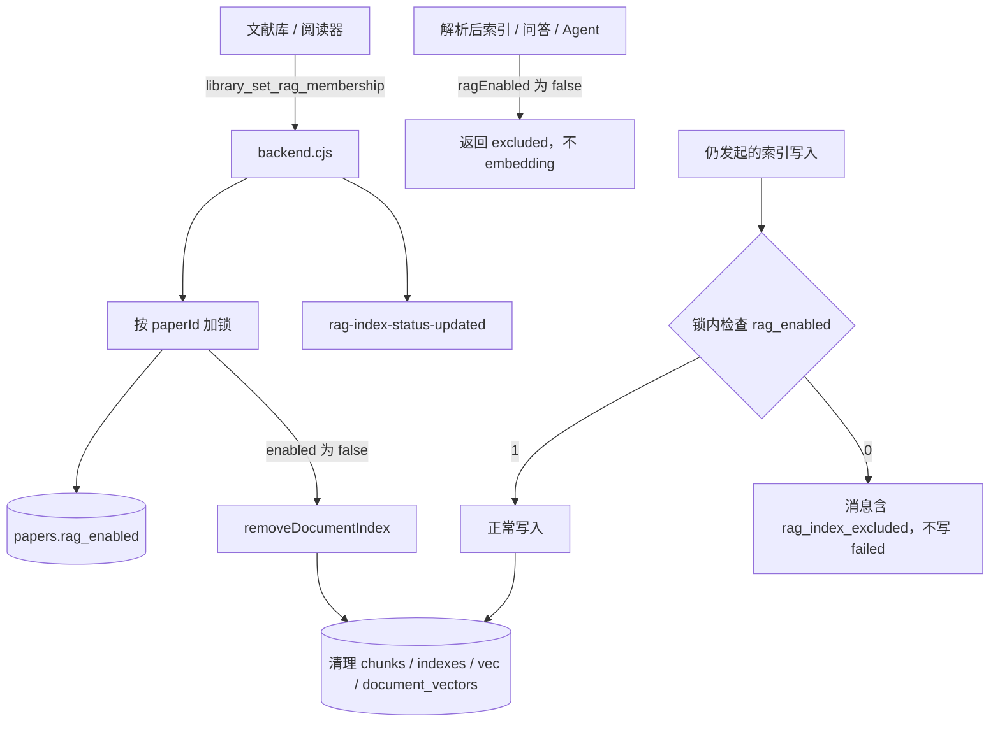

# 文献级 RAG 索引开关（加入/移出本地知识库）计划

- 日期：2026-10-26
- 状态：**implemented（2026-10-26）**；同日按当前代码修订后实施
- 范围：文献库数据模型、后端命令、RAG 索引门禁与清理、文献库与阅读器 UI、MCP 只读字段
- 关联：`docs/plans/2026-09-23-performance-reader-outline-and-rag-context.md`、`docs/MCP_AGENT_INTEGRATION.md`、`docs/USER_MANUAL.zh-CN.md`

## 结论

逐篇记录“不参与本地 RAG”。关闭时删掉该文献的索引派生数据，并拒绝之后的索引写入。

排除标记放在文献库 `papers.rag_enabled`，**不得**进入 `PAPER_TABLE_COLUMNS` / `paperRowValues`。全量保存沿用 `paper_references` 的做法：清表前缓存，插入后写回。

唯一对外命令是 `library_set_rag_membership`。不要再拆一个只改标记的 IPC，也不要再拆一个只删索引的 IPC。

## 边界

开关只影响本地 RAG 索引，以及依赖这份索引的检索：

- 阅读器问答的 RAG 切片
- Agent 的 RAG 切片与后台补索引
- MCP `search_knowledge_base`、`read_paper_content`
- 图谱里由 `rag_document_vectors` 算出的文献相似度（`electron/backend/knowledgeGraphCommands.cjs`）

开关不改变这些行为：

- PDF 阅读、MinerU 解析、翻译、概览、笔记
- 图谱里的引用关系
- 阅读器问答和 Agent 单篇上下文在没有 RAG 命中时回退整篇文本

关闭不删除 PDF、MinerU 缓存或笔记。只删除 `paperquay-rag.sqlite` 里该 `document_key` 的索引派生数据。

阅读器问答在 RAG 未取到切片时，会改用整篇 PDF 文本或 MinerU 文本（`src/features/reader/DocumentReaderTab.tsx` 的 `resolveQaRequest`）。排除后问答仍要回答，并显示已移出；不得报错，也不得把这次当成索引失败。

Agent 单篇上下文同样会回退整篇文本（`src/services/libraryAgent.ts` 的 `loadPaperContext`）。排除不会让 Agent 跳过这本书。变少的是知识库检索和相似度，不是单篇全文。

## 现状

| # | 现状 | 缺口 |
|---|------|------|
| 1 | 索引入口有 4 类，见下表。没有全库后台扫描 | 4 类入口都不看逐篇开关 |
| 2 | `papers` 没有 RAG 列。索引用 `document_key = paper.id` 关联 | 无法表示“这篇不参与索引” |
| 3 | `ragStore.removeNoteIndex` 只删 `note:${id}`。文献删除可复用 `deleteDocumentSourceData` | 没有按文献 `document_key` 删除的方法 |
| 4 | `libraryCommands.cjs` 与 `aiCommands.cjs` 互不引用，由 `electron/backend.cjs` 组装 | 没有同时改文献库和 RAG 库的命令 |
| 5 | 右键有“建立/重建 RAG 索引”（`LiteratureLibraryView.tsx`）。列表有索引角标。阅读器设置有索引概览（`readerPreferencesContent.tsx` 知识库索引管理） | 没有开关、排除态和批量加入/移出 |
| 6 | `get_paper_details` 虽然 `SELECT *`，返回对象是手写白名单，不会自动带出新列。`search_knowledge_base` / `read_paper_content` 只查 RAG 库 | 元数据看不到排除状态。索引删掉后，检索自然不再返回 |

索引入口：

1. 手动或批量：`src/features/reader/useReaderRagIndexActions.ts` → `indexLibraryPaperMineruSource`。
2. 解析完成后自动索引：`useReaderLibraryActions.ts` 的 `scheduleLibraryItemRagIndexing`；`useReaderLibraryBatchActions.ts` 在复用缓存和解析成功后也会调用。
3. 阅读器问答：`DocumentReaderTab.tsx` → `resolveLocalRag` → `ensurePreparedSourceIndexed`。
4. Agent：`libraryAgent.ts` 的 `resolveLocalRag({ syncIndexing: false })` 会在后台补索引。

`scripts/rag-index-build.mjs` 直接调用 `ragStore`，不走 IPC。该文件是个人脚本，本次不改。该脚本不受下面的 IPC 门禁约束。

`store.save()` 会 `clearData` 后整库重插（`libraryDatabaseStore.cjs` 的 `saveLibraryToDb`）。分类、导入、WebDAV 和 MCP 写入都走这条路径。`savePaper` 则是全列 UPSERT。阅读进度目前没有单独的高频写路径。

## 设计决策

### 决策 1：标记在 `papers` 上，但不进通用行写入

新增列：`papers.rag_enabled INTEGER NOT NULL DEFAULT 1`。

用 `ensureColumn` 加上。旧库默认全部为加入，升级后行为与现在一致。

读取：

- `PAPER_SELECT_COLUMNS` 增加 `rag_enabled AS ragEnabled`。
- `mapPaperRows` 写成 `ragEnabled: paper.ragEnabled !== 0`。

写入只允许两处：

1. `library_set_rag_membership` 执行 `UPDATE papers SET rag_enabled = ? WHERE id = ?`。
2. `saveLibraryToDb` 在 `clearData` 之前读出 `id, rag_enabled`，插完论文后按仍存在的 id 写回。做法与同函数里的 `referenceCache` 相同。

禁止：

- 把 `rag_enabled` 放进 `PAPER_TABLE_COLUMNS` 或 `paperRowValues`。
- 在 `UpdatePaperRequest` 里增加 `ragEnabled`。
- 用 `paper.ragEnabled ?? true` 参与 UPSERT。缺字段会把已排除的文献写回加入。
- 让内存里的 `paper.ragEnabled` 覆盖全量保存缓存。全量保存只恢复清表前的数据库值。切换开关必须走命令，不能靠改对象再 `save` / `savePaper`。

新插入的行不写该列，使用 `DEFAULT 1`。

### 决策 2：关闭要同时改标记并删除索引

关闭在同一把文献锁里做完两件事：

1. `rag_enabled = 0`。
2. 调用 `ragStore.removeDocumentIndex({ documentKey })`。

`removeDocumentIndex` 放在一个事务里：

1. 对 `mineru-markdown` 和 `pdf-text` 分别调用现有 `deleteDocumentSourceData`。
2. 再调用一次 `rebuildDocumentVectors`。没有剩余向量时，该函数会删掉 `rag_document_vectors` 行。
3. 不处理 `sourceType = 'note'`。笔记的 `document_key` 是 `note:${id}`。

`deleteDocumentSourceData` 会删 chunk、索引状态和向量行。`rag_chunks` 的 DELETE 触发器会同步 FTS。不要另写删除 SQL。

没有索引时也返回成功。返回 `{ removed: boolean }`。`removed` 表示删除前是否已有 `rag_indexes` 或 `rag_chunks` 行。

重新打开只把 `rag_enabled` 设为 1，不自动重建索引。重建仍走现有的手动或批量索引。

### 决策 3：主进程门禁是权威，前端在 embedding 之前跳过

只在 UI 判断会被绕过。权威检查放在主进程这 3 个命令的写库之前：

- `rag_index_document`
- `rag_finalize_document_index`
- `rag_report_document_index_failure`

规则：

- `sourceType === 'note'`：放行。
- `papers` 中没有这个 `document_key`：放行。
- 对应论文 `rag_enabled = 0`：拒绝，且不调用 `reportFailure`。被排除不是索引失败，不能留下 `status = 'failed'` 的行。

IPC 传到渲染进程时，通常只保留 `Error.message`。`src/services/rag.ts` 的 `toErrorMessage` 会保留这段消息，但不会保留自定义的 `error.code`。拒绝时抛出的消息必须含稳定标记 `rag_index_excluded`。

`ensurePreparedSourceIndexed` 必须在调用 `ragReportDocumentIndexFailure` 之前识别该标记，并返回 `{ outcome: 'excluded' }`。识别晚了就会先写入失败行。

这个失败分支只兜住竞态。正常路径要更早返回，避免把整本书送去 embedding：

- `indexLibraryPaperMineruSource`
- `resolveLocalRag`，含 `syncIndexing === false` 的后台分支

两处都在 `prepareReaderRagDocument` 和 `embedRagChunks` 之前检查。`WorkspaceItem.ragEnabled === false` 时直接返回排除，不切块、不请求 embedding。

`ragEnabled` 为 `undefined` 时，前端按“可能加入”继续。主进程门禁仍会拒绝写入。因此两处构造函数都必须带上布尔值：

- `createNativeWorkspaceItemForPaper`（`literatureLibraryUtils.ts`）
- `paperToWorkspaceItem`（`libraryAgent.ts`）

`LocalRagResolutionSkipped.kind` 增加 `'excluded'`。同步增加 `DocumentChatQaContextState` 和 `toQaContextState`。问答面板将 excluded 显示为“该文献已移出本地知识库”，然后继续走现有的整篇文本回退。

### 决策 4：只增加一个 IPC，并用文献锁串行

`library_set_rag_membership({ paperIds, enabled })` 定义在 `electron/backend.cjs` 的命令组装处。

参数校验：先确认每个 id 都存在。有一个不存在，整批失败，不写任何一行。

每个 `paperId` 使用主进程里的 Promise 链锁。同一把锁覆盖：

- 成员命令里的改标记和 `removeDocumentIndex`
- 决策 3 的 3 个写索引命令

锁的顺序：先看标记，再调用 `ragStore`。embedding 不要放进锁，否则移出要等整本书向量化结束。

这样可以盖住这个顺序：写入命令已经看过 `rag_enabled = 1`，但真正写库发生在移出的删除之后。没有这把锁时，删除之后仍会留下 chunk。

移出或加入完成后，派发现有的 `paperquay:rag-index-status-updated`。

`removeDocumentIndex` 加入 `RAG_WORKER_METHODS`。不单独暴露 `rag_remove_document_index`。

### 决策 5：启动时清掉已排除文献的残留索引

WebDAV 若只恢复 RAG 库，或恢复了旧 RAG 快照，`rag_enabled = 0` 的文献可能重新出现索引。

对账放在 `electron/backend.cjs` 存储初始化之后，后台执行，不挡住窗口。失败只 `console.warn`，口径与现有 legacy RAG 迁移一致。

步骤：

1. 读出 `rag_enabled = 0` 的 paper id。
2. 每批 50 个，`await removeDocumentIndex`，再处理下一批。
3. 不在主进程里同步扫完 RAG 库。

已删除文献留下的索引行是现有行为。本次不清理。

## 数据流

## 实施步骤

### 阶段 P0：数据、命令、门禁

1. 数据模型（`electron/backend/libraryDatabaseStore.cjs`）
   - `ensureColumn(db, 'papers', 'rag_enabled', 'INTEGER NOT NULL DEFAULT 1')`。
   - 按决策 1 增加读取和全量保存写回。
   - 增加 `setPapersRagEnabled(paperIds, enabled)`，只执行 UPDATE。
2. 类型（`src/types/library.ts`、`src/types/reader.ts`）
   - `LiteraturePaper` 增加 `ragEnabled: boolean`。
   - `WorkspaceItem` 增加可选 `ragEnabled?: boolean`。
   - 不改 `UpdatePaperRequest`。
   - `DocumentChatQaContextState` 增加 `'excluded'`。
3. 两处 `WorkspaceItem` 构造函数写入 `ragEnabled: paper.ragEnabled`。
4. `ragStore.cjs` 增加 `removeDocumentIndex`。`ragWorkerHost.cjs` 的白名单加上该方法。
5. `backend.cjs` 增加 `library_set_rag_membership` 和决策 4 的锁。3 个写索引命令在写库前检查标记。
6. 前端早退与错误映射
   - `indexLibraryPaperMineruSource`、`resolveLocalRag`：`ragEnabled === false` 时直接返回排除。
   - `RagIndexEnsureResult.outcome` 增加 `'excluded'`。
   - `ensurePreparedSourceIndexed` 识别 `rag_index_excluded`，且不得调用失败上报。
   - `readerQaContext.ts` 增加 `excluded` 分支。问答继续回退整篇文本。
   - Agent 的 `excluded` 不得记成 `retrievalOutcome: 'failed'`，也不得再调度后台索引。
7. 测试，优先补在现有文件：
   - `tests/libraryDatabaseStore.test.ts`：旧库补列后值为 1；`savePaper` 和 `store.save()` 都不改已写成 0 的值；`setPapersRagEnabled` 能改回 1。
   - `tests/ragStore.test.ts`：`removeDocumentIndex` 可重复调用；`rag_chunks`、`rag_indexes`、向量行、`rag_document_vectors` 都没有该 `document_key`；笔记索引仍在。
   - 门禁：拒绝后没有 `failed` 行。可在后端命令测试或 `ragStore` 调用约定能触及的层覆盖。

### 阶段 P1：界面与启动对账

1. 文献详情（`LiteraturePaperDetails.tsx`）
   - 增加“本地知识库”开关，调用 `library_set_rag_membership`。
   - 展示当前索引角标。
   - 关闭前用 `LibraryConfirmDialog` 确认。文案写明：将删除该文献已建立的索引；PDF、解析结果和笔记保留；之后需要重新建立索引才能再被检索。
2. 右键菜单（`LiteratureLibraryView.tsx` 的 `paperContextMenu`）
   - 增加“移出本地知识库”或“加入本地知识库”。
   - 已排除时，“建立/重建 RAG 索引”不可点。
3. 批量栏
   - 增加“加入知识库”和“移出知识库”。
   - 移出前确认，并写出这批里已有索引的篇数。
   - 结果文案分开写成功数和失败数，沿用 `deletePapersAfterConfirm` 的写法。
4. 列表角标（`ragIndexStatus.ts`、`LiteraturePaperList.tsx`）
   - `RagAggregateStatus` 增加 `'excluded'`。
   - 文献 `ragEnabled === false` 时直接显示灰色“已排除”，不要先看 `rag_indexes`。
   - 优先级：`excluded` > `failed` > `pending` > `ready` > `none`。
5. 阅读器索引概览（`readerPreferencesContent.tsx`，知识库索引管理一节）
   - 统计增加“已排除 N”。
   - `selectRagIndexCandidates` 不返回已排除文献。解析完成后的自动索引同样要早退。
6. 按决策 5 做启动对账。

### 阶段 P2：筛选、MCP 与文档

1. 列表筛选：`ListPapersRequest` 增加 `ragEnabled?: boolean | null`。`libraryQuery.cjs` 的 `buildLibraryFilter` 增加条件。工具条提供“全部 / 已加入 / 已排除”。
2. MCP：`get_paper_details` 的返回对象显式增加 `ragEnabled`。`search_papers` 如要带上，也写进该工具的返回白名单。不要依赖 `SELECT *`。
3. 文档：`docs/MCP_AGENT_INTEGRATION.md` 说明被排除的文献不会出现在 `search_knowledge_base` 和 `read_paper_content`。`docs/USER_MANUAL.zh-CN.md` 写操作说明。`docs/changes/` 按 `docs/changes/README.md` 记账。发布时再改 `CHANGELOG.md`。
4. `tests/knowledgeMcp.test.ts` 自建了 `papers` 表。MCP 开始读 `rag_enabled` 时，测试建表也要有这一列。

P2 不要求 Agent 汇报“本轮跳过了 N 篇已排除文献”。单篇上下文仍会读全文，这句会让人以为该书未进入上下文。

## 风险与对策

| # | 风险 | 触发条件 | 对策 |
|---|------|----------|------|
| 1 | 排除标记被写回 1 | 把新列放进全列 UPSERT，或全量保存使用了缺字段的论文对象 | 决策 1。测试锁定 `savePaper` 与 `store.save()` |
| 2 | 删除之后又写入 chunk | 索引命令先通过检查，移出命令后完成删除，原命令再写库 | 决策 4 的文献锁。前端另在 embedding 前返回 |
| 3 | 移出后仍去 embedding | 只在写库时拒绝。解析完成、问答和 Agent 后台索引都先切块再 embedding | 决策 3 的早退，覆盖 4 类入口 |
| 4 | 排除被记成索引失败 | `ensurePreparedSourceIndexed` 的 catch 会调用 `ragReportDocumentIndexFailure` | 先识别 `rag_index_excluded`。主进程也不为排除写 `reportFailure` |
| 5 | 恢复旧 RAG 库后又能搜到已排除文献 | WebDAV 或 `replaceWithSnapshot` 换回 RAG 库 | 决策 5 |
| 6 | 个人脚本把已排除文献重新写入 | `scripts/rag-index-build.mjs` 不走 IPC | 本次不改脚本。使用该脚本前先看标记 |

## 验收标准

1. 详情里关闭后再打开应用，仍是排除。
2. 关闭后，`%APPDATA%\PaperQuay\PaperQuay\paperquay-rag.sqlite` 中该 `document_key` 的 `rag_indexes`、`rag_chunks` 无行；对应向量和 `rag_document_vectors` 也无行。
3. 关闭后在该文献里提问：仍用整篇文本回答，界面显示“该文献已移出本地知识库”，不报错。提问过程不发起该文献的 embedding。
4. 关闭后，Agent 与 MCP `search_knowledge_base` 检索不到该文献切片。`read_paper_content` 返回空。`get_paper_details` 在 P2 后为 `ragEnabled: false`。Agent 打开该文献单篇上下文时，仍可能读到全文。
5. 重新加入后，不自动建索引。手动或批量索引可以建好，角标变为 ready。
6. 批量移出 10 篇后，列表都显示“已排除”。批量加入后角标不再是排除；已加入但未重建的显示未索引，不是失败。
7. 改标题、移动分类、增删附件、导入或一次全量 `store.save()` 之后，排除标记仍在。
8. 笔记索引不受影响。
9. `npm run build` 与 `npm test` 通过。本机若遇 esbuild 临时文件被锁，把 `TEMP` / `TMP` 指到工作区内目录后再跑。

## 回滚

- 旧代码的 INSERT / UPSERT 不包含 `rag_enabled`。单篇 `savePaper` 不会改这一列。
- 旧代码的 `store.save()` 会删除全部 `papers` 再插入。新列不在插入列表里，值回到 `DEFAULT 1`。回滚之后，下一次全量保存会清除排除标记。已删除的索引不会自动恢复。
- 需要索引时，重新加入并手动或批量建立。不提供自动全库重建。
- 不在主流程里删除这一列。若要删列，另写 `scripts/` 下的一次性脚本，不提交。

## 工作量

| 阶段 | 内容 | 估算 |
|------|------|------|
| P0 | 数据模型、一条命令、门禁、早退、单测 | 0.5–1 天 |
| P1 | 详情、右键、批量、角标、索引概览、启动对账 | 1–1.5 天 |
| P2 | 筛选、MCP 字段、手册与变更记录 | 0.5 天 |

建议分支：`feat/rag-index-opt-out`。按阶段提交。P0 完成后即可使用命令；界面在 P1。
