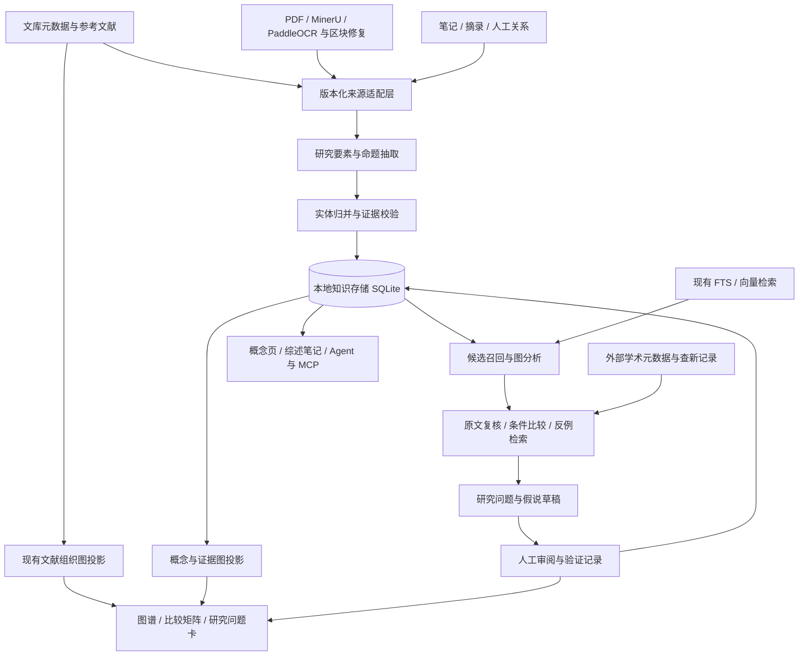

# PaperQuay 知识图谱与文献研究发现能力升级计划

> 联合实施记录（2026-11-12）：`0.4.26` 工作树最新 `npm run check` 构建通过、测试 1014/1014，Windows x64 安装器已本地构建并由标签工作流准备发布。图谱文献节点右键复用 P0-F 位置服务，章节查询只返回 active sourceVersion 匹配的 current generation；图谱仍未将实际 EvidenceSpan ID 绑定到关系证据，也未完成抽取/审核及来源失效闭环，KG-P1 进行中、KG-P2 未开始。安装版及真实服务验收仍待补。详见[联合执行台账](../implementation/joint-execution-ledger.md)、[图谱入口记录](../changes/2026-11-12-graph-node-file-location-entry.md)与[L1b 章节记录](../changes/2026-11-12-long-document-l1b-structure-store.md)。

- 创建日期：2026-11-11；更新日期：2026-11-12（Asia/Shanghai）。
- 状态：**按当前代码重新核对的待实施计划**。已有文献图谱与候选基础不等于研究知识模型已实现；本文中的新模块、接口与指标为设计目标。
- 本项目基线：PaperQuay `0.4.25`，HEAD `0757957`，最近功能提交 `fe647ec`。维护和桌面验收范围为 Windows x64。
- 参考项目：[Seaual/meta-knowledge-graph](https://github.com/Seaual/meta-knowledge-graph)，固定审计提交 `9aee684925f8c7429bb3a693d571e174f2b85326`。上游源码审计和逐文件永久链接见[独立调研附件](../research/meta-knowledge-graph-and-literature-discovery.md)。
- 目标：在现有本地文库、解析、RAG、笔记、Agent 和图谱之上，建立可追溯的文献关系发现、跨论文证据综合、研究问题与可检验假说生成能力。
- 长来源配套：[长篇书籍、报告处理与知识图谱联动计划](2026-11-11-long-document-knowledge-integration-plan.md)。共享来源／存储／备份只实现一次；两计划第 12 节共同定义交接，第 14 节的旧投入估算待基线与范围确定后重估。
- 关联治理：[PDF 命名、重复附件与存储治理计划](2026-11-11-pdf-asset-naming-deduplication-and-storage-governance-plan.md)。既有只读体检和命名预览可复用；不将资产全量迁移作为 P0 或最小证据闭环的前置。涉及物理改名、locator 迁移及备份路径变更时，须与其 A4 重新核对兼容协议。
- 历史治理证据：2026-11-11 的 [225 个已登记源 PDF 只读盘点](../research/pdf-asset-inventory-2026-11-11.md)未见重复或 hash 不符；这是当日样本记录，本次未重扫文库。library SQLite 已增加资产／位置／附件绑定／路径别名／操作账本 schema，历史附件自动回填、路径 alias 消费和迁移恢复仍未完整交付。来源继续用 `paperId + attachmentId + contentHash`，可选关联 `assetId` 并保留 role、hash 快照。
- 工作区配套：[文献工作区 UI 与元数据计划](2026-11-11-literature-workspace-ui-and-metadata-plan.md)。其 P0-F 提供共享“打开所在位置”能力，本计划在证据侧栏和文献节点复用，不重复建立文件路径解析器。
- 阅读顺序：先读第 1、2、3、12、13 节判断方向和投入；实施时按第 5—11 节的契约与第 14 节的验收执行。

## 1. 核心建议与预期成果

**值得继续优化，而且现有基础足够支撑一个有实际研究价值的版本。最关键的升级，是让图谱从“文献及其附属信息的连接图”，发展为“文献—研究要素—命题—证据—研究问题”的研究工作台。**

建议保留 Electron、TypeScript、SQLite、sqlite-vec、Cytoscape、MinerU/PaddleOCR 和现有 Agent 架构，借鉴 meta-knowledge-graph 的背景/贡献分离与概念组织，评估其独立去重模块和研究点提示机制，按本项目已有的原文定位、来源身份和审批机制重建研究发现层。

优先交付以下四项结果：

1. **能解释的文献联系。** 用户不仅看到 A 与 B 相似，还能看到“使用相同方法但研究对象不同”“结论差异来自条件不同”“共享参考文献但属于不同研究分支”等具体联系，并打开双方原文。
2. **能阅读的研究主题结构。** 从论文全文中提取问题、方法、对象、数据、指标、条件、结果与局限，形成概念及证据网络；概念页、比较矩阵和社区摘要与原有笔记联动。
3. **能追问的证据缺口。** 找到条件尚未覆盖、结果不一致、方法可迁移、相邻领域尚未连接等候选机会，展示支持材料、反例、范围和未知项。
4. **能检验的研究问题卡。** 每张卡包含明确问题、来源、推导路径、最接近已有研究、差异点、可证伪预测、最低成本验证方案与失败条件，用户可保存、驳回、修改和继续查证。

“新的方向、知识、问题”应采用不同交付标准：

| 产物 | 系统可以负责到哪一步 | 产品中如何表达 |
| --- | --- | --- |
| 新发现的文献联系 | 找到并解释此前未展示的联系，附原文依据 | “新关联”，并标明由什么信号发现 |
| 跨文献综合 | 在明确条件下归纳已有结果，列出支持与相反证据 | “证据综合”，保留适用范围和争议 |
| 新研究问题 | 提出尚待研究、边界清楚且值得验证的问题 | “候选研究问题”，显示查证进度 |
| 新假说 | 提出超出原文的可检验预测，给出依据和检验办法 | “待验证假说” |
| 新知识 | 在实验、仿真、数据分析或严格论证后得到结果 | 由用户提交验证记录后升级状态；不能仅靠生成文本认定 |

首批 profile 和评测样本按用户实际的工程、计算、数学或其他非生命科学文献选择；实体、条件和验证字段保持可扩展，不预设生命科学专用分类或检索服务。

## 2. 调研方法与本项目现状审计

### 2.1 调研边界与已经执行的核查

2026-11-12 复核时仓库存在 `.codegraph/`，先用 CodeGraph 定位图谱、RAG、解析与文件路径调用链，再定向读取当前源码。范围包括图谱前后端、Agent 编排、引用同步、MCP、备份、PDF 来源与长文档链路。

现状判断以源码和测试为主，README、手册及历史计划只用于理解产品意图。它们与实现不一致的部分在下文单列。本轮没有读取个人文献数据库，没有测量真实文库规模、解析质量或研究发现效果，也没有进行桌面 UI 验收。

2026-11-12 与长文档计划共用一次现有专项回归：

```powershell
node --test tests/knowledgeGraphCommands.test.mjs tests/agentGraphQuery.test.ts tests/ragMembership.test.ts tests/mineruSplitMerge.test.ts tests/mineruSegments.test.ts tests/readerRagContext.test.ts tests/readerResourceBudget.test.ts tests/ragIndexStatus.test.ts tests/documentParseTasks.test.ts tests/paddleOcrRuntime.test.ts
```

结果为 **55 项通过、0 失败**；不是新增知识模型或文件位置 UI 的验收。本次未重新运行全套构建／测试；`0.4.25` 的 977 项全套通过和安装版验收来自[既有记录](../changes/2026-11-12-translated-pdf-language-metadata.md)。

2026-11-11 原调研记录为 21 项专项通过，并在临时 SQLite 中用两个不同 `embeddingModelKey`、相同四维向量复现跨模型相似边；本次从源码再次确认缺少模型空间隔离，未重复该复现，也不能据此估算真实误连比例。上游固定版本和外部资料沿用原调研附件，本次未重新联网审计。

### 2.2 可直接复用的能力

| 已有能力 | 当前实现与价值 | 源码锚点 |
| --- | --- | --- |
| 文献—笔记—标签—分类图谱 | 动态聚合现有数据，不需要重建文献管理系统 | [knowledgeGraphCommands.cjs](../../electron/backend/knowledgeGraphCommands.cjs)，`createKnowledgeGraphSnapshot` |
| 库内引用关系 | Crossref 参考文献缓存、DOI/标题匹配后形成 `paper_cites_paper` | 同文件 `referenceCandidatesFromCache`、`findReferencedPaper`；[libraryCommands.cjs](../../electron/backend/libraryCommands.cjs) |
| 语义相似边 | 文档平均向量缓存，避免每次读取所有 chunk 向量；可复用候选生成 | [ragStore.cjs](../../electron/backend/ragStore.cjs)，`rebuildDocumentVectors`、`listDocumentSimilarities` |
| 原文与证据定位 | 已有 `paperId`、页序、`blockId`、chunk、章节路径、内容签名与 generation | [reader.ts](../../src/types/reader.ts)；[localRag.ts](../../src/services/localRag.ts) |
| 来源注册与查看 | 运行级来源身份、正文编号、原文跳转与可选内容检查已经分开 | [agentCitationRegistry.ts](../../src/services/agentCitationRegistry.ts)、[agentAnswerEvidence.ts](../../src/services/agentAnswerEvidence.ts) |
| 混合检索 | 向量、FTS5、RRF；未配置向量时可降级 | [ragStore.cjs](../../electron/backend/ragStore.cjs)、[knowledgeMcpService.cjs](../../electron/mcp/knowledgeMcpService.cjs) |
| 研究过程恢复 | 综述已有候选/检索/阅读/引用覆盖台账、预算、取消和继续机制 | [agentSurveyCoverage.ts](../../src/services/agentSurveyCoverage.ts)、[agentCapability.ts](../../src/services/agentCapability.ts) |
| 概念笔记和证据笔记 | 概念页、综述页、问答页、摘录锚点、vault 同步可作为研究成果出口 | [notes-charter.md](../notes-charter.md)、[noteStore.cjs](../../electron/backend/noteStore.cjs) |
| 图谱浏览与人工确认 | 全局 fcose、局部视图、关系详情、人工/AI 关系确认、PNG/JSON 导出 | [KnowledgeGraphWorkspace.tsx](../../src/features/graph/KnowledgeGraphWorkspace.tsx) |
| 本地任务与备份 | 后台任务、RAG worker、加密备份与恢复可复用，但新增知识库需显式接入 | [ragWorkerHost.cjs](../../electron/backend/ragWorkerHost.cjs)、[backupSources.cjs](../../electron/backend/backupSources.cjs) |

### 2.3 影响目标实现的具体缺口

| 编号 | 已核实的实现事实 | 对研究发现的影响 | 建议优先级 |
| --- | --- | --- | --- |
| G01 | 节点类型只有 paper/note/tag/category/reference；没有独立研究要素、命题、条件和证据对象 | 无法表达“谁在什么条件下证明了什么” | P0：先设计模型，P1 实施 |
| G02 | 自定义/AI 关系只存 `paperquay-knowledge-graph-relations.json`，字段是端点、自由标签、描述、confidence 等 | 缺少来源位置、审核状态、版本失效与变更历史 | P0 |
| G03 | `related_by_embedding` 的平均向量表以 `(document_key, dimension)` 为主键，未纳入模型身份；比较时只检查维度 | 相同维度的不同模型仍会比较；隔离样例返回 similarity=1 的跨模型边 | P0 |
| G04 | 目前文档表示是全部可用正文 chunk 的平均，跨 source type 汇总 | 方法、背景、参考文献等不同信息混在一起；双来源文本可能重复计权 | P1 |
| G05 | `includeReferences=true` 仍只展示匹配到库内论文的引用；未入库参考文献保留缓存但不投影 | 不能据当前画面观察共同外部参考文献、外部桥梁与完整知识来源 | P0/P1 |
| G06 | Crossref 抓取最多 200 条/篇；图谱候选再截到 48 条/篇 | 研究分析可能遗漏长参考文献表，且当前快照未给出完整覆盖账本 | P0 |
| G07 | 引用匹配在 DOI/标题精确匹配后允许长标题互相包含即匹配；共同作者依靠规范化姓名 | 存在标题误配、同名作者误连风险；不能把这些边当语义支持 | P0 |
| G08 | AI 建议最多读 60 个 paper/note，论文最多 1200 字符、笔记 1000 字符；`graphItemText` 还混入 `aiSummary` 和 `userNote` | 需分开作者原文、模型概览与用户观点的来源；现有建议不能承担精确证据综合 | P0/P1 |
| G09 | AI 建议过滤器按已有端点对去重，任意已有正反向边均会阻止该对新增建议 | 已有 similarity/cites 可能遮蔽同一对论文的 supports/contrasts/extends 等关系 | P0 |
| G10 | 缺边纯函数支持 `embeddingPairs`，但 `loadMissingPaperEdges` 仅传标签、分类和现有边 | Agent 的实际缺边报告尚未用上向量候选；共享标签/分类本身很弱 | P0 |
| G11 | 缺边最多 12 篇、24 对；能力焦点最多 8 篇；邻域整形最多 40 节点/80 边 | 适合轻量局部探索，不能解释为全库系统性研究发现 | P1 |
| G12 | 图谱探索能力不调用模型、不读双方正文，也不写关系；概念主题仅聚合 `pageKind=concept` 笔记 | 当前没有自动全文概念抽取、关系证据核查或研究假说生成流水线 | P1/P2 |
| G13 | 后端局部查询先构建全库快照，再过滤邻域；笔记最多取 5000 条；向量相似度仍做文档两两比较 | 规模增长后，局部请求和重复 Agent 调用仍可能承担全库成本 | P1 |
| G14 | `confidence` 为模型返回值，缺少校准集；当前存储未区分“模型抽取置信度”“人工接受”和“证据充分度” | 容易把数值误解为学术结论真实概率 | P0 |
| G15 | 内置 Agent 已有 graph 工具；外部 MCP 工具表没有图谱查询／构建工具 | 后续开放外部研究工作流需新增契约，不能宣称现已开放 | P1/P2 |
| G16 | 现有笔记和回答来源机制完善，但图谱边没有复用来源结构 | 图谱发现无法直接达到回答引用与阅读器的定位体验 | P0/P1 |
| G17 | `filterLocalGraph` 在焦点不存在或 depth≤0 时返回整个快照 | 局部请求可能意外扩大到全库；须显式区分全局请求、无效深度与不存在的焦点 | P0 |

G05 对应一个文档漂移：类型和部分前端文案保留了外部 reference 节点，但实际后端和专项测试明确不展示未入库引用。第一个交付版本应同步校正文案，并以独立的“外部文献占位”视图恢复所需能力。

G09 还意味着“缺边”需要重新定义。同一对论文可能同时有引用、方法相似、数据重用和结果冲突，不能因为已有一条连接就认定该对已被充分解释。新版本分析的是**关系类型及其证据是否缺失**。

### 2.4 当前交付与依赖边界

| 能力／关联计划 | 截至 0.4.25 的事实 | 对本计划的约束 |
| --- | --- | --- |
| PDF 来源与阅读 | 0.4.23 来源生命周期、0.4.24 对照分栏及初始同步、0.4.25 译版语言管理已交付 | 复用附件身份和原文跳转；修改语言／书目不生成新的内容版本 |
| 资产治理 | 只读审计、命名预览及 schema 已有；历史资产迁移未完成 | `assetId` 可选；用现有登记身份开始，禁止依赖未交付 locator／别名能力 |
| 工作区 UI | 筛选、草稿和概览恢复仍按配套计划推进；文件位置入口新增为 P0-F | KG 可独立交付；证据文件定位接入其共享服务，位置可打开不等于内容支持命题 |
| 长文档 | 分卷合并／RAG 基础已有，持久账本、真实 unit 和版本 manifest 待实施 | S1 共同定 schema；普通论文最小闭环先行，不等待全书摘要或 KG P2 |
| 新知识层 | 尚无本文定义的知识库／写入者、EvidenceSpan、审核事件和问题卡闭环 | P1 按纵向样例新建；旧 JSON 图谱继续兼容，不能将候选结果算已完成知识建库 |

## 3. 如何借鉴 meta-knowledge-graph

上游审计固定在 `9aee684925f8c7429bb3a693d571e174f2b85326`，文件、实现细节和局限以[独立调研附件](../research/meta-knowledge-graph-and-literature-discovery.md)为准。审计覆盖当前网页服务、CLI、独立去重模块和两套 Neo4j 实现；仅为静态审计，未启动上游服务验证。产品层面建议采用“机制移植、接口重写、原文证据增强”的方式。

### 3.1 借鉴方向

| 机制 | 对 PaperQuay 的价值 | 本项目采用方式 |
| --- | --- | --- |
| 两阶段贡献/概念抽取 | Stage 1 区分背景、缺口和贡献；Stage 2 组织概念并标注 proposed/improved/applied/analyzed | 第一阶段先保存可定位的贡献命题和证据，第二阶段引用其 ID；避免把“提及”当成“提出” |
| 动态概念组织 | 当前有 field/direction/subdirection/task/dataset/method/finding/technique 八类概念，深度动态 | 保留主题导航层；方法、任务、数据、发现用类型关系组织，不全部强制上下位化 |
| 概念归并与别名管理 | 独立模块包含字面候选、LLM 判断和事务合并；现行网页入口是另一套字面服务 | 规范名、别名、论文内缩写作用域、人工合并/拆分与回滚；语义能力需独立接通并验证 |
| 概念层级与跨论文连接 | 支持从具体方法上升到问题或主题，再回到论文 | 用受控类型与多父关系；区分 taxonomy、共现和事实关系 |
| 概念图与引用图联合 | 同时观察内容关联与研究脉络 | 引用、共被引、文献耦合、语义/概念信号分别保留 |
| 研究点生成 | 形成从图谱探索到具体问题的产品闭环 | 加入证据筛选、反例检索、相近工作比较、实验方案和状态机 |
| 可持续的研究上下文 | 让选题、假设和已否定方向可以继续 | 扩展现有能力 artifacts/checkpoint；长期产物进入知识库和笔记 |

当前实现有四个边界，直接影响复用判断：

1. **概念树存在不等于持久化闭环成立。** 网页 `ProcessService._save_concepts()` 末尾只保存根概念，收集子树和论文关联的函数未被调用；CLI 有另一条递归写入路径。因此不直接接入整个网页处理服务。[上游处理源码](https://github.com/Seaual/meta-knowledge-graph/blob/9aee684925f8c7429bb3a693d571e174f2b85326/backend/services/process_service.py#L143-L198)
2. **网页“智能去重”未调用独立 LLM 去重模块。** 网页采用字符集合 Jaccard 和包含判断，且进度更新字段与白名单冲突；独立模块有事务/历史，但旧关联迁移没有覆盖较新的贡献角色字段。复用应逐层验证候选召回、判定和合并。[去重审计](../research/meta-knowledge-graph-and-literature-discovery.md#5-去重必须区分现行网页服务与独立库模块)
3. **研究点提示词只使用有限图结构、论文标题和关键词。** 四种启发式没有对应的独立检测器，也未执行原文定位、反例检索或最近邻查新；输出的 novelty 是模型标签。现行两阶段抽取的 `research_questions` 固定为空，不能引用旧提示词示例证明已抽出开放问题。[上游研究服务](https://github.com/Seaual/meta-knowledge-graph/blob/9aee684925f8c7429bb3a693d571e174f2b85326/backend/services/research_service.py#L212-L354)
4. **旧共现/稀疏分支查询与当前图服务分离。** `find_gaps/find_connections` 属于旧 Keyword/level Neo4j 模型，当前研究点入口不调用它们；当前另有 Concept/HAS_SUB 存储。不能把仓库内不同年代的函数拼成一条已运行的发现链。[模型与调用链审计](../research/meta-knowledge-graph-and-literature-discovery.md#6-文献关系发现与共现的真实实现)

因此，上游适合作为可比较的抽取/启发式基线。PaperQuay 的优势切入点是已有阅读器证据定位、来源版本、混合检索和人工工作流；升级应把这些能力连接起来。

### 3.2 需要重新设计的部分

1. **抽取结果必须定位到原文。** 概念名称与定义之外，还要记录提及位置、来源版本、限定条件、正负极性和证据级别。
2. **共现必须独立成信号。** 两个概念同篇出现，只能证明共同出现；同章/同段也不自动证明方法作用、因果或支持关系。
3. **层级必须允许领域差异。** “方法—任务—学科”在一些场景有用，但材料、机制、装置、工况、对象、指标不适合全部塞进一条抽象树。
4. **概念去重不能只靠字符串或模型判断。** 缩写、一词多义、方法版本、对象尺度不同，均需要保留作用域和拆分能力。
5. **研究点不能只返回自然语言建议。** 需结构化到可比较、可查证、可证伪、可保存和可追踪的研究问题卡。
6. **保持一个写入者和一个事实源。** 第一阶段不引入另一套文库、解析器、聊天历史、记忆和图数据库双写系统。

### 3.3 技术路线选择

| 路线 | 优点 | 主要代价 | 建议 |
| --- | --- | --- | --- |
| 在 TypeScript/SQLite 内实现核心机制 | 复用桌面分发、来源定位、现有 worker 与备份；数据一致性边界清楚 | 需要移植抽取与图分析逻辑 | **主路线** |
| Python sidecar 运行上游算法 | PoC 时可较快比较概念抽取与研究点流程 | Python 打包、进程、端口、依赖、更新和两套身份映射 | 仅用作隔离评测适配器；收益明确后再考虑产品化 |
| 默认接入 Neo4j | 复杂遍历、查询语言、服务端分析方便 | 桌面安装运维、资源占用、备份与多存储同步成本 | 首版不作为必要依赖；大规模团队版再评估 |

上游固定版本采用 [MIT License](https://github.com/Seaual/meta-knowledge-graph/blob/9aee684925f8c7429bb3a693d571e174f2b85326/LICENSE#L1-L21)，复制或修改实质代码时保留版权与许可文本，并另行核对实际引入依赖的许可证。记录固定提交和实际复制文件；本轮没有复制上游实现进入产品代码。不要将上游 README 的功能描述当成已经验证的研究发现质量。

## 4. 相关研究给出的设计依据

以下结论来自论文原始摘要、作者/项目官方文档与源码。它们用于选择机制，不表示这些论文中的效果已经迁移到 PaperQuay。

| 来源 | 已有证据支持的机制 | 适用方式与限制 |
| --- | --- | --- |
| [R1 GraphRAG](https://arxiv.org/abs/2404.16130) 与[官方查询文档](https://microsoft.github.io/graphrag/query/overview/) | 实体图、社区摘要、面向全局问题的分层综合；local/global/DRIFT 各有用途 | 社区综述用于主题地图，具体结论仍回查原始 text units；global 查询费用较高，按需运行 |
| [R2 HippoRAG](https://arxiv.org/abs/2405.14831) | LLM、知识图谱和 Personalized PageRank 联合召回跨跳证据 | 可作为有类型、受范围约束的候选召回通道；图路径不自动构成推理证明 |
| [R3 HippoRAG 2](https://arxiv.org/abs/2502.14802) | 更深的 passage 集成和在线筛选改善关联记忆，并指出结构化检索可能损害简单事实检索 | 保留原有向量/FTS 作为基线与兜底，图检索不能全局替换现有检索 |
| [R4 SciERC/SciIE](https://aclanthology.org/D18-1360/) | 科学实体、关系与跨句指代需要联合考虑 | 借鉴提及—实体分离、跨句上下文和关系类型；其数据领域不能代表中文或工程全文 |
| [R5 SciREX](https://aclanthology.org/2020.acl-main.670/) | 科学全文包含跨句甚至跨节的 N 元关系，文档级抽取仍有难度 | 结果要表达任务/方法/数据/指标/数值/条件组合，不能全部压成无条件二元边 |
| [R6 SciFact](https://aclanthology.org/2020.emnlp-main.609/) | 检索支持/反驳命题的材料并标出 rationale，是独立于检索的任务 | 为支持/相反/不足/未知建立明确输出和人工评测；原数据以摘要为主，全文比较需另测 |
| [R7 SciMON](https://aclanthology.org/2024.acl-long.18/) | 从既有研究检索灵感，反复比较先前工作并修改建议，有助于优化新颖性；生成器仍可能缺乏技术深度 | 采用“候选—近似工作检索—差异说明—改写”闭环；不能用距离阈值认证新颖性 |
| [R8 Co-Scientist](https://arxiv.org/abs/2502.18864) | 生成、批评和修订假说；部分领域通过实验验证后才形成发现 | 借鉴角色分工与验证闭环；其领域验证和计算投入不能直接外推到本地桌面应用 |
| [R9 OpenAlex Work 对象](https://docs.openalex.org/api-entities/works/work-object) | `referenced_works` 等字段可补充外部引文和关联元数据 | 需保存提供方、获取时间、覆盖和错误；元数据推荐不等于论文内容证据 |
| [R10 Crossref REST API](https://www.crossref.org/documentation/retrieve-metadata/rest-api/) | DOI 元数据、参考信息、更新等来自成员及受信来源的提交 | Crossref 缺参考文献或中文条目缺 DOI，不代表没有引用或没有相关研究 |

由这些工作可得到四条架构约束：保留原文 passage；把检索、抽取、判断和假说生成分开；按查询类型决定是否用图；用领域人工样本验证收益。

## 5. 目标架构与数据所有权

### 5.1 分层结构



### 5.2 存储建议

建议新增 `paperquay-knowledge.sqlite`，由独立 `knowledgeWorker` 单写入，保存研究实体、命题、证据、抽取运行、候选、审核与验证记录。

书籍/长报告也使用同一库保存 document manifest、章节/子节、分卷账本、目录与页码修订及摘要依赖；解析大文件和页面产物继续存版本化缓存，不复制整本正文进多个权威数据库。配套计划的单元查询与 KG 查询共享来源/资格契约，RAG 库继续由现有 RAG worker 写入。

原因是这些数据既不只是可丢弃的 RAG 缓存，也不适合进入文库全量快照保存路径：人工归并、驳回意见、研究问题和验证结果应长期保存；抽取与图分析又有高频增量写入和独立索引需求。

数据所有权必须明确：

| 内容 | 权威来源 | 知识库存什么 |
| --- | --- | --- |
| 题名、作者、DOI、附件、分类、文库成员资格 | library SQLite | 稳定 ID、必要快照和版本引用 |
| PDF、解析块与区块修复 | 原文件/解析缓存/修复层 | 来源版本、证据片段、定位与校验哈希 |
| 用户笔记及锚点 | notes SQLite | 笔记 ID 和内容版本引用；区分用户观点与论文证据 |
| chunk 和向量 | RAG 存储；新增知识向量按命名空间管理 | 引用其身份；避免复制整库 chunk 和重复生成正文向量 |
| 人工关系、实体归并、命题、问题卡和审核历史 | knowledge SQLite | 完整记录 |
| 当前画面 | 投影 API | 有界节点/边及游标、截断和覆盖信息 |

不同 SQLite 间不能依赖普通外键自动级联。用应用事件、来源 revision 和后台 reconciler 对齐；删除文献或改变成员资格后，查询服务立即进行资格过滤，再异步清理派生数据。

### 5.3 不变量

1. 原文事实、作者推断、系统综合、待验证假说、用户观点分开存储和显示。
2. 人工确认表示接受记录或研究价值，不表示科学命题被证明。
3. 共现、相似度、引用与图路径各自保留信号语义，不升级为支持或因果。
4. 每条实质性自动语义关系、命题和研究问题都能说明依据、范围与未知项。
5. 查询使用显式作用域；空范围不能退化为全库。未入库外部文献不会默认为已读。
6. 自动抽取首先写入候选空间；只有明确审核或验证后的产物进入相应可信状态。
7. 重算不得覆盖人工修订、驳回和拆分；模型更换或来源变化产生新版本。
8. 沿用现有“来源可查看”与“内容是否支持”分离的产品契约，不恢复默认逐句模型核验。

## 6. 研究知识模型

### 6.1 核心对象

| 对象 | 关键字段 | 作用 |
| --- | --- | --- |
| `SourceVersion` | paperId、attachmentId、可选 assetId、roleSnapshot、contentHash、sourceType、contentSignature、parseGeneration、repairRevision、textVersion、createdAt | 固定一次抽取所依据的文件及文本版本；语言标签和路径变化本身不等于正文变化 |
| `EvidenceSpan` | sourceVersionId、pageIndex、blockId、chunkId、sectionPath、start/endOffset、quote、quoteHash、locatorStatus | 保存原文依据和定位能力；页序统一 0 基，界面显示 1 基 |
| `Entity` | id、type、canonicalName、language、definition、status、domainProfile | 可跨文献复用的研究要素 |
| `EntityMention` | entityId、surfaceForm、scopePaperId、evidenceSpanId、senseId | 区分实体与其在各论文中的具体表述 |
| `EntityAlias` | alias、language、scope、entityId、decisionSource、revision | 中英文/缩写/别名与人工决策 |
| `PaperEntityContribution` | paperId、entityId、role、claimIds、evidenceIds、reviewState | 记录论文对概念的使用/提出/改进/应用/分析角色；角色属于论文—概念关联，不属于概念永久属性 |
| `Claim` | text、claimKind、polarity、epistemicKind、conditionFrame、source/review status、revision | 带语境的命题；可对应作者结论、观测、局限或系统综合 |
| `ClaimEvidence` / `ClaimDerivation` | claimId、evidenceSpanId、role；derivedClaimId、premiseClaimIds、rule/summary、assumptions、dependencyRevisions | 支持/反驳/上下文的直接证据关联，以及派生命题对前提的版本化依赖；不能仅靠关系描述文本追溯 |
| `Observation` | method、task、object/dataset、metric、value/range、unit、baseline、conditions、uncertainty、evidenceIds | 表达实验或仿真结果的 N 元记录 |
| `Relation` | predicate、source、target、direction、evidenceIds、conditionFrame、origin、reviewState | 有类型关系，允许同一端点对存在多种关系 |
| `Hypothesis` | question、prediction、premiseClaimIds、reasoningSteps、counterEvidenceIds、noveltyRecord、validationPlan、state | 研究问题及其验证闭环 |
| `ValidationRecord` | hypothesisId、protocolVersion、executor、data/code/artifact refs、conditions、result、uncertainty、assessment、reviewer、createdAt | 保存实验/仿真/分析/证明的实际结果，包含否定与无结论结果；与仅有计划的状态分开 |
| `AnalysisRun` | scopeSnapshot、graphRevision、models、prompt/schema versions、budget、coverage、usage、checkpoint | 复现、取消、继续和成本审计 |

第一版实体类型建议从有限集合起步：`problem`、`task`、`method`、`object`、`dataset`、`metric`、`variable`、`condition`、`mechanism`。材料、装置、算法、工况等由所选领域 profile 增加，避免一次引入几十种低质量标签。

对长篇书籍和报告，`SourceVersion/EvidenceSpan` 增加可选 `unitId/unitRevision`、文档版次、物理页与印刷页快照；Claim 增加来源角色，区分教材转述、原始观测、规范条款和情景建议。保留一个文库根 ID，在其下建立章节，不把分卷或章节伪装成多篇独立论文。定义及索引迁移见[配套第 5、10 节](2026-11-11-long-document-knowledge-integration-plan.md#5-数据契约复合来源而不是几十个假论文条目)。

`limitation` 与 `open_question` 优先是 Claim 的类型：它们可能是作者明确提出，也可能只是系统推导，不能只做无出处概念节点。

### 6.2 关系类型与语义约束

| 关系族 | 例子 | 证据要求 |
| --- | --- | --- |
| 文献结构 | `cites`、`co_cited_with`、`bibliographically_coupled` | 标识符匹配与引用来源；不需要 LLM 认定 |
| 研究结构 | `studies`、`uses_method`、`evaluated_on`、`measured_by`、`has_condition` | 至少一个能定位的原文 span |
| 概念组织 | `is_a`、`part_of`、`variant_of` | 定义或归并依据；方向明确、层级环检测 |
| 语义对照 | `extends`、`compares_with`、`reuses_data_from`、`addresses_limitation_of` | 双方原文和具体比较维度 |
| 命题证据 | `supports`、`refutes`、`qualifies` | 主体是命题，附条件对齐和 evidence；不能直接由 paper cites 推导 |
| 发现信号 | `co_occurs`、`semantic_neighbor`、`bridge_candidate` | 算法、语境窗口、分数与版本；默认作为候选 |
| 研究推断 | `may_transfer_to`、`hypothesized_effect`、`needs_test` | 推断前提、尚未验证处、替代解释与验证计划 |

去重键至少考虑 `(source, target, predicate, conditionFrameHash, originScope)`，证据以独立表追加。关系方向和对称性由 schema 定义；只有对称关系规范化端点顺序。

同一对论文“相似且结论相反”是有价值信息。存在 `semantic_neighbor` 不阻止新增 `compares_with` 或命题层的 `refutes`。

### 6.3 状态与置信度

把容易混淆的维度拆开：

- `origin`：规则、元数据提供方、模型抽取、模型推断、人工。
- `evidenceLevel`：元数据、摘要、正文、表格/图、用户验证记录。
- `reviewState`：pending、accepted、rejected、needs_review、superseded。
- `verificationState`：unreviewed、supported、partially_supported、contradicted、insufficient、unknown。
- `sourceState`：current、stale、missing、excluded。
- `extractionScore`：模型原始值或经校准的任务分数，注明用途和校准版本。

不要把一个模型输出的 `0.87` 显示为“87% 可信”。首版可只显示“待核查/已人工接受/证据不足”，分数用于候选排序；有独立标注集后再做置信度校准。

### 6.4 建议表与索引

目标表族：`kg_sources`、`kg_evidence_spans`、`kg_entities`、`kg_mentions`、`kg_aliases`、`kg_paper_entity_roles`、`kg_claims`、`kg_claim_evidence`、`kg_claim_derivations`、`kg_derivation_premises`、`kg_observations`、`kg_relations`、`kg_relation_evidence`、`kg_hypotheses`、`kg_validation_records`、`kg_runs`、`kg_review_events`、`kg_external_works`、`kg_novelty_checks`。按第 12 节逐步启用，不要求 P1 同时完成所有研究模式和观测结构。

实体检索建规范名/别名 FTS；关系建 source+predicate、target+predicate、reviewState 索引；证据建 paperId+sourceVersion、blockId 索引。条件初期允许版本化 JSON，但经常筛选的 task、method、object、metric 和 time 提升为索引字段。不要把所有对象塞入一张任意 JSON 表后再全量扫描。

研究问题中的推导步骤保存结构化前提与结论摘要，记录程序输入输出；无须也不应依赖保存模型内部思维过程。

概念标签和映射可借鉴 [SKOS](https://www.w3.org/TR/skos-reference/) 对 preferred/alternative label、broader/related、exact/close match 的区分；溯源借鉴 [PROV-O](https://www.w3.org/TR/prov-o/) 的来源—活动—生成者链；约束检查借鉴 [SHACL](https://www.w3.org/TR/shacl/) 的显式规则与违规报告。它们用于约束本地契约，无须先迁移 RDF；溯源或结构校验通过均不代表学术命题成立。

## 7. 增量构建与质量控制流水线

### 7.1 构建范围

默认手动选择一个分类、一个主题或 20—50 篇论文进行试点；20—50 是首次抽样建议，最终按领域和标注能力调整。不要第一次启用就对全库全文调用模型。

长来源可进一步选择章节/子节；scopeSnapshot 保存实际 unit 集合与 revisions，根文献成员资格仍为最终边界。采用章节级稳定任务、内容哈希和覆盖台账，不用“已解析整本”代替“已抽取/已阅读全部章节”。全书系统性任务必须逐单元完成或明确 partial；按需只读相关章节时不报告全书覆盖。

研究语料资格建议采用以下初始策略：默认继承 `ragEnabled`；新加 `knowledgeEnabled` 时只允许在明确 UI 操作后独立设置。已排除正文不进入自动抽取、向量/图召回和发现结果。人工笔记和手工关系可以保留，但相关原文证据显示 excluded；重新加入后按版本检查再构建。用户明确打开单篇阅读时，沿用现有直接阅读边界，不能借此自动加入研究语料。

### 7.2 执行阶段

1. **盘点与计划。** 固定 scopeSnapshot，列出元数据、解析、正文和参考文献覆盖；估算 token/调用量，用户选择预算后开始。
2. **来源规范化。** 优先使用当前有效解析及区块修复；缺失时回退 PDF 文本。摘要与 AI 概览只进入摘要级候选，不伪装全文。
3. **章节识别。** 复用章节路径，优先方法、结果、讨论、局限和结论；记录哪些节被处理。结果信息不能仅从引言抽取。
4. **贡献与研究要素抽取。** 借鉴上游两阶段职责：先从分块原文提取背景/已有方法、作者贡献、明确局限及其 span，再组织跨块概念和论文—概念角色。第二阶段只能引用已保存的证据 ID，不能依据摘要重新编造出处。每个对象执行 JSON schema、类型、长度和 ID 校验；“作者声称提出”不能直接改写成“领域首次提出”。
5. **命题与观测抽取。** 条件、比较对象、指标方向、单位、正负极性和不确定性一起抽取；复合命题拆分但保留同一观测关联。
6. **跨块整合。** 为跨句/跨节关系有界补取上下文；无法形成完整证据链时保留候选或 abstain，不能猜测缺失数值。
7. **本地证据校验。** quote 必须在指定 sourceVersion 的原文中定位；规范化匹配保留映射，不能因为文本清洗把原始偏移丢掉。
8. **实体归并。** DOI/标准标识符、规范化术语、论文内缩写优先；再用词法和向量召回少量候选，最后做上下文比较。
9. **语义核查与抽样。** 对新增命题/语义边执行任务内验证；困难项进入人工队列。它发生在知识构建任务，不增加普通问答默认开销。
10. **提交一个 generation。** 成功批次原子发布并更新图 revision；失败批次保留 checkpoint 和错误，不把 partial 作为 complete。

### 7.3 归并的具体规则

- 论文内缩写只在该论文的定义范围生效；“SVM”等高频缩写也需类型与上下文一致。
- 同名方法的不同版本可建 `variant_of`，不要直接覆盖；研究对象、尺度、装置或方程不同不自动 same_as。
- 中英文名称作为 alias 保存原文；中文切词、公式符号和单位另做规范化，不能用翻译结果替代原文。
- 首版仅自动合并确定性标识符和已接受 alias，模型建议合并进入审阅队列。
- 人工 merge 保留旧 ID 到 canonical ID 映射、mentions 和事件；split 可以撤回错误归并并重算受影响候选。

### 7.4 版本失效和删除

来源内容、解析 generation 或区块修复变化时，将依赖对象标为 stale；按 evidence 依赖计算重建范围。仅修改题名、附件语言标签或不改变字节的路径迁移不应重新付费抽取全文；仍需更新显示／locator 并校验身份。替换译本 PDF 是内容变化，不能与语言标签编辑混同。Embedding 模型变化只重建对应向量空间，不抹去经人工接受的实体和命题。

运行中变化必须有提交闸门：任务固定 `expectedSourceVersion/eligibilityRevision/taskGeneration`；模型调用结束、写入和发布前重新核对当前来源、语料资格及取消状态。过时输出可留作历史或废弃，但不能发布为 current。跨库无法靠一个普通事务解决全部竞态，因此同时使用持久化失效事件/重放、知识库内 generation 比较与查询时的权威版本复核；不能只在来源变化时标记一次 stale，随后又让迟到的旧批次写回 current。

旧 evidence 仍可显示快照及“来源已变化”，但不能继续作为 current 事实进入新生成。PDF 缺失、block 失效、页码不可用分别表示；可回退页面定位时明确标注，不能静默替换到相似片段。

删除文献时立即停止检索使用其证据；人工假说保留历史快照并提示来源已删除，由用户决定是否删除研究记录。清理派生数据不删除用户笔记或改写原文。

### 7.5 运行机制

幂等任务键由 `canonicalPaperId + sourceVersion + taskKind + extractor/modelKey + promptVersion + schemaVersion + profileVersion` 确定，`runId/attemptId` 记录本次编排与重试，二者分开。跨 run 对相同输入可以复用成功结果；同 run 失败重试不会重复写入，版本变化才触发对应重建。人工审核历史与派生批次分开，重新抽取不能覆盖已接受/驳回决策。

分批提交、限流、指数退避、取消、暂停、重试与恢复复用现有任务中心体验；知识任务在 worker 运行，渲染器仅消费事件和有界数据。

模型输出、PDF 文本和外部元数据都是输入数据，不得作为工具指令执行。领域提示、schema 和抽取样例受仓库版本控制；来源中的脚本或提示文字不改变抽取任务。

## 8. 文献联系发现：从相似度到有证据的关系

### 8.1 多通道候选生成

| 通道 | 发现什么 | 计算和边界 |
| --- | --- | --- |
| 直接引用 | 已有研究继承与对照脉络 | DOI/可信标识符为主；标题近似只给待确认匹配，不直接固化 |
| 文献耦合 | 两篇文献共享参考文献，可能有共同问题背景 | 参考集合交集、Jaccard/余弦等；按参考覆盖报告，跨年份不直接比原始个数 |
| 共被引 | 后续论文共同引用的两个工作 | 使用本地或外部可见 citing corpus；注明覆盖与时间，缺失不能当负证据 |
| 文档/要素向量 | 同问题异表述、同方法异对象 | 按完整模型身份+维度+内容版本隔离；题名摘要、方法、结果分别建表示 |
| 实体与命题 | 相同数据/对象/指标、不同方法，或同方法跨领域 | 类型与条件对齐，降低通用概念权重，返回命中 mentions |
| 结构桥梁 | 连接不同研究社区的方法、机制或中间概念 | 受控元路径、局部 PPR、跨社区候选；防止标签/分类 hub 垄断 |
| 作者与笔记 | 用户已有认知和研究组织线索 | 作者身份不足时标为姓名匹配；共作者、同笔记只作弱候选 |

每条候选保留 `signals[]`，各信号显示原始值、归一化方法、提供方、覆盖和版本。相关性、结构稀缺性、新颖性、证据强度和可行性分开。

第一版采用透明规则优先级与多样性重排，不宣称任意加权和就是科学价值。规则权重通过人工标注集调节；积累反馈后再比较学习排序是否值得引入。

### 8.2 向量改造

1. 把文档向量缓存主键至少扩为 `canonicalDocumentId + representationKind + embeddingModelKey + dimension + generation`；同维度不同模型不可比较。
2. 对 MinerU/PDF 双来源先做内容去重或指定唯一主来源，避免同一内容重复计权。
3. 保留平均向量作为低成本基线，再评估摘要/方法/结果表示是否改善跨论文候选；不同表示分开索引。
4. 同一论文的 bare ID 与 `native-library:` ID 归并到 canonicalPaperId，避免重复节点和重复候选。
5. 小范围先用批量 top-k；大范围改用可基准测试的近邻索引或分块候选，避免每次全库 O(N²d) 两两比较。
6. `0.82` 不应作为所有模型和领域的永久阈值；按模型/profile 校准，并提供每节点 top-k 与最大总量约束。

### 8.3 双方原文复核

对候选 A/B，分别检索最相关方法/结果/局限片段，按比较维度输出：共同部分、差异部分、条件、支持/相反证据、未知项和拟议 predicate。

自动形成 `extends` 或 `contrasts` 不能只依据双方摘要。无法取得一方全文时保留 abstract-level 候选。存在引用只说明引用发生，不说明作者支持被引结论。

邻域结果按查询相关性、证据质量和边类型排序后分页。不要先按插入顺序截断节点再删边；计算范围、展示范围和模型预算范围分别记录。旧有 40/80、12/24 等上限可保留为交互预算，但必须有 `truncated`、总候选数、分页或缩小范围提示。

### 8.4 外部文献占位

增加 `ExternalWork`：DOI/OpenAlex ID/其他标识符、题名、提供方、fetch 时间、可用摘要/全文状态。它可以参与引用拓扑和查新，但默认不冒充本地已读论文。

外部参考节点默认折叠，按共同引用、桥梁价值和用户展开进入画面；库内导入后通过稳定身份映射归并，保留原引用及匹配记录。对无 DOI 的中文文献提供题名/作者/年份待确认记录和用户补充入口。

## 9. 研究问题与假说发现

### 9.1 六类可操作的发现模式

| 模式 | 触发条件 | 必须附带的核查 |
| --- | --- | --- |
| 方法迁移 | 方法 M 对任务 A 有证据，任务 B 共享关键结构但现有范围未见 M 的使用 | 结构对应、失配条件、B 的现有强基线、外部近似工作 |
| 条件扩展 | 现有研究集中在某些温度／尺度／数据分布／工况，邻近条件覆盖不足 | 覆盖矩阵、缺失原因、物理／实验可行性；未抽取不能当未研究 |
| 结论冲突 | 相似命题在可比条件下有方向相反或不一致结果 | 单位、指标方向、基线、样本/不确定性和方法条件对齐 |
| 机制桥接 | A—B、B—C 有证据，A—C 存在值得检验的联系 | 每一步关系类型、方向、条件与替代解释；禁止默认传递因果 |
| 局限求解 | 作者明确提出的 limitation 可由另一研究分支的方法应对 | limitation 原文、候选方法的适用前提、是否已有对应解决方案 |
| 评价与复现缺口 | 方法被频繁采用但缺某种验证、外部数据、基线或结果稳健性证据 | 在声明范围内逐篇检查，并说明未解析/未读条目 |

“孤立节点”“低密度社区”“没有边”可以提示抽样位置，但不能独立成为研究空白证据。

### 9.2 发现流水线


生成者、证据检查者和可行性审阅者可先由同一配置模型顺序运行，但提示、输入和输出职责分开。检查阶段先看命题与证据，再看生成建议，减少迎合；允许使用第二模型或人工复核，但不把多模型一致当真实性证明。

默认最多产出 3—5 张详细卡片，代替几十个泛泛想法。每张卡至少给出一个强替代解释或失败原因。无法得到有根据候选时，返回“需要补充哪些文献/条件/数据”也算有效结果。

### 9.3 研究问题卡契约

```ts
interface ResearchQuestionCard {
  id: string;
  revision: number;
  questionFingerprint: string;
  question: string;
  pattern: 'transfer' | 'condition-gap' | 'conflict' |
    'mechanism-bridge' | 'limitation' | 'validation-gap';
  scopeSnapshotId: string;
  premiseClaimIds: string[];
  evidenceIds: string[];
  reasoningSteps: Array<{ premiseIds: string[]; inference: string; unknowns: string[] }>;
  nearestPriorWorks: Array<{ workId: string; overlap: string; difference: string; evidenceIds: string[] }>;
  counterEvidenceIds: string[];
  falsifiablePrediction: string;
  boundaryConditions: string[];
  noveltyCheckIds: string[];
  validationRecordIds: string[];
  validationPlan: { baseline: string; intervention: string; outcome: string;
    controls: string[]; failureCriteria: string[]; resources: string[] };
  noveltyState: 'local-only' | 'external-checked' | 'overlap-found' | 'inconclusive';
  scientificState: 'proposed' | 'under-test' | 'supported-in-scope' | 'refuted' | 'inconclusive';
  reviewState: 'pending' | 'accepted' | 'rejected' | 'needs-revision';
}
```

“至少两篇来源”只作为综合问题的起步条件，不等于独立验证。综述引用原始实验、预印本与正式版、同一团队同一数据集的结果需要标记共同来源，避免重复计票。

科学状态更新应引用实际 `ValidationRecord`：记录原先预测、所用协议、数据/代码/结果文件、条件、误差或不确定性、基线对比，以及支持/否定/无结论的判定。由用户或获授权研究工作流提交并审阅后变更状态；模型可协助整理记录，不能仅凭“建议已接受”把 proposed 升级为 supported-in-scope。验证只覆盖已记录条件，推广到新条件应另建待验证命题。

### 9.4 查新与反例流程

查新记录至少包含：问题分解、同义词/中英文术语、检索式、数据库、时间、筛选条件、命中文献、最接近已有研究、实际阅读级别与未解决项。

默认先查本地全文和笔记，再在显式联网研究模式中用 OpenAlex/Crossref 和可选 Semantic Scholar 获取元数据及候选。按配置与来源能力查摘要/合法全文，尊重现有服务端点和额度设置。

输出只能表述为“在本次检索范围内未找到直接重合工作”或说明具体重合。外部服务错误、无全文、数据库覆盖不足时为 inconclusive。论文向量距离大、图中无边或 LLM 认为新颖，都不能独立使 noveltyState 通过。

`NoveltyCheck` 必须绑定 `cardId + cardRevision + questionFingerprint + premiseRevisions`，并保存实际检索范围和时间。修改核心问题、干预、对象、条件或前提后，旧记录保留为历史，新版本回到 local-only/待查证；仅改显示格式可在规范化指纹一致时复用。`external-checked` 只表示该版本完成了声明范围的外部核查，不能作为“通过全球新颖性认证”的标志。

### 9.5 一个工程领域示例

以下仅说明产品应输出的结构，不是对用户文库或领域现状的研究结论：

- 论文 A 报告方法 M 在条件 C1 下改善指标 Y；论文 B 研究对象 O 在条件 C2 下的 Y 问题。
- 系统展示 A 的方法与结果原文、B 的对象与限制原文，并指出 C1/C2 的差异。
- 候选问题为“在 C2 的约束下，M 的哪一部分还能改善 O 的 Y？”
- 假说写出方向性预测、与 B 原有方法的基线、控制变量、至少一种可能失败机制。
- 若 C2 对物理机制、尺度、无量纲参数或边界条件改变很大，卡片标为高失配风险，先做最小仿真/数据验证。
- 查新若发现论文 C 已研究同一组合，卡片更新为 overlap-found，并转向更具体的边界条件或直接驳回。

## 10. 检索、Agent 与 MCP 接入

### 10.1 统一查询服务

在后端提供同一 `KnowledgeQueryService`，桌面图谱、内置 Agent 和外部 MCP 复用。渲染器不直接拼 SQL，MCP 不另建一套关系判断规则。

建议新增查询契约：

| 接口 | 输入重点 | 输出重点 |
| --- | --- | --- |
| `knowledge_graph_query` | scope、nodeIds、predicateFilter、depth、revision、cursor、limit | 有界投影、coverage、截断、下一游标和来源摘要 |
| `knowledge_find_connections` | paper/entity IDs、关系族、范围、候选预算 | signals、证据、比较维度、未知项、候选状态 |
| `knowledge_compare_claims` | claim IDs、condition policy | 条件对齐、支持/相反/不足/未知、rationale evidence |
| `knowledge_get_evidence` | evidence IDs、sourceVersion | 原文、定位、版本、可查看性和失效原因 |
| `knowledge_build_plan/start` | 范围、profile、预算、版本 | 估算、runId、进度/恢复身份 |
| `research_discovery_start/resume` | 目标、约束、范围、预算、已有卡片 | coverage、卡片、查新记录、终态与继续点 |

所有接口都带 `schemaVersion`，查询绑定 `graphRevision`。版本变化或范围改变导致游标失效时明确返回 invalidated，不能静默跨快照继续后声称覆盖完成。

局部与全局查询显式区分：局部焦点不存在返回 not-found／空投影；depth=0 只返回已授权焦点，负数或超限深度返回校验错误。空 ID 集合不隐式解释为全库；全局入口使用明确的 mode／scope，并保持现有全局浏览兼容。查询资格与模型空间校验在取数端生效，不能只在画布隐藏不合格节点。

### 10.2 保留混合召回

事实型问题首先走现有 FTS/向量；关联型问题增加实体/关系/PPR 通道；全局主题问题才使用缓存的社区摘要。检索阶段通过 RRF 等排序融合，最终回答回到原文证据，不将社区摘要当唯一出处。

`PPR(A→B→C)` 返回可解释的候选路径和中间原文，不让模型把任意异质路径解释成逻辑蕴含。标签、分类和通用概念可降权或禁止进入某些元路径。

### 10.3 能力演进

保持现有 `graph-explore` ID 和轻量只读行为；先扩展其证据卡与候选质量。新增 `research-discovery` 作为独立重任务能力，复用现有注册表、事件、预算、coverage 和恢复，不把普通 ReAct 轮次简单调大后承担全库研究。

图谱构建、关系/问题卡接受、写笔记分别是不同动作：构建计划经用户启动后可把自动结果写入候选空间；接受语义关系或研究卡进入人工状态；写概念/综述笔记继续走现有证据检查与审批卡。不能为了保存假说绕过笔记宪章；若新增问题卡引用节点，先定义对应 schema，再更新编辑器、vault、MCP 和 tests。

### 10.4 外部 MCP

当前外部 MCP 没有图谱工具。第一批可仅开放 `search_entities`、`get_graph_neighborhood`、`find_paper_connections`、`get_evidence` 等少量只读接口，名称实施时与现有命名规范统一。

知识构建与问题卡写入后续接入单写入者/应用运行护栏，不复制现有三库直接写入模式形成第二个竞争写入者。同步 `tools/list`、schema、stdio contract tests、接入文档与 repo-owned skills；变更不能只停在内置 Agent。

## 11. 图谱与研究工作台交互

### 11.1 默认入口

保留现有“混合图谱”等视角，新增三个任务入口：

1. **解释联系**：选择两篇或一组论文，查看关系卡、双方证据、比较矩阵和未核查项。
2. **理解主题**：查看主题社区、概念层次、代表论文、时间分布及覆盖；可逐级展开，展开后保持视图位置。
3. **发现问题**：输入研究目标和约束，查看候选问题、反例、查新进度和验证计划。

### 11.2 优先呈现的视图

- **关系证据侧栏**：边的语义、来源级别、双方原文、条件、审核状态、打开 PDF/块和接受/驳回。
- **论文比较矩阵**：行是论文，列是问题/方法/对象/数据/指标/条件/结果/局限；缺失显示“未抽取/未报告/未读”，这三种状态分开。
- **命题对照视图**：按条件比较支持、相反与不可比材料，允许用户纠正单位和映射。
- **主题地图**：社区折叠、逐级展开、代表论文与命名证据，社区名称可人工修改；社区变化记录 revision。
- **研究问题队列**：按证据充分度、可行性、研究价值和查新状态筛选，保留驳回原因和已否定方向。
- **覆盖面板**：候选论文数、摘要已读、正文可用、章节已处理、证据已审、失败/排除/待处理数与实际用量。

### 11.3 图谱可读性与规模

现有标签抽稀和缩放保留。新增节点/边类别用形状、线型和可访问颜色共同区分，避免仅靠颜色区分“事实/推断”。用户可直接只看 accepted、正文证据或特定年份。

初始画布采用几百个以内的有界视图，外部参考、mentions 和 evidence 默认折叠。大图先在 worker 中分析，再下发社区或局部子图；不把几万条细粒度节点一次塞进 Cytoscape。设置节点固定位置、布局取消和局部增量展开，避免一次确认关系导致全图重排。

“最近新增联系”以 revision diff 展示；它是知识库更新，不用未验证的“重大科学发现”通知用户。

### 11.4 打开证据文件所在位置

文献节点右键和关系证据侧栏提供“打开所在位置”，共用[工作区计划第 4.5 节](2026-11-11-literature-workspace-ui-and-metadata-plan.md#45-右键文献打开所在位置)的服务与菜单。可定位来源 PDF、明确关联的 Markdown／解析 JSON 及数据目录；多译版按语言和文件名列出。外部占位没有本地文件时显示该状态，不自动下载。

证据入口携带 `paperId + sourceVersionId`。当前文件与证据版本一致时直接定位；历史证据有保留产物时定位对应版本；只剩当前文件时显示“证据版本文件缺失”，另给明确的当前版本入口，不默认为旧证据来源。文件可打开、quote 可定位、原文支持关系是不同状态。此 UI 动作不触发知识重建，也不通过只读 MCP 工具弹出系统窗口。

## 12. 分阶段实施路线与工作包

### 12.1 P0：先修图谱基础正确性和可观测性

目标：为后续发现提供可靠输入，可独立发布。

| 工作包 | 具体修改 | 主要代码位置 | 验收 |
| --- | --- | --- | --- |
| W0.1 向量空间隔离 | 新缓存 schema/迁移；按模型身份隔离；规范文献 ID；来源去重策略 | `ragStore.cjs`、RAG worker、类型 | 不同模型同维度不产生比较；同模型有效结果保留；旧缓存可重建 |
| W0.2 关系、范围与覆盖 | 去重按 predicate；AI 不被 similarity/cites 屏蔽；限制／截断显式返回；修复无效局部焦点全库回退；分离 AI／用户文本来源 | `knowledgeGraphCommands.cjs`、`knowledgeGraph.ts`、types | 同 pair 多关系保留；显式空范围／缺焦点不返回全库；来源级别和截断可见 |
| W0.3 引用身份 | 标识符优先、标题近似候选、外部占位设计；48/200 截断分别计入 coverage | `libraryCommands.cjs`、library DB、graph backend | 错标题/同名文献不直接固化；外部与库内身份归并可追踪 |
| W0.4 Agent 缺边 | 接通实际 embedding 候选；保留 signal；分页及范围；重新定义语义缺边 | `agentGraphExplore.ts`、`agentGraphQuery.ts`、tools | loader 级集成测试证明向量候选进入结果，不能只测纯函数 |
| W0.5 基准样本 | 领域样本、现有候选结果、时间/内存/调用统计和人工判断 | 评测脚本和脱敏 fixtures | 可以复现当前基线；文档与运行数据分开 |

第一阶段不提高“自动写事实”的权限。现有 AI 建议在未具备 evidence 时继续显示为摘要级候选。

### 12.2 P1：可追溯概念、命题与关系

依赖 P0，交付最小纵向闭环：**选定论文 → 抽取研究要素 → 归并 → 解释一条关系 → 打开原文 → 人工接受 → 重启后保持 → 备份恢复。**

排期所覆盖的 P1 范围为一个主领域 profile、段落级证据、method/task/object 三类优先实体、保守别名审核，以及 `uses_method/compares_with/addresses_limitation_of` 等少量关系。Claim、条件字段和版本契约先完整定义；复杂 N 元观测、自动表格/图数值读取、全库社区和自动冲突判定在后续包逐步实现。不要把第 6 节目标模型全部视为 P1 同期交付。

| 工作包 | 内容 | 完成条件 |
| --- | --- | --- |
| W1.1 知识存储/worker | schema、版本迁移、单写入者、事件、增量 run、reconciler | 取消恢复不丢审核记录；来源变化可失效 |
| W1.2 来源适配 | 复用解析、修复、RAG 签名／章节及附件来源；接入版本化产物与位置服务 | 能定位和验证 quote；原文变化不误指；文件位置缺失／历史版本可辨 |
| W1.3 受控抽取 | P1 优先实体／mentions、段落级 Claim、少量 typed relation 和一个领域 profile；Observation 定义契约 | 有 schema、条件与极性；无证据输出保持候选或拒绝；自动数值／复杂观测不列入本包完成条件 |
| W1.4 实体治理 | 别名、论文内缩写、merge/split、人工审核历史 | 中英和同名歧义案例通过；回滚不丢 mentions |
| W1.5 关系解释 UI | 最小证据侧栏、少量比较字段、状态过滤；复用文件位置菜单 | 两边原文与对应文件可定位，缺失有原因；支持／相反／推断可辨；完整矩阵后续扩展 |
| W1.6 数据迁移与备份 | 旧 JSON 幂等导入；知识库纳入完整与日常备份 | 新旧安装、跨路径恢复、缺 RAG 恢复均不丢人工知识 |

### 12.3 P2：跨文献发现与研究问题卡

依赖 P1 的证据质量达标，按以下顺序增加能力：

1. 多通道召回：引用拓扑、要素相似、实体/命题和局部元路径；展示每种信号。
2. 对双方原文做条件比较，形成关系候选和命题对照。
3. 从“作者明确局限 + 可对应方法”和“条件覆盖矩阵”两类低歧义模式开始生成问题卡。
4. 接入查新记录、反例检索、最近已有研究比较与验证计划。
5. 接入 `research-discovery` 能力、预算、覆盖、checkpoint、问题卡保存和驳回反馈。
6. 达到内置契约后开放第一批 MCP 只读查询。

首版不必同时实现全部六种模式。机制桥接与复杂冲突比较需要更高条件抽取质量，可晚于方法/局限匹配。

### 12.4 P3：规模化与研究深度增强

按评测结果选择：社区摘要及增量更新、PPR/DRIFT 式查询、时间演化与前沿主题、表格/图数值证据、可复现实验模板、学科 profile、团队共享或远程图服务。

GNN 链接预测、知识图谱嵌入、复杂贝叶斯证据聚合和自动实验执行作为独立研究方向；没有领域标注、足够规模和对照收益前，不进入主线。

### 12.5 排期与投入估算

以下保留 2026-11-11 的需求级历史估算，作为原范围的预算参考，不是本次重新测得的工期。它未按 G17、版本文件定位、持久来源及联合 L1a／L1b 完整拆分。先完成 W0.5／L0，再按验收包估算开发、标注、模型费用与 Windows 回归；不在重估前指定发布版本或日期。

| 阶段 | 原始独立估算 | 交付价值 |
| --- | --- | --- |
| P0 | 5—8 人日 | 正确性修复、覆盖信息和可重复基线 |
| P1 | 18—25 人日 | 可追溯实体/命题/关系、人工审阅及恢复闭环 |
| P2 | 15—22 人日 | 研究问题卡、反例/查新流程和 Agent 接入 |
| P3 | 另估，建议先预留 15—25 人日 | 根据实测瓶颈选择功能 |

原 P0—P2 合计 **38—55 人日**，原日历参考为 **10—14 周**；两者均保留为历史估算，不作为当前排期。P0 和 P1 纵向版本分别设门槛，P2 须在证据质量达标后再排。共享底座不能在 KG、长文档和工作区三条线重复计费，也不能在未拆工作包时直接扣除一个固定共享天数。

若两人实施，可把来源/知识存储和前端/评测分工，但 schema、身份、版本失效与备份应先共同定稿；不能简单把所有工期减半。

## 13. 迁移、备份、费用与风险控制

### 13.1 迁移与回退

- 旧 JSON 关系保留原 ID、类型、描述和时间，导入为 legacy/manual 或 legacy/AI；不能凭迁移补造证据或把旧 confidence 视作校准结果。
- 使用迁移账本和校验哈希，事务内幂等导入；新库成为关系权威来源后停止双写。过渡期读取适配保持旧图谱可用。
- 新知识库有独立 schemaVersion；向量派生表可重建，人工事件、问题卡和验证记录必须备份。
- `.pqbackup` 当前只显式处理三个数据库和 graph JSON，新增库必须修改 sources、快照、manifest、导入、校验、计数与恢复逻辑。
- 日常备份即使省略 RAG 大库，也应包含人工知识、问题卡和证据快照；恢复后标明待重建索引，不能丢研究记录。
- 对旧客户端读取含新知识库备份的行为，通过备份 schema/minReaderVersion 显式约束；不可静默跳过知识库后报告完整恢复。
- 回退产品功能时关闭新入口并继续保留知识库；跨版本降级按已定义兼容策略进行，不反向覆写旧 JSON 丢掉新字段。

### 13.2 成本预算

建库费用主要来自全文 token、跨块整合、实体归并和关系核查。先抽样 5 篇测量，再给选定范围估算，并记录实际 input/output/cache tokens、重试与运行时间。

示例仅为预算公式：若 100 篇文献每篇实际处理 8,000 输入 tokens，正文抽取约 800,000 输入 tokens；若采用 20% 重叠窗口则约 960,000，再加归并/验证/输出。不能把 100×8,000 当成最终账单。

总费用按实际配置模型价格计算：

```text
费用 = Σ(输入 tokens × 输入单价 + 输出 tokens × 输出单价 + 其他实际计费)
```

没有价格信息时只给 token/调用估算。预设轻量/标准/深入三档，但每档必须列出处理章节、候选数、验证轮数、联网范围和预算停止点。达到预算输出 partial 与继续入口。

### 13.3 主要风险及处置

| 风险 | 影响 | 控制方式 |
| --- | --- | --- |
| OCR、表格或公式错误 | 数值和条件抽错，形成伪冲突 | 来源质量标记；表格/图回看；关键数值要求原文位置；缺单位不猜测 |
| 实体误合并 | 跨文献错误传播 | 受控 alias、论文内作用域、人工 merge/split、依赖重算 |
| 同模型自我确认 | 建议与核查共享偏差 | 证据优先输入、可驳回、领域人工样本；必要时第二模型对照 |
| 综述/预印本重复计证 | 假装有多份独立证据 | 文献版本族、原始研究来源与共同数据标记 |
| 条件不同却判冲突 | 误导研究方向 | 单位/指标/对象/基线/条件对齐，不可比单独状态 |
| 查新覆盖不足 | 把已做过工作当新方向 | 检索账本、最近已有工作、日期和范围、inconclusive 状态 |
| 图密度和 hub 偏差 | 只推荐热门或泛化方向 | 类型约束、hub 降权、多样性、跨社区抽样与长尾指标 |
| 新库一致性和恢复 | 旧证据误用、用户成果丢失 | 单写入者、revision、查询资格过滤、幂等迁移、备份往返测试 |
| 性能回退 | 卡住桌面或重复扫描全库 | worker、有界查询、缓存/增量、真实规模基准与超时/取消 |
| 领域差异 | 通用抽取模板效果差 | profile 与分领域评测；先做一个用户主领域 |

## 14. 评测与上线门槛

### 14.1 评测集合

以用户主研究领域为主构建脱敏或有许可的小型黄金集，再补一个相邻领域和跨语种集合。建议起步规模：30—50 篇论文、约 150—250 个经核对实体/别名、100—150 条关系/命题、30—50 个跨论文问题和约 20 张研究问题卡。数量是标注预算建议，应按实际难度调整。

至少包含：同名缩写、方法版本、中英文别名、无 DOI 中文论文、不同单位/指标方向、相似但不可比结果、相反结果、未解析文献、旧 block、删除/排除/重新加入、重复版本和失败服务。

开发集与保留测试集按论文族/主题拆分，不能把同一论文的片段分散到训练/评测两边。实体名称、提示样例和人工规则调整不得偷看保留集。

### 14.2 分层指标与建议门槛

**下表均为建议上线目标，不是本轮测量结果。** 先建立基线和样本置信区间，再由试点数据修订；质量不足时缩小自动化范围。

| 层次 | 指标 | 初始建议门槛 |
| --- | --- | --- |
| 结构正确性 | schema/ID/状态/事务/范围/模型隔离 | 必须全部通过确定性回归 |
| 原文依据 | 自动关系 evidence 身份可解析率 | 所有生成关系必须有合法证据或明确标为 metadata/signal/hypothesis |
| 来源定位 | 在有完整本地来源的保留集上定位成功率 | ≥98%；其余有明确失败/降级原因，无静默误跳 |
| 关系准确性 | 固定候选队列的独立人工 precision，以及已接受关系的复核 precision | ≥90%，按关系类型和领域分别报告；不能只统计筛过的成功样例 |
| 语义核查 | 原文是否支持 predicate/极性/条件，及系统 supported 判定的 precision/coverage/弃答率 | 对人工处理前的保留样本独立标注；合法 evidence ID 和 quote 命中不能替代语义判断 |
| 实体治理 | 自动归并 precision | ≥98%；不足时关闭相应自动规则，保留待审 |
| 多跳召回 | 相对现有混合 RAG 的 evidence Recall@k | 在关联问题集取得可重复改善，同时报告简单事实集回退 |
| 关系推荐 | precision@10、重复率、覆盖、多样性 | 与“同标签/平均向量”基线比较，领域研究者认为值得读的比例提升 |
| 冲突发现 | 真冲突 precision、不可比识别、条件遗漏率 | 单独报告，不能与普通相似关系平均掩盖低质量 |
| 问题卡 | 证据可追溯、非显然、具体、可证伪、可行 | 所有字段齐全；证据缺项不进入可接受队列 |
| 实用价值 | Top-5 中被领域用户接受为值得进一步验证的数量 | 先以中位数≥2/5作为试点目标，并记录驳回原因 |
| 新颖性流程 | 最近已有工作与查新记录完整度 | 每个宣称已查新的卡有可核查检索记录；没有记录只能 local-only |
| 查新有效性 | 已知重合工作识别率、伪空白驳回、无全文/检索失败时的弃答 | 用已知重合和无结论样本对照；有检索日志但漏掉显著重合不算查新质量达标 |
| 性能 | 缓存邻域延迟/首个结果/内存/主线程阻塞 | 固定硬件和规模后定门槛；候选目标：1万论文级缓存邻域 p95<500ms |

最后一项是工程预算目标，需在例如 10 万级实体/关系的隔离数据上验证 SQLite 查询与投影。它不代表全文抽取、所有图分析或模型调用在 500ms 内完成。实际硬件、节点/边规模、冷/热缓存和页限必须随结果报告。

计数指标报告分子、分母和区间；少量样本上的点估计不能认证稳定达到 98% 等目标。关系/证据由领域人员独立于生成过程核对，对争议项保留原始分歧并复议；用户点击接受用于衡量使用价值，不能直接替代关系真伪的黄金标签。

### 14.3 基线与消融

依次比较：B0 当前共享标签/分类；B1 当前文档均值向量；B2 现有 FTS+向量；B3 增加引用结构；B4 增加实体/命题；B5 增加条件对齐与原文核查；B6 增加图召回/社区信息。

研究问题生成比较“只有主题提示”“检索文献后生成”“图候选+证据+反例+查新”。用相同模型、预算和输入范围；最终卡片匿名、随机顺序评审，不让生成模型作为唯一评委。

不要以边数、实体数、输出字数、模型评分或漂亮截图作为研究价值指标。未发现的关系通常是未标注，而非负样本；引用链接预测只能评价结构，不能直接评价假说真实性。

### 14.4 时间回溯测试

如果做“能否提前发现后来研究方向”的评测，必须固定年份截点、文献与引文快照，剔除截点后的内容及其派生摘要。结果同时报告模型预训练知识泄漏风险；历史回溯只能作为线索，不能证明系统在当时独立发现。

更可信的验证是前瞻试点：冻结候选卡、来源、模型与日期，让研究者按验证计划继续实验/仿真，记录支持、否定或无结论结果。

### 14.5 自动化与桌面验收矩阵

| 范围 | 必测场景 |
| --- | --- |
| RAG/图基础 | 同维不同模型、同论文双 ID、多来源重复、同 pair 多 predicate、引用错误匹配、截断覆盖、空范围／缺焦点／非法深度不回退全库、AI 概览／用户观点来源分离 |
| 抽取 | JSON 非法、虚构 evidence ID、原文不含 quote、否定句、跨节关系、表格单位、中文缩写 |
| 版本 | block 变化、repair revision、来源删除/排除、重新加入、向量模型变更、重建保留人工决策；模型调用期间修复/排除/删除来源，迟到结果不得成为 current |
| 任务 | 中断、取消、重试、预算耗尽、恢复、模型失败、部分批次成功、跨工作区切换 |
| 一致性 | worker 单写入、MCP 只读/写护栏、无范围泄漏、图 revision 游标失效、跨库对齐 |
| 迁移/备份 | JSON 幂等导入、旧库迁移、完整/日常备份、无 RAG 恢复、异机路径、旧客户端拒绝不兼容包 |
| 查新与验证 | 核心问题/条件/前提变更后旧查新不可沿用；已知重合被识别；服务失败为 inconclusive；无实际验证记录不能升级科学状态 |
| 桌面 | 关系双方原文跳转、文件所在位置／历史版本／缺失状态、译版语言标签更新不重建内容、中文／长标题／窄窗口、社区展开、审核状态、重新启动、任务继续 |

产品代码实施后先运行改动相关专项，阶段交付执行 `npm run check`。当前 `npm test` 已同时匹配 `tests/*.test.ts` 和 `tests/*.test.mjs`，`npm run check` 包含生产构建及测试；无需为覆盖现有 `.mjs` 再改脚本。新测试若放在子目录需另行核对 glob。自动化、Windows 安装版、真实文库质量和性能试点分别记录。

## 15. 建议新增/调整的模块与依赖关系

路径是实施建议，可按最终边界调整，不表示本轮已创建：

```text
electron/backend/knowledgeStore.cjs          schema、事务、迁移与审核事件
electron/backend/knowledgeWorker.cjs         构建、抽取、归并、分析任务执行
electron/backend/knowledgeWorkerHost.cjs     IPC/worker 生命周期与取消
electron/backend/knowledgeSources.cjs        来源版本、修复与 evidence 适配
electron/backend/knowledgeExtraction.cjs     schema 约束抽取与证据校验
electron/backend/knowledgeResolution.cjs     alias、作用域、merge/split
electron/backend/knowledgeQuery.cjs          范围、revision、索引邻域、投影
electron/backend/knowledgeDiscovery.cjs      候选信号、条件比较、发现模式
src/types/researchKnowledge.ts               共享契约
src/services/researchKnowledge.ts            前端服务适配
src/services/researchDiscoveryCapability.ts  能力阶段、预算与 checkpoint
src/features/graph/GraphEvidencePanel.tsx    关系和命题证据
src/features/graph/PaperComparison.tsx       比较矩阵
src/features/graph/ResearchQuestions.tsx     问题卡、查新与验证记录
docs/research/                              一手调研与模型/数据说明
```

优先把 `KnowledgeGraphWorkspace.tsx` 的投影取数、关系审阅、证据详情与卡片 UI 分离，避免在当前约 2000 行组件里继续堆全部发现逻辑。保持 query、抽取、候选排序和 UI 独立可测；存储细节不进入用户界面。

依赖顺序：**向量/身份正确性 → 来源与知识 schema → 最小证据关系闭环 → 多文献比较 → 研究问题卡 → 查新与验证闭环 → 大规模图分析。**

## 16. 第一轮实施的明确交付清单

建议从 P0 加一个 P1 纵向样例开始，验收包包含：

1. 不同 Embedding 模型同维度不再误比较的修复及迁移记录。
2. 同一对论文能同时保留引用、相似和一条有 evidence 的语义关系。
3. 引用/候选覆盖、截断和失效原因在 API 和 UI 可见。
4. 对选定 20—50 篇试点文献建立研究要素与来源版本，给出一组经人工核查的关系。
5. 点击关系能打开双方原文；接受/驳回、重启、来源变化与备份恢复行为正确。
6. 用现有共享标签/向量基线比较候选 precision@10、覆盖和成本。
7. 文件位置服务已接入：能定位双方真实 PDF／关联解析产物；旧版本文件缺失时不跳到新版冒充原来源；位置查询不调用模型。

上述为 P0＋P1 的首轮门槛。3—5 张结构完整的问题卡属于后续 P2 试点，须先有证据、最近已有工作、未知项和验证方案；没有外部查新时保持 local-only。社区摘要、PPR/DRIFT 和多领域扩展在各自对照评测后再决定投入。

若试点包含长书/报告，按[配套计划第 12 节](2026-11-11-long-document-knowledge-integration-plan.md#12-与-kg-计划联动共同底座与单一依赖图)共同安排 S0—S5：共享 schema/来源/备份只实施一次，先提供章节证据，再做跨文献问题卡。教材章节数不作为独立研究数量，报告修订版与译本不重复计票；按长来源 profile 评测转述、原创和规范角色。

## 17. 来源、验证记录与交付范围

### 17.1 本项目一手来源

本地源码以本文头部的 `0.4.25 / 0757957` 为复核基线，使用文件与符号定位。核心文件包括：

- [图谱后端](../../electron/backend/knowledgeGraphCommands.cjs)、[图谱契约](../../src/types/knowledgeGraph.ts)、[图谱工作区](../../src/features/graph/KnowledgeGraphWorkspace.tsx)。
- [Agent 图查询](../../src/services/agentGraphQuery.ts)、[图探索编排](../../src/services/agentGraphExplore.ts)、[工具表](../../src/services/agentTools.ts)、[能力注册](../../src/services/agentCapabilityRegistry.ts)。
- [RAG 存储](../../electron/backend/ragStore.cjs)、[正文版本和索引适配](../../src/services/localRag.ts)、[引用同步](../../electron/backend/libraryCommands.cjs)。
- [外部 MCP 工具表](../../bin/paperquay-mcp.cjs)、[备份来源枚举](../../electron/backend/backupSources.cjs)。
- [来源可查看与内容判断的现行边界](../changes/2026-10-09-agent-local-citation-navigation.md)、[覆盖台账](../changes/2026-10-09-agent-survey-coverage-ledger.md)、[历史图谱规划](2026-09-30-agent-capability-memory-graph.md)。

### 17.2 外部一手来源

R1—R10 链接在第 4 节，访问日期均为 2026-11-11；meta-knowledge-graph 固定版本与逐文件证据在[调研附件](../research/meta-knowledge-graph-and-literature-discovery.md)。正文未复述论文基准的提升百分比作为本项目承诺。

### 17.3 本轮完成与未验证事项

原调研完成上游比较、一手资料核对、21 项专项和跨模型隔离复现；记录保留在原附件。本次完成当前源码复核、三计划依赖与范围调整，以及共用的 55 项现有专项回归（全部通过）。未实施新知识模型或文件位置 UI，未处理个人文库、运行真实全文抽取或验证发现质量；第 14 节仍是待评测目标。

下一步的工程起点是 W0.1—W0.5 与 P1 最小闭环。实施状态应在真实代码和验收完成后逐项更新，不因本文完成而改为“功能完成”。

### 17.4 状态清单与本次修订

- [x] 2026-11-12 复核 0.4.25 基线、当前测试脚本和来源／PDF 交付记录。
- [x] 与长文档计划共用一次 55 项专项回归；更新三计划依赖和文件位置需求。
- [ ] P0：W0.1—W0.5，包括 G17 范围回退修复和可复现质量基线。
- [ ] P1：来源／证据／审核／备份最小闭环；版本定位接入工作区 P0-F。
- [ ] P2：多文献发现、问题卡、查新／反例和 MCP 接口验收。
- [ ] P3：依据规模和质量对照决定的增强项。

| 日期 | 修订 | 验证边界 |
| --- | --- | --- |
| 2026-11-12 | 更新基线、CodeGraph 与测试事实，新增 G17，明确 AI／用户文本来源；对齐资产和 PDF 已交付能力 | 当前源码及 55 项已有回归；未重新联网审计上游 |
| 2026-11-12 | 加入共享文件位置与历史版本契约，统一长文档 S0—S5；收敛 P1，把问题卡归回 P2，历史估算改为待重估 | 计划更新，功能与性能／研究质量仍待实施验收 |
| 2026-11-12 | 开始联合实施并建立[联合台账](../implementation/joint-execution-ledger.md)；CodeGraph 已核实局部图谱无效范围会回退全图，文档同时登记 embedding 模型隔离缺口 | 仅相关既有回归通过；KG-P0 修复/迁移、P1—P2 新功能均未完成 |
| 2026-11-12 | P0-F 已开始提供主进程文献位置查询与 paper/location ID 二次校验，图谱可复用服务定义见联合台账；尚未接入证据侧栏／历史 sourceVersion locator | 位置 resolver 受控测试通过；知识图谱 P0 无效局部范围和 embedding 模型隔离仍未修复，KG-P1/P2 未实施 |
| 2026-11-12 | KG-P0 增量修复局部图谱缺焦点／焦点不存在／深度非法时意外退回全图；同维度文档向量比较要求来源索引只有一个已就绪 embedding model key | 对应局部范围和跨模型隔离专项通过；旧向量投影恢复迁移、representation/sourceVersion 边界及其余 KG-P0 指标继续待实施 |
| 2026-11-12 | KG-P0 表示边界补强：文档平均向量不再跨 `pdf-text` 与 `mineru-markdown` 混算；仅同模型、同维度、同一单独 sourceType 表示可建立相似边。混合表示旧缓存保留但不参与边生成 | `node --test tests/ragStore.test.ts`：21/21 通过；来源版本身份、知识 schema、备份恢复及其余 KG-P0 指标仍待实施 |
| 2026-11-12 | 联合实施新增 P0-F 旧 locator 失效保护：原文附件 `contentHash` 改变后，重放旧 location ID 被拒绝且不调用系统 shell；位置接口仍未接入图谱证据侧栏或持久 EvidenceSpan/sourceVersion | `node --test tests/literatureFileLocations.test.mjs tests/fileCommands.test.ts`：5/5 通过；历史证据文件 manifest、KG-P1 知识 schema 与来源定位仍待完成 |
| 2026-11-12 | 联合共享底座增量：工作区 SQLite 的全库处理状态投影现可启动时幂等重建，来源签名用于识别失效状态；该状态用于后续图谱来源核对，不等同于 KG EvidenceSpan 或图谱存储 | `npm run check` 通过，完整测试 993/993；跨重启与超首屏状态专项 7/7。KG-P0 sourceVersion 身份、KG-P1 持久证据／审核／备份闭环仍待实施；详见[联合台账](../implementation/joint-execution-ledger.md) |
| 2026-11-12 | KG-P1 共享存储首段：新建单写入者 `paperquay-knowledge.sqlite`，自定义与 AI 批准关系从 JSON 改为 SQLite 持久读写；旧 JSON 在单事务中幂等迁入并保留。来源/generation/unit/page/parse partition 基础表与 L1a 共用；新备份纳入该库，旧 JSON 包仍兼容 | 图谱/备份恢复测试 22/22、生产备份源快照 1/1；`npm run check` 构建通过、完整测试 996/996；`git diff --check` 通过。未实现 EvidenceSpan、来源版本失效、抽取候选、人工审核/恢复闭环，KG-P1 继续进行中，见[联合台账](../implementation/joint-execution-ledger.md)和[变更记录](../changes/2026-11-12-shared-knowledge-store-first-slice.md) |
| 2026-11-12 | 与长文档 L1a 共用的来源 generation 现由实际 PaddleOCR-VL 命令链创建并验证页覆盖、sourceVersion 和 current 切换；该基础可供后续 EvidenceSpan 绑定解析版本，但图谱实体/命题抽取、审核和 stale 失效尚未接入 | `npm run check` 构建通过、完整测试 998/998；仅用本地 PDF 与受控模拟服务响应，未调用外部模型或解析服务。KG-P1 仍进行中，详见[联合台账](../implementation/joint-execution-ledger.md)与[L1a 变更记录](../changes/2026-11-12-long-document-l1a-generation-gate.md) |
| 2026-11-12 | 共享 generation 发布现在要求持久 artifact manifest，并拒绝解析文件在登记后被改动的迟到产物；这为后续 EvidenceSpan 引用提供完整性基础，但尚无 EvidenceSpan/审核事件，也未实现 KG 来源失效重放 | 隔离图谱/解析专项 13/13，完整 `npm run check` 999/999；没有调用外部服务。KG-P1 继续进行中；实现范围与限制见[联合台账](../implementation/joint-execution-ledger.md)及[artifact manifest 变更记录](../changes/2026-11-12-long-document-artifact-manifest.md) |
| 2026-11-12 | 共享来源状态补上 UI 迟到响应隔离和文献删除写入拒绝，可复用于未来 KG/L3 的任务 generation 提交闸门；不替代 EvidenceSpan、图谱单写入者或持久来源失效账本 | 专项 27/27、完整 `npm run check` 993/993 通过；KG sourceVersion 身份与 KG-P1 持久证据／审核／备份仍待实现，见[联合台账](../implementation/joint-execution-ledger.md) |

## 联合实施进度更新（2026-11-12）

- KG-P1 继续复用 `paperquay-knowledge.sqlite`、generation manifest 与共享文献位置服务；当前/历史产物位置携带 generation/sourceVersion 信息，哈希不符时不允许定位打开。
- 定位、图谱命令及解析生命周期专项 17/17；全量 `npm run check` 构建通过、测试 1000/1000。工作区阅读器入口已复用同一 locator 弹窗。
- EvidenceSpan 持久抽取、人工审核、来源变化失效、证据原文定位 UI 和知识库备份端到端仍未完成，KG-P1 保持进行中；KG-P2 依赖这些证据质量闸门，尚未开始。详见[联合变更记录](../changes/2026-11-12-literature-file-location-generations-reader.md)及[执行台账](../implementation/joint-execution-ledger.md)。

## 联合实施进度更新（2026-11-12，L1a 共用知识存储）

- 共用 `paperquay-knowledge.sqlite` 的 `parse_partitions` 增加远端 job ID 持久字段和 generation 分卷枚举，旧 schema 幂等升级；该共享状态供后续 KG/长文档来源任务恢复共用。
- 受控生命周期与备份专项 6/6 通过；任务 ID 在知识库重开后可读。KG EvidenceSpan、审核、sourceVersion 失效闭环仍未完成，不改变 KG-P1/P2 状态。详见[联合台账](../implementation/joint-execution-ledger.md)。

- 同一共享知识库 schema/job ID 增量后，完整 `npm run check` 测试 1001/1001、构建通过；测试临时 fixture 的 `EPERM` 清理提示不影响退出码。完整边界见[执行台账](../implementation/joint-execution-ledger.md)。

## 联合实施补充（2026-11-12，EvidenceSpan 历史位置）

EvidenceSpan 来源版本现在带回 `parseGeneration`，并可通过工作区共享文件位置服务按 evidence ID 查询和 reveal。定位限定到所引用的历史 generation/sourceVersion；来源无效时不产生可打开位置，已登记文件缺失时不回退新版。集成回归与 EvidenceSpan 专项 5/5。该增量交付的是位置服务接口，不是抽取、Claim/Relation 审核或图谱证据侧栏；KG-P1 仍进行中、KG-P2 未开始。详情见[联合变更记录](../changes/2026-11-12-evidence-generation-locator.md)。

## 联合实施进度更新（2026-11-12，generation 不可变产物）

- 工作区/图谱共用的知识 generation 在 Paddle 解析中改用唯一产物目录，历史 generation 的登记路径不会作为后续 attempt 写入目标；locator 继续按 generation manifest 精确校验。
- 生命周期和备份专项 11/11 通过；完整阶段检查正在运行。Paddle 来源的 durable evidence、来源失效、人工审核和图谱原文 UI 未完成，不改变 KG-P1/P2 未完成状态。详见[联合台账](../implementation/joint-execution-ledger.md)。

## 联合实施进度补充（2026-11-12，来源发布恢复）

共享 Paddle generation 的兼容阅读器目录现在用持久 journal 与 `paperquay-knowledge.sqlite` 的 current generation 对账：进程在数据库发布前中断会恢复旧缓存，发布后中断会保留新缓存并清理本次备份。生命周期/备份专项 7/7，隔离 TEMP 下完整 `npm run check` 构建通过、测试 1002/1002。该机制只建立解析来源目录的崩溃一致性，不构成 KG EvidenceSpan、抽取候选、人工审核、来源失效重放或图谱证据侧栏；KG-P1、P2 状态不变。详见[联合执行台账](../implementation/joint-execution-ledger.md)及[变更记录](../changes/2026-11-12-long-document-publication-journal-recovery.md)。

同一文献再次发起解析时，也可依据 generation 的来源版本、模型和分卷哈希接续仍在 building 的远端 job ID。该共享存储能力不代表图谱证据抽取/审核已接入；KG-P1、P2 保持原状态。重启后续接专项 17/17；完整检查需在本增量后重跑。详见[长文档任务恢复记录](../changes/2026-11-12-long-document-remote-job-resume.md)。

完整 `npm run check` 已在这次续接实现后通过：生产构建成功，测试 1003/1003。Electron runtime 仍以 Windows 状态码 `-2147483645` 退出，桌面图谱证据入口和版本定位交互尚未实测；KG-P1/P2 的证据闭环仍未完成。

## 联合实施进度更新（2026-11-12，共享分卷恢复写入者）

- KG 与长文档继续共用 `paperquay-knowledge.sqlite`。`parse_partitions` 现在持久化逐卷文件清单、SHA-256、页数和块数；重启后可核验并复用有效解析卷。SQLite 迁移幂等，数据只由共享 knowledge store 写入。
- 隔离 TEMP 下完整 `npm run check` 通过，测试 1004/1004；该结果仅验证共享持久化和解析生命周期，未实现 KG EvidenceSpan、人工审核、来源失效重放或问题卡。
- KG-P1/P2 状态保持进行中/未开始。现有共享库已具备来源版本、原文 EvidenceSpan 与追加审核事件持久表，quote 必须精确匹配 block 原文，替换/删除来源后旧快照保留并标 stale/missing；专项 16/16。实际来源解析登记、候选 Claim/Relation 与审核 UI、共同 locator、来源排除/替换竞态和完整证据备份恢复流程仍未完成。详见[联合执行台账](../implementation/joint-execution-ledger.md)、[分卷恢复记录](../changes/2026-11-12-long-document-partition-staging-recovery.md)及[证据底座记录](../changes/2026-11-12-knowledge-graph-evidence-foundation.md)。

## 联合阶段验证更新（2026-11-12）

EvidenceSpan 已可经共享文件位置服务限定到来源版本登记的 `parseGeneration`；最新 L1b 结构存储共同增量后，生产构建与完整测试通过（1006/1006）。图谱尚未把实际 evidence ID 传给证据侧栏，也未完成抽取候选、审核投影、来源排除/替换竞态与 P2 问题卡，因此 KG-P1 进行中、KG-P2 未开始。见[联合台账](../implementation/joint-execution-ledger.md)和[精确位置记录](../changes/2026-11-12-evidence-generation-locator.md)。

## 联合实施进度更新（2026-11-12，L1b 章节来源）

共享解析发布现将章节候选、物理页映射与 generation current 原子提交；目录缺失时不推测印刷页。新增章节查询拒绝旧 sourceVersion。KG 仍需按章节和来源角色生成 EvidenceSpan/Claim 候选并由用户审核，当前章节候选实现不提升 KG-P1 状态。最新完整检查构建通过、测试 1012/1012；真实 Paddle 服务和图谱证据审核闭环未验收。详细证据见[联合台账](../implementation/joint-execution-ledger.md)及[L1b 变更记录](../changes/2026-11-12-long-document-l1b-structure-store.md)。

## 联合桌面启动复核（2026-11-12）

本轮发现 profile 若位于 Vite 仓库监听树内，Chromium Cookie 文件会使 Vite 报 `EBUSY`；将 profile 移出仓库后仍出现 Electron Error 窗口。KG-P1 的 EvidenceSpan 仍没有抽取/关系审核投影或真实图谱证据 UI，KG-P2 未开始；Windows 桌面证据 UI 与来源定位验收待 Electron 启动链恢复，见[联合执行台账](../implementation/joint-execution-ledger.md)。

## 联合实施进度更新（2026-11-12，章节目录阅读器接入）

长文档结构现在转为阅读器章节目录，并以经过登记附件及磁盘 SHA-256 核验的原文版本为边界；章节跳转暂以物理页作为定位依据。KG-P1 仍缺章节 EvidenceSpan 抽取、来源角色、审核投影和证据 ID 定位 UI，本次不提升 KG 状态。专项 18/18、完整 `npm run check` 1014/1014。详见[变更记录](../changes/2026-11-12-long-document-outline-reader-integration.md)与[联合执行台账](../implementation/joint-execution-ledger.md)。
