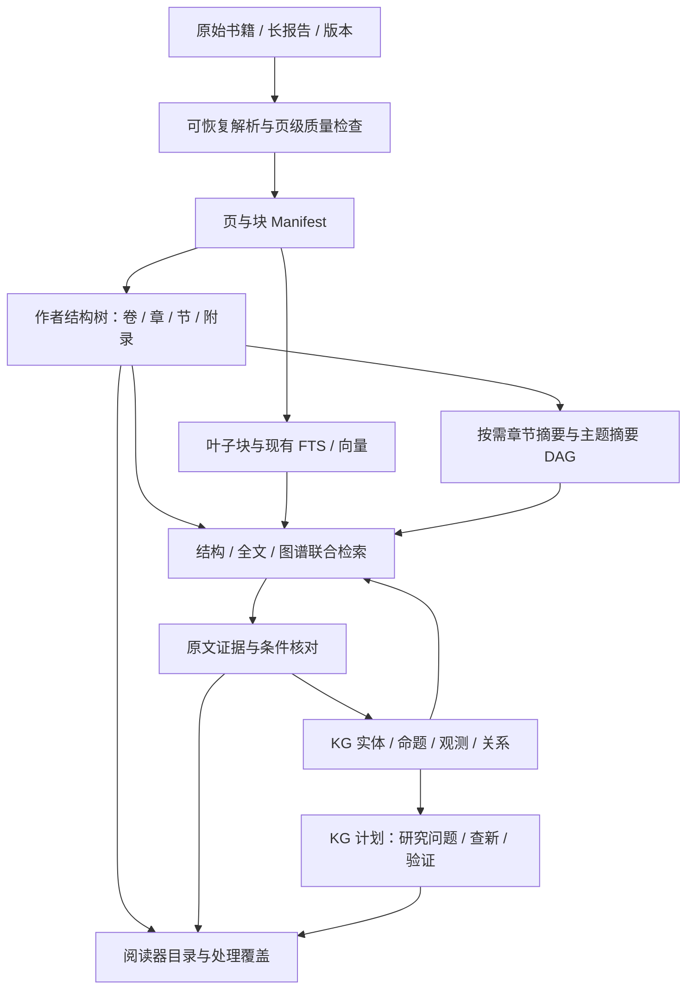
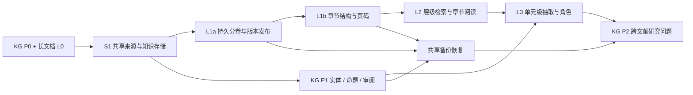

# PaperQuay 长篇书籍、报告处理与知识图谱联动计划

> 联合实施记录（2026-11-12）：版本推进至 `0.4.26`；Paddle generation 已从三种 content-list 形状提取章节候选，并在 generation 发布事务中与物理页映射一并提交；无可信标题时退化为 page-only 且不推测印刷页。新增只读查询只返回 sourceVersion 仍匹配的 current generation。完整检查构建通过、测试 1014/1014，Windows x64 安装器已本地构建并由标签工作流准备发布。目录修订 UI、L2 层级检索、L3 来源角色仍未验收；L0 复杂表格质量闸门继续阻塞，安装版和真实服务验收待补。见[联合执行台账](../implementation/joint-execution-ledger.md)与[L1b 变更记录](../changes/2026-11-12-long-document-l1b-structure-store.md)。

- 创建日期：2026-11-11；更新日期：2026-11-12（Asia/Shanghai）。状态：**按当前代码重新核对的待实施计划**。
- 项目基线：PaperQuay `0.4.25`，HEAD `0757957`，最近功能提交 `fe647ec`；桌面维护及验收范围为 Windows x64。
- 联动主线：[知识图谱与文献研究发现能力升级计划](2026-11-11-knowledge-graph-research-discovery-plan.md)，下文简称 **KG 计划**。
- 关联治理：[PDF 命名、重复附件与存储治理计划](2026-11-11-pdf-asset-naming-deduplication-and-storage-governance-plan.md)。只读体检／命名预览和资产 schema 已有；不将全量资产回填或改名作为长文档最小交付的前置。涉及物理迁移、locator 和备份路径改变时，与其 A4 复核兼容协议。
- 历史治理证据：2026-11-11 [225 个已登记源 PDF 的只读盘点](../research/pdf-asset-inventory-2026-11-11.md)作为当日记录保留，本次未重扫。library SQLite 已有资产位置、附件绑定和操作账本 schema，历史附件自动回填和阅读／解析 locator 迁移仍未完整交付。输入继续使用 `rootPaperId + attachmentId + contentHash`；分卷、临时 PDF、人工修订与 manifest 保留各自 role／版本，可选关联 `assetId`，不假定 rename alias 和迁移恢复已可用。
- 工作区联动：[文献工作区 UI 与元数据计划](2026-11-11-literature-workspace-ui-and-metadata-plan.md)提供右键“打开所在位置”及共享位置服务；本计划接入版本化 PDF、Markdown、解析目录和分卷产物。
- 联合实施进度：工作区已提供受 paper/location ID 二次校验的文件位置基础服务；manifest revision、单卷 artifact ID 与历史证据定位尚不存在，因此当前服务不能代表长文档版本定位闭环。KG-P0 已将 PDF 文本与 MinerU Markdown 视为不同向量表示空间；旧混合表示平均向量不参与关系生成。
- 一手调研：[层级检索开源机制](../research/long-document-hierarchical-retrieval-survey.md)、[长文档解析开源项目](../research/long-document-parsing-open-source-survey.md)。
- 本文所有新接口、数据表、指标、预算和排期均为设计建议；没有修改应用代码或处理个人文献。
- 阅读建议：先看第 1、3、12、14、17 节；实现时使用第 4—11 节的契约，第 15 节验收。

## 1. 核心建议：按结构管理，按问题读取，按证据进入图谱

**书籍和长报告可以处理得更好。应把它们视为有版本、有章节、有局部证据的复合知识来源，保留一个文库条目，再在内部建立章节、子节和证据单元。**

推荐采用：**可靠分卷解析 + 真实章节树 + 小块检索/有界父上下文 + 按需多层摘要 + 单元级增量 + 章节级知识抽取**。现有混合检索和阅读器继续作为基础，知识图谱在其上做跨章、跨书、跨论文关联。

这覆盖以下任务：

| 用户任务 | 应采取的处理方式 | 可交付结果 |
| --- | --- | --- |
| “这本书在哪里讲某个机制？” | 目录/全文/术语多路检索，定位到子节，再打开段落 | 章节路径、原文和页码 |
| “报告中的结论在附录有什么限制？” | 先命中结论，扩展交叉引用与附录，核对条件 | 双方证据和适用范围 |
| “结合这本教材和这些论文找研究方向” | 教材提供概念/机制/适用前提，论文提供原始结果和局限，进入 KG 的问题卡流程 | 有原文、最近已有工作、反例及验证计划的候选问题 |
| “系统性梳理整本书” | 独立的全范围任务：逐单元处理、记录覆盖、分阶段汇总 | 带章节覆盖台账的结构化综述，可暂停继续 |

不要将“云端解析分卷”“语义章节”“向量 chunk”“研究命题”合成同一个对象：150 页一卷通常只是服务传输单元，不能据此认定它是一个完整知识单元。

第一版优先覆盖用户已有 PDF 书籍/报告，包括文本 PDF 和扫描 PDF；EPUB、DOCX、HTML 可预留适配接口，但不进入首版全部实现。没有真实样本前，不以固定页数决定所有策略，需同时考虑字节、文本量、扫描占比、表格/公式密度与目录质量。

首批使用工程、计算、数学及其他非生命科学来源，按实际样本选择 profile。最小版本先解决“能查、能读、能续”，研究问题卡在 KG P2 联合试点验收。

## 2. 当前项目已经具备什么，仍缺什么

### 2.1 已核实基础

2026-11-12 复核时根目录存在 `.codegraph/`，先用 CodeGraph 定位调用链，再定向阅读解析、任务运行时、缓存、阅读器、RAG 和 Agent 源码。

| 编号 | 当前源码事实 | 价值与剩余问题 |
| --- | --- | --- |
| LD01 | MinerU 分支在 >200 页时按 150 页拆分，逐卷解析，再合并 content/middle/Markdown 与图像 | 已有超页数处理；这些阈值是当前代码策略，不代表所有部署的通用服务限制 |
| LD02 | PaddleOCR 分支每任务 100 页，复用拆分/合并 | 已有备用路径；不需要重新引入一套基础 OCR 流水线 |
| LD03 | `pdfSplitter.cjs` 读取整个源文件并用 pdf-lib 加载，之后逐卷复制页面和保存 | 分卷并不保证低峰值内存；大文件、图片型 PDF 仍需后台进程与资源实测 |
| LD04 | 两个分卷处理入口的 `partResults` 在本次调用内累计，成功后才最终合并 | 未见可跨重启复用的分卷产物账本；中后段失败可能重复前面已完成的远程工作 |
| LD05 | `mineruMerge.cjs` 能偏移显式 `page_idx`，改写重名图像并合并产物；部分解析错误记录 warning 后继续 | 保留此能力；需要发布前验证页覆盖、形状、缺页和资产完整性，不能因“合并文件存在”判完整成功 |
| LD06 | MinerU JSON 在 worker 中先完整解析，再生成 25 页 segments/outline，主线程累计接收的 pages | 已降低主线程解析和传输压力，但不是磁盘级流式/按需加载；两边仍可能持有完整对象 |
| LD07 | `readerRag.ts` 默认约 900 字符切块、120 字符重叠，MinerU chunk 带 sectionId/sectionPath，PDF 文本回退以页路径组织 | 有可复用的叶子证据和章节元数据；尚无可持久查询的章节实体、层级摘要和章节质量契约 |
| LD08 | 现有正文命中有前后扩展，单目标约 1500 tokens、邻接扩展总预算约 6000 tokens；标题扩展另有块/字符上限 | 是局部窗口补充，不能当作已完成跨章理解；6000 也不是整个问答输入的硬 token 总上限 |
| LD09 | RAG 有 source signature、generation、模型身份、按缺失 chunk ID 恢复和 finalize | 应复用其增量基础；当前任务和完成判定以整篇 source 为主，需增加单元粒度而非另造索引 |
| LD10 | `request_paper_context` 有 offset/contextVersion 续读，每篇单次最多 1600 字符，最多返回 5 篇 | 适合有界交互；如果可读正文有 100 万字符，顺序续读至少约 625 次，不能让普通 Agent 靠逐段翻页完成整本研究 |
| LD11 | Agent 加载上下文会读取 Markdown/JSON 或 PDF 文本，RAG 不可用时回退文档文本；初始 ReAct context 另有限额 | 能打开长文档不等于模型本轮已读全书；新流程必须显示实际读取范围 |
| LD12 | `page_footnote` 与页眉页脚等目前均被排除出 RAG chunk | 可避免页装饰误引用；但书籍/报告中的实质脚注、表格注释、限定条件需识别后保留，不能全部按装饰丢弃 |
| LD13 | 已有阅读器窗口化、字节预算 LRU、目录索引和 RAG worker | 首版继续扩展；缓存估算是启发式，不能代替大文档真实 RSS/主线程/IPC 测量 |
| LD14 | `documentParseTasks.ts` 提供内存任务快照／revision 事件及 PaddleOCR 查询；`paddleOcrRuntime.cjs` 保持任务运行而不依赖发起页签 | 可复用订阅和运行时；不等于跨应用进程重启的持久分卷任务账本 |
| LD15 | 当前 `paper_reader_manifest.json` 的兼容校验主要检查 documentKey／pdfPath；路径工具支持当前 `document-*` 与旧标题目录 | 不是本计划的来源版本／完整页覆盖 manifest；新版本需兼容读旧缓存并标明可验证程度 |
| LD16 | `prepareMineruCacheForReparse` 先移走 translations／summaries／images 并移除旧解析文件；成功收尾再删除备份 | 不能直接作为版本化发布协议；需先生成新 revision 再切换，保留仍被证据引用的旧产物 |
| LD17 | 0.4.23—0.4.25 已交付 PDF 来源生命周期、对照适配／初始同步与译版语言管理 | 复用当前身份和阅读状态；语言标签修改不等于译本内容变化或原译页码对齐 |

源码锚点：

- [mineruCommands.cjs](../../electron/backend/mineruCommands.cjs)、[paddleOcrCommands.cjs](../../electron/backend/paddleOcrCommands.cjs) 的分卷调度；[documentParseTasks.ts](../../src/services/documentParseTasks.ts)、[paddleOcrRuntime.cjs](../../electron/backend/paddleOcrRuntime.cjs) 的任务和运行时。
- [pdfSplitter.cjs](../../electron/backend/pdfSplitter.cjs)、[mineruMerge.cjs](../../electron/backend/mineruMerge.cjs)。
- [mineruParse.worker.ts](../../src/features/reader/mineruParse.worker.ts)、[mineruParseWorker.ts](../../src/features/reader/mineruParseWorker.ts)、[mineruSegments.ts](../../src/features/reader/mineruSegments.ts)。
- [readerRag.ts](../../src/features/reader/readerRag.ts)、[localRag.ts](../../src/services/localRag.ts) 的来源准备、索引与上下文扩展。
- [agentTools.ts](../../src/services/agentTools.ts)、[libraryAgent.ts](../../src/services/libraryAgent.ts) 的上下文请求和回退读取。
- [readerResourceBudget.ts](../../src/features/reader/readerResourceBudget.ts)、[历史长文档阅读器改动](../changes/2026-09-21-long-document-reader-windowing.md)。
- [documentReaderManifest.ts](../../src/features/reader/documentReaderManifest.ts)、[mineruCache.ts](../../src/utils/mineruCache.ts)、[mineruCacheCommands.cjs](../../electron/backend/mineruCacheCommands.cjs) 的 manifest、路径与重解析生命周期。

### 2.2 当前回归与历史证据

2026-11-12 与 KG 计划共用一次现有专项：

```powershell
node --test tests/knowledgeGraphCommands.test.mjs tests/agentGraphQuery.test.ts tests/ragMembership.test.ts tests/mineruSplitMerge.test.ts tests/mineruSegments.test.ts tests/readerRagContext.test.ts tests/readerResourceBudget.test.ts tests/ragIndexStatus.test.ts tests/documentParseTasks.test.ts tests/paddleOcrRuntime.test.ts
```

**55 项通过、0 失败**，覆盖图谱、成员资格、拆分／合并、目录传输、上下文、预算、索引状态及现有任务运行时。该结果不证明持久分卷、真实章节、新文件定位 UI 或 1000 页实测已经完成。本次未读取个人数据库、上传书籍或调用付费模型，也未执行全套构建和桌面验收。

原调研的 26 项通过保留为 2026-11-11 历史记录；`0.4.25` 全套 977 项与 Windows 安装版验收来自[既有记录](../changes/2026-11-12-translated-pdf-language-metadata.md)。外部固定版本和许可仍以原调研附件为准，本次未重新联网审计。

## 3. 开源项目选择与采用方式

下表区分已读源码机制与拟采用方案。固定版本、许可和细节见两个调研附件；项目自报成绩不能当作本项目承诺。

| 项目 | 最值得借鉴的机制 | 关键边界 | 采用建议 |
| --- | --- | --- | --- |
| [PageIndex](https://github.com/VectifyAI/PageIndex) | 作者结构/版面树、结构优先查询，再读页内容 | 当前本地默认 Flash；原始树可无 LLM，但默认摘要/优化会调用模型；本地主要面向文本 PDF，云 OCR/块级引用不能算成本地能力 | **优先借鉴结构导航**；对照评测适配器可独立运行，不让 SDK 代管文库 |
| [RAPTOR](https://github.com/parthsarthi03/raptor) | 递归聚类/摘要，支持不同抽象层召回 | 摘要树不是作者章节树；Node 缺现有块级证据；原型没有完整增量与人工成果保护 | **按需实现章节摘要，之后评估语义聚类**；叶子来源必须保留 |
| [LlamaIndex](https://github.com/run-llama/llama_index) 的 hierarchical/auto-merging | 小块命中后上卷到父上下文，补邻接内容 | 默认按大小分层，不自动等于真实章节；命中比例阈值不构成 token 预算 | **优先用 TS 实现同类父子策略**，复用当前检索 |
| [jina-ai/late-chunking](https://github.com/jina-ai/late-chunking) | 在长上下文编码后按段 pooling，缓解指代丢失 | 需要 token 级表示，普通单向量 API 不一定支持；模型仍有限长；代码/权重许可分开 | **后续可选实验**，不作为首版前置依赖 |
| [Docling](https://github.com/docling-project/docling) | 结构化文档对象、版面/表格、来源位置与序列化 | 结构导出不自动保证书籍章节正确；仍需资源、格式和版本适配评测 | **可选解析 adapter 的优先候选**，先和已有解析结果比较 |
| [MinerU](https://github.com/opendatalab/MinerU)、[PaddleOCR](https://github.com/PaddlePaddle/PaddleOCR) | 已有部署基础，版面、公式、表格/OCR与结构产物 | 长任务仍需应用层分卷账本、页码映射、质量验证；许可按代码/权重/实际版本分别处理 | **主解析路线继续使用**，先补调度和结构质量 |
| [Marker](https://github.com/datalab-to/marker) | 文档转换与结构化 JSON/Markdown 输出的对照实现 | 调研固定版本的代码为 Apache-2.0，但模型权重使用另行约束的 OpenRAIL-M；资源、模型和部署需分别评估 | **评测候选**，不是默认替换 |

相关论文依据：[RAPTOR](https://arxiv.org/abs/2401.18059)、[LongRAG](https://arxiv.org/abs/2406.15319)、[Late chunking](https://arxiv.org/abs/2409.04701)、[Lost in the Middle](https://aclanthology.org/2024.tacl-1.9/)。采用它们的机制必须在本领域、中文和长书样本上验证。

建议顺序为：当前解析质量盘点 → 结构树/父子检索 → 章节摘要 → KG 单元级抽取 → 可选高级算法。没有必要首版同时安装所有项目。

## 4. 三种结构共存，使用同一证据身份



必须区分：

1. **Document structure tree**：作者组织内容的路径。用于导航、章节范围和归属，允许人工纠正。
2. **Summary/semantic DAG**：系统组织摘要和跨章主题。可能多父、多归属，派生且可重建，不改变作者目录。
3. **Research knowledge graph**：类型化实体、命题、证据及研究假说。沿用 KG 计划的状态与科学有效性规则。

“第 7 章”包含“方法 M”是结构/提及关系；不能因此推出该章提出 M，更不能据主题聚类推出 M 与另一方法存在因果关系。

## 5. 数据契约：复合来源而不是几十个假论文条目

### 5.1 身份与书目信息

保留当前 `paperId` 作为库内根 ID 和权限／成员资格入口。先映射现有书目类型、ISBN、机构与出版者等字段，复用工作区元数据编辑契约，不另建一套可互相覆盖的书目系统。内部处理 profile 可用 `article|book|edited-volume|report|manual|standard|unknown` 等类别，但必须定义与现有类型的映射和 unknown 回退；仅为确实缺失的版次／修订、有效日期、适用区域等新增字段。

ISBN、书籍 DOI、章节 DOI、报告编号是不同外部标识，按对象粒度关联；章节 DOI 不能把整本书误合并成某篇论文。章节可能有独立作者和参考文献表，编者不自动等于各章作者。中文无 DOI 书籍保留书名、版次、作者/机构、年份和用户确认记录。

`DocumentFamily` 连接新版/旧版、译本/原本、扫描本/电子本。译本段落和页码不同，不做同偏移继承；版本关联不自动覆盖旧版证据。报告修订/勘误、标准的生效与废止日期需要单独字段，不能只用入库年份判断“最新有效”。

语言标签沿用 0.4.25 已交付的附件语言字段，仅描述用户确认的语言；不凭标签认定译本与原本逐页对齐、校验通过或建立新内容版本。只改书目、语言、显示名称不重新解析全文；替换 PDF 则按新 hash／来源版本处理。

同机构不同年度报告通常属于 `DocumentSeries` 下的不同 work，不自动合并为同一份报告的版本；它们的研究期间、统计口径和数据可能不同。版本族、系列、共同数据来源及独立研究身份分开，避免一方面重复计票，另一方面错误折叠真实时间变化。

### 5.2 对象与存储

| 对象 | 最少字段 | 约束 |
| --- | --- | --- |
| `DocumentManifest` | rootPaperId、attachmentId、可选 assetId、roleSnapshot、fileHash、fileSize、pageCount、parser/config/model version、sourceVersionId、revision、artifact refs、publicationState | 原文件与解析产物身份明确；没有真实统计时不填完整状态 |
| `PhysicalPage` | sourceVersionId、pageIndex、labelRaw、printedLabel、quality、text/artifact refs | pageIndex 统一 0 基；逻辑页码只是标签，不作全局唯一键 |
| `DocumentUnit` | unitId、rootPaperId、parentUnitId、kind、title、order、page/block boundaries、unitContentHash、revision、structureOrigin/quality | 章/节/附录等可持久查询；同页多节用 block/span，不能只用页范围 |
| `ParsePartition` | stableTaskKey、source fileHash、physical page set、provider/config、remoteJobId、artifact hash、attempts、state | 物理分卷与 DocumentUnit 分离；跨重启恢复 |
| `SummaryNode` | kind、text、inputUnitRevisions、coveredLeafIds/coverage refs、claimEvidenceMap、model/prompt、state | 摘要可多父；保留来源与缺失范围，不作为唯一事实依据 |
| `CrossReference` | fromUnit/span、targetLabel、resolvedTargetId、kind、confidence/reviewState | “见 7.2/表 3-1/附录 B”可未解析，不猜目标 |
| `UnitCoverage` | taskKind、unitRevision、eligible/processed/failed/skipped counts、reason、runId | 解析、索引、抽取、阅读、审核分别计数 |

**共享 KG 计划的 `paperquay-knowledge.sqlite` 和单写入者。** 新增 `kg_document_manifests/units/pages/parse_partitions/summaries/summary_inputs/crossrefs/unit_coverage` 等表；在该库尚未实现时，将基础 schema 拉到联合里程碑 S1，避免另建长期权威 `longdoc.sqlite` 再迁移。

解析原始 JSON、页面 shards、图片和可重建的大正文存既有 cache 下的版本目录；数据库存身份、索引和 artifact refs。人工目录更正、页码映射、更名、排除、章级审核和书目纠正存持久事件。`knowledgeWorker` 负责该库写入，解析进程产出文件并提交结果；现有 `ragWorker` 仍是 RAG 库写入者，不让多个 worker 直接竞争同一知识库。

当前旧 manifest 先以兼容适配器只读导入为 legacy／unverified；不能因 JSON 中有 documentKey 和 pdfPath 就补标完整或当前匹配。新 manifest 保存 schemaVersion、expected／verified page set、artifact hashes 和发布状态。由同一产物解析器提供当前与历史定位；旧 `full.md` 等兼容入口应指向已发布版本，不能让读取方猜到 staging 文件。

### 5.3 与 KG 核心对象的扩展契约

| KG 对象 | 本计划增加的字段/规则 |
| --- | --- |
| `SourceVersion` | rootPaperId、documentFamily/version、manifestRevision；unit 内容哈希用于复用，但不能替代具体来源版本 |
| `EvidenceSpan` | 可选 unitId/unitRevision、physical pageIndex、printedLabelSnapshot、block/span；跨页论述由多个 span 表达 |
| `Claim/Observation` | 来源角色、章节归属、documentKind；区分原始观测、综述转述、规范要求、建议、教材定义 |
| `PaperEntityContribution` | 可选 unitId 与局部作者；“书籍提及/介绍”不自动写 proposed；新书版的收录不等于概念首次出现 |
| `Relation` | 可涉及 DocumentUnit，但图投影默认聚合到 root；证据指向真实叶子 |
| `AnalysisRun/NoveltyCheck` | scope 包含 unit IDs 与 revisions、读取级别；问题依赖章节变化后按 KG 失效规则处理 |

`kg_claim_evidence` 和推导前提链沿用 KG 计划；不要让章节摘要形成一个绕过命题证据校验的旁路。

## 6. 解析与长任务：能恢复，能知道哪里缺失

### 6.1 先做文档体检与路由

读取文件页数、字节、书签、文本层可用度、随机/分层页样本与图表密度；展示估算和处理范围。策略示例：

- 文本层可靠、目录清晰：优先轻量提取与结构恢复，复杂页面再用布局解析。
- 文本层混乱、双栏、密集表格/公式：沿用 MinerU/PaddleOCR；按页质量补处理。
- 扫描为主：先少量前/中/后和目录页试解析，评估方向、语言、文字质量后批量运行。
- 混合扫描/数字文本：逐页选择来源，但保留 page→parser/version 映射；同页只能有明确主文本来源，避免索引重复。

这些是拟议路由规则，不以一个 OCR confidence 数值自动认证整本质量。目录、表格或公式重点页需要人工抽检；横向页、双页扫描要先定义 pageRegion→原页的映射。

### 6.2 分卷账本与发布协议

1. 以文件 hash、物理页集合、provider/config/version 构成稳定任务键；runId 是执行身份，不能作为唯一复用键。
2. 创建 pending partition，记录配额/文件/页数约束。页数阈值按 provider capability 配置，不把当前 200/150/100 写死成所有服务政策。
3. 提交远端任务后持久化 remoteJobId；下载后校验输出 hash、页覆盖、必要文件与图像引用；每卷独立标记 verified。
4. 模型/API 失败只重试失败卷；重启后先恢复已有任务或有效产物。签名 URL 过期则尝试重新获取，不能把“已提交”当“产物已保存”。
5. 支持取消：停止后续提交，记录已发出的远端任务及可能产生费用的状态；不承诺远端已运行任务一定能撤回。
6. 合并生成临时 manifest，校验 expected pages 与实际 pages 的差集、重复、显式/隐式页序及资产路径。失败卷未补齐则整体 partial，并可先查询已验证范围。
7. 通过校验后原子发布新 manifest revision；读者绑定版本。旧 manifest 保留到无人引用与回收策略允许时再清理。

`partition` 状态建议为 planned／submitted／downloading／verified／failed／cancelled／unknown；manifest 分开记录 `publicationState=staging|prepared|current|superseded` 与 `coverageState=unknown|partial|complete`。新 revision 尚不完整时，可显式读取其已验证范围并显示 partial，不默认替换旧 current 或混入其查询结果。断电可能发生在远端接受任务而本地尚未记录 job ID 的窗口：优先用提供方幂等键或查询恢复，不能确认时标 unknown 并报告重复计费风险，不承诺任何服务都能做到远端恰好提交一次。

### 6.3 重解析发布与旧成果保护

新长文档流程不直接调用“先清理当前成果”的旧重解析路径。每次在独立 revision／attempt staging 下写分卷与合并结果，校验后先记录 prepared 状态，再事务切换 current 指针；文件发布和 SQLite 提交之间用可重放账本恢复，不能把跨文件／数据库操作当成一个天然原子事务。

失败或取消保留旧 current 可读，新任务显示 partial／失败及继续入口。旧 translations／summaries／images 保留所属来源版本，不将它们自动挂到新正文；仍被 EvidenceSpan、人工修订或运行中读者引用的产物不得删除。清理走受管理路径和引用保留策略，与资产治理协调；兼容旧缓存读取不触发历史目录清空。

提交前再次比较文件 hash、任务 generation、排除/删除状态；迟到的旧任务不能成为 current。清理只针对受管理 cache 根内的已校验路径，不能依照解析内容中的路径执行任意文件操作。

页数读取或拆分失败时返回明确的诊断与可选处理路径；只有当前 provider 明确支持文件大小/页数且用户原计划仍适用时才降级直传。不能把“页数未知”当成短文档，也不能无限重复一个已知超限的整本请求。

### 6.4 分卷边界与跨页对象

物理分卷优先在服务限制内选择附近自然边界，但不要求等待完整目录才开始 OCR。跨卷段落/表格应保存 continuation candidate、前后原页与片段，不直接拼出新数值。

必要时追加 1—2 页边界重处理或语义补读，页号仍指向原 PDF。重叠页只用于校验/上下文，按原页和内容身份去重；不能把同一张表、同一观测计成两份证据。表格的行列、标题、单位、脚注和出处必须一起可访问，首版无法可靠合并时显示两段原表并人工核对。

页眉页脚的重复检测按位置、跨页频率和块角色综合；实质脚注、endnotes、表注和安全/适用限制保留为可检索对象。不能因为当前类型名含 footnote 就一律丢弃。

## 7. 章节与页码：先建立可靠导航，再生成总结

### 7.1 多来源章节恢复

推荐顺序：PDF bookmarks → 现有解析 title/text_level → 目录页识别与编号/字体线索 → 少量 LLM 辅助判断。不同来源作为证据和候选，不按“第一个有结果”盲目信任。

自动检查：标题顺序、同页并列标题、层级跳跃、空章、父子范围、参考文献/附录边界、重复 running header。显示结构来源和待审项；用户可合并/拆分、移动层级、修改范围。人工更正保留 revision，下游摘要/索引依赖更新。

没有可靠目录时，建立页组或标题候选范围并标明 `structureQuality=page-only/partial`，仍可全文检索。`page-group` 不显示为作者章节；每页都有位置不代表每页语义都完整。

### 7.2 物理页与印刷页映射

保留三个值：`physicalPageIndex`、PDF `pageLabel`、可选 `printedPageLabel`。正文可能从 1 重新计数，前言使用罗马数字，附录使用 A-1，合订报告甚至多次重置。映射应为分段/逐页记录，不能全书只加减一个 offset。

引用可显示“第 8 章 §8.3，印刷页 217（PDF 第 239 页）”；跳转始终使用物理页和实际 block。目录中的印刷页只能作为映射候选，经对应页标题核对后生效。找不到印刷页时显示 PDF 页即可，不补猜。

### 7.3 本章开头与整章范围

整章包括子节，但父节点自身 introduction 与 children 的正文覆盖需能区分。同页结尾/开头的两节不能通过整页简单分割；证据层使用有序 block 或 span 范围。跨页表、图与其说明使用对象组连接，不以“最近标题”替代真正归属。

## 8. 检索与阅读：结构和全文互相补漏

### 8.1 路由策略

| 问题类型 | 优先通道 | 扩展方式 |
| --- | --- | --- |
| 定义、公式、参数、精确数值 | 叶子 FTS/向量与术语/索引页 | 命中小节的必要上下文、公式定义、表注 |
| “某章如何论证”“整书结构” | 作者结构、章节摘要 | 逐级下钻，结论回查叶子 |
| 前文条件与后文结论、附录例外 | 分解子问题，独立检索各证据角色 | crossrefs、前提/结果关系和受控图路径 |
| 主题跨多个章节 | 章节主题检索、全文通道 | 语义摘要 DAG 或 KG，保留跨章多样性 |
| 整本系统性综述 | 有范围的逐单元读取任务 | map→证据化单元报告→分层综合，覆盖台账必填 |

结构召回作为额外通道，不把首轮选中的几章当永久硬过滤。首版可并行召回若干章节候选和全书叶子候选，融合后重排；章节召回不足、结构质量低或待查附录时主动扩大范围。

### 8.2 父子检索与上下文预算

1. 叶子仍按段落/块检索，保持原文定位；新增 parentUnitId，不重造不可定位文本。
2. 小块命中后，扩展到合适子节、定义、表注或前后块；父节过长则拆成有界窗口。
3. 窗口范围按 token/角色/结构约束，不一律扩大成整章。查询预算需覆盖 seeds、父上下文、图像、历史消息与输出预留，不能只统计邻接补充。
4. 每个命中区分 `retrieved-leaf/parent-context/summary-route/graph-route`，被摘要路由命中不代表已阅读对应原文。
5. 数值/冲突问题优先保留条件和反例；不要只把重复解释排在前面挤掉附录例外。

初始实验可比较叶子约 300—700 tokens、父上下文约 1500—3000 tokens，但**不是永久默认值**；中文、表格和公式按实际 tokenizer、原文边界及模型能力配置。现有 900 字符基线保留用于对照。

### 8.3 文档长度偏置与独立来源

一部书可能贡献数千块，不应占满全库 top-k。采取 query-scoped 的 root/章节配额、多样性重排、同段近重复折叠，必要时先选来源再选单元。用户明确只问某书时放宽该书配额。

证据数量至少同时显示 root 数、章节数、span 数及原始研究来源族数。一本书 20 章或同一年度报告的多个表格不能被汇总成 20 项独立研究；也不能让长书因出现频率高就把概念 hub 权重无限放大。

### 8.4 章节工具替代低效字符翻页

建议新增只读能力：

```text
get_document_structure(rootId, depth, cursor, structureRevision)
search_document_units(rootIds, query, unitKinds, scope, budget)
read_document_unit(unitId, revision, cursor, maxTokens, evidenceRole)
resolve_cross_reference(sourceSpanId, targetLabel)
get_document_coverage(rootId, taskKinds, unitScope)
```

游标绑定 unit/source/structure revision，来源变化明确 invalidated。返回 rootId、unit 路径、实际读取页/块、是否 partial、下一游标、正文/摘要级别和可用证据 ID。原有字符续读继续兼容，但不承担全书系统性读取。

内置 Agent 与 MCP 复用统一后端服务；外部 MCP 不假定已经有这些工具。增加 stdio/schema/范围/版本契约测试，先开放查询，重构建与写入沿用主计划护栏。

## 9. 分层摘要与全书综合：记录遗漏，不把摘要变成事实源

### 9.1 两种摘要分别构建

- **结构摘要**：子节→章→卷→书，帮助导航和范围综合；记录实际覆盖的 children 与未处理项。
- **主题摘要**：跨章相关原文/命题的多归属集合，借鉴 RAPTOR；后续有收益再做，不强改作者目录。

摘要中的实质性结论保存 claim→原文 evidence 映射，以及例外、争议、术语表和未解决交叉引用。父摘要不得将“部分章节已有证据”写成“全书均如此”。数值和限制不能只从更高层摘要反推。

摘要/模型版本变化可以重建；人工笔记和确认的 Claim 不自动覆盖。摘要缺失或过时时可回退原文，不静默用旧摘要当 current。

### 9.2 按需与全范围任务分开

默认先解析结构和建立基础索引。用户问到相关章节时再建摘要和抽取，后台按预算预热常用章节；这可减少首次整本付费建图的成本。

用户明确要求全书系统性梳理时，必须枚举所有 eligible unit，按队列完成，显示失败/排除/未处理范围；最终为 complete 或 partial。按需读了几章不能返回“已读全书”。全书 map/reduce 每一步持久化中间结果，支持暂停与审阅后继续，不能把根摘要当完成证明。

## 10. 增量、资源与索引一致性

### 10.1 单元级复用与来源版本

原文件 hash 变更后建立新 SourceVersion。可以用 unitContentHash、标题/邻接、块文本与页位置建立候选映射，但只有验证内容和定位一致后才复用抽取/向量产物并绑定新来源。相同文字不能自动认定仍在同一页，也不能仅按“第 7 章”复用另一个版次。

更改一段或一个页码映射时，计算受影响 unit/摘要祖先/命题依赖，不重做整书所有模型调用。规范化结果哈希、parser profile、模型、prompt/schema 和 representationKind 均参与复用身份；人工 merge/split/驳回记录独立持久化。

产物复用还要包含实际输入的上下文依赖：父标题、术语定义、被引用前提、跨章条件和所用修订。某节自身文字未变，但前文定义已变时，其相关命题仍需失效复核。摘要 DAG 按所有 input revision 失效，不只沿作者目录祖先传播；单纯显示用的标题改名与改变语义的修订区分处理。

### 10.2 对现有 RAG schema 的改造边界

当前 `ensurePreparedSourceIndexed/finalize` 以 document+source 计算 expectedChunkIds。新增单元粒度不能简单把章节伪装为新 documentKey，否则可能破坏 library membership、排除、引用和根级覆盖。

建议保持 rootDocumentKey，新增 unitId/unitGeneration 分区与状态表；事务内只替换受影响分区，根级状态聚合各单元。清理 stale 行按 expectedUnitSet 与 generation 执行，禁止单章 finalize 删除其他章节。查询同时过滤当前模型空间、资格、manifest revision 和已发布分区。

KG 计划 W0.1 的向量空间隔离先完成；章节/摘要/方法等表示增加独立 representationKind，不能与正文均值向量混算。模型重建期间保留明确状态，不能把尚未完整发布的不同 generation 混为一套完整索引。

### 10.3 大文件与按需读取

首版先把分卷、JSON 解析和合并放到可取消的后台任务并测峰值。L0 若发现代表样本超出预算，必要的版本化 page shards／磁盘索引和按需读取进入 L1／L2 的阻塞项；只有不影响目标样本的进一步优化才留到 L4。仅把解析移动到 worker 并继续两边累计完整 pages，仍无法解决峰值内存。

阅读器只常驻可见窗口和小量预取，结构索引轻量常驻；查询后端从磁盘读必要范围，不为一次检索把整书反序列化到渲染器。图像缩略图按预算载入，原图按需；请求 IPC 有 byte/page/token 上限与 backpressure。

多任务并行同时受全局内存、provider 并发、限流与预算约束；初始保持保守并发，不用提高分卷并行度掩盖资源问题。性能评测分别报告 UI、主进程、worker、解析进程与远端时间。

## 11. 长来源进入知识图谱时的学术语义

### 11.1 来源角色与贡献归属

| 内容 | 初始记录方式 | 必须补的核查 |
| --- | --- | --- |
| 教材定义、推导和通用原理 | definition/derivation/established-background，附条件和原文 | 书中假设、符号作用域与适用范围 |
| 教材转述他人实验 | reported-secondary-claim | 尽可能连接原始论文；无法取得原始材料时保留二手状态 |
| 专著中的作者新方法/证明 | author-claimed-contribution | 记录“作者声称”，跨外部工作查证；不是因为是书就否定或肯定原创 |
| 技术报告的实测/仿真 | primary-observation（待核查） | 方法、样本、单位、基线、不确定性和版本 |
| 政策/行业报告的判断、情景预测 | assessment/scenario/recommendation | 机构、情景、时间、假设与数据来源；预测不当作已观测事实 |
| 标准/规范 | normative-requirement | 版本、有效期、适用区域和条款；与经验命题分开 |

来源角色按具体 Claim/Observation 判断，不能仅按文件类型统一赋值。编辑文集中不同作者的原创章节、单份报告中不同独立实验可以有各自的原始研究身份；必须记录作者/方法/数据与独立性依据后再分别计数。root 数用于来源组织，`primaryStudyKey/dataFamilyKey` 用于证据独立性；无法确认时标 unknown，不按章节数自动增加，也不把整本中的所有研究强制算成一个实验。

章节里的“研究空白”可能是十年前写作时的状态，也可能是练习题或教学简化。记录发表/修订时间、角色和外部查新，不能直接转成当前未解问题。

### 11.2 跨章变量与指代

符号、缩写、单位和定义保留 chapter/section 作用域；同一本书不同章节的 `Re`、`k`、`M` 不自动 same_as。章节开头定义和后文公式通过 crossref/definition 引用补取，不能只凭块向量相近合并。

同条件范围下再比较结论。不同版本、不同无量纲定义、不同统计口径和不同规范要求的差异可以是条件差异，不先标为矛盾。

章节参考文献也有作用域：编辑文集可能每章都从 `[1]` 重新编号，章节 DOI 与书籍 ISBN/DOI 分别解析。`CitationOccurrence` 保存所在 unit、原文 span、局部参考表和解析目标；不能只用数字 `[12]` 跨全书匹配。正文引用、章末参考表、全书索引/术语表分别标识；参考表可用于拓扑候选，但不把其中的标题串当作者自己的主张抽取。

跨论文引用比较优先使用相关章节的参考集合，同时保留整本聚合的覆盖信息。否则一本参考资料丰富的教材会成为泛化 hub，产生大量没有具体研究语境的文献耦合边。

### 11.3 研究问题的联合输入

例：教材某章给出机制 M 的前提与失效条件；论文 A 在条件 C1 验证改进方法；报告 B 显示实际工况 C2 的需求。系统分别读取三处原文，检查 C1/C2 与 M 的前提，再交给 KG 六类发现模式中的方法迁移/条件扩展/局限求解。

产物仍是 KG 的 ResearchQuestionCard，增加 unit 范围、书籍版本与原始来源追踪；保存最近已有工作、反例、预测和最小实验。缺一侧原文则降低证据级别；没有实验或论证记录仍为 proposed。详细科学状态、查新失效和验证规则以 KG 第 9 节为准，不另建一套状态机。

## 12. 与 KG 计划联动：共同底座与单一依赖图

两个计划是同一升级的两条工作线：本计划负责**长来源如何完整、经济、可追溯地进入研究语料**；KG 计划负责**对语料中的关系和研究问题进行发现、核查与验证**。

### 12.1 共享里程碑

| 共享项 | 本计划职责 | KG 工作包 | 验收交接 |
| --- | --- | --- | --- |
| S0 正确性和基线 | 长书/报告样本、资源与范围测量 | W0.1—W0.5 | 同模型空间、身份和覆盖契约一致 |
| S1 来源与基础存储 | manifest/unit/page/partition、目录修订 | W1.1、W1.2 | 同一个 knowledge store/writer；给 KG 可定位 SourceVersion/EvidenceSpan |
| S2 检索与证据 | leaf/parent/structure 通道和章节工具 | W1.2、W1.3、W1.5 | 原文定位、条件补取和失效规则通过 |
| S3 语义与归属 | 章节 profile、来源角色、缩写作用域 | W1.3、W1.4 | Claim/实体/贡献角色可追溯；章节不重复计独立证据 |
| S4 发现与问题卡 | 提供选中章节、跨章证据和版本 | P2 | 共用问题卡、查新和验证状态机 |
| S5 恢复与发布 | 页面 artifacts、人工目录/页码/排除、manifest恢复 | W1.6 | 备份后原文可定位，或准确显示缺失与待重建 |

S0—S5 是交接编号，不是必须串行完成的六个版本；S5 的备份与恢复设计从 S1 开始，随最小版本交付。S1 的基础 manifest／partition schema 可先于 KG 全文抽取实现；L1 不等待完整 KG P1 或问题卡。

| 外部依赖 | 最小长文档交付的要求 | 可独立推进部分 |
| --- | --- | --- |
| 工作区 P0-F | 复用文件位置服务，扩展 manifest／分卷角色 | 解析账本、结构与查询不等待完整筛选或编辑器改版 |
| 资产治理 A4 | 真正启用改名／迁移时联合复核 locator、备份与旧路径 | 继续用现有附件＋hash，先交付只读定位与持久分卷 |
| KG W0.1／W1.1／W1.2 | 章节向量前完成模型隔离；共用来源 schema、存储和写入者 | L1 的恢复可先做；L2 的结构／FTS 路径不依赖高级图分析 |
| KG P2 | 研究问题卡按证据质量门槛后交接 | 长书查询、阅读、恢复和选章建图各自验收 |

### 12.2 依赖顺序



层级检索可以在 KG 研究问题生成前交付；新假说生成不应绕过可靠来源与恢复验收。普通短论文允许只有一个或少量单元，使用同一契约，不强制生成深目录或多层摘要。

### 12.3 联动的不变量

1. 文库成员资格始终在 root 层校验；章节排除只能进一步收窄。父文献被移出时，不能通过章节工具、摘要或图路径继续自动检索。
2. `scopeSnapshot` 包含实际单元集合与 revisions；文档数、章节数、已读证据数分别报告。
3. 知识 schema、worker、备份、来源失效与查新状态只各实现一份，不按两个计划重复造。
4. 已保存的人工问题卡和审核事件不随 cache 清理消失；重建派生摘要不能覆盖人工记录。
5. PDF/模型/外部元数据是内容输入；不执行书中出现的脚本、提示或任意工具指令。

## 13. 交互：让用户知道处理了哪一部分

长文档详情新增轻量处理面板：文档类型/版次、文件/页数、目录质量、解析覆盖、索引覆盖、摘要/抽取覆盖、实际 token/费用、失败分卷与继续入口。

目录树每章显示“可读取/未解析/未索引/未抽取/来源变化/人工排除”等实际状态；用户可以选择几章建图，或发起全书任务。处理计划先给范围和预算，不默认一次全文调用所有模型。

检索结果显示 root→章→节、物理/印刷页和证据级别；跨章回答可展开“本次查了哪些章节、未查哪些范围”。图谱默认折叠整本来源，按需展开章节与局部命题，避免一部书淹没全库视图。

书籍比较矩阵允许选择章节/方法/条件；整本级汇总标明来源范围，不用一个平均向量或一句摘要代表全书。接受某条语义关系时，证据侧栏直接复用 KG 设计。

### 13.1 PDF、Markdown 与解析产物所在位置

文献右键、长文档处理面板及证据入口复用[工作区第 4.5 节](2026-11-11-literature-workspace-ui-and-metadata-plan.md#45-右键文献打开所在位置)的菜单和位置服务：定位原文／译版 PDF、已发布 `full.md`、已有解析 JSON、图片和目录。分卷记录可通过展开项定位已下载产物，显示物理页范围、任务和版本；只有远端 job ID 时显示“尚无本地产物”。

从 manifest 按 artifact ID 和 revision 解析实际文件；原文、解析分卷和译文的角色保持可见，不扫描邻近目录任意认领 PDF。旧缓存路径可兼容发现，但归属未核实应明确提示。历史证据只定位其对应文件；缺失时保留缺失状态，另行提供当前版本或已知父目录入口。操作不创建目录、不恢复远端任务、不重新生成 Markdown，也不替代证据支持核查。

## 14. 分期实施、工作量与合并排期

### 14.1 工作包

| 阶段 | 具体范围 | 前置／估算状态 | 完成条件 |
| --- | --- | --- | --- |
| L0 体检／基线 | 数字／扫描／报告样本；目录、检索、内存、临时磁盘和覆盖测量 | 当前代码可开始；完成后重估后续包 | 有 fixtures、问题集和固定硬件预算；决定必要的按需 page store 范围 |
| L1a 持久分卷与发布 | S1 基础 schema／writer、任务账本、远端恢复、staging 校验、current 切换、旧版本保留 | L0 和共享来源契约；不等待 KG 抽取 | 已验证卷可复用；崩溃／取消不破坏旧 current；unknown／partial 准确；最小备份往返通过 |
| L1b 结构与页码 | 页映射、章／节边界、目录质量、人工修订及版本化产物位置 | L1a 的 manifest／page；可先用已校验样本开发 | 无可靠目录时仍能页级查询；印刷／物理页不混淆；人工更正可恢复 |
| L2 层级检索 | unit 索引、父子窗口、章节工具、覆盖 UI、按需结构摘要 | L1a／L1b；向量路径先满足 KG W0.1 | 跨章／附录证据可追溯；单章 finalize 不删其他章；总输入和资源预算受控 |
| L3 KG 联动 | 单元抽取、二手／原始／规范角色、作用域及备份联验 | L2 与 KG P1；问题卡另依赖 KG P2 | 先验收经审阅的证据关系；P2 就绪后再验收跨书／报告／论文的问题卡 |
| L4 可选增强 | page store 深化、语义摘要 DAG、late chunking、新解析器、更多格式 | 依实测收益另估 | 首版必需的资源修复已在 L1／L2 完成；增强项单独对照验收 |

原计划 L0—L3 的独立估算为 **30—46 人日**（L0 3—5、原 L1 10—15、L2 10—15、L3 7—11），包含与 KG 重合的共享底座。本次把 L1 拆成 L1a／L1b，并明确旧缓存发布改造及资源门槛；旧数字仅作历史参考，不能直接分配到新工作包。L0 后按实际样本、失败恢复协议和共享任务重新估算。

首版范围不包含通用跨页表格数值抽取、所有图像／公式理解、多格式支持、自动实验执行或多学科质量承诺。每个包在实现及验证后更新状态，不因完成此计划而标记交付。

### 14.2 两计划合并投入

原联合 **56—93 人日／15—24 日历周**，来自旧 KG 38—55 与长文档 30—46 人日，减去未经实测的共享项 8—12 人日。保留为历史预算记录，本次撤下它作为当前排期的依据；固定核减天数尚无新的工作分解支持。

新的排期以单一 backlog 为准：S1 存储／来源、S5 备份、W0.1 模型隔离和工作区 P0-F 各计一次；解析发布、章节结构、检索、抽取和问题卡分别估算。W0.5／L0 后记录负责人、范围、依赖、样本、开发与标注投入、验收证据和剩余不确定性，再给日历计划。多人可并行后台与 UI，但共享 schema／版本／备份有串行交接。

可提前交付的最小版本是 L0＋L1a＋L1b＋L2 的真实结构／全文双路检索，以及相应备份恢复和位置入口；按需摘要可在相同里程碑内分批开放，KG 高级发现与 L4 不阻塞该版本。选章建图属 L3，问题卡再对接 KG P2，分别验收。

### 14.3 建议代码边界

```text
electron/backend/documentManifest.cjs       原文件/分卷/页/产物一致性
electron/backend/documentStructure.cjs      目录、unit、页标签与修订
electron/backend/documentParseJobs.cjs      持久任务计划、恢复、发布
electron/backend/documentUnitQuery.cjs      范围、正文游标与跨引用
electron/backend/knowledgeStore.cjs         与 KG 共用 schema/迁移/人工事件
electron/backend/knowledgeWorker*.cjs       与 KG 共用写入/任务协调
electron/backend/ragStore.cjs               unit 分区与 generation/finalize
src/types/documentStructure.ts             共享来源/单元/覆盖契约
src/services/documentUnits.ts               前端章节查询适配
src/services/literatureFileLocations.ts     工作区共用的位置服务，扩展 manifest 角色
src/features/reader/DocumentProcessing.tsx  处理范围/继续/覆盖
src/features/reader/DocumentOutline.tsx     结构质量/更正/章节选择
src/services/agentTools.ts                  新章节工具及旧接口兼容
```

路径是实施建议。本轮没有创建这些模块；现有文件如何拆分以最终接口边界为准，避免把调度/索引/知识发现继续堆入大型阅读器组件。

## 15. 评测、资源门槛和回归

### 15.1 试点样本

建议 8—12 个有许可的来源：至少包含 300—1000+ 页文本教材、无书签扫描本、中英文混排技术报告、含跨页表格/脚注的报告、前言罗马页码、多个附录、合订重置页码、双版/译本和少量短论文回归。数字仅为取样建议，无需一次处理全部深度抽取。

从中人工标注约 60—100 个问题与原文证据集合，包括精确细节、跨章、目录误导、正文+附录条件、二手转述、无答案、版本冲突和同名符号。按文档族/版次拆开发与保留集，不能拿同书相邻章节调参再宣称跨书泛化。

### 15.2 基线与消融

- B0：当前 900 字符/120重叠、现有混合检索与邻接扩展。
- B1：只加标题路径/真实章节过滤与多样性。
- B2：B1 + 父子上下文与跨引用。
- B3：B2 + 按需章节摘要通道。
- B4：B3 + KG 单元关系/命题通道。
- 选配对照：PageIndex 原生本地检索、RAPTOR、late chunking、新解析器分别单独加入。

相同模型、候选/上下文预算和问题集比较；整本输入仅对上下文可容纳的小样本作为基线。分别报告建库一次成本、每问题成本、冷/热缓存与增量成本，不用总费用掩盖某个模式的退化。

### 15.3 建议门槛

**以下全部是拟议目标，未在本项目大文档上测得。**

| 维度 | 验收方式与初始目标 |
| --- | --- |
| 完整性 | 所有预期物理页有明确可用/失败/排除状态；不得静默丢页或以缺卷标 complete |
| 定位 | 保留集 evidence 定位成功率候选目标≥98%；同时报告语义支持和失败原因，不能只测页号合法 |
| 结构 | 标注标题/层级/范围准确度按文档类型报告；低质量自动降级，不设一个跨所有类型的虚高平均 |
| 检索 | evidence Recall@k与跨章所需证据集合的完整召回率，相比B0有可重复改善；报告简单细节回退 |
| 回答/关系 | 原文支持、条件/脚注保留、二手来源归属和弃答率，由独立领域人员评审 |
| 恢复 | 第 2／末卷失败、进程重启、URL 过期、取消后重开；可核实的有效卷不重复提交，丢失 job ID 时标 unknown，费用账本可核查 |
| 增量 | 只改一节时未变更单元可复用；单章 finalize不误删其他单元，旧版结果不混current |
| 资源 | 固定例如16GB内存、无独显机器测1千页文本/扫描样本；峰值RSS、IPC、UI长任务、临时磁盘分别报告 |
| 交互 | 缓存章节/正文首屏候选目标p95<1秒；模型生成、首次OCR与全书构建单独计时 |
| 科研联动 | 长来源进入Claim/卡片仍保留原文、版本、角色与查新绑定，不因多章而重复计独立证据 |

资源目标须在 L0 测量后定具体预算；不能承诺所有千页扫描书都在固定内存内解析。给出资源不足时的范围缩小、任务排队或可选远端路径，不能卡住 UI。

少量样本的百分比报告分子/分母与区间；公开长上下文 benchmark 只补充压力测试，不代替本领域页码与证据标注。研究问题质量按 KG 计划独立验收，不以章节数、边数或摘要字数作价值指标。

### 15.4 必测工程场景

| 范围 | 场景 |
| --- | --- |
| 页/卷 | 恰好阈值/超一页/最后不足一卷、缺页、空页、重叠、旋转、双页扫描、显式/隐式page_idx、重名图像 |
| 结构 | 书签错误、目录页偏移、同页多节、章节重名、罗马/附录页码、无目录、跨页表/正文脚注 |
| 权限/范围 | root排除、章排除、父重新加入不撤回章级排除、单篇直接阅读与自动研究语料的边界 |
| 并发 | 解析期间换 PDF／修复／删除，取消后迟到结果，目录更正期间摘要完成，模型切换；文件发布与 DB 提交之间崩溃、远端提交后丢 job ID |
| 索引 | 单元finalize、全书finalize、同模型不同表示、旧generation、跨source重复、多版本root映射 |
| 知识 | 综述转述/原创/规范混淆、同书多章计票、跨章缩写、表注否定、问题修改导致查新失效 |
| 恢复 | 完整/日常备份、无原文件、无大cache、异机路径、旧客户端、人工目录/页码修订保留 |
| 缓存／版本 | 旧 manifest 兼容、旧重解析路径隔离、失败保留 current、成功后旧证据仍可定位；已验证卷缺文件／hash 不符需重新校验 |
| 文件位置 | 原文／多译版／Markdown／解析目录／单卷产物、历史版本缺失、远端无本地文件、旧标题目录、中文／空格路径；语言标签更新不触发重解析 |

实施后先执行改动相关专项，再按交付包运行 `npm run check` 及 KG 回归矩阵。当前 `npm test` 已覆盖根级 `tests/*.test.ts` 和 `tests/*.test.mjs`；无需为现有后端测试重复修改脚本。恢复测试注入真实磁盘／数据库边界失败，UI／shell 用受控适配器验证；Windows 安装版和代表性大文档单独记录。

| 可复用测试 | 后续必须补的验证 |
| --- | --- |
| `tests/mineruSplitMerge.test.ts`、`tests/mineruSegments.test.ts` | 持久分卷、产物 hash／页覆盖、staging 与发布故障；现有纯合并测试不能证明可跨重启恢复 |
| `tests/documentParseTasks.test.ts`、`tests/paddleOcrRuntime.test.ts` | 进程重启后的账本重放、job ID 确认、取消／迟到结果和 partial 发布；原内存运行时测试保留 |
| `tests/readerRagContext.test.ts`、`tests/ragIndexStatus.test.ts` | unit 范围、单章 finalize、总 token 预算、版本游标与成员资格 |
| `tests/readerResourceBudget.test.ts` | 固定硬件真实峰值／磁盘／IPC 测量与超预算降级，不能只测预算计算函数 |

## 16. 费用、备份与可维护性

### 16.1 预算与成本

解析服务费用、模型输入/输出、Embedding、索引/资产磁盘和人工复核分别计。先对前/中/后、目录/表格/公式抽样，再对计划范围估算；不能按第一页文字量推整本扫描书。

仅作为算例：假设1000页平均每页500个输入tokens，正文约50万tokens。10%窗口重叠约55万，再加摘要/归并/核查/输出及重试；如果每次问题都直接重读整书，每次又可能产生大范围输入。按需预处理和缓存能减少重复，但依赖命中率、供应商计价和工作量；不引用上游“每页成本”作为本项目报价。

全书抽取不默认执行；轻量档=结构+基础索引，标准档=选中章节摘要/要素，深入档=系统性逐单元抽取与跨章综合。每档写清范围、任务、覆盖、预计用量、停止点和partial后继续方式。

### 16.2 备份和保留

与 KG W1.6 共用 manifest/schema 升级。日常备份至少包含研究记录、人工结构修订、页码映射、来源/版本 manifest、证据快照及必要审计；可重建大向量/页面产物由显式选项控制。不能把“省略cache”误当“所有内容均已备份”。

恢复到缺原PDF或缺解析产物的机器时，允许查看历史证据快照并标 missing/degraded，不能假装能跳转。artifact refs用可迁移身份和相对管理路径重绑定，不能照搬原机器临时绝对路径。

长期存储区与可回收cache要分开标识；已验证分卷在最终manifest发布和保留策略满足前不删，人工更正与验证记录不随LRU回收。多版本大书的磁盘占用在L0测量后定额，优先回收可重建且无引用的旧产物。

### 16.3 许可与部署

实际引入版本需分别记录代码、模型权重、依赖、云API与测试文档的许可；MIT/Apache项目也不代表默认模型权重和云服务同许可。复制实质代码保留声明；开源算法优先适配到现有技术栈，可选Python/GPU服务只有评测收益明确后才进入产品依赖。

## 17. 第一轮可审阅交付

建议先选择“一本长教材 + 一份长报告 + 相关短论文”的小范围试点，交付：

1. 文档体检、处理范围和费用估算；一条现有解析器主路径。
2. 可跨重启恢复的分卷账本，含失败卷/缺页/产物校验和partial状态。
3. 一个库内根条目下的可修正章节树，可靠物理页跳转，印刷页可选。
4. 结构/全文双通道查询和有界父上下文；检索不到时能扩大范围，引用能打开原文。
5. 右键和处理面板能打开实际 PDF／Markdown／解析数据所在位置；版本与缺失状态明确，历史证据不误指当前文件。
6. 当前基线与新策略对照、真实资源／费用数据、恢复和备份往返证据。

以上为最小长文档版本（L0—L2）的首轮门槛。后续联合验收分为两步：L3＋KG P1 完成选中章节建图，区分定义、方法、条件、局限、转述与原创；KG P2 就绪后形成 3—5 张与短论文联动的问题卡，沿用同一查新／验证状态，没有外部检索时保持 local-only。不要把问题卡尚未实现当作“长书可恢复查询”未完成，也不要用前者的演示替代后者的资源和恢复验收。

先以“找得准、读得明、可恢复、可追溯”验收，再扩展全库自动问题发现。两计划的实施状态应共同更新在实际工作包和验收记录中，本文完成不代表功能已实现。

## 18. 来源与本轮交付边界

- 当前源码与本次共用的 55 项回归见第 2 节；原 26 项是历史记录。配套：[KG 主计划](2026-11-11-knowledge-graph-research-discovery-plan.md)、[meta-knowledge-graph 审计](../research/meta-knowledge-graph-and-literature-discovery.md)。
- PageIndex、RAPTOR、late-chunking、LlamaIndex固定版本与源码证据见[层级检索调研](../research/long-document-hierarchical-retrieval-survey.md)。
- Docling、MinerU、PaddleOCR、Marker的解析机制、许可和未验证边界见[解析器调研](../research/long-document-parsing-open-source-survey.md)。
- 评测参考：[QASPER](https://aclanthology.org/2021.naacl-main.365/)、[LongBench v2](https://github.com/THUDM/LongBench)。

外部来源核对日期为 2026-11-11，沿用原附件；本地源码复核和 55 项现有专项为 2026-11-12。联合实施已开始文件位置 UI 与详情页签集成，但尚无 manifest／单卷 artifact 身份、持久分卷或章节知识模型；真实大书资源和研究质量仍须后续试点验证。

### 18.1 实施状态与修订记录

- [x] 按 0.4.25 复核代码、CodeGraph、任务运行时、缓存发布与测试覆盖。
- [x] 完成共用的 55 项专项回归，统一三计划的来源、位置、依赖及验收边界。
- [ ] L0：代表样本、质量／资源／费用基线及联合重估。
- [ ] L1a：持久分卷与 staging 发布、旧版本保护和最小备份恢复。
- [ ] L1b：章节、页码、人工修订及版本文件位置。
- [ ] L2：结构／全文检索、章节工具、单元索引、覆盖与预算。
- [ ] L3：选章知识抽取与 KG P1 联验；问题卡在 KG P2 单独验收。
- [ ] L4：经过收益对照的可选增强。

| 日期 | 修订 | 验证边界 |
| --- | --- | --- |
| 2026-11-12 | 更新当前基线、CodeGraph 与测试事实，补 LD14—LD17；明确旧缓存、内存任务与持久 manifest 的差异 | 当前源码及 55 项已有回归；未重新审计上游 |
| 2026-11-12 | 拆分 L1a／L1b，新增重解析发布、版本位置与共享依赖；把资源必要项提前，问题卡后置；历史估算等待联合重估 | 文档设计；新功能、真实资源和研究质量待实施验收 |
| 2026-11-12 | 开始联合实施并建立[联合台账](../implementation/joint-execution-ledger.md)；CodeGraph 已核实解析任务仍以进程内状态为主、分卷结果当前不构成持久恢复账本 | 本轮未处理长文档样本或测量资源；L0—L3 均待实施和实测验收 |
| 2026-11-12 | P0-F 位置 resolver 已形成首版，长文档面板可复用 `src/services/literatureFileLocations.ts` 查询/执行契约；现阶段支持登记来源附件和当前/历史 MinerU 缓存候选 | 尚未接入分卷 manifest／历史 sourceVersion 定位，也未开展 L0 样本质量、耗时、内存和磁盘测量；L0—L3 状态仍待实施 |
| 2026-11-12 | L0 使用 NASA NTRS 工程手册 19830015360（官方权利元数据允许公共使用、无第三方内容）建立 PDF.js 4.8.69 全文抽取基线：248 页、245 页有文本、435,800 字符、599 ms、RSS 峰值约 167.2 MiB、无磁盘产物／外部费用 | 仅为本地 PDF.js 基线；表格/公式/页码/检索质量及持久分卷资源仍待抽样核验，不能视为 L0 完成。详见[测量记录](../changes/2026-11-12-long-document-l0-sample-baseline.md) |
| 2026-11-12 | L0 质量抽样渲染物理页 8、17、65、224：目录和正文阅读次序基本可用；组件材料表跨行关联不稳，风荷载表被 PDF.js 拆成字符片段，方向/数值列关联丢失。原 PDF 表格页面清晰，缺陷来自当前抽取结构 | PDF.js 复杂表格质量闸门未通过，L0 仍进行中；需验证隔离本地结构化解析路线或将真实云解析质量与费用留待具备外部条件后验证。详见[可视质量抽样](../changes/2026-11-12-long-document-l0-visual-quality-audit.md) |
| 2026-11-12 | 工作区 P0-F 增加历史 locator 防误指回归：附件 `contentHash` 变化后旧 location ID 被拒绝、未调用 shell。四页签详情开始整合，详情位置面板仍复用同一服务 | 定位专项 `tests/literatureFileLocations.test.mjs` 与 `tests/fileCommands.test.ts` 5/5；仍缺 manifest revision／单卷 artifact ID、跨重启分卷账本、资源版位置入口及 Windows Explorer 验收 |
| 2026-11-12 | 联合共享底座增量：文献处理状态投影在 SQLite 打开时按全库文献与附件来源签名幂等重建，跨重启恢复并保留有效失败状态；它不替代后续长文档 manifest、分卷 artifact 版本或章节索引账本 | `npm run check` 通过，完整测试 993/993；跨重启、超首屏、来源失效和删除专项 7/7。L1a 持久分卷与长文档自身发布恢复仍未实现；详见[联合台账](../implementation/joint-execution-ledger.md) |
| 2026-11-12 | 共享解析状态按每篇来源事件修订号隔离迟到响应，文献删除后的旧状态写入被拒绝；这是长文档 generation/current 发布门槛的可复用基础，不代表 L1a staging 发布已实现 | 专项 27/27、完整 `npm run check` 993/993 通过；L1a 持久 manifest、分卷恢复及原子 current 发布仍待实现，见[联合台账](../implementation/joint-execution-ledger.md) |
| 2026-11-12 | 建立与 KG 共用的 `paperquay-knowledge.sqlite` 首段 schema：source document/generation/unit/physical+printed page/parse partition；知识库作为正式 SQLite 备份条目，旧包仍可导入。当前仅有 schema 和图谱关系写入者，长文档 partition writer、校验和 current 发布尚未接入 | 生产备份源快照 1/1、受控加密恢复包通过 staging/应用；`npm run check` 构建与 996/996 完整测试通过。L1a 仍缺分卷任务恢复、staging 覆盖验证、失败保护和长文档资源实测，不标记完成；详见[联合台账](../implementation/joint-execution-ledger.md)与[变更记录](../changes/2026-11-12-shared-knowledge-store-first-slice.md) |
| 2026-11-12 | L1a 第一段真实解析接线：PaddleOCR-VL 任务以 PDF SHA-256 绑定 generation，持久记录分卷运行/完成/失败；发布前复核源哈希、连续页覆盖和全部分卷状态，事务切换 current，失败替换保留旧成果 | `npm run check` 构建通过、完整测试 998/998；集成测试使用本地 PDF 和受控模拟响应，未调用外部 Paddle 服务。实际分卷产物 staging/hash、远端任务续跑、跨重启恢复和旧产物引用保护仍缺，故 L1a 继续进行中；详见[联合台账](../implementation/joint-execution-ledger.md)与[变更记录](../changes/2026-11-12-long-document-l1a-generation-gate.md) |
| 2026-11-12 | L1a 增加 generation artifact manifest：数据库记录输出路径与相对路径、大小、SHA-256；发布前复核每个文件并在检测到登记后篡改时拒绝切换 current，旧成果保持可用；为旧 knowledge DB 增加兼容列升级 | 隔离 generation/解析生命周期专项 13/13；完整 `npm run check` 构建通过、999/999；后端语法与 `git diff --check` 通过。当前 manifest 尚未建立唯一 attempt staging、远端 job 恢复、跨重启续跑或引用保护清理，不能视为完整 L1a；详情见[联合台账](../implementation/joint-execution-ledger.md)与[artifact manifest 变更记录](../changes/2026-11-12-long-document-artifact-manifest.md) |

## 联合实施进度更新（2026-11-12）

- 长文档 L1a 已将发布 generation 的 artifact manifest 接到共享位置服务；generation locator 返回版本身份，并核对文件大小与 SHA-256。历史证据缺失不会静默定位至 current 版本。native-library 阅读器入口使用同一弹窗，长文档章节/分卷面板后续复用该接口。
- 专项 17/17；`npm run check` 构建通过、完整测试 1000/1000。当前验证使用受控本地 fixture/解析响应，未调用真实 Paddle 服务，未做新的长文档质量/资源测量。
- 本轮没有完成独立 attempt staging、远端 job ID 与跨重启续跑、取消/崩溃恢复、旧产物引用保护；L1a 保持进行中。L0 工程表格抽取质量闸门仍未通过，L1b/L2/L3 仍未完成，具体下一步见[执行台账](../implementation/joint-execution-ledger.md)。

## 联合实施进度更新（2026-11-12，兼容缓存崩溃恢复）

- reader compatibility cache 发布现在先持久化 journal，再逐项移动旧缓存或记录新写入目标。解析入口启动时依据 SQLite 的 current generation 恢复：current 尚未切换则移除 attempt 写入并还原备份；current 已切换则接受新缓存并删除 attempt 备份。历史无主 `.bak-*` 不会被清理。
- 验证：`node --test tests/paddleOcrLifecycle.test.ts tests/backupKnowledgeStore.test.mjs` 7/7；模拟进程在数据库切换前/后的恢复分支。仓库隔离 TEMP 下 `npm run check` 构建成功、自动化测试 1002/1002、0 失败；`node --check` 与 `git diff --check` 通过。清理器对部分隔离 fixture 输出 `EPERM` 并跳过清理，命令仍以 0 退出。受控 fixture 未调用真实 Paddle 服务。
- **L1a 仍进行中：** 远端 job ID 已持久化但尚未自动恢复轮询/下载；缺取消恢复、逐卷 staging 复用、被引用旧产物保护/清理和知识库备份往返验收。L0 工程手册复杂表格质量门槛仍未通过，因此不能将依赖 L0 的总体长文档链路标记完成。下一步见[联合执行台账](../implementation/joint-execution-ledger.md)及[变更记录](../changes/2026-11-12-long-document-publication-journal-recovery.md)。

## 联合实施更新（2026-11-12，显式重试续接远端任务）

- 对同一文献的解析重试会按 sourceVersion、模型、连续分卷页范围及输入哈希匹配未完成 generation。匹配成功后使用已持久的远端 job ID 继续轮询并下载，不重复提交；进程在远端任务完成但整代尚未发布时中断，重试会从同一 job 重新取得结果并重建本地 staging。
- knowledge store 关闭并重开后的集成专项 `node --test tests/paddleOcrLifecycle.test.ts tests/backupKnowledgeStore.test.mjs tests/knowledgeGraphCommands.test.mjs`：17/17。新用例断言已恢复 job 只触发 GET、不发起新的 POST。随后隔离 TEMP 下完整 `npm run check` 构建成功、测试 1003/1003、退出码 0；清理器对部分 fixture 报 `EPERM` 并跳过清理，不影响测试结果。
- 这是文献解析被再次触发时的续接，不是应用启动自动轮询。只有仍为 building 且来源哈希与分卷计划精确匹配的 generation 可以恢复；已失败、已发布或来源变化的 generation 不复用。token 由当前用户请求提供，不存入 knowledge DB。远端提交与 job ID 本地落库之间的崩溃窗口、取消恢复、逐卷产物持久化/校验、备份往返和引用保护仍待实现，L1a 继续进行中。详见[联合执行台账](../implementation/joint-execution-ledger.md)和[变更记录](../changes/2026-11-12-long-document-remote-job-resume.md)。

Electron runtime 检查仍以 Windows 状态码 `-2147483645` 退出；1420 端口现有本地页面为空白。因此 Reader 中触发重试的桌面交互以及主题/缩放验收仍待运行时可用后实测，不用自动化测试结果替代。

## 联合实施进度更新（2026-11-12，L1a 远端任务身份）

- `parse_partitions.remote_job_id` 现持久保存每个分卷的远端任务 ID；服务提交成功后写入。按 generation 读取的分卷账本在 knowledge store 关闭并重开后仍可恢复，旧 schema 升级幂等。lifecycle/backup 专项 6/6 通过。
- 该接口尚未轮询恢复远端任务，也未提供独立 attempt staging、崩溃/取消恢复及产物引用保护。L1a 继续进行中，真实 Paddle 服务和长文档资源/质量测试均待验证。详见[联合变更记录](../changes/2026-11-12-literature-file-location-generations-reader.md)与[执行台账](../implementation/joint-execution-ledger.md)。

- 在此 job ID 增量合入后，完整 `npm run check`（隔离 TEMP）最终通过，完整套件 1001/1001；清理器仍报告 fixture 临时目录 `EPERM` 并跳过清理。构建有既有 chunk、动态导入及 Browserslist 提示。详见[联合变更记录](../changes/2026-11-12-literature-file-location-generations-reader.md)。

## 联合实施进度更新（2026-11-12，逐卷 staging 恢复）

- L1a 为每个分卷持久化 artifact manifest：分卷输出目录、文件相对路径、大小、SHA-256、页数和块数；知识库重开后先校验产物，再复用有效分卷并进入合并发布。校验失败只重建当前 generation 登记的分卷目录。
- 失败发布保留 building generation，供同来源版本和同分卷计划显式重试。生命周期集成测试覆盖 SQLite 关闭/重开、零新增 fetch 和最终 current 发布；篡改产物用例覆盖哈希失败时旧 current 保留。隔离 TEMP 下 `npm run check` 构建通过、测试 1004/1004。
- 备份验收现覆盖真实加密包的 stage/apply 往返，验证 generation/current、job ID 与分卷 manifest 保留，并将旧 cache root 绝对路径重绑至本机管理路径。未纳入包的大型解析文件仍缺失；artifact bytes 的可选打包/恢复尚未实现。L1a 仍未通过验收：应用启动恢复 UI、取消/迟到响应、旧证据引用保护/清理、真实 Paddle 与大文档资源质量均未完成。L0 工程手册表格质量闸门仍未通过。实现和限制见[变更记录](../changes/2026-11-12-long-document-partition-staging-recovery.md)及[联合台账](../implementation/joint-execution-ledger.md)。

## 联合实施进度更新（2026-11-12，attempt 独立 staging）

- 每个 Paddle generation 使用 source/generation 隔离产物目录；仅在 manifest、文件哈希和页覆盖核验后更新 current。现有阅读器固定缓存通过 generation 专属备份进行兼容写入；普通错误/切换失败会回滚本次替换，既有 `.bak-*` 不会被本 attempt 清理。
- 生命周期/运行时/备份专项 11/11；本增量后的完整 `npm run check` 正在执行，生产构建通过。外部 Paddle 服务未调用。
- sudden crash 的兼容目录恢复 journal、远端 job 恢复轮询/下载、取消恢复及旧 artifact 引用保护尚无，L1a 继续进行中；详情见[执行台账](../implementation/joint-execution-ledger.md)与[变更记录](../changes/2026-11-12-literature-file-location-generations-reader.md)。

## 联合阶段验证更新（2026-11-12，L1b 结构存储）

共享知识库为 document unit 增加显式 revision，支持单元树增量 upsert；物理页/印刷页映射采用独立且不可变的 mapping revision 历史。单章更新保留兄弟、相同 revision 冲突、非法层级环及不存在的物理页被拒绝，关闭并重开 SQLite 后结构和修订仍在。专项 4/4（含 EvidenceSpan 与旧 schema 迁移）；最新 `npm run check` 构建通过、测试 1006/1006。章节自动解析、人工修订 UI、PDF 页跳转、单元索引与覆盖仍未实现，L1b 继续进行中。详见[L1b 变更记录](../changes/2026-11-12-long-document-l1b-structure-store.md)及[联合台账](../implementation/joint-execution-ledger.md)。

## 联合实施补充（2026-11-12，历史 EvidenceSpan 定位）

共享位置 service/dialog 现接受可选 `evidenceId`，并且只查询 EvidenceSpan 来源版本所登记的 generation manifest；读取失败或历史文件缺失时不会定位到新版产物。集成专项 `tests/literatureFileLocations.test.mjs` 与 EvidenceSpan 专项共 5/5。实际章节/evidence UI 尚未传入该 ID，L1b/L2/L3 仍未验收；L1a 的任务取消、自动恢复、引用保护、真实服务及资源边界不因该位置能力而改变。见[联合变更记录](../changes/2026-11-12-evidence-generation-locator.md)与[执行台账](../implementation/joint-execution-ledger.md)。

## 联合实施进度更新（2026-11-12，解析章节候选）

Paddle 解析发布现从受 manifest 管理的 `content_list_v2.json` 提取 `text_level` 标题并映射物理页，覆盖扁平、分页数组和页字典形状；缺标题/坏 JSON 采用 page-only 根单元，不猜印刷页标签。单元与页映射和 current generation 同事务提交，非法页映射时保留旧 current。只读结构查询按 sourceId 查找，并拒绝不匹配 active sourceVersion 的历史 current。章节专项 11/11、查询/图谱专项 11/11；最终 `npm run check` 构建通过、测试 1012/1012。仍需人工目录修订、阅读器跳转、章节证据定位、L2/L3 与备份覆盖，且代表性长文档实测尚未具备；详见[变更记录](../changes/2026-11-12-long-document-l1b-structure-store.md)。

## 联合实施进度更新（2026-11-12，阅读器章节导航）

持久章节树现接入阅读器目录，按父子关系显示层级并跳转物理页；本地 viewer 只有在当前 PDF 与文库登记原文附件、活动 generation sourceVersion 及磁盘 SHA-256 全部一致时才使用持久目录。专项 18/18，最新完整 `npm run check` 构建通过、1014/1014。人工目录修订、EvidenceSpan 页映射、章节索引和覆盖/备份仍未完成；Electron 桌面、真实 Paddle 与代表性长文档质量/资源验收待补。详见[变更记录](../changes/2026-11-12-long-document-outline-reader-integration.md)和[联合执行台账](../implementation/joint-execution-ledger.md)。

## 联合桌面启动复核（2026-11-12）

隔离 profile 放在仓库内曾使 Vite 监听 Chromium Cookie 文件并以 Windows `EBUSY` 退出；该次 renderer connection reset 是测试启动配置污染，不能记为 Electron 根因。profile 移出仓库后 Electron 仍显示 Error 窗口，桌面 renderer 尚未就绪。章节目录与来源核验的自动化结果不替代可视跳转、P0-F Explorer、L2 单元索引/覆盖以及长文档质量和资源测量；这些阻塞继续见[联合执行台账](../implementation/joint-execution-ledger.md)。
