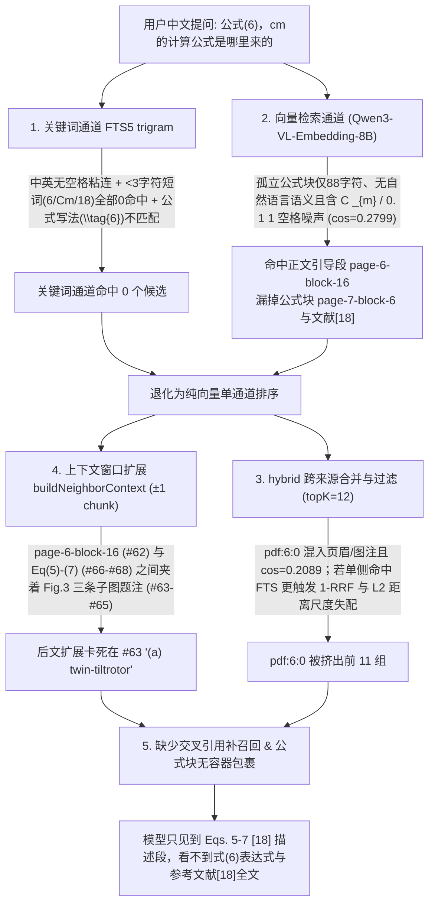
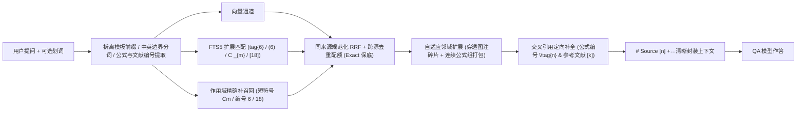

# 阅读器问答无法识别公式块根因分析与修复方案

- 日期：2026-11-22
- 状态：**已实施**（已完成代码落地、构建与全量自动化测试，并基于本机 `paper_mufwwou2_5a014354` 真实样本只读副本验证 Phase 1/2 与 MCP 检索链路）
- 代码基线：`main`，`package.json` 版本 `0.4.36`
- 触发样例：论文《Conceptual Design of an AAM Tiltrotor via Aircraft-Level Weight-Performance Feedback》（内部 ID `paper_mufwwou2_5a014354`），用户提问 `「公式(6)，cm的计算公式是哪里来的」`
- 相关文档：[核心工作流优化方案](2026-11-18-agent-chat-retrieval-notes-and-review-removal.md)、[Agent 检索范围与交付质量修复计划](2026-10-09-agent-retrieval-rendering-delivery-quality.md)

---

## 1. 现象与实证核查

### 1.1 现场表现

用户截图显示：阅读器左侧结构块视图中已清晰解析并渲染出第 7 页公式 (5)–(7)：

- `(5)`：$C_l = 1.175 \sin 2(\alpha - \alpha_0)$
- `(6)`：$C_m = -0.5 \sin(\alpha - \alpha_0) + 0.11 \sin 2(\alpha - \alpha_0)$
- `(7)`：$C_d = 1.135 - 1.05 \cos 2(\alpha - \alpha_0)$

右侧问答命中本地 RAG（`已命中本地 RAG，整理出 11 组候选上下文。当前索引 269/269 段。检索范围：当前文献；已检索向量通道。关键词通道已检索，命中 0 个候选。`），模型却只回答出「来自参考文献第 18 条」，并明确提示：**「现有摘录没有给出式 (6) 的完整表达式，也没有列出第 18 条文献的作者和题名」**。

### 1.2 本机数据核查事实（只读核验）

对本机 MinerU 缓存与 `paperquay-rag.sqlite` 进行只读核查，确认以下事实：

1. **MinerU 结构块本身完整包含公式 (5)–(7)**：
   - 缓存 `content_list_v2.json` 第 7 页（`pageIndex: 6`）存在三条 `equation_interline` 块：
     - `page-7-block-5`：`C _ {l} = 1. 1 7 5 \sin 2 (\alpha - \alpha_ {0}),\tag{5}`
     - `page-7-block-6`：`C _ {m} = - 0. 5 \sin (\alpha - \alpha_ {0}) + 0. 1 1 \sin 2 (\alpha - \alpha_ {0}),\tag{6}`
     - `page-7-block-7`：`C _ {d} = 1. 1 3 5 - 1. 0 5 \cos 2 (\alpha - \alpha_ {0}).\tag{7}`
2. **公式文本已入库 `rag_chunks`，269/269 段均处于 `ready` 状态**：
   - `mineru-markdown`（175 段）：`mineru:page-7-block-6:0`（`chunk_index = 67`）文本为 `C _{m} = - 0. 5 \sin (\alpha - \alpha_{0}) + 0. 1 1 \sin 2 (\alpha - \alpha_{0}),\tag{6}`（仅 88 字符）。
   - `pdf-text`（94 段）：`pdf:6:0`（`chunk_index = 42`）文本为第 7 页整段混合文本，同时包含 `Eqs. 5–7 (Fig. 6) [18]` 与式 `(5)–(7)`。
   - `mineru-markdown` 第 15 页 `mineru:page-15-block-2:0`（`chunk_index = 152`）包含文献 `[18]`：`18. Leishman JG (2000) Principles of Helicopter Aerodynamics. Cambridge University Press, Cambridge, New York`。
3. **当前配置与实时实测指标**：
   - 本机当前生效配置为 `ragSourceMode = "hybrid"`、`localRagTopK = 12`、`embeddingModel = "Qwen/Qwen3-VL-Embedding-8B"`（4096 维）。
   - 对 `paperquay-rag.sqlite` 中现有 4096 维向量实测余弦相似度：
     - 介绍式 (5)–(7) 的正文段落 `mineru:page-6-block-16:0` 与公式块 `mineru:page-7-block-6:0` 的余弦相似度仅 **`0.2799`**；
     - `mineru:page-6-block-16:0` 与文献 `[18]` 块 `mineru:page-15-block-2:0` 的余弦相似度仅 **`0.2266`**；
     - `mineru:page-6-block-16:0` 与包含完整公式的 `pdf:6:0` 余弦相似度仅 **`0.2089`**。
   - 对 `rag_chunks_fts`（FTS5 `trigram`）按现行 `buildFtsMatchQuery` 实测：
     - 查询 `"公式(6)，cm的计算公式是哪里来的"` 生成 MATCH 表达式 `"公式" OR "6" OR "cm的计算公式是哪里来的"`，返回 **0 行**；
     - 单独测试 `"6"`、`"Cm"`、`"C_m"`、`"18"` 均返回 **0 行**；
     - 而查询 `"tag{6}"` 精确命中 `mineru:page-7-block-6:0`，查询 `"(6)"` 精确命中 `pdf:6:0`，查询 `"C _{m}"` 精确命中 `mineru:page-7-block-6:0`，查询 `"[18]"` 命中 `mineru:page-6-block-16:0` 与 `pdf:6:0`。
4. **全库分块碎片化规模**：
   - 全库 `mineru-markdown` 共 `198,412` 条分块，其中 **`118,783` 条（约 59.9%）长度不足 120 字符**，说明「短公式/图注块孤立」是全库共性问题。

---

## 2. 完整根因链条分析

问题不是「MinerU 没识别出来」或「模型瞎了」，而是 **分块隔离 + OCR 空格噪声 + FTS 失效 + 邻域窗口被插图挡断 + 跨源分数失配** 六重机制叠加热失效的结果：



逐环节代码定位如下：

1. **按单块独立建 chunk，公式块彻底孤立无语境**（[readerRag.ts:205-245](file:///C:/Users/yusen/.proma/agent-workspaces/paperquery/workspace-files/src/features/reader/readerRag.ts#L205-L245)、[mineru.ts:1155-1157](file:///C:/Users/yusen/.proma/agent-workspaces/paperquery/workspace-files/src/services/mineru.ts#L1155-L1157)）
   - `buildMineruRagChunks` 对每个 `PositionedMineruBlock` 单独生成一个或多个 chunk，`equation` 块只调用 `extractMathText(block.content)` 输出裸 LaTeX。
   - 既没有与前导/后继解释段落合并，也没有把已采集的 `sectionPath` 拼接到用于向量化（[aiCommands.cjs:675](file:///C:/Users/yusen/.proma/agent-workspaces/paperquery/workspace-files/electron/backend/aiCommands.cjs#L675)）和 FTS 索引（[ragStore.cjs:746](file:///C:/Users/yusen/.proma/agent-workspaces/paperquery/workspace-files/electron/backend/ragStore.cjs#L746)）的 `chunk.text` 中。
   - 公式块自身只有数学符号、不含「pitching moment」「post-stall」「Eqs. 5–7」等自然语言锚点，导致向量召回倾向命中讨论公式的叙述段而非公式本身。

2. **MinerU LaTeX 空格碎片清洗不彻底**（[markdown.ts:232-250](file:///C:/Users/yusen/.proma/agent-workspaces/paperquery/workspace-files/src/utils/markdown.ts#L232-L250)）
   - `normalizeRawLatexExpression` 合并了 `([_^])\s+\{`，但未清理花括号内部空格和 OCR 拆开的小数位空格，索引中仍存在 `C _{m}`、`b _ { w }`、`0. 5`、`0. 1 1`、`1. 1 7 5`。这既破坏了向量模型对符号与数值的语义编码，也导致按 `C_m`、`Cm`、`0.11` 的文本子串匹配失败。

3. **FTS5 关键词通道在中文混合提问与公式短词上彻底失效**（[ragStore.cjs:742](file:///C:/Users/yusen/.proma/agent-workspaces/paperquery/workspace-files/electron/backend/ragStore.cjs#L742)、[ragStore.cjs:1005-1014](file:///C:/Users/yusen/.proma/agent-workspaces/paperquery/workspace-files/electron/backend/ragStore.cjs#L1005-L1014)、[knowledgeMcpService.cjs:427-438](file:///C:/Users/yusen/.proma/agent-workspaces/paperquery/workspace-files/electron/mcp/knowledgeMcpService.cjs#L427-L438)）
   - `buildFtsMatchQuery` 用 `/[\p{L}\p{N}_]+/gu` 提取 token，中英文之间不分隔，将 `"cm的计算公式是哪里来的"` 粘连为一个 12 字整串。
   - `rag_chunks_fts` 使用 SQLite FTS5 `trigram` 分词器，最小索引长度为 3 字符；长度 1~2 的短编号与符号（`"6"`、`"Cm"`、`"18"`）在底层恒返回 0 行。
   - 同时问句写 `"公式(6)"`，而 MinerU 公式块写 `\tag{6}`，正文引用写 `Eqs. 5–7`；且 `buildRagRetrievalQuery`（[readerRag.ts:340-347](file:///C:/Users/yusen/.proma/agent-workspaces/paperquery/workspace-files/src/features/reader/readerRag.ts#L340-L347)）拼接划词模板文本 `"Question:\n...\n\nSelected excerpt:\n..."` 直接作为 `queryText`，进一步干扰关键词提取。

4. **上下文窗口扩展固定 ±1 chunk，极易被浮动图表/图注挡断**（[readerRag.ts:501-564](file:///C:/Users/yusen/.proma/agent-workspaces/paperquery/workspace-files/src/features/reader/readerRag.ts#L501-L564)）
   - `buildNeighborContext` 对非标题命中的常规块硬编码只取 `position - 1` 与 `position + 1`。
   - 论文实际序列为：`[62] page-6-block-16 (Eqs. 5–7 [18])` → `[63] (a) twin-tiltrotor` → `[64] (b) quad-tiltrotor` → `[65] (c) hexa-tiltrotor Fig. 3 ...` → `[66] Eq.(5)` → `[67] Eq.(6)` → `[68] Eq.(7)`。
   - 即使命中 `[62]`，后文扩展也在 `[63]`（18 字符图注碎片）处提前结束，距离公式 (6) 相差 4 个短块而彻底失之交臂。

5. **`hybrid` 模式下跨来源融合存在尺度失配，且 `pdf:6:0` 被噪声拖累挤出**（[localRag.ts:111-129](file:///C:/Users/yusen/.proma/agent-workspaces/paperquery/workspace-files/src/services/localRag.ts#L111-L129)、[localRag.ts:560-590](file:///C:/Users/yusen/.proma/agent-workspaces/paperquery/workspace-files/src/services/localRag.ts#L560-L590)、[ragStore.cjs:1749-1751](file:///C:/Users/yusen/.proma/agent-workspaces/paperquery/workspace-files/electron/backend/ragStore.cjs#L1749-L1751)）
   - `retrieveDocumentChunks` 在 `fts.rows.length === 0` 时返回原始 `sqlite-vec` L2 距离（范围约 `0~2`），在 `fts.rows.length > 0` 时返回 `1 - rrfScore`（范围恒在 `0.967~0.992`）。
   - `localRag.ts` 分别检索 `mineru-markdown` 和 `pdf-text` 后直接将两组分数混排并经过 `filterRelevantRetrievals`（`bestScore + dynamicMargin`）截断。一旦一侧命中 FTS 而另一侧未命中，两个完全不可比的数量纲会相互挤杀；当双方 FTS 均 0 命中时，混杂页眉图注断行的 `pdf:6:0`（`cos = 0.2089`）也排不过干净的 `mineru` 叙述块而被挤出 Top 12。

6. **缺少交叉引用按需补召回与公式区块清晰标记**（[readerRag.ts:581-598](file:///C:/Users/yusen/.proma/agent-workspaces/paperquery/workspace-files/src/features/reader/readerRag.ts#L581-L598)、[aiCommands.cjs:433-440](file:///C:/Users/yusen/.proma/agent-workspaces/paperquery/workspace-files/electron/backend/aiCommands.cjs#L433-L440)）
   - 阅读器问答是单次检索组装，没有针对问题和命中正文中的显式交叉引用（如 `Eqs. 5–7`、`公式(6)`、`[18]`）做确定性定向补查，导致「引文解释在 P6、公式本体在 P7、参考文献在 P15」的跨页三角关系几乎注定缺脚。
   - 送给 LLM 的 `buildContextSection` 直接拼接裸 LaTeX 文本，未对 `equation` 块还原 `$$...$$` 边界标记。

---

## 3. 总体解决思路与架构目标

采用**「检索与扩展层零重嵌立即可用 + 分块与清洗层按需懒升级 + Prompt/MCP 协同补齐」**三层治理策略，**不修改 SQLite 表结构 / `user_version`**，**不静默全库重嵌已有 19.8 万条向量**：



---

## 4. 详细实施工作包

### Phase 1：检索、邻域扩展与交叉引用补全（零重嵌，立即对已有 269/269 索引生效）

> 优先级最高：不改 `MINERU_RAG_EXTRACTOR_VERSION`，无需重新请求 Embedding API，已有论文打开即恢复公式与参考文献识别。

#### W1.1 多语种分词、公式编号扩展与短词精确补召回

- **目标文件**：[electron/backend/ragStore.cjs](file:///C:/Users/yusen/.proma/agent-workspaces/paperquery/workspace-files/electron/backend/ragStore.cjs)、[src/features/reader/readerRag.ts](file:///C:/Users/yusen/.proma/agent-workspaces/paperquery/workspace-files/src/features/reader/readerRag.ts)
- **具体改造**：
  1. **剥离查询包装噪声**：`buildRagRetrievalQuery` 仍可构造用于向量嵌入的语义串，但向 `ragRetrieveDocumentChunksWithDiagnostics` 传递的 `queryText` 应优先只包含用户真实 `question`（必要时附带精简划词关键词），避免 `"Question:"`、`"Selected excerpt:"` 占满词元配额。
  2. **修复 `buildFtsMatchQuery` 中英混排粘连**：
     - 将 CJK 字符与 ASCII 字母数字拆分提取，例如对 `"公式(6)，cm的计算公式是哪里来的"` 拆出 `["公式", "6", "cm", "的计算公式是哪里来的"]`（并把长中文段拆为 3-gram 或有效词段），同时保持对 `'MTOW OR "lift-to-drag"'` 的原有测试契约兼容（见 [tests/ragStore.test.ts:264](file:///C:/Users/yusen/.proma/agent-workspaces/paperquery/workspace-files/tests/ragStore.test.ts#L264)）。
  3. **公式/文献编号与下标符号的 Query Expansion**：
     - 当问句匹配到公式编号指代（`/(?:公式|方程|式|Eq\.?|Eqs\.?|Equation)\s*[（(]?\s*(\d{1,3})\s*[)）]?/i` 或独立括号编号 `/(?:^|[^\d])[（(](\d{1,3})[)）]/`）时，自动向 FTS 查询扩展长度 ≥ 3 且可命中 trigram 的等价字面串：`tag{N}`、`(${N})`、`Eq. ${N}`、`Eqs. ${N}`、`Equation ${N}`。
     - 当问句包含参考文献编号（`/(?:参考文献|文献|引用|ref\.?|reference)\s*\[?\s*(\d{1,3})\s*\]?/i` 或 `\[(\d{1,3})\]`）时，自动扩展 `"[N]"`、`N.`。
     - 当问句包含典型短物理量/上下标（如 2~4 字符的 `[A-Za-z][A-Za-z0-9]{1,3}`，例如 `cm` / `cl` / `cd` / `cw`），自动补充 LaTeX 常见分隔写法：`C _{m}`、`C_{m}`、`C_m`（兼容 MinerU 空格下标）。
  4. **单篇/限定范围下的短词 Exact/Regex 辅助召回通道**：
     - 针对 SQLite FTS5 `trigram` 对 `< 3` 字符词元天然零命中的限制，在 `retrieveDocumentChunks` 当 `documentKey` 确定或 `documentKeys` 数量可控（例如 `<= 20`）且查询包含公式编号 / 短符号（1~2 字符）时，补充一次轻量 SQL 过滤（针对已 ready 的 `rag_chunks`，匹配 `\tag{N}` / `(N)` / 去空白后的 `C_{m}` / `Cm` 等边界正则），命中结果纳入 `ftsRows` 参与 `rrfFuse`，并在诊断信息 `ftsHitCount` 中计入关键词通道命中数。

#### W1.2 跨源分数对齐与精确命中保底

- **目标文件**：[src/services/localRag.ts](file:///C:/Users/yusen/.proma/agent-workspaces/paperquery/workspace-files/src/services/localRag.ts)、[electron/backend/ragStore.cjs](file:///C:/Users/yusen/.proma/agent-workspaces/paperquery/workspace-files/electron/backend/ragStore.cjs)
- **具体改造**：
  1. **修复混合检索分数尺度失配**：在 `localRag.ts` 合并多个 `sourceType`（`mineru-markdown` 与 `pdf-text`）结果时，不再把一侧的 `1 - RRF` 与另一侧的原始 L2 `distance` 直接混排比较。统一按来源内部做归一化或仅当两端使用同度量（如统一经过归一化 rank / `retrievalOrigin` 标记）时再合并，或对不同 `sourceType` 的命中做交叉去重后按优先级交错选取（`mineru-markdown` 结构清晰优先，仅当 `pdf-text` 补充了 `mineru` 未命中的页码/公式/精确关键词时保留）。
  2. **Exact/FTS 精确命中保底**：对于明确命中了精确公式编号或文献编号的结果，不因 `filterRelevantRetrievals` 的向量阈值截断被丢弃，确保至少保留前排精确命中进入 `buildRagContextText`。

#### W1.3 自适应邻域扩展与交叉引用定向补全

- **目标文件**：[src/features/reader/readerRag.ts](file:///C:/Users/yusen/.proma/agent-workspaces/paperquery/workspace-files/src/features/reader/readerRag.ts)
- **具体改造**：
  1. **替换固定 ±1 chunk 扩展（升级 `buildNeighborContext`）**：
     - 在保持 `CONTEXT_TARGET_TOKEN_BUDGET = 1500` 与 `CONTEXT_QUESTION_TOKEN_BUDGET = 6000` 约束的前提下，将单侧硬上限从 `1 chunk` 改为**语义邻域窗口**（最多扫描相邻 `MAX_NEIGHBOR_STEPS = 5` 个同章节 `sectionId` 内的 chunk，累计新增正文达到约 `400 tokens` 或遇到下一个 `title` 块时停止）。
     - **图注与空壳块穿透**：向后扫描时，若遇到 `image`/`caption` 类型的短图注碎片（例如 `(a) twin-tiltrotor`、`Fig. 3 ...`），不把它们算作「已满足 1 步后文」，而是继续向后推进直到拿到实质正文段或公式块。
     - **连续公式组打包**：一旦种子本身或邻域扫描触及 `equation` 块（如式 `(5)`），自动将相邻连续的同组 `equation` 块（`(6)`、`(7)`）及紧随其后的 `where ...` 符号定义段一并纳入；若命中块本身是 `equation` 块，则向前至少追溯到最近一条非图注 `paragraph` 引导段。
  2. **确定性交叉引用补全（Cross-Reference Hydration）**：
     - 在 `buildRagContextText` 末尾（预算裁剪前）或 `resolveLocalRag` 中，对**用户提问 + 当前已拼装的上下文文本**做轻量正则扫描：
       - **公式引用补全**：提取问句中的公式编号（如 `公式(6)`、`Eq. 6`）以及高相关种子段中引用的公式编号（如 `Eqs. 5–7` 自动展开为 `5, 6, 7`）。若已选 chunk 中不存在 `\tag{6}` 或 `(6)` 对应公式块，直接从 `preparedSources` 检索匹配该公式编号的 `equation` block（优先 `mineru-markdown`，次选包含该编号的 `pdf-text`）及其相邻连续公式块并追加为上下文补充段（`retrievalRole: 'context'`）。
       - **参考文献引用补全**：若问句存在出处意图（如「哪里来的 / 出处 / 来源 / 参考文献 / who proposed / reference」）或命中段中包含 `[N]` 引用编号（如 `[18]`），且参考文献列表中第 `N` 条尚未进入上下文，则从文档末尾 References 区域（匹配 `^\s*18[.\s)]` 或 `\[18\]` 的 chunk）补入最多 `2~3` 条关键文献条目（`retrievalRole: 'context'`）。
     - 所有补全段在预算控制下执行，不占用高优直击段的排名名额。

---

### Phase 2：LaTeX 规范化清洗与上下文感知分块重建（`mineru-chunks-v3`）

> 目的：从源头消除 59.9% 超短孤立分块与 `C _{m}` / `0. 1 1` OCR 空格噪声，让单次向量检索本身就能直接命中带语义语境的公式。

#### W2.1 增强 LaTeX 规范化清洗（保持渲染与已有测试兼容）

- **目标文件**：[src/utils/markdown.ts](file:///C:/Users/yusen/.proma/agent-workspaces/paperquery/workspace-files/src/utils/markdown.ts)、[src/services/mineru.ts](file:///C:/Users/yusen/.proma/agent-workspaces/paperquery/workspace-files/src/services/mineru.ts)
- **具体改造**：
  1. 在 `normalizeRawLatexExpression` 中安全清理 MinerU 常见断字空格：
     - 合并下标/上标花括号内纯字母/数字间空格（如 `C _{m}` → `C_{m}`、`b _ { w }` → `b_{w}`、`c _ { d o }` → `c_{do}`、`\\alpha_{ 0 }` → `\\alpha_{0}`）；
     - 修复小数点后逐位断开的空格（如 `0. 5` → `0.5`、`0. 1 1` → `0.11`、`1. 1 7 5` → `1.175`），规则严格限定在 `小数点 + 空格 + 单/多位数字` 模式，避免误合并 `\sin 2 (\alpha` 中的独立系数。
  2. 为 `extractTextFromMineruBlock` 对 `equation` 块保留规范化的 `$$...$$` 表达或同步提供无噪音可读形式，确保既不影响 UI KaTeX 渲染，又提升嵌入模型的数学表征精度。

#### W2.2 上下文感知的 MinerU 分块合并策略

- **目标文件**：[src/features/reader/readerRag.ts](file:///C:/Users/yusen/.proma/agent-workspaces/paperquery/workspace-files/src/features/reader/readerRag.ts)
- **具体改造**：
  1. **引入分组与章节上下文注入**：
     - 在保持每个 chunk 映射有效 `blockId`（主锚点指向组内核心块，点击引用仍可准确定位到 PDF 与结构块视图）的前提下，按同章节（不跨越 `title` 块）对连续短块做语义打包（单 chunk 目标窗长 350–900 字符）：
       - **公式绑定规则**：`equation` 块不再单独成为 88 字符孤岛；优先与紧邻的前导正文段或后续连续同组公式及 `where ...` 变量解释段合并，并在公式前后保留 `$$\n...\n$$` 定界符；若中间隔着少量插图/图注块（`image` / `caption`），跳过插图继续把紧跟插图之后的连续公式组与同段前后文保持紧密邻接关系或注入所属小节标题前缀（如 `[Section: 2.2 Rotor Blade Planform Design Selection]`）。
       - **碎图注合并规则**：同一页内连续多个 `image` 题注碎片（如 `(a) ...`、`(b) ...`、`Fig. 3 ...`）合并为一个完整图注 chunk，避免占用检索名额并阻断邻接扩展。
  2. **升级版本号与保护已有索引**：
     - 将 `MINERU_RAG_EXTRACTOR_VERSION` 从 `'mineru-chunks-v2'` 递增为 `'mineru-chunks-v3'`（[readerRag.ts:289](file:///C:/Users/yusen/.proma/agent-workspaces/paperquery/workspace-files/src/features/reader/readerRag.ts#L289)）。
     - 沿用现有 [libraryRagIndexing.ts:183](file:///C:/Users/yusen/.proma/agent-workspaces/paperquery/workspace-files/src/features/reader/libraryRagIndexing.ts#L183) 与 [localRag.ts:177-185](file:///C:/Users/yusen/.proma/agent-workspaces/paperquery/workspace-files/src/services/localRag.ts#L177-L185) 的 `skipIfSignatureMismatch: true` 保护：**后台自动扫描跳过旧签名索引，仅在用户实际打开某篇论文进行问答（懒重建）或手动重建索引时按 `v3` 重建**，防止 19.8 万条旧块被静默全库重嵌入。

---

### Phase 3：上下文呈现、QA Prompt、MCP 对齐与诊断完善

#### W3.1 上下文格式化与 QA Prompt 强化

- **目标文件**：[src/features/reader/readerRag.ts](file:///C:/Users/yusen/.proma/agent-workspaces/paperquery/workspace-files/src/features/reader/readerRag.ts)、[electron/backend/aiCommands.cjs](file:///C:/Users/yusen/.proma/agent-workspaces/paperquery/workspace-files/electron/backend/aiCommands.cjs)、[src/types/reader.ts](file:///C:/Users/yusen/.proma/agent-workspaces/paperquery/workspace-files/src/types/reader.ts)
- **具体改造**：
  1. `buildContextSection`（[readerRag.ts:581-598](file:///C:/Users/yusen/.proma/agent-workspaces/paperquery/workspace-files/src/features/reader/readerRag.ts#L581-L598)）在拼接 `equation` 块时自动确保以 `$$...$$` 块级公式展示，并在头部注明页码与可选小节名（如 `Page 7 · 2.2 Rotor Blade Planform Design Selection`），避免裸 LaTeX 混在文本里被模型忽略或误以为是乱码。
  2. `qaMessages`（[aiCommands.cjs:433-451](file:///C:/Users/yusen/.proma/agent-workspaces/paperquery/workspace-files/electron/backend/aiCommands.cjs#L433-L451)）补充规则：要求模型仔细核对上下文中以 `$$...$$` 或 `\tag{n}` 呈现的数学公式与参考文献列表；当公式表达式已存在但参考文献详情未命中（或相反）时，分别如实说明已观察到的部分与缺失部分。
  3. 同步核查 `DocumentChatEvidenceKind`（[reader.ts:434](file:///C:/Users/yusen/.proma/agent-workspaces/paperquery/workspace-files/src/types/reader.ts#L434)）与 `evidenceKindFor`（[readerRag.ts:640-650](file:///C:/Users/yusen/.proma/agent-workspaces/paperquery/workspace-files/src/features/reader/readerRag.ts#L640-L650)），评估是否补充 `'equation'` 类型标识；并将引用 `previewText` 在 480 字符截断时尽量避免从 `$$...$$` 公式中间腰斩。

#### W3.2 MCP 关键词检索与邻域窗口同步对齐

- **目标文件**：[electron/mcp/knowledgeMcpService.cjs](file:///C:/Users/yusen/.proma/agent-workspaces/paperquery/workspace-files/electron/mcp/knowledgeMcpService.cjs)
- **具体改造**：
  1. 将 `ragStore.cjs` 修复后的分词与公式/编号扩展逻辑提取为共享纯函数（例如在 `ragStore.cjs` 导出供 `knowledgeMcpService.cjs` 复用），解决 MCP `escapeFtsQuery` 同源存在的中文粘连与 `< 3` 字符公式编号 0 命中问题。
  2. 同步优化 `snippetWithNeighbors`（[knowledgeMcpService.cjs:449-493](file:///C:/Users/yusen/.proma/agent-workspaces/paperquery/workspace-files/electron/mcp/knowledgeMcpService.cjs#L449-L493)），在遇到连续短块/图注或公式块时适度扩展邻域（例如至少覆盖公式组及其前后正文锚点）。

#### W3.3 附带排查注记（非本缺陷主因，实施时可顺带核对）

- `src/features/reader/DocumentReaderTab.tsx` 第 47 行导入了 `resolveScopedLocalRag` 且第 2179 行判断了 `qaScopeMode !== 'current'`，但第 2148 行实际调用的仍是单篇 `resolveLocalRag`；若在后续统一整理阅读器问答路径时需保持两者接线一致，不在本轮公式修复中越界大改 `DocumentReaderTab.tsx`。

---

## 5. 实施顺序与范围控制

| 阶段 | 工作包 | 修改范围 | 重嵌影响 | 预期效果 |
| --- | --- | --- | --- | --- |
| Phase 1 | W1.1–W1.3 | `ragStore.cjs`、`localRag.ts`、`readerRag.ts` | **无重嵌**（复用现有 269/269 索引） | 中文提问 FTS 不再 0 命中；跨越 Fig.3 图注召回 Eq.(5)–(7) 与文献 `[18]`；解决 hybrid 分数混排挤出问题 |
| Phase 2 | W2.1–W2.2 | `markdown.ts`、`mineru.ts`、`readerRag.ts` | 递增至 `mineru-chunks-v3`，**单篇懒重建** | 消除 `C _{m}` / `0. 1 1` OCR 空格；从源头减少 60% 超短孤立块，提升公式向量召回率 |
| Phase 3 | W3.1–W3.2 | `aiCommands.cjs`、`readerRag.ts`、`knowledgeMcpService.cjs`、`reader.ts` | **无重嵌** | 公式块清晰包裹呈递给模型；MCP `search_knowledge_base` 同步具备公式与中文短查询能力 |

---

## 6. 验证与验收计划

### 6.1 自动化回归测试

每个阶段完成后先运行定向测试，再运行全量检查：

```powershell
npx tsc --noEmit
npm run build
npm test
```

新增或补充的定向测试用例：

1. `tests/ragStore.test.ts`：
   - 验证 `buildFtsMatchQuery` 面对 `"公式(6)，cm的计算公式是哪里来的"` 等中英混合、带括号公式编号、短物理量提问时正确拆词并扩展 `tag{6}` / `(6)` / `C _{m}`，在含 `\tag{6}` 的 chunk 上实现 `ftsHitCount > 0`，同时保持 `'MTOW OR "lift-to-drag"'` 等已有断言通过。
   - 验证 `retrieveDocumentChunks` 在 `documentKey` 下对 1~2 字符编号（`6`、`18`、`Cm`）的精确辅助召回能正确参与 `rrfFuse`。
2. `tests/readerRagContext.test.ts`：
   - 构造贴近真实论文的回归 fixture：`page-6-block-16`（含 `Eqs. 5–7 [18]`）→ 3 个短图注碎片（`(a)`/`(b)`/`(c) Fig. 3`）→ 3 个公式块（`Eq.(5)`/`Eq.(6)`/`Eq.(7)`）→ 页末文献 `[18]`。验证即使初始仅命中引导段，也能**跨过图注碎片并定向补全式 (6) 表达式与参考文献 `[18]`**。
   - 验证 `mineru-chunks-v3` 分块合并：公式块与邻近正文/同组公式绑定、不跨 `title` 边界、`sectionPath` 与有效 `blockId` 保持完整。
3. `tests/localRag*.test.*`（或新增单测）：
   - 验证 `hybrid` 模式下当单源命中 FTS（`1 - RRF` 分数段）而另一源未命中 FTS（L2 距离段）时，不会因尺度失配被 `filterRelevantRetrievals` 误杀精确命中。
4. `tests/markdownGluedLatex.test.ts` & `tests/mineruVisualBlocks.test.ts`：
   - 验证 `C _{m}` → `C_{m}`、`0. 1 1` → `0.11`、`1. 1 7 5` → `1.175` 清洗正确且不误伤 `\sin 2 (\alpha` 等合法空格。
5. `tests/knowledgeMcp.test.ts`：
   - 验证 MCP `search_knowledge_base` 在中文混合查询公式编号时能命中公式 chunk 并返回含上下文的 snippet。

### 6.2 隔离桌面实机验收（真实论文样本验证）

1. 使用隔离 `--user-data-dir` 导入《Conceptual Design of an AAM Tiltrotor via Aircraft-Level Weight-Performance Feedback》及本机已解析的 `content_list_v2.json`（不写入用户正式数据目录）。
2. 先验证 **Phase 1（零重嵌、沿用旧结构索引）**：提问 `"公式(6)，cm的计算公式是哪里来的"`，核对：
   - 诊断条不再显示 `关键词通道已检索，命中 0 个候选`；
   - 发给模型的上下文同时包含式 `(6)` 表达式（`C_m = -0.5 \sin(\alpha - \alpha_0) + 0.11 \sin 2(\alpha - \alpha_0)`）、正文说明 `Eqs. 5–7 (Fig. 6) [18]` 与文献 `[18]`（`Leishman JG (2000) Principles of Helicopter Aerodynamics`）；
   - 模型回答准确写出式 `(6)` 完整公式并指明文献 `[18]` 来源，点击引用可定位到原块/原页。
3. 再验证 **Phase 2（触发单篇懒重建至 `mineru-chunks-v3`）**：确认 `rag_indexes` 中该篇 `source_signature` 升级且旧库其它文献保持 `skipIfSignatureMismatch` 不触发全库重嵌。

---

## 7. 风险与回退策略

- **全库重嵌风险控制**：通过保留 `skipIfSignatureMismatch: true` 保证升级 `MINERU_RAG_EXTRACTOR_VERSION` 后只对用户打开或显式重建的单篇论文生效；如新分块策略发现回归，回退版本号常量与对应分块函数即可恢复原有行为，无需手工清理旧表。
- **Query Expansion 噪声风险**：公式编号与短符号扩展仅面向 `1~3` 位数字与显式公式/文献语义触发，并限制最大扩展词数；在单篇作用域与 RRF 权重下不会淹没正常语义正文检索。
- **向后兼容**：不更改 SQLite 表结构、`user_version` 或历史聊天记录持久化格式；Phase 1、2、3 各自独立可验证、可按阶段独立回退。
