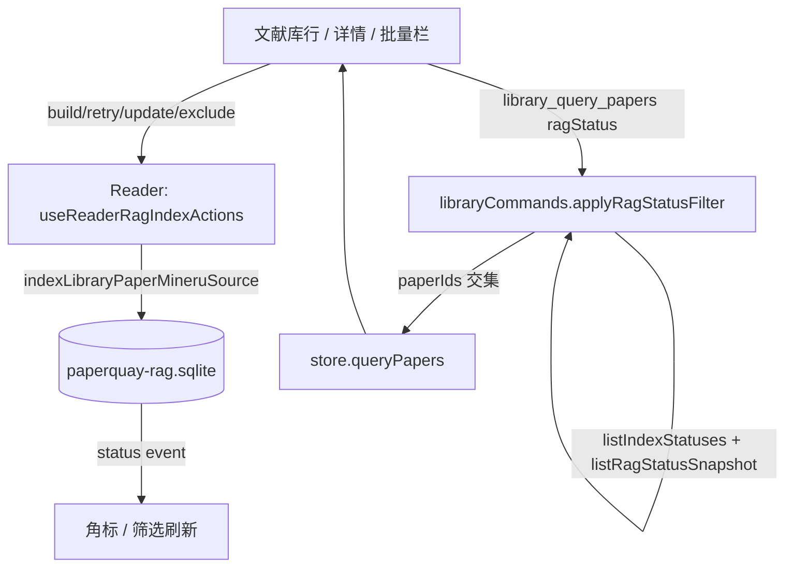

# 文献级 RAG 索引管理与知识图谱显示优化计划

- 日期：2026-11-25
- 状态：**已完整实施 A0–A6 与 B4–B8（2026-11-26）**；D1–D6 按建议执行（D6：高级引用模式另立计划）。实施记录见 [第一批](../changes/2026-11-26-library-rag-status-and-graph-semantic-edges.md) 与 [第二批](../changes/2026-11-26-graph-view-modes-scale-and-rag-closeout.md)。Electron 实机验收项仍需在应用内逐项执行。
- 代码基线：`main` `c197e32`（0.4.40）
- 关联：
  - [2026-10-26 文献级 RAG 索引开关](2026-10-26-paper-rag-index-opt-out.md)（成员开关、门禁、清理）
  - [2026-11-25 RAG 角标、过期索引重建与侧栏问答](2026-11-25-rag-badge-stale-rebuild-and-qa-silent-drop.md)（`stale`、暂存重建、全库角标）
  - [2026-11-22 代码架构与 UI 审计](2026-11-22-code-architecture-ui-audit.md)（S5 图谱性能、E2 设计令牌）

## 0. 结论（先看）

1. **RAG 管理的底层能力已经有一大半**：逐篇成员开关（`papers.rag_enabled`）、索引状态列表、单篇索引、全库批量索引、失败冷却、过期重建都已存在。缺的是**入口、失败可见性、按选中批量、按索引状态筛选**，以及是否自动重试/补建的明确策略。
2. **图谱的主要问题不是 Cytoscape 太弱，而是数据不诚实 + 布局/视觉没有为阅读服务**。本机 196 篇文献中，语义相似度在 0.82 以上的文档对有 **9,209 对**（中位度数 126），但渲染层只取全局前 120 条，结果全是 0.94–0.99 的近重复对；同时默认把标签/分类作为普通节点，形成“蜘蛛网 + 孤岛”。先修语义边和默认视角，收益远大于换渲染库。
3. **本轮不建议更换图谱渲染栈**。现有 Cytoscape 3.34 在 200–500 节点规模绰绰有余；官方 WebGL 渲染器已在安装包内，可在 5,000 节点门槛测试后再决定是否启用。迁移 G6/Sigma 的完整成本约 15–20 人日，在 500 节点以内买不到可见收益。
4. 实施顺序建议：**RAG 状态管理（A）先落地**；**图谱先做数据正确性和默认视角（B1/B2），再做视觉与布局（B3/B4）**。两部分可独立分支、独立发布。
5. 预计工作量：A 约 3.5–5 人日；B 的 P0–P2 约 6–8 人日；高级引用模式（Prior/Derivative/Timeline/Connect）单列，不在本轮默认范围。

### 0.1 待确认决定

| # | 决定 | 建议 | 备选 |
|---|------|------|------|
| D1 | 图谱默认视角 | **主题总览**：论文 + 引用 + 语义边，标签/分类默认关闭 | 混合全量 / 聚焦选中文献 |
| D2 | 语义边策略 | **均值中心化 + 去前 2 主成分 + 互近邻 kNN（k=10）** | 保留 0.82 绝对阈值，只调上限 |
| D3 | 失败索引自动重试 | **默认关闭**；设置里可开“最多 2 次、间隔 30 分钟” | 默认开启自动重试 |
| D4 | 未建立索引是否自动建立 | **仅在 MinerU 解析完成后自动建**；启动不扫描全库 | 启动时自动补建全库 |
| D5 | 是否新增图社区检测依赖 | **先用分类/年份着色，不加依赖**；需要时再加 `graphology-communities-louvain` | 本轮直接加 Louvain |
| D6 | 是否本轮做高级引用模式 | **先不做**，只做显示优化；高级模式另立计划 | 本轮一起做 |

---

# A. 文献级 RAG 索引管理

## A1. 现状与证据

| 能力 | 现状 | 缺口 | 证据 |
|------|------|------|------|
| 逐篇是否参与 RAG | `papers.rag_enabled` + `library_set_rag_membership`；详情页和右键菜单可切换 | 行内角标不可操作；状态语义埋在菜单里 | `electron/backend.cjs:258`、`electron/backend/libraryDatabaseStore.cjs:914`、`src/features/literature/components/LiteraturePaperDetails.tsx:452` |
| 逐篇索引状态 | `rag_list_index_statuses` 全量状态 → `aggregateRagIndexStatus` → 行角标 | 只有聚合角标，没有按来源（MinerU / PDF 文本）的明细、错误和重试入口 | `src/services/ragIndexStatus.ts:77-110`、`src/features/literature/components/LiteraturePaperRow.tsx:269-309` |
| 单篇建立/重建 | `handleIndexPaperRag`，内部 `force: true` 绕过冷却 | 入口只在右键菜单/设置页；失败后没有“重试”文案和原因 | `src/features/reader/useReaderRagIndexActions.ts:393-483` |
| 全库批量 | `handleBatchRagIndex({ onlyFailed, onlyStale })` 遍历 `indexableItems` | 不能只处理“当前选中的 N 篇”；依赖已加载条目；没有批量栏入口 | `src/features/reader/useReaderRagIndexActions.ts:229-391`、`src/features/reader/readerPreferencesContent.tsx:1749-1836` |
| 批量选择 | 文献库已支持 Ctrl/Shift 多选、全选当前筛选 | 没有 RAG 相关批量操作 | `src/features/literature/hooks/usePaperSelection.ts:125-240`、`LiteratureLibraryView.tsx:684-724` |
| 筛选 | 只有“知识库成员”：全部/已加入/已排除 | 没有“已索引/待更新/待索引/失败/未建立”筛选 | `src/features/literature/libraryFilters.ts:6-27,61-81`、`electron/backend/libraryQuery.cjs:78-82` |
| 自动索引 | MinerU 解析完成后 `scheduleLibraryItemRagIndexing`；打开/提问时懒索引 | 没有用户可见开关；启动不会补建；失败只在 60 秒冷却后被动重试 | `src/features/reader/useReaderLibraryActions.ts:247`、`src/services/localRag.ts:36-110` |
| 失败处理 | `rag_indexes.last_error`、`cooldown_until`；批量遇 401/402/403 整体暂停 | 错误不展示；没有自动重试策略；PDF 文本来源失败时单篇重试只重跑 MinerU | `src/services/localRag.ts:242-254,368-413`、`electron/backend/rag/indexing.cjs:1341` |
| 测试 | `ragIndexStatus`、`ragMembership`、`libraryFilters`、`libraryQuery` 已有单测 | 缺“按状态筛选”“按选中批量”“自动重试候选”用例 | `tests/ragIndexStatus.test.ts` 等 |

**本机只读实测（2026-11-25）**：文献 196 篇；RAG 库 176 篇文献共 344 条 `ready`、1 条 `pending`、0 条 `failed`；其余约 20 篇未建立。也就是说，当前库正适合验证“未建立/已索引”筛选和批量补建。

## A2. 状态模型

沿用现有 `RagAggregateStatus`，只补充 UI 语义和来源明细，不新增数据库状态。

| 聚合状态 | 判定 | UI 文案 | 默认动作 |
|----------|------|---------|----------|
| `excluded` | `paper.ragEnabled === false` | 已排除 | 加入知识库 |
| `failed` | 任一来源 `status === 'failed'` | 索引失败 | 重试 / 查看原因 |
| `pending` | 任一来源 `status === 'pending'`，或部分来源缺失 | 待索引 / 索引中 | 查看进度 / 重建 |
| `stale` | 所有来源 `ready`，但 embedding 模型或 MinerU 抽取器版本不一致 | 待更新 | 更新索引 |
| `ready` | 所有来源 `ready` 且不过期 | 已索引 | 重建 / 移出 |
| `none` | `rag_indexes` 无该文献记录 | 未建立 | 建立索引 |

优先级保持不变：`excluded > failed > pending > stale > ready > none`。

“能否建立索引”是**资格**，不是状态：`ragEnabled === true` 且 MinerU 已解析（手动索引目前只建 `mineru-markdown` 来源）。未解析的文献显示“需先 MinerU 解析”，不把它记成失败。

来源明细直接使用 `RagDocumentIndexStatus`：`sourceType`、`status`、`totalChunkCount`、`indexedChunkCount`、`embeddingModelKey`、`extractorVersion`、`indexedAt`、`lastError`、`rebuildError`、`cooldownUntil`。详情页按来源分行展示。

## A3. 单篇管理（P0）

### A3.1 行内可操作角标

`LiteraturePaperRow` 的 RAG 角标从 `<span>` 改成 `<button>`（仅在 `ragIndexAvailable || ragStatus === 'excluded'` 时出现），点击打开 `Menu`，`stopPropagation` 避免触发行选中/打开。

菜单项按状态生成：

| 状态 | 菜单 |
|------|------|
| `ready` | 重建索引 / 移出知识库 / 查看索引详情 |
| `stale` | 更新索引 / 重建索引 / 移出知识库 |
| `failed` | 重试索引 / 查看失败原因 / 移出知识库 |
| `pending` | 索引中（禁用）/ 查看进度 / 移出知识库 |
| `none` | 建立索引（未解析时禁用并提示“先 MinerU 解析”）/ 移出知识库 |
| `excluded` | 加入知识库 |

新增统一动作类型（放在 `src/features/literature/ragActions.ts`，纯函数生成菜单项，便于测试）：

```ts
type RagPaperAction =
  | 'build' | 'retry' | 'update' | 'rebuild'
  | 'exclude' | 'include' | 'open-details' | 'parse-mineru';
```

`LiteraturePaperRow` 只负责渲染与回调，不直接调用 IPC；回调经 `LiteraturePaperList → LiteratureLibraryView → Reader` 上送。

### A3.2 详情页“本地知识库”面板

在 `LiteraturePaperDetails` 中新增 `PaperRagPanel`（可折叠），内容：

1. 第一行：聚合状态徽标 + “参与本地知识库”开关（`ragEnabled`）。
2. 来源表：MinerU Markdown / PDF 文本，各自状态、已索引/总分块、模型、抽取器版本、索引时间。
3. 错误区：`lastError` / `rebuildError` 按类型显示（认证/余额、限流、超时、向量不完整、其他），可展开原文；显示“冷却到何时”。
4. 操作：建立 / 重试 / 更新 / 重建 / 移出；未解析时给“先解析 MinerU”。
5. 说明：移出会删除索引但保留 PDF、解析结果和笔记；重新加入不会自动建索引。

`PaperDetailsStatusBar` 的“知识库”chip 改成显示实际状态文案（已索引/待更新/失败/未建立/已排除），失败时用 danger 色，点击打开同一组动作菜单。

### A3.3 并发与边界

- 批量索引运行中，单篇动作禁用并提示“批量任务进行中”，避免同一文献被两条路径同时写索引。
- `handleIndexPaperRag` 保持 `force: true`（用户主动重试应绕过 60 秒冷却）；自动重试走 `force: false`。
- 已移出文献不得进入建立/重试候选；仍保留现有 `rag_index_excluded` 门禁。
- PDF 文本来源失败时，单篇“重试”目前只重跑 MinerU；UI 明确提示“PDF 文本索引会在打开文献或重建全部来源时更新”。若要单来源重试，见 A6.4 可选项。

### A3.4 涉及文件

| 文件 | 改动 |
|------|------|
| `src/features/literature/components/LiteraturePaperRow.tsx` | 角标改按钮 + 菜单 |
| `src/features/literature/components/LiteraturePaperList.tsx` | 透传 `onRagAction`、`ragStatusEntries` |
| `src/features/literature/components/LiteraturePaperDetails.tsx` | 挂载 `PaperRagPanel` |
| `src/features/literature/details/PaperRagPanel.tsx`（新） | 状态、来源表、错误、动作 |
| `src/features/literature/details/PaperDetailsStatusBar.tsx` | chip 文案与动作菜单 |
| `src/features/literature/ragActions.ts`（新） | 菜单/动作纯函数 |
| `src/features/reader/Reader.tsx` | 把 `ragStatusByDocumentKey`、成员切换、索引动作传给文献库 |

## A4. 选中批量（P1）

### A4.1 批量模式

在批量栏新增“RAG 索引”下拉（与“加入知识库/移出知识库”并列），四种模式：

| 模式 | 候选 | 说明 |
|------|------|------|
| `missing` | 聚合状态 `none` | 只补未建立；已排除、未解析、已索引跳过 |
| `failed` | 聚合状态 `failed` | 重试失败；手动模式 `force: true` |
| `stale` | 聚合状态 `stale` | 更新过期；显示预计需要重新 embedding 的篇数 |
| `rebuild` | 所有已加入且已解析 | 全量重建；需二次确认 |

菜单项显示选中范围内的候选篇数；候选为 0 时禁用。执行前弹确认框，写明：将调用 embedding 服务、会跳过的篇数与原因（未解析/已排除/已就绪）、可在任务中心暂停或取消。

### A4.2 Reader 侧批处理重构

把 `handleBatchRagIndex` 的入参扩展为：

```ts
interface RagBatchOptions {
  mode?: 'missing' | 'failed' | 'stale' | 'rebuild' | 'all-legacy';
  paperIds?: string[];
  reason?: 'manual' | 'auto';
  force?: boolean;
}
```

规则：

- `paperIds` 缺省时保持现状（设置页全库候选）；传入时只处理这些 id。
- 逐篇按需解析：已加载条目从 `indexableItems` 取；未加载的用 `resolveIndexableItem`（`Reader.tsx:672` 已有）。
- `missing` 不处理 `pending`，避免和正在进行的懒索引打架；卡住的 `pending` 归入 `rebuild`。
- `indexOneItem(entry, { force })`：手动/设置页 `force: true`；自动重试 `force: false`，尊重 `cooldown_until` 和内存失败缓存。
- 保持串行、暂停/取消、401/402/403 整体暂停。
- 结束后刷新状态；若文献库正在按 RAG 状态筛选，触发一次列表刷新（见 A5.4）。
- 结果文案分开写：成功、跳过（未解析/已排除/已就绪）、失败；失败给首个原因和“去筛选失败项”。

### A4.3 进度展示

- 复用 `BatchProgressState`（total/completed/succeeded/skipped/failed/currentLabel）。
- 批量栏显示一行紧凑进度 + 暂停/继续/取消；设置页原有 `BatchProgressCard` 保留。
- 任务中心已有按文献的 RAG 任务（`backgroundTasks.ts`），批量执行时自然出现；不额外造重复任务。
- 完成后 `toast` 汇总，并派发 `RAG_INDEX_STATUS_UPDATED_EVENT`。

### A4.4 涉及文件

| 文件 | 改动 |
|------|------|
| `src/features/reader/useReaderRagIndexActions.ts` | 批处理支持 `paperIds/mode/force`；按需解析条目 |
| `src/features/reader/Reader.tsx` | 向文献库传 `onBatchRagIndex`、进度、暂停/取消 |
| `src/features/literature/LiteratureLibraryView.tsx` | 批量栏下拉、确认框、进度条 |
| `src/features/literature/hooks/useBatchOperations.ts` | 批量 RAG 动作与确认框状态 |
| `src/features/literature/components/LibraryConfirmDialog.tsx` | 新增 `batch-rag-index` 确认类型 |
| `src/services/ragIndexStatus.ts` | `selectRagIndexCandidates` 支持按 id + 模式过滤 |

## A5. 按 RAG 状态筛选（P1）

### A5.1 前端状态

`LibraryFilterState` 新增：

```ts
export type LibraryRagStatusFilter =
  | 'all' | 'ready' | 'stale' | 'pending' | 'failed' | 'none';

ragStatus: LibraryRagStatusFilter; // 默认 'all'
```

- `serialize/parse` 增加校验；旧 localStorage 缺字段时回落 `'all'`。
- `buildPaperQuery` 传 `ragStatus`（`'all'` 时传 `null`）。
- `describeActiveFilters` 增加“RAG 已索引/待更新/待索引/失败/未建立”chip；`removeLibraryFilter` 自动生效。
- 筛选弹层在“知识库”下方增加“RAG 索引状态”下拉。
- 演示模式没有真实 RAG 状态：下拉禁用并提示“演示库不提供 RAG 状态”。

“已排除”仍由现有“知识库成员”筛选表达，避免一个状态两个入口；`none` 的口径是“无索引记录的已加入文献”，包含未解析文献，UI 提示“未建立（含未解析）”。成员筛选与状态筛选同时生效时取交集；例如“已排除 + 已索引”必然为空，界面直接显示空态说明，不把两者合并成一个下拉。

### A5.2 后端筛选

RAG 状态在独立 SQLite（`paperquay-rag.sqlite`），不能直接 JOIN 文献库。采用“先算匹配 id，再用现有 `paperIds` 过滤”的方式：

1. `ListPapersRequest` 增加 `ragStatus?: 'ready'|'stale'|'pending'|'failed'|'none'|null`。
2. `libraryCommands` 在 `library_query_papers`、`library_list_paper_ids`、旧 `library_list_papers` 三条路径上统一执行 `applyRagStatusFilter`：
   - 取 `store.listRagStatusSnapshot()`（新增：`SELECT id, rag_enabled AS ragEnabled FROM papers`，不水合整库）。
   - 取 `ragStore.listIndexStatuses()`；按 `documentKey` 分组。
   - 用共享纯函数聚合；`ragEnabled === false` 归 `excluded`，不进入任何状态筛选。
   - 得到匹配 id 集合，与请求已有的 `paperIds`（MinerU 筛选）取交集。
3. `library_list_papers` 的旧 JS 过滤同样使用交集后的 `paperIds`。
4. RAG 库不可用（`ragStore.available === false`）时：`ragStatus === 'none'` 返回所有已加入文献，其余状态返回空；前端显示“索引库不可用”提示。

### A5.3 共享状态计算

把 `aggregateRagIndexStatus` / `groupRagIndexStatuses` / `isRagIndexStale` 移到共享 CJS：

- 新增 `src/shared/ragIndexStatus.cjs` + `.d.ts`，供渲染进程和 `electron/backend` 同时 require。
- 当前 `src/services/ragIndexStatus.ts` 保留原有导出（内部转调共享模块），避免改动所有调用方和测试。
- 把 `MINERU_RAG_EXTRACTOR_VERSION` 移到 `src/shared/ragIndexVersions.cjs` + `.d.ts`；`ragIndexVersions.ts` 转导出，保持现有 import 不变。
- 增加 **parity test**：同一组状态行，旧 TS 实现与共享 CJS 输出逐项相等。

后端当前 embedding 模型键从 app 配置文件解析（`buildEmbeddingModelKey` + `resolveEmbeddingConfigFromDocument({ requireApiKey: false })`），不把 API Key 传给查询层。

### A5.4 刷新时机

- 正在按 RAG 状态筛选时，监听 `RAG_INDEX_STATUS_UPDATED_EVENT`，防抖 500ms 后刷新当前页与总数（`useLibraryQueryRefresh` 增加 RAG 事件源）。
- 批量/单篇动作完成后主动刷新；未筛选时不额外刷新。
- 数量口径：设置页概览只统计“可索引集合”（MinerU 已解析）；文献库筛选统计全部已加入文献。两处文案分别写清，避免“数字对不上”的误解。

### A5.5 性能与缓存

- 只在 `ragStatus != null` 时读取 RAG 状态；普通列表查询不受影响。
- `ragStore.listIndexStatuses()` 结果在 `libraryCommands` 内做 2 秒 TTL 缓存，避免筛选输入/翻页反复跨 worker。
- 状态行约数百条，内存过滤成本可忽略；不引入把状态写回文献库的派生列，避免两库同步风险。

### A5.6 涉及文件

| 文件 | 改动 |
|------|------|
| `src/features/literature/libraryFilters.ts` | 新字段、序列化、query、chip |
| `src/features/literature/components/LiteratureFilterPopover.tsx` | 状态下拉 |
| `src/types/library.ts` | `ListPapersRequest.ragStatus` |
| `electron/backend/libraryCommands.cjs` | `applyRagStatusFilter` 三条查询路径 |
| `electron/backend/libraryDatabaseStore.cjs` | `listRagStatusSnapshot()` |
| `src/shared/ragIndexStatus.cjs` + `.d.ts`（新） | 共享聚合 |
| `src/shared/ragIndexVersions.cjs` + `.d.ts`（新） | 共享版本常量 |
| `src/services/ragIndexStatus.ts` | 转调共享模块，保留 API |
| `src/services/library.ts` | `queryLibraryPapers` 类型已透传，无需大改 |

## A6. 失败重试与自动化（P2，默认保守）

### A6.1 手动重试（默认路径）

- 单篇“重试索引” → `handleIndexPaperRag`，`force: true`，立即绕过冷却。
- 批量“重试失败” → `mode='failed'`，`force: true`。
- 失败详情展示错误分类与原文；401/402/403 显示“检查 API Key 或余额”，不逐篇重试。

### A6.2 自动重试（可选，默认关闭）

新增阅读器设置：

```ts
ragAutoIndexAfterParse: boolean;      // 默认 true，保留现有行为
ragAutoRetryFailed: boolean;          // 默认 false
ragAutoRetryMaxAttempts: number;      // 0-5，默认 2
ragAutoRetryIntervalMinutes: number;  // 5-240，默认 30
```

- 在 `useReaderRagIndexActions` 内增加一个 60 秒 tick 的调度器（不需要后台服务）。候选条件：
  - `ragAutoRetryFailed === true`、RAG 可用、当前没有批量任务；
  - 聚合状态 `failed`、`cooldownUntil <= now`、本会话自动重试次数 < 上限；
  - 错误分类不是认证/余额（401/402/403）；429 允许退避后重试。
- 自动重试走 `force: false`，保留数据库冷却；成功后清除尝试计数；失败累加。
- 切换 embedding 模型/API Key 后清空尝试计数；用户手动重试也清零。
- 自动重试的批量结果只写状态栏/任务中心，不弹阻塞对话框。
- 默认关闭的原因：embedding 调用可能计费，用户应显式选择。

### A6.3 “未建立是否建立”

- 保留现有“MinerU 解析完成后自动建索引”，并把它显式化为 `ragAutoIndexAfterParse` 开关（默认开）。
- 增加“补建缺失索引”一键入口（设置页已有“为未索引文献建立索引”；文献库批量栏增加 `missing` 模式）。
- **不在启动时扫描全库自动补建**；避免用户打开应用就产生大额 embedding 调用和长时间占用任务中心。
- 未解析文献：建立索引前提示先 MinerU 解析；批量 `missing` 会跳过并报告“N 篇未解析”。

### A6.4 失败分类与 PDF 文本来源（可选项）

新增 `src/services/ragIndexError.ts`：

```ts
type RagIndexErrorKind = 'auth' | 'billing' | 'rate-limit' | 'network'
  | 'incomplete-vectors' | 'excluded' | 'unknown';
```

- 用于 UI 文案和自动重试决策；纯函数 + 单测。
- 当前 `indexOneItem` 只建 MinerU 来源。若后续需要单来源重试，新增 `indexLibraryPaperRagSources(paperId, sourceTypes)`，把 `readerRag` 的 `prepareReaderRagDocument` 复用到库批量路径；本轮先不做，UI 明确“PDF 文本来源会在打开文献/重建全部来源时更新”。

## A7. 数据流



## A8. 测试与验收

### A8.1 自动化

- `tests/ragIndexStatus.test.ts`：共享 CJS 与原 TS 输出 parity；`stale` 优先级；`pending` 部分来源；`excluded` 不进入状态。
- `tests/libraryFilters.test.ts`：`ragStatus` 序列化/反序列化、默认值、active chip、remove。
- `tests/libraryQuery.test.ts`：`ragStatus` 五个状态 + 成员筛选 + MinerU 筛选组合；`paperIds` 交集；分页 total。
- `tests/libraryDatabaseStore.test.ts`：`listRagStatusSnapshot` 不返回多余字段。
- `tests/ragMembership.test.ts`：移出后不进入 `missing` 候选；加入后状态为 `none`。
- 新增 `tests/ragIndexBatchSelection.test.ts`：按 id + mode 的候选选择、未解析/已排除/已就绪跳过、`force` 传递、自动重试候选。
- 新增 `tests/ragIndexError.test.ts`：错误分类。

### A8.2 实机验收（本机 196 篇库）

1. 不打开设置页，文献库行角标与 RAG 库逐篇一致：约 176 篇已索引、20 篇未建立、0 失败。
2. 筛选“未建立”得到约 20 篇；“已索引”约 176 篇；“待更新/失败”与数据库一致。
3. 选中 5 篇未建立 → 批量建立 → 进度显示、任务中心出现、角标变已索引；其中未解析的被跳过并报告。
4. 人为把 embedding Key 改错 → 单篇建立失败 → 失败角标/原因 → 改回 Key → 重试成功。
5. 移出 3 篇后，它们不出现在“未建立”候选中；重新加入后显示“未建立”，不自动建索引。
6. 同时开“MinerU 已解析”和“RAG 未建立”筛选，结果正确且总数一致。
7. 批量中途取消/暂停/继续正常；401/402/403 整体暂停。
8. `npm run typecheck`、`npm run lint`、`npm test`、`npm run build` 通过。

## A9. 风险与回退

| 风险 | 对策 |
|------|------|
| RAG worker 忙时筛选查询变慢 | 2 秒 TTL 缓存；只在有 `ragStatus` 时读取；失败回退到上一次快照并提示 |
| 状态与筛选结果短暂不一致 | 动作完成后派发事件 + 防抖刷新；RAG 事件监听 |
| 更换 embedding 模型后“待更新”数量巨大 | 批量前显示篇数并二次确认；沿用暂存重建和向量复用 |
| 自动重试产生费用/循环 | 默认关闭、次数上限、冷却、认证/余额错误不重试、切换配置清零 |
| 批量与懒索引重复写 | `runningRef` + 成员锁；单篇动作在批量中禁用 |
| PDF 文本来源失败无法单篇修复 | UI 明确提示；后续 P2 可加按来源重试 |
| 筛选统计与设置页数字不一致 | 文案区分“可索引集合/全部已加入”；文档写明口径 |

**回退**：A 的改动都是增量字段和 UI；关闭筛选/批量入口即可回到现状。共享 CJS 保留 TS 导出，回退只需恢复原实现。数据库无新列，无需迁移。

## A10. 工作量

| 阶段 | 内容 | 估算 |
|------|------|------|
| A0 | 共享状态模块、后端 ragStatus 筛选、测试 | 1–1.5 天 |
| A1 | 行角标菜单、详情面板、状态文案 | 1–1.5 天 |
| A2 | 选中批量、确认框、进度、任务中心 | 1–1.5 天 |
| A3 | 自动重试/自动补建设置、错误分类、测试 | 0.5–1 天 |
| A4 | 文档、手册、变更记录 | 0.5 天 |

建议分支：`feat/library-rag-status-management`。

---

# B. 知识图谱显示优化

## B1. 实测与根因

### B1.1 当前图谱规模（本机只读实测，2026-11-25）

- 文献 196、笔记 6（未删除）、标签 20（有边）、分类 10（非系统）、引用边 210（本地可匹配）。
- 结构边：`paper_tag` 63、`paper_category` 199、`note_paper` 1；语义边渲染层请求 120 条。
- 连通分量：`[93, 34, 25, 21, 20, 19, 15, 1]`，共 8 个分量。
- 度数最高的节点是分类（最大 52），其次是标签（最大 15）；论文节点的“大小”目前由阅读进度决定，不是由连接度决定。

### B1.2 语义边是当前最大的“假信号”

- 176 篇有效文档向量中，原始余弦 ≥ 0.82 的文档对 **9,209 对**；中位度数 126，最高 151。
- 渲染层 `embeddingEdgeLimit: 120` 只保留全局前 120 条，相似度范围 **0.94–0.99**，覆盖 72/176 篇；剩下 104 篇没有任何语义边。
- 原因有两层：
  1. **表示层**：每篇取所有 chunk 向量的平均值，chunk 向量本身单位化，平均后仍保留了很强的公共方向；文档向量与全局均值方向的余弦中位数约 0.92，余弦基线整体抬高。
  2. **选边层**：`listDocumentSimilarities` 用绝对阈值 + 全局 top-N，阈值不可迁移（不同 embedding 模型在 0.8 上的接受率可从 17% 到 85%），且度数无上界。
- 结论：**语义视图目前不是“相似文献网络”，而是“近重复对排行榜”**。这比布局或配色更值得先修。

### B1.3 布局与渲染问题

- 全局布局每次 `randomize: true`，刷新/改筛选后整张图重排，用户没有空间记忆。
- `buildFcoseLayoutOptions` 不传节点尺寸，fcose 把所有节点当同样大小；布局不知道标签尺寸。
- `packComponents: true` / `tile: true` 实际是空操作：fcose 只有在注册 `cytoscape-layout-utilities` 时才启用组件打包。当前 8 个分量并没有被真正打包。
- 标签抽稀按 `size`（论文是阅读进度）而不是连接度，导致“重要但未读”的论文不显示标签。
- 所有节点都是同形状圆形；边全部 bezier + 低透明度；没有 hover 提示、邻居高亮锁定、证据面板；选中详情卡浮在画布右下角，遮挡视图。
- `KnowledgeGraphWorkspace.tsx` 已有 2,041 行、82 处 Cytoscape 调用；继续堆功能会难以维护。

### B1.4 渲染栈判断

- 当前 200–500 节点，Cytoscape canvas 完全够用。Cytoscape 3.34 已内置 WebGL 渲染器预览（`renderer: { webgl: true }`），官方基准：1,200 节点/16k 边约 20→100+ FPS；3,200/68k 约 3→10 FPS。
- WebGL 预览不支持虚线、overlay、边标签、渐变、非三角箭头；现有 `note_tag`/`co_author` 虚线和 `paper_reference` 点线会退化成实线。因此**先保持 canvas，WebGL 作为 5,000 节点门槛测试后的可选开关**。
- 迁移 G6 v5 或 Sigma v4 的完整平替成本约 15–20 人日；在 500 节点以内没有可见收益。G6 的优势是 combo 折叠、lasso、minimap、边捆绑；若未来产品需要这些，再按决策门迁移。

## B2. 目标与原则

1. **诚实**：语义边必须按“每篇的最近邻”生成，不再是全局阈值排行榜；边权重用排名/校准分，不把原始余弦当通用阈值。
2. **可读**：默认图上先看出主题簇和桥接文献，而不是标签/分类蜘蛛网。
3. **稳定**：刷新、筛选、打开文献不应让整张图重新洗牌；用户可钉住节点、保留位置。
4. **可解释**：悬停/选中能看到“为什么相连”（引用原文、相似度、共同标签/分类），而不是一根匿名线。
5. **可扩展**：200 篇好看，2,000 篇可用，5,000 篇有聚合/降级方案；有明确的迁移决策门。

## B3. 方案总览

| 阶段 | 内容 | 优先级 | 估算 |
|------|------|--------|------|
| G0 | 基线、fixture、性能埋点、质量指标 | P0 | 0.5 天 |
| G1 | 文档几何 + 互近邻语义边 + 质量元数据 | P0 | 1–1.5 天 |
| G2 | 默认视角/模式、分类/年份着色、标签分类降级 | P0 | 1 天 |
| G3 | 稳定布局、增量布局、组件打包、位置持久化 | P1 | 1.5–2 天 |
| G4 | 视觉系统、hover/选中、右侧 inspector、图例、搜索 | P1 | 1.5–2 天 |
| G5 | 边预算、LOD、快照缓存、WebGL 开关、规模聚合 | P1 | 1 天 |
| G6 | Prior/Derivative、共被引、时间轴、两文连接、多 seed | P2 | 2–4 天（另立计划） |

## B4. G1：语义边与图质量（最高优先）

### B4.1 文档几何

在 `electron/backend/rag/retrieval.cjs` 新增 `buildDocumentGeometry(db, { components: 2 })`：

1. 读取 `rag_document_vectors`，只保留同一 `embedding_model_key` + 同一维度 + `ready` 的文档；排除 `note` 来源。**当前 `rag_document_vectors` 没有模型键**：需要新增 `embedding_model_key` 列并纳入唯一键（`document_key, dimension, embedding_model_key`），或新建 `rag_document_vectors_v2` 后原子换名；旧行按当前配置回填/重建。否则用户更换 embedding 模型后，同维度不同模型的平均向量会被混在一起做中心化，几何结果不可解释。`rebuildDocumentVectors` 也要按模型分组，不能跨模型求平均。
2. 对每个文档向量 L2 归一化（当前是 chunk 平均，norm 约 0.55–0.64）。
3. 减去文档均值 `mu`（单位化文档向量的均值；本机 `||mu||≈0.91`）。
4. 用 **Gram 技巧** 在 `n×n` 矩阵上求前 `D=2` 个主成分并投影掉（`n≈170 << d=4096`，不要构造 `d×d` 协方差；本机特征值约 22.4、19.6，随后明显下降到 10.5，`D=2` 合理）。
5. 再次 L2 归一化。
6. 以 `(embedding_model_key, dimension, 文档数, max(updated_at))` 为键做进程内缓存；可选持久化到 `rag_document_geometry` 表。

本机实测：完整流程约 133ms（读 4ms、归一化/中心化 8ms、Gram 42ms、特征分解 30ms、投影 11ms、全对比较 38ms），不需要 HNSW/ANN。

### B4.2 互近邻选边

`listDocumentSimilarities` 增加 `strategy: 'mutual-knn' | 'global-top'`（默认 `mutual-knn`，保留 `global-top` 作为回退/旧测试）：

- 每篇取几何空间中的 top-k 邻居（默认 `k=10`，范围 3–20）。
- 只保留双向互为近邻的边（互近邻），把度数硬限制在 k。
- 如果互近邻图出现多个连通分量，按“两个分量间最高相似度”补一条桥边，避免小众方向被孤立。
- 边权重用排名：`w = 1 - (rank - 1) / k`；原始中心化余弦只放在 tooltip/证据里，不再作为筛选阈值。
- 本机实测（170 篇有效向量，D=2）：`k=10` 得到 619 条边、最大度数 10、0 个孤立节点、1 个连通分量；`k=8` 得到 472 条边、1 个孤立节点、2 个分量。默认 `k=10`。

### B4.3 UI/IPC 变更

- `KnowledgeGraphRequest`：
  - 去掉/废弃 `embeddingMinSimilarity` 作为主参数；
  - 新增 `embeddingStrategy`, `embeddingK`, `embeddingComponents`, `embeddingBridge`；
  - 保留旧字段一个版本，避免 MCP/旧快照直接崩。
- 侧栏“语义相似阈值 0.82”滑杆改成 **“每篇语义邻居数 K”**（3–20，默认 10）；高级区显示当前库对应的相似度范围（只读说明）。
- 去掉渲染层硬编码 `embeddingEdgeLimit: 120`；边数由 `k` 和桥边决定。
- 语义视图的节点覆盖率要可见：只有已建索引的文献有语义边；在图例/统计中显示“语义覆盖 176/196”。

### B4.4 图质量元数据

`KnowledgeGraphSnapshot.metadata` 增加 `graphQuality`：

```ts
interface GraphQuality {
  nodeCount: number;
  edgeCount: number;
  degreeMin: number;
  degreeMedian: number;
  degreeMax: number;
  componentCount: number;
  isolatedCount: number;
  hubnessSkew: number; // k-occurrence skewness, k=10
  semanticCoverage: { indexed: number; total: number };
  geometryVersion: string;
}
```

- 在“图谱统计”面板显示；`hubnessSkew > 1.4`、`degreeMax > 2k`、桥接后仍有多个分量时给出警告（开发/高级模式）。
- 本机修复前 `S_5≈1.71`、`S_10≈1.70`、最大度数 126；中心化后 `S_10≈0.41`，可直接作为回归门禁。

### B4.5 测试

- 新增 `tests/graphGeometry.test.mjs`：合成“公共方向 + 两个真实主题 + 近重复对”的向量，断言中心化/去主成分后近重复仍高、跨主题降到基线；互近邻度数 ≤ k；桥接后连通分量 = 1；hubness 下降。
- 更新 `tests/graphSimilarityScale.test.mjs`：保留 `global-top` 旧算法对照；新增 `mutual-knn` 的边数/度数/分量断言。
- `tests/knowledgeGraphCommands.test.mjs`：`graphQuality`、语义覆盖、k 参数透传。

## B5. G2：默认视角与模式

### B5.1 视角/模式

新增 `graphMode: 'overview' | 'focus' | 'connect'`（先实现前两个）：

- **overview（默认）**：论文 + 引用 + 语义；标签/分类/笔记默认关闭；分类只作为**着色/图例**，不作为节点。196 篇库默认约 196 个节点、600–900 条边，而不是 232 节点 + 分类蜘蛛网。
- **focus**：从文献库/阅读器/笔记“在图中查看”进入，中心节点 + 1 跳；沿用现有 `localNodeId/localDepth`，默认深度 1（1–5），focus 节点加环、居中。
- **mixed**：保留现有全量视角，作为显式“全部”模式；标签/分类节点仍可手动打开。
- **connect**：两篇文献最短引用路径，放 G6，不在本轮。

默认 `perspective` 从 `mixed` 改为 `paper`；`perspectiveNodeTypes('paper')` 里把 `tag/category` 设为 `false`。标签/分类作为可选的“注释层”：打开时以更大的菱形/六边形锚点显示，但不参与语义边度数统计。

### B5.2 着色

新增 `colorBy: 'type' | 'category' | 'year' | 'cluster'`：

- overview 默认 `category`（主分类；无分类用中性灰），让主题簇先可读。
- citation/reference 模式默认 `year`（5 档年份色带，未知年份灰色）。
- mixed 默认 `type`。
- `cluster` 先用主分类，后续可接 Louvain；不在本轮引入 `graphology` 依赖。

节点大小改为**图内度数**：`size = clamp(18, 56, 18 + 6 * sqrt(degree))`；阅读进度改成外环/角标，不再决定大小。分类/标签节点按成员数放大，但只在其开启时参与布局。

### B5.3 边类型

- 默认显示：`paper_cites_paper`（有向箭头）、`related_by_embedding`（细线、低透明度）、`note_paper`/`note_link`（笔记视角）。
- 默认关闭：`paper_tag`、`paper_category`、`co_author`、`custom_relation`（可手动开）。
- 多种边落在同一对节点时，渲染层加 `parallel` 类，只有这类边用 bezier；无向密集边用 `haystack`（Cytoscape 官方性能建议，见 B10），有向引用边用 `straight`/`bezier` 保留箭头——`haystack` 与箭头组合受限，不能为了性能把方向信息丢掉。
- 语义边和引用边视觉上必须能区分：语义=虚线/细线/青色，引用=实线/箭头/暖色；tooltip 写明“相似，不代表引用”。

### B5.4 涉及文件

| 文件 | 改动 |
|------|------|
| `src/features/graph/KnowledgeGraphWorkspace.tsx` | 默认 perspective、graphMode、colorBy、边默认值 |
| `electron/backend/knowledgeGraphCommands.cjs` | 默认 include 标志、节点 `year/categoryIds/degree/community` |
| `src/types/knowledgeGraph.ts` | `graphMode/colorBy/graphQuality` 类型 |
| `src/features/graph/graphElements.ts`（新） | 节点尺寸、颜色、标签、parallel 类 |
| `src/features/graph/graphStyles.ts`（新） | 主题化样式表 |

## B6. G3：布局稳定与组件打包

### B6.1 传入节点元数据

`GraphLayoutNodeInput` 从 `{ id }` 扩展为 `{ id, type, size, degree, x?, y?, locked? }`；`GraphLayoutEdgeInput` 增加 `type, weight`。worker 在 headless cytoscape 里为每个节点设置 `width/height = size`（否则 `nodeDimensionsIncludeLabels`/非均匀尺寸没有意义），再用这些信息做差异化斥力/边长：

- 论文节点斥力基准 40k–60k；分类/标签锚点 120k；笔记 30k。
- 引用边理想长度 140；语义边 110；标签/分类边 220。
- `nodeDimensionsIncludeLabels: true`，`uniformNodeDimensions: false`，让布局给标签留空间。
- `gravity ≈ 0.25`、`gravityRange ≈ 3.5`；`packComponents` 不再依赖未注册的扩展，改为我们自己打包（见 B6.3）。

### B6.2 确定性与增量

- 首次布局：用确定性初始位置（按类型/度数排布的圆环或网格）作为 `preset`，再 fcose `randomize: false`；不要每次 `randomize: true`。
- 后续数据刷新/筛选：
  - 节点集合不变 → 只更新数据，不重新布局；
  - 新增节点 → 保留旧坐标，新节点放在邻居质心附近，跑一次 `randomize:false` 的轻量布局；
  - 用户点“重新布局”才全局重排。
- 位置持久化：`localStorage['paperquay-graph-positions-v1']`，按 `graphSignature`（节点/边 id 排序 + 布局版本 + 几何版本）存 `{id,x,y}`；节点数 > 2,000 时不存，避免大对象。
- 用户手动缩放/平移后不自动 `fit`（现有 `userAdjustedViewRef` 保留并扩展到布局应用）。

### B6.3 组件打包

当前 `packComponents/tile` 是空操作。两个选择：

1. 注册 `cytoscape-layout-utilities`（MIT，但最后发布 2021-06-25，维护停滞）；
2. **在 worker 内自己打包**（推荐）：布局后按边求连通分量，计算每个分量的包围盒，按面积降序做 shelf packing，分量间留 40–60px 间距，平移坐标后返回。

自打包代码量小、可测试、不引入陈旧依赖；也避免 fcose 约束模式下 `packComponents` 被强制关闭的问题。新增 `tests/graphLayoutPacking.test.ts` 断言包围盒不重叠、分量间距 ≥ 设定值。

### B6.4 局部/聚焦布局

`layoutMode === 'local'` 不再用 concentric 作为唯一方案：

- 默认对局部子图跑 fcose（质量 proof/1200 取决于节点数），中心节点 `locked: true` 固定在视口中心；
- 保留“径向”作为可选布局；
- 局部深度 1 默认，选中节点的 1 跳邻居显示；深度 >2 时提示可能爆炸。

### B6.5 力参数（可选，P1）

借鉴 Obsidian 的四项参数，但只暴露三个，并映射到 fcose（默认值参考 Obsidian graph view）：

| UI | 范围/默认 | fcose |
|----|-----------|-------|
| 聚集力 | 0–1，0.52 | `gravity` |
| 斥力 | 0–20，10 | `nodeRepulsion`（平方曲线） |
| 连线长度 | 30–500，250 | `idealEdgeLength` |

所有值 clamp 到 ≥0.01；输入防抖 250ms；不自动 fit；提供“恢复默认”。若时间不够，这一项可放 G4 之后。

## B7. G4：视觉与交互

### B7.1 视觉规范

| 元素 | 规范 |
|------|------|
| 论文节点 | 圆形；颜色按 `colorBy`；大小按度数 sqrt；选中/悬停加粗边框；阅读进度用外环或角标 |
| 笔记节点 | 圆角矩形；绿色系 |
| 标签节点 | 菱形；琥珀色；仅开启时显示 |
| 分类节点 | 六边形；紫色；默认只用于着色/图例 |
| 引用节点 | 未来：空心矩形 |
| 边 | 引用=实线+箭头；语义=细虚线/青色；标签/分类=浅色虚线；同对多边=bezier，其余 haystack |
| 标签 | 顶部 20% 度数 + 选中/悬停节点常显；`text-outline`/背景光晕；字号随 zoom 连续变化（对数公式），带 1.15/0.95 迟滞；不因标签显隐改变 fit 包围盒 |
| 背景 | 保留点阵，降低对比度；深色主题用不透明 hex（Cytoscape 不解析 rgba CSS 变量） |
| 主题色 | 新增 `--pq-graph-*` 令牌（浅/深各一套），运行时 `getComputedStyle` 读取；画布样式表由 `graphStyles.ts` 生成 |

### B7.2 交互

- **Hover**：鼠标进入节点 → 其余元素 opacity 0.12，节点 + 1 跳邻居 + 相连边高亮；移出恢复。用 5px/300ms 拖拽阈值区分 pan 和 click；补 `tapdragout` 清理，避免现有 `tapdragover` 高亮卡住。
- **Click**：选中并锁定高亮；再点空白/Esc 清除；双击进入局部图；右键菜单保留“打开/局部/加关系”。
- **Tooltip**：跟随指针的轻量 HTML tooltip（不用原生 `title`），显示标题、作者/年份、分类/标签、度数、RAG 状态；语义边显示“相似度 0.xx（中心化）”。
- **Inspector**：把右下角浮卡改成右侧可折叠面板（窄屏覆盖）。标签页：
  - 概览：元数据、RAG 状态、分类/标签、打开/局部/加关系；
  - 连接：按边类型分组的邻居列表，显示方向、权重、引用原文/相似度、共同标签/分类；
  - 统计：度数、分量、语义覆盖。
- **图例**：交互式，点击类型开关；显示各类型计数；与侧栏筛选同步。
- **搜索**：默认“聚光”（保留全图，匹配节点加环、其余变暗），可切换“只显示匹配”；显示匹配数/上一个/下一个；保留 220ms 防抖。
- **刷新**：新增显式刷新按钮；监听文献库/RAG/笔记变更事件，防抖 800ms 刷新快照并保留位置。
- **工具栏**：重新布局、适配、聚焦、导出 PNG/JSON、刷新；移除/弱化与阅读无关的统计占位。

### B7.3 组件拆分

把 2,041 行的 `KnowledgeGraphWorkspace.tsx` 拆成：

- `graphElements.ts`：snapshot → 元素、尺寸/标签/parallel 类；
- `graphStyles.ts`：主题化 stylesheet；
- `graphLayout.ts`：布局请求、组件打包、位置持久化；
- `graphEvents.ts`：hover/select/drag 事件；
- `GraphSidebar.tsx`、`GraphInspector.tsx`、`GraphToolbar.tsx`。

不改变现有对外行为；先拆纯函数，再接 UI，保证 `graphLayout.test.ts` 和 `initialChunks.test.mjs` 的 fcose 动态 import 约束不被破坏。

## B8. G5：性能与规模

- **边预算**：UI 默认总边数上限 50,000；后端 `graphEdgeLimitPerNode` 从 250 降到 60（可作为请求参数），节点上限 UI 默认 3,000，10,000/250 仅作为显式“最大”档。超出时用现有 `samplingSummary` 显示“显示 X/Y”。
- **LOD**：zoom 低于阈值时只画权重前 10–20% 的边；放大后逐步显示全部；非 hub 标签隐藏。避免“边太多看不清、标签又全部消失”的两极。
- **快照缓存**：主进程按 `(library revision, notes revision, rag revision, request)` 缓存 `KnowledgeGraphSnapshot`；RAG/文献/笔记事件触发失效。图谱工作区常驻 hidden，避免每次切换都重算。
- **渲染**：`cy.batch()` 批量增删；`hideEdgesOnViewport: true`；`pixelRatio` 上限 2；`text-events: 'no'`；基础 node 样式去掉 `transition-property`（只保留 selected/focused）；边默认 solid，不用大范围 opacity 0.42。
- **WebGL 开关**：设置里 `graph.renderer = 'canvas' | 'webgl'`，默认 canvas。启用前先做样式降级（虚线改实线/颜色区分）；启动时检测 `WEBGL_debug_renderer_info`，若为 SwiftShader/llvmpipe 自动回落 canvas。
- **规模模式**：>1,500 节点时默认聚合到分类/社区超节点（显示成员数），点击展开局部；这是 G5 的产品级降级，不做“5,000 个点硬画”。
- **性能埋点**：复用 `src/utils/perfTrace.ts`（`pq.perf`），记录 snapshot fetch、elements build、layout worker、首帧、pan/zoom rAF p50/p95；在图谱统计面板显示节点/边/分量/采样状态。

### B8.1 迁移决策门

用 5,000 节点/约 25,000 边 fixture 测试：

- PASS：pan/zoom p95 帧时间 ≤33ms（≥30fps），首帧 <2s，完整布局 <3s；
- TUNE：33–66ms，继续调布局/边预算；
- MIGRATE：仍 >66ms，且产品需要 combo 折叠/lasso/minimap 等 G6 能力，再评估 G6 v5；Sigma v4 作为 WebGL 备选。迁移前不并行动手。

**实施结果（2026-11-26）**：5,000 节点/25,000 边 headless fcose fixture 实测约 389s（本机 Node 24），判定 MIGRATE；因此未迁移渲染栈，而是在 UI 层增加保护：超过 1,200 节点且未聚合时使用确定性网格布局并提示开启聚合，避免力导向阻塞工作区。Electron 实机的 pan/zoom p95 仍待测量。

## B9. G6：可选高级模式（另立计划）

以下来自 Connected Papers / ResearchRabbit / Litmaps / Inciteful / Citation Gecko，价值高但不属于“显示优化”的最小闭环：

- Prior Works / Derivative Works（利用已解析的 `paper_references` 与反向引用；当前 `reference` 节点类型已声明但未启用）。
- 共被引 / 文献耦合边（在视图内计算，标注“本视图内”）。
- 时间轴布局（x=年份，y=引用数/度数）。
- 两篇文献最短引用路径（Connect）。
- 多 seed（2–5 篇）与 seed 指标。
- OpenAlex/Semantic Scholar 外部引用扩展（缓存、限流、覆盖率标识）。

这些模式会显著增加数据层和 UI 复杂度，建议在 B1–B5 稳定、用户确认方向后单独出计划。

## B10. 开源借鉴（本轮采用的模式）

| 来源 | 可借鉴 | 用在 |
|------|--------|------|
| [Cytoscape performance guide](https://github.com/cytoscape/cytoscape.js/blob/master/documentation/md/performance.md) | haystack 边、solid、少箭头、`hideEdgesOnViewport`、`cy.batch()`、`text-events:'no'`、去掉基础态 transition | B8 |
| [Cytoscape WebGL preview](https://blog.js.cytoscape.org/2025/01/13/webgl-preview/) / [WebGL docs](https://github.com/cytoscape/cytoscape.js/blob/master/documentation/webgl.md) | 3.34 内置 WebGL；基准与限制（虚线/overlay 不支持） | B8 决策门 |
| [cytoscape-fcose](https://github.com/iVis-at-Bilkent/cytoscape.js-fcose) | `randomize:false` 增量布局、`initialEnergyOnIncremental`、约束；`packComponents` 需 layout-utilities | B6 |
| [cytoscape-layout-utilities](https://www.npmjs.com/package/cytoscape-layout-utilities) | 组件打包（维护停滞，优先自实现） | B6.3 |
| [Obsidian Graph view](https://obsidian.md/help/plugins/graph) | 全局/局部图、depth 1–5、标签/附件默认关、四项力参数、hover 高亮、click-to-lock、搜索 color groups、持久化视图 | B5/B6/B7 |
| [Quartz graph](https://github.com/quartz-community/graph) | d3-force + Pixi、hover dim、fx/fy 拖拽固定、log2(zoom) 标签淡出 | B7 |
| [Logseq graph PR](https://github.com/logseq/logseq/pull/12604) | viewport culling、zoom 迟滞 | B8 |
| [Juggl](https://github.com/HEmile/juggl) | 节点展开/折叠、typed links、minimap；局部图渐进展开 | G5/G6 |
| [cytoscape.js-expand-collapse](https://www.npmjs.com/package/cytoscape.js-expand-collapse) | 节点展开/折叠（2024-08 仍在维护），用于大图聚合模式 | G5 规模模式 |
| [Connected Papers](https://connectedpapers.com/about) | 以 seed 为中心的 focus graph、prior/derivative、节点按引用/年份编码 | B5/G6 |
| [ResearchRabbit citation map](https://learn.researchrabbit.ai/en/articles/17309356-how-to-read-the-citation-map-in-researchrabbit) | 时间 × 引用布局、按批次扩展、推荐点 hollow | G6 |
| [Litmaps map views](https://docs.litmaps.com/en/articles/17702023-map-views-semantic-map-co-citation-and-co-author-networks) | 语义/共被引/共作者视图、分组阴影、时间轴 | G6 |
| [Inciteful methods](https://incitefulmed.com/academic/help/methods.html) | 局部 PageRank/Adamic-Adar、深度 2、Connect 路径 | G6 |
| [Citation Gecko](https://github.com/CitationGecko/gecko-react) | d3 force 参数、时间轴、过滤器、表格回退 | G6 |
| [All-but-the-top](https://arxiv.org/abs/1702.01417) / [Anisotropy](https://arxiv.org/abs/1907.12009) / [BERT-flow](https://arxiv.org/abs/2011.05864) | 去公共均值 + 去主成分 | B4.1 |
| [Hubness](https://jmlr.csail.mit.edu/papers/v11/radovanovic10a.html) / [Hubness reduction](https://www.cp.jku.at/people/schedl/Research/Publications/pdf/schnitzer_jmlr_2012.pdf) | k-occurrence 偏度、互近邻/局部缩放 | B4.2/B4.4 |
| [Leiden](https://arxiv.org/abs/1810.08473) / [graphology Louvain](https://graphology.github.io/standard-library/communities-louvain.html) | 社区检测；Louvain 可能产生不连通社区，Leiden 更好；本轮先用分类着色 | B5/G6 |
| [G6](https://github.com/antvis/G6) / [Sigma](https://github.com/jacomyal/sigma.js) | 若 5k 门槛失败，G6（combo/lasso/minimap）或 Sigma v4（WebGL + graphology）为迁移候选 | B8.1 |
| [Hairball 分析](https://cambridge-intelligence.com/blog/hairball-effect-in-graph-visualization/) | 控制度数/边预算、聚合、focus+context | B5/B8 |

## B11. 测试与验收

### B11.1 自动化

- `tests/graphGeometry.test.mjs`：中心化/去主成分、互近邻、桥接、hubness。
- `tests/graphSimilarityScale.test.mjs`：旧 `global-top` 对照 + 新 `mutual-knn` 规模；断言 k 上限、边数范围、分量。
- `tests/knowledgeGraphCommands.test.mjs`：`graphQuality`、`graphMode`、默认 include、节点 `year/categoryIds/degree`。
- `tests/graphLayout.test.ts`：新 fcose 选项、节点元数据透传、组件打包、位置持久化纯函数。
- 新增 `tests/graphPresentation.test.ts`：尺寸/颜色/标签/parallel 边纯函数。
- `tests/initialChunks.test.mjs`：fcose 仍动态 import，不进入首屏 chunk。
- 规模 fixture：196 篇真实结构脱敏 fixture、1,000/5,000 合成图；记录布局耗时与度数分布。

### B11.2 实机验收（本机 196 篇库）

1. 默认打开“主题总览”：不出现标签/分类蜘蛛网；约 200 节点、600–900 条边；能看到若干主题簇和桥接文献。
2. 语义视图：每篇最多 10 个邻居；不再出现“全是 0.94–0.99 近重复对”的排行榜；语义覆盖显示 176/196。
3. 鼠标悬停节点：1 跳邻居高亮、其余变暗；移出恢复；点击锁定、Esc 清除。
4. 右侧 inspector 显示“为什么相连”：引用原文/相似度/共同标签；点击邻居可定位。
5. 刷新/筛选/切换节点类型：已有节点位置不跳；新增节点就近放置；可“重新布局”主动重排。
6. 重开图谱：位置恢复；节点数 >2,000 时不持久化（提示重新布局）。
7. 深色/浅色都清晰；标签不重叠到不可读；顶部节点标签常显。
8. 5,000 节点 fixture：按 B8.1 记录 p50/p95、首帧、布局时间；未达标再谈 WebGL/G6。
9. `npm run typecheck`、`npm run lint`、`npm test`、`npm run build` 通过。

## B12. 风险与回退

| 风险 | 对策 |
|------|------|
| 去主成分误删真实主题轴 | `D` 上限 2–3；检查特征值间隙；断言已知近重复对仍 >0.80；提供 `embeddingComponents: 0` 回退 |
| 互近邻让冷门论文孤立 | 连通分量桥接（必须）；“显示孤立节点”开关；语义覆盖提示 |
| 旧 `minSimilarity` 设置/测试/MCP 参数失效 | 新增 `strategy/k`，旧参数保留一个版本并标注废弃；快照 `geometryVersion` 失效缓存 |
| 布局调参主观、回归难 | fixture + 截图 + `graphQuality` 指标；不把“看起来更好”当唯一验收 |
| WebGL 在 Windows 驱动上回落 SwiftShader | 启动检测 unmasked renderer；自动回落 canvas；WebGL 默认关 |
| 5,000 节点仍卡 | 先边预算/LOD/聚合；决策门达标才考虑迁移，不并行动手 |
| 快照缓存过期 | 按文献/笔记/RAG revision 失效；显式刷新；事件监听 |
| 新增依赖许可 | 只用 MIT/Apache-2.0/BSD；避免 `cytoscape-klay`（EPL-1.0）；`cytoscape-elk` 需选 GPL 分支并记录 |
| 图谱与文献库/RAG 状态不一致 | 图节点带 RAG 状态字段；刷新事件；语义覆盖/采样提示 |

**回退**：`embeddingStrategy: 'global-top'` 保留旧行为；WebGL/新布局/新视角均可通过设置关闭；`graphStyles/graphElements` 是纯函数，出问题可切回旧 stylesheet；数据库只新增几何缓存表（可选），不影响旧版本。

## B13. 工作量

| 阶段 | 内容 | 估算 |
|------|------|------|
| G0 | fixture、埋点、质量指标 | 0.5 天 |
| G1 | 几何 + 互近邻 + 质量元数据 + 测试 | 1–1.5 天 |
| G2 | 默认视角/模式/着色/边默认值 | 1 天 |
| G3 | 稳定/增量布局、组件打包、位置持久化 | 1.5–2 天 |
| G4 | 视觉、hover/inspector/图例/搜索 | 1.5–2 天 |
| G5 | 边预算/LOD/缓存/WebGL 开关/规模聚合 | 1 天 |
| G6 | 高级引用模式 | 2–4 天（另立） |

建议分支：`feat/knowledge-graph-visual-refresh`。

---

## C. 实施顺序与发布建议

1. **第一批（可独立发布 0.4.41）**：A0–A2 + B0–B2（RAG 状态管理 + 图谱语义边/默认视角/基础视觉）。这一批就解决用户最直接的痛点。
2. **第二批（0.4.42）**：A3 自动重试 + B3–B5（稳定布局、inspector、规模/性能）。
3. **第三批（按需）**：G6 高级引用模式（Prior/Derivative/Timeline/Connect/外部数据源）。

发布前按 `docs/RELEASE.md` 更新 `CHANGELOG.md`；每个主题在 `docs/changes/` 建记录，写明现象、根因、修改、验证（含本机库实测数字与截图路径）。

## D. 待确认问题

1. **D1**：图谱默认打开“主题总览”（推荐）还是“混合全量”？如果用户更习惯看标签/分类，可保留 mixed 为默认，但会把蜘蛛网问题留在一开始。
2. **D3**：失败索引是否允许自动重试？默认关闭更省费用；若希望“失败后自己重试”，建议 2 次/30 分钟上限。
3. **D4**：未建立索引是否在启动时自动补建？建议只在 MinerU 解析后自动建，启动不扫描全库，避免一开应用就产生大量 embedding 调用。
4. **D5**：社区检测是否引入 `graphology-communities-louvain`？建议先用分类着色；若分类太粗，再加依赖做 Louvain/Leiden。
5. **D6**：高级引用模式是否进入本轮？建议先交付显示优化，再根据实际使用决定是否做 Prior/Derivative/Timeline/Connect。

> 说明：计划中的本机数字来自 2026-11-25 对 `paperquay-library.sqlite`、`paperquay-notes.sqlite`、`paperquay-rag.sqlite` 的只读查询；未修改任何库、脚本或配置。
